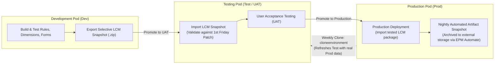

# 14.1 Application Lifecycle Management: LCM, Migration & Environment Cloning

## Table of Contents
1. [Core Consultant Mental Model](#1-core-consultant-mental-model)
2. [The 3-Tier Deployment Pipeline: Dev -> Test -> Prod](#2-the-3-tier-deployment-pipeline-dev---test---prod)
3. [Lifecycle Management (LCM) Snapshot Architecture](#3-lifecycle-management-lcm-snapshot-architecture)
4. [Environment Cloning (`epmautomate cloneenvironment`)](#4-environment-cloning-epmautomate-cloneenvironment)
5. [Disaster Recovery Architecture: RPO & RTO](#5-disaster-recovery-architecture-rpo--rto)
6. [Tough & Twisted Review Questions with Consultant Model Answers](#6-tough--twisted-review-questions-with-consultant-model-answers)

---

<!-- ===================================================================== -->
<!-- 🎯 LIVE INTERACTIVE VISUAL CARD: APPLICATION LIFECYCLE & MIGRATION -->
<!-- ===================================================================== -->
<details open>
<summary><b>🎯 Live Interactive Architecture Card: Lifecycle Management & Migration Engine (Click to Collapse / Expand)</b></summary>

<br/>

> [!TIP]
> **Interactive Standalone Dashboard:** Open [`card_kb_08_lifecycle_migration.html`](../interactive_cards/card_kb_08_lifecycle_migration.html) in your browser for a live interactive application lifecycle & snapshot migration simulator!

| Operational Capability | Artifact Scope | Command / Tool | Execution Blast Radius |
| :--- | :--- | :--- | :--- |
| **Selective Migration** | Specific forms, rules, or dimensions | Migration Console / LCM Zip | Low; overwrites selected artifacts only |
| **Full Snapshot Backup** | Entire application (Data + Metadata + Security) | `epmautomate exportsnapshot` | Zero risk; background read-only export |
| **Environment Cloning** | Complete pod synchronization | `epmautomate cloneenvironment` | **High:** Overwrites entire target environment |
| **Nightly Maintenance** | Automatic full backup | Oracle Managed Blackout Window | Disconnects users; exports `Artifact Snapshot` |



</details>

---

## 1. Core Consultant Mental Model

In enterprise Cloud EPM deployments, **development is strictly forbidden directly inside the Production pod**.
* All modifications (metadata updates, new business rules, form designs) must originate in **Development / Test**, pass rigorous User Acceptance Testing (UAT), and migrate into Production via **Lifecycle Management (LCM) snapshots**.
* **The Golden Law of Migration:** Never import a snapshot into Production without first taking an **on-demand full backup snapshot of Production** right before the import!

---

## 2. The 3-Tier Deployment Pipeline: Dev -> Test -> Prod

1. **Development Pod:** Used by consultants and developers to build new modules, test Groovy scripts, and configure metadata.
2. **Test / UAT Pod:** Used for regression testing and user acceptance sign-off. Crucially, Test receives the monthly Oracle cloud patch on the **first Friday of the month**, giving the team two weeks to test before Production patches on the **third Friday**.
3. **Production Pod:** The live environment accessed by enterprise business users. Highly restricted; only Service Administrators have elevated privileges.

---

## 3. Lifecycle Management (LCM) Snapshot Architecture

An **LCM Snapshot** is an encrypted `.zip` archive containing the structural definition and data of the EPM application:

```
Artifact Snapshot.zip/
  ├── Application Metadata/      (Dimensions, members, properties, aliases)
  ├── Calculation Manager/        (Business rules, scripts, rule sets, variables)
  ├── Data / Essbase/             (Native Essbase data export files by cube)
  ├── Forms and Folders/          (Web form layouts, validation rules)
  ├── Security / Access Control/  (Application roles, group grants, member permissions)
  └── Data Integration/          (Locations, import formats, mapping tables)
```

### Selective Migration Strategy:
* If you only updated one business rule, **do not import the entire snapshot**.
* In the Migration console, expand `Calculation Manager -> Rules`, select the single rule, and export an incremental patch zip. This eliminates the risk of accidentally overwriting unrelated production artifacts.

---

## 4. Environment Cloning (`epmautomate cloneenvironment`)

A common requirement is refreshing the Test pod with the latest Production data and metadata to support realistic UAT testing:

```bash
/* Executed on the target (Test) pod */
epmautomate cloneenvironment ProductionPodURL user.enc password.epw Key
```

### What Cloning Does:
1. Automatically triggers an export of the source (Production) application.
2. Streams the snapshot across Oracle's internal high-speed cloud backbone directly to the target (Test) pod.
3. Completely overwrites the target pod, recreating the exact relational repository and Essbase cubes.
4. Preserves target identity domain connections and users.

---

## 5. Disaster Recovery Architecture: RPO & RTO

* **Recovery Point Objective (RPO):** Maximum 24 hours. Guaranteed by Oracle's automated nightly maintenance backup (`Artifact Snapshot`). If an external script archives snapshots daily, RPO is strictly the time since the last maintenance window.
* **Recovery Time Objective (RTO):** Typically **1 to 2 hours**. Rebuilding an application from a complete `Artifact Snapshot` requires importing the zip via Migration and running a database refresh.

---

## 6. Tough & Twisted Review Questions with Consultant Model Answers

### Question 1: "A developer imports an LCM snapshot from a 24.10 environment into a 24.08 environment. The import fails with schema version mismatch. Why?"
**Consultant Model Answer:**
> "Oracle Cloud EPM strictly forbids **downward version migration**. 
> The snapshot was captured on release `24.10` (October release), which introduced new relational schema definitions, Groovy APIs, or feature flags that do not exist in the older `24.08` (August release) environment. 
> LCM snapshots can migrate forward (from older release to newer release) or between identical versions, but cannot migrate backward. To resolve, the destination environment must be updated to match the source release version before snapshot import."

### Question 2: "What is the mandatory protocol before importing an incremental LCM migration package into a live Production application?"
**Consultant Model Answer:**
> "The mandatory production migration protocol consists of 4 steps:
> 1. **Lock Application:** Announce a maintenance window and disconnect active users to prevent concurrent write-backs during migration.
> 2. **Capture Pre-Migration Baseline Snapshot:** Execute an on-demand full export snapshot (e.g., `Pre_Migration_Rollback_FY26`) via Migration or EPM Automate. If the incremental import corrupts application state, this snapshot provides an immediate 100% rollback point.
> 3. **Import Incremental Package:** Import strictly the tested artifacts (e.g., only the modified business rules or forms).
> 4. **Execute Cube Refresh & Smoke Test:** Run Refresh Database, verify Job Console status, and execute regression test forms before reopening to planners."

### Question 3: "How does `epmautomate cloneenvironment` differ from manually exporting a snapshot, downloading it, and uploading it to Test?"
**Consultant Model Answer:**
> "`epmautomate cloneenvironment` is an automated, cloud-to-cloud direct stream managed entirely within Oracle Cloud Infrastructure (OCI). 
> * **No Local Bandwidth / Disk Consumption:** Manual download and upload requires transferring a 20 GB snapshot over the local corporate WAN twice (Prod -> Local PC -> Test), taking hours and risking network drops.
> * **Zero User Intervention:** `cloneenvironment` streams data directly across Oracle's internal 100 Gbps cloud backplane between pods in minutes.
> * **Automatic Reset & Replay:** It automatically clears the target pod, restores artifacts, runs cube refreshes, and can selectively preserve target application settings."

---
*Proceed to [Module 15: Professional Development & Technical Reviews](../15_Professional_Development/00_INDEX.md).*
