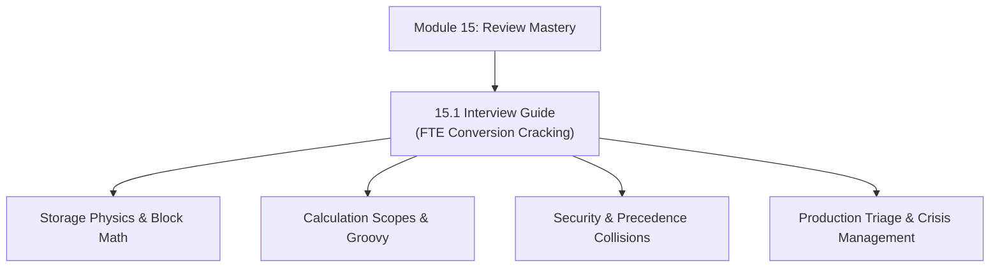

# Module 15: Professional Development & Technical Review Mastery

## Navigation & Module Overview

This module is designed specifically for junior consultants and freshers preparing for high-stakes **Conversion Reviews to Full-Time Employee (FTE)**, technical panel interviews, and client-facing architecture defenses.

---

<!-- ===================================================================== -->
<!-- 🎯 LIVE INTERACTIVE VISUAL CARD: MODULE 15 PROFESSIONAL DEVELOPMENT -->
<!-- ===================================================================== -->

<b>🎯 Live Interactive Architecture Card: FTE Review Cracking Suite (Click to Collapse / Expand)</b>

 

> [!TIP]
> **Consultant High-Yield Summary:** Master the 5 technical evaluation pillars (Storage Physics, Calculation Engineering, Security/Validation, Integration/Write-Back, and Production Triage) and the 25 High-Stakes Twisted Review Scenarios.

| Document | Primary Domain | Core Focus | Direct Link |
| :--- | :--- | :--- | :--- |
| **15.1 Interview Guide** | Review Cracking | 5 Evaluation Pillars, 25 Twisted Review Scenarios, First-Principles Reasoning | [01_Interview_Guide.md](01_Interview_Guide.md) |

---

## Module Documents

1. **[15.1 Technical Consultant Review & Interview Cracking Guide (FTE Conversion)](01_Interview_Guide.md)**
   * The 5 Technical Evaluation Pillars for FTE conversion.
   * Anatomy of twisted review questions asked by senior architects.
   * Master Question Bank: 25 High-Stakes Twisted Review Scenarios.
   * Consultant model answers with first-principles physical explanations.

---
*Return to [Knowledge Base Master Index](../README.md) or advance to [Module 16: Performance Tuning](../16_Performance_Tuning/00_INDEX.md).*
