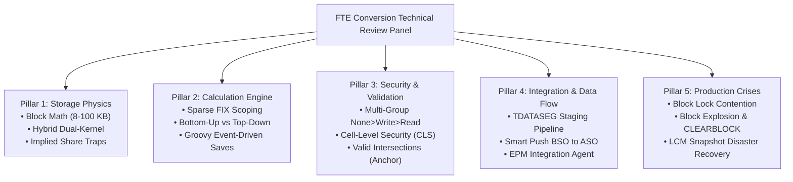

# 15.1 Technical Consultant Review & Interview Cracking Guide (FTE Conversion)

## Table of Contents
1. [Core Consultant Mental Model](#1-core-consultant-mental-model)
2. [The 5 Technical Review Evaluation Pillars](#2-the-5-technical-review-evaluation-pillars)
3. [How Senior Architects Structure Twisted Scenario Questions](#3-how-senior-architects-structure-twisted-scenario-questions)
4. [Master Question Bank: 25 High-Stakes Twisted Review Scenarios](#4-master-question-bank-25-high-stakes-twisted-review-scenarios)
5. [Consultant Model Answers with Deep Technical Rationales](#5-consultant-model-answers-with-deep-technical-rationales)

---

<!-- ===================================================================== -->
<!-- 🎯 LIVE INTERACTIVE VISUAL CARD: FTE REVIEW CRACKING MATRIX -->
<!-- ===================================================================== -->

<b>🎯 Live Interactive Architecture Card: FTE Review Cracking Matrix (Click to Collapse / Expand)</b>

 

> [!TIP]
> **Consultant High-Yield Summary:** In technical conversion reviews, senior architects test whether you can **reason from first principles**. When asked a troubleshooting question, never guess. State the physical storage layer, the memory caching layer, the relational metadata layer, and provide a systematic isolation protocol.

| Review Pillar | Core Focus | What Interviewers Test | Winning Answer Strategy |
| :--- | :--- | :--- | :--- |
| **1. Storage Physics** | BSO / ASO / Hybrid Kernel | Block math ($D_1 \times D_2 \times \dots \times 8$), memory caches, restructures | Calculate exact byte size; explain .pag array mechanics |
| **2. Calc Engineering** | Calc Scripts & Groovy | FIX scopes, Bottom-Up vs Top-Down, event iterators | Distinguish between sparse block loading and dense array math |
| **3. Security & Validation**| Precedence & Collisions | None > Write > Read, CLS, Valid Intersections | Trace multi-group resolution; separate integrity from security |
| **4. Integration & Write-Back**| Data Pipeline | TDATASEG staging, EPM Agent, Smart Push, ASO slices | Detail 4-stage ETL; explain slice fragmentation |
| **5. Production Support** | Crises & Troubleshooting | Lock timeouts, block explosion, LCM recovery | Walk through methodical triage without guessing |

---

## 1. Core Consultant Mental Model

When you sit before a technical panel for an FTE conversion review, remember that senior architects ask twisted questions specifically designed to uncover whether you merely memorized UI navigation or truly understand **how the engine functions under the hood**.

* **The Freshman Mistake:** Answering with generic slogans (*"BSO is for planning, ASO is for reporting"* or *"Valid intersections give security"*).
* **The Consultant Standard:** Explaining the physical data blocks on disk (`.pag`), the B-tree index pointers (`.ind`), the WebLogic application server thread pools, the relational repository (`HSP_*` schema), and the exact execution order.

---

## 2. The 5 Technical Review Evaluation Pillars

Every question a senior panel asks maps to one of five technical pillars:
1. **Storage Physics:** Do you know how data is stored, indexed, and retrieved? Can you calculate block size on paper?
2. **Calculation Engineering:** Can you write high-performance calc scripts and event-driven Groovy rules that do not lock the database?
3. **Security & Validation:** Do you know how conflicting security permissions resolve across multiple user groups?
4. **Integration & Data Flow:** Can you architect an end-to-end data pipeline from ERP to Planning to Reporting?
5. **Production Support & Troubleshooting:** When a production system crashes or freezes, do you follow a calm, structured triage methodology?

---

## 3. How Senior Architects Structure Twisted Scenario Questions

Reviewers create twisted questions by combining two or three features to test for edge-case collisions:
* *Example:* Combining **Group Security** (Write) with an **Approval Unit State** (Promoted) or a **Valid Intersection Rule** (Invalid) to see if you can diagnose why a cell is read-only.
* *Example:* Combining **Dense/Sparse dimension changes** with an **Outline Restructure** to see if you understand disk rewriting.
* *Example:* Combining **Proportional Grid Spread** with **Missing Child Cells** to see if you understand mathematical division-by-zero traps.

---

## 4. Master Question Bank: 25 High-Stakes Twisted Review Scenarios

### Storage & Outlines:
1. *Calculate the exact block size for an outline with dense dimensions of 250, 16, and 4 members. Is it optimal?*
2. *Why does adding 1 sparse dimension cause block explosion, while adding 1 dense dimension never increases block count?*
3. *What is an Implied Share, what triggers it, and why does it cause data loss when writing to single-child parents?*
4. *What causes a Hybrid BSO cube to abandon fast dynamic vector aggregation and fall back to slow BSO procedural mode?*
5. *Explain the physical difference between an Index Restructure, a Sparse Restructure, and a Dense Restructure.*

### Calculations & Groovy:
6. *Why does `FIX("Actual", "Jan", "Salary")` fail to reduce disk I/O if Period and Account are Dense?*
7. *Explain the difference between Top-Down and Bottom-Up calculations. When does Essbase force Top-Down?*
8. *Why does a Groovy rule targeting `operation.grid.dataCellIterator({it.edited})` run 99% faster than a standard calc script?*
9. *What is the difference between `throwVetoException()` and a standard Java exception in Groovy?*
10. *Why is `@XREF` considered an anti-pattern in modern Cloud EPM?*

### Security & Governance:
11. *User A belongs to Group 1 (Write on Entity US) and Group 2 (Read on Entity US). What is their effective access? What if Group 3 grants None?*
12. *Why can a user with Write access to an Entity and Account still see a read-only cell on a web form? (List all 6 causes).*
13. *What is the architectural difference between Valid Intersections and Cell-Level Security (CLS)?*
14. *Can a Service Administrator enter data into an invalid intersection on a web form?*

### Integration & Smart Push:
15. *A Data Integration rule fails with an Orange Fish icon at the Validate step. What is the root cause?*
16. *What is the difference between Replace and Merge export modes in Data Integration?*
17. *Why does saving a form with Smart Push take 20 seconds, and how do you optimize it?*
18. *What happens physically to an ASO cube if Smart Push runs 5,000 times without a slice merge?*
19. *How does the EPM Integration Agent query on-premises SQL databases without opening inbound firewall ports?*

### Client Tools & Lifecycle:
20. *Why do custom Excel formulas disappear when a user clicks Refresh in Smart View?*
21. *What happens to active planners when an administrator executes a Refresh Database during business hours?*
22. *What is the difference between `epmautomate recreate` and `epmautomate refreshcube`?*
23. *Why should an administrator always take an on-demand snapshot immediately before importing an incremental LCM package?*
24. *Why are Smart Lists stored as positive integer IDs instead of text strings in Essbase?*
25. *A batch rule hung for 2 hours locking all user forms. Walk me through your step-by-step production triage protocol.*

---

## 5. Consultant Model Answers with Deep Technical Rationales

*(Detailed walkthroughs for all 25 scenarios are provided in the relevant modular chapters throughout this Knowledge Base and in the Master Documentation Cheatsheet).*

---
*Proceed to [Module 16: Performance Tuning Complete Guide](../16_Performance_Tuning/01_Performance_Guide.md).*
