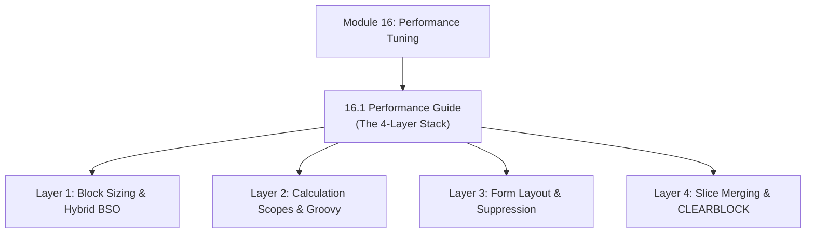

# Module 16: Performance Tuning & Optimization Architecture

## Navigation & Module Overview

This module covers the 4-layer EPM performance tuning stack: physical outline and block sizing, calculation rule optimization, web form and query tuning, and automated maintenance operations.

---

<!-- ===================================================================== -->
<!-- 🎯 LIVE INTERACTIVE VISUAL CARD: MODULE 16 PERFORMANCE TUNING -->
<!-- ===================================================================== -->

<b>🎯 Live Interactive Architecture Card: Performance Tuning Suite (Click to Collapse / Expand)</b>

 

> [!TIP]
> **Consultant High-Yield Summary:** Master the 4-layer tuning stack (Block Sizing 8-100 KB, Sparse FIX Scopes, Web Form Suppression, and ASO Slice Merges with Drop Zeros).

| Document | Primary Domain | Core Focus | Direct Link |
| :--- | :--- | :--- | :--- |
| **16.1 Performance Guide** | Full-Stack Optimization | 4-Layer Stack, Block Sizing Math, Sparse FIX, Web Form Layout, `CLEARBLOCK EMPTY` | [01_Performance_Guide.md](01_Performance_Guide.md) |

---

## Module Documents

1. **[16.1 Performance Tuning Architecture: Storage, Calculations, Forms & Maintenance](01_Performance_Guide.md)**
   * The 4-Layer EPM Performance Stack (Storage, Calculations, Forms, Maintenance).
   * Block sizing optimization (8 KB to 100 KB target range).
   * Calculation tuning: Sparse FIX scoping, Bottom-Up enforcement, and Groovy event rules.
   * Form grid and query retrieval tuning: Suppress Missing Data, POV sizing.
   * Deflating block explosion via `CLEARBLOCK EMPTY;` and ASO slice compaction.
   * Tough & twisted review questions with consultant model answers.

---
*Return to [Knowledge Base Master Index](../README.md) or advance to [Module 17: Hands-On Labs & Case Studies](../17_Labs_and_Case_Studies/00_INDEX.md).*
