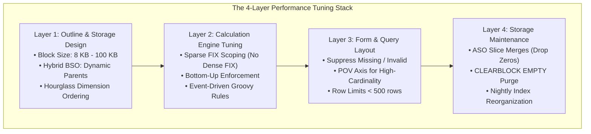

# 16.1 Performance Tuning Architecture: Storage, Calculations, Forms & Maintenance

## Table of Contents
1. [Core Consultant Mental Model](#1-core-consultant-mental-model)
2. [The 4-Layer EPM Performance Stack](#2-the-4-layer-epm-performance-stack)
3. [Layer 1: Outline & Storage Optimization (Block Sizing & Hybrid)](#3-layer-1-outline--storage-optimization-block-sizing--hybrid)
4. [Layer 2: Calculation & Business Rule Tuning (Micro-FIX & Parallelism)](#4-layer-2-calculation--business-rule-tuning-micro-fix--parallelism)
5. [Layer 3: Form Grid & Query Retrieval Tuning](#5-layer-3-form-grid--query-retrieval-tuning)
6. [Layer 4: Maintenance Operations & Block Explosion Remediation](#6-layer-4-maintenance-operations--block-explosion-remediation)
7. [Tough & Twisted Review Questions with Consultant Model Answers](#7-tough--twisted-review-questions-with-consultant-model-answers)

---

<!-- ===================================================================== -->
<!-- 🎯 LIVE INTERACTIVE VISUAL CARD: PERFORMANCE TUNING STACK -->
<!-- ===================================================================== -->
<details open>
<summary><b>🎯 Live Interactive Architecture Card: 4-Layer Performance Tuning Stack (Click to Collapse / Expand)</b></summary>

<br/>

> [!TIP]
> **Consultant High-Yield Summary:** In Oracle Cloud EPM, performance bottlenecks are 95% architectural and 5% infrastructure. Sizing blocks to **8 KB - 100 KB**, converting stored parents to **Dynamic Calc** in Hybrid BSO, scoping calc scripts to **Sparse dimensions**, and enabling **Suppress Missing** on forms resolves almost every performance crisis.

| Tuning Layer | Primary Bottleneck | Optimization Lever | Benchmark Target |
| :--- | :--- | :--- | :--- |
| **1. Storage / Outline** | Block size too large (> 500 KB) or too small (< 4 KB) | Reassign Dense/Sparse; Hourglass ordering | **8 KB to 100 KB block size** |
| **2. Calculations** | Monolithic rules scanning unneeded blocks | Target sparse FIX; Bottom-Up calc; Groovy micro-FIX | **Sub-second on-save execution** |
| **3. Form Grids** | Explosive Cartesian rows; no suppression | Move sparse dims to POV; enable Suppress Missing | **< 500 rows; load time < 2s** |
| **4. Maintenance** | Accumulated ASO slices; ghost empty blocks | `CLEARBLOCK EMPTY;` + `mergeslices dropzeros` | **Zero fragmented slices** |



</details>

---

## 1. Core Consultant Mental Model

When a client reports performance degradation:
* **The Incompetent Approach:** Randomly tweaking settings, restarting the instance, or telling the client "the cloud is just slow today."
* **The Senior Consultant Protocol:** Systematically dissecting the **4-Layer Performance Stack**:
  1. *Is the block size within 8 KB to 100 KB?*
  2. *Are calculations fixing on Sparse dimensions and executing in Bottom-Up mode?*
  3. *Is the web form attempting to render thousands of empty Cartesian rows?*
  4. *Has the ASO cube accumulated thousands of unmerged data slices?*

---

## 2. The 4-Layer EPM Performance Stack

Performance tuning in Oracle Cloud EPM operates across four distinct operational boundaries:
1. **Outline & Physical Storage:** How data is physically indexed and partitioned on disk.
2. **Calculation Engine:** How business rules and Groovy scripts execute math in memory.
3. **Form & Query Interface:** How grids retrieve, format, and render data in browsers and Smart View.
4. **Maintenance & Compaction:** Scheduled jobs that purge ghost blocks and merge fragmented slices.

---

## 3. Layer 1: Outline & Storage Optimization (Block Sizing & Hybrid)

### 1. Sizing the Multidimensional Data Block:
* Compute block size: $\prod(\text{Dense Members}) \times 8 \text{ bytes}$.
* Keep size strictly between **8 KB and 100 KB** (up to 200 KB in 64-bit systems).
* If block size is > 500 KB, move the smallest dense dimension to **Sparse**.

### 2. Hybrid BSO Conversion:
* Convert all upper-level parent members from Stored (`+`) to **Dynamic Calc (`~`)**.
* Eliminates stored upper blocks, slashing disk footprint by 70% to 90% and eliminating batch consolidation runtimes.

### 3. Hourglass Ordering:
* Dense dimensions ordered from largest member count to smallest.
* Sparse dimensions ordered from smallest member count to largest.

---

## 4. Layer 2: Calculation & Business Rule Tuning (Micro-FIX & Parallelism)

### 1. Fix on Sparse Dimensions Only:
```essbase
/* GOOD: Fixes on sparse dimensions; loads only matching physical blocks */
FIX("Actual", "FY26", @RELATIVE("Total_Entity", 0))
    "Expense" = "Driver" * "Rate";
ENDFIX

/* BAD: Fixing on dense dimensions does NOT reduce block loads from disk! */
FIX("Jan", "Expense") 
    ...
ENDFIX
```

### 2. Force Bottom-Up Evaluation:
* Use `@BOTTOMUP` operator to prevent Essbase from executing slow Top-Down loops across non-existent blocks.

### 3. Implement Groovy Event-Driven Calculations:
* On web forms, replace monolithic calc scripts with **Groovy rules** that iterate strictly across edited cells (`dataCellIterator({it.edited})`). This accelerates save times by up to **99%**.

---

## 5. Layer 3: Form Grid & Query Retrieval Tuning

Web forms that take longer than 3 seconds to open suffer from poor layout design:
1. **Enable Data Suppression:** Check **"Suppress Missing Data"** and **"Suppress Invalid Combinations"**.
2. **Limit Visible Rows:** Never place 4 sparse dimensions on rows simultaneously. Keep visible grid rows under 500.
3. **Use POV Slicers:** Move high-cardinality sparse dimensions (Entity, CostCenter, Product) to Page or POV axes.

---

## 6. Layer 4: Maintenance Operations & Block Explosion Remediation

### 1. Deflating Block Explosion via `CLEARBLOCK EMPTY;`:
When an unconstrained allocation creates thousands of blocks with all `#Missing` cells, execute:
```essbase
FIX("Scenario", "Version", "Year")
    CLEARBLOCK EMPTY;
ENDFIX
```
Essbase scans the database, identifies blocks where every cell is `#Missing`, and truncates them from `.pag` files.

### 2. ASO Slice Merging with `dropzeros`:
Automate nightly via EPM Automate:
```bash
epmautomate mergeslices AppName AsoCubeName dropzeros
```
Merges all accumulated incremental slices into a single main slice and drops zero-value cells, restoring sub-second ad-hoc query speeds.

---

## 7. Tough & Twisted Review Questions with Consultant Model Answers

### Question 1: "A client reports that opening a web form takes 30 seconds. In Smart View, an ad-hoc query on the same data opens in 1 second. What explains the difference?"
**Consultant Model Answer:**
> "The massive performance difference between the web form and Smart View indicates that the bottleneck is **Web Form Layout & DOM Rendering**, not Essbase:
> 1. **Missing Suppression on Web Form:** The web form likely has 'Suppress Missing Data' unchecked, forcing the web application server to generate JSON payloads for thousands of blank cells, and forcing the browser DOM to render 10,000 table elements.
> 2. **Dynamic Validation Rules:** The web form may have dozens of conditional formatting and validation rules evaluating on the browser side.
> 3. **Smart View Efficiency:** In Smart View, the user queried a compact ad-hoc slice with missing suppression enabled. 
> Enabling 'Suppress Missing Data' and 'Suppress Invalid Combinations' on the web form will immediately align its performance with Smart View."

### Question 2: "What is the physical architectural consequence of running `CLEARBLOCK ALL;` versus `CLEARBLOCK EMPTY;`?"
**Consultant Model Answer:**
> "* **`CLEARBLOCK ALL;`:** Completely purges all data blocks within the active FIX scope, deleting every leaf and summary number permanently from disk.
> * **`CLEARBLOCK EMPTY;`:** Scans physical data blocks within the FIX scope and deletes **strictly those blocks in which every single dense cell is `#Missing` (or zero)**. Blocks containing valid data are left 100% untouched.
> `CLEARBLOCK EMPTY;` is the standard tuning tool to reclaim disk space and purge ghost blocks created by faulty calc rules without risking data loss."

### Question 3: "A business rule with `@CALCPARALLEL 8` runs slower than when configured with `@CALCPARALLEL 2`. Why does adding more threads degrade performance?"
**Consultant Model Answer:**
> "In Oracle Cloud EPM virtualized compute architecture, instances typically have 2 to 4 virtual CPU cores. 
> Setting `@CALCPARALLEL 8` forces the operating system to manage 8 concurrent worker threads on fewer physical CPU cores, causing severe **thread contention and CPU context-switching overhead**. Additionally, multiple threads simultaneously reading and writing to the same Essbase index and page cache memory structures generate **memory bus contention and lock queuing**. Setting parallel threads strictly between 2 and 4 aligns with physical core capacity and maximizes throughput."

---
*Proceed to [Module 17: Hands-On Labs & Production Case Studies](../17_Labs_and_Case_Studies/00_INDEX.md).*
