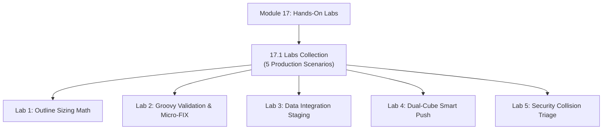

# Module 17: Hands-On Implementation Labs & Production Case Studies

## Navigation & Module Overview

This module provides end-to-end practical implementation labs covering outline sizing, event-driven Groovy validation, Data Integration ETL, dual-cube Smart Push synchronization, and security collision debugging.

---

<!-- ===================================================================== -->
<!-- 🎯 LIVE INTERACTIVE VISUAL CARD: MODULE 17 LABS -->
<!-- ===================================================================== -->

<b>🎯 Live Interactive Architecture Card: Hands-On Labs Suite (Click to Collapse / Expand)</b>

 

> [!TIP]
> **Consultant High-Yield Summary:** Work through these 5 production labs to cement your understanding of block math, Groovy event scripting, Data Integration mappings, Smart Push synchronization, and security collision resolution.

| Document | Primary Domain | Core Focus | Direct Link |
| :--- | :--- | :--- | :--- |
| **17.1 Labs Collection** | Practical Exercises | 5 Production Labs: Outline Sizing, Groovy Veto, Data Integration, Smart Push, Security | [01_Labs_Collection.md](01_Labs_Collection.md) |

---

## Module Documents

1. **[17.1 Hands-On Implementation Labs & Production Case Studies](01_Labs_Collection.md)**
   * Lab 1: End-to-End Hybrid BSO Outline Sizing & Slicing (75 KB block design).
   * Lab 2: Pre-Save Groovy Data Validation & Micro-FIX Calculation (`throwVetoException`).
   * Lab 3: Data Integration Staging, Mapping (Explicit/Like), and Drill-Through.
   * Lab 4: Dual-Cube Smart Push & ASO Slice Compaction (`mergeslices dropzeros`).
   * Lab 5: Security Collision Resolution & Valid Intersection Debugging.
   * Tough & twisted review questions with consultant model answers.

---
*Return to [Knowledge Base Master Index](../README.md) or advance to [Module 18: Reference & Encyclopedias](../18_Reference/00_INDEX.md).*
