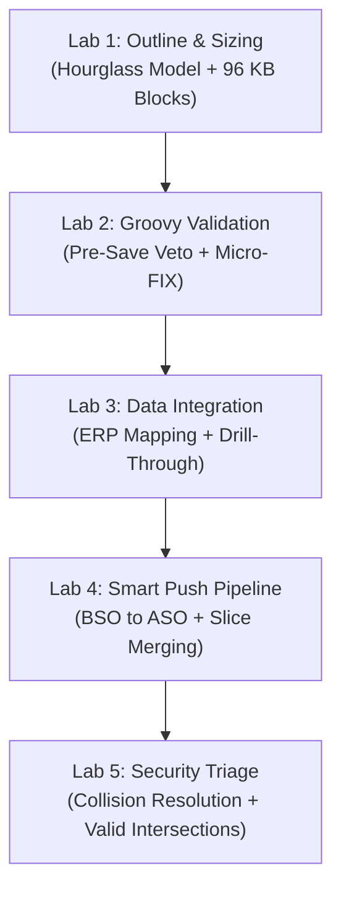

# 17.1 Hands-On Implementation Labs & Production Case Studies

## Table of Contents
1. [Core Consultant Mental Model](#1-core-consultant-mental-model)
2. [Lab 1: End-to-End Hybrid BSO Outline Sizing & Slicing](#2-lab-1-end-to-end-hybrid-bso-outline-sizing--slicing)
3. [Lab 2: Pre-Save Groovy Data Validation & Micro-FIX Calculation](#3-lab-2-pre-save-groovy-data-validation--micro-fix-calculation)
4. [Lab 3: Data Integration Staging, Mapping & Drill-Through](#4-lab-3-data-integration-staging-mapping--drill-through)
5. [Lab 4: Dual-Cube Smart Push & ASO Slice Compaction](#5-lab-4-dual-cube-smart-push--aso-slice-compaction)
6. [Lab 5: Security Collision Resolution & Valid Intersection Debugging](#6-lab-5-security-collision-resolution--valid-intersection-debugging)
7. [Tough & Twisted Review Questions with Consultant Model Answers](#7-tough--twisted-review-questions-with-consultant-model-answers)

---

<!-- ===================================================================== -->
<!-- 🎯 LIVE INTERACTIVE VISUAL CARD: HANDS-ON LABS SUITE -->
<!-- ===================================================================== -->
<details open>
<summary><b>🎯 Live Interactive Architecture Card: Hands-On Consultant Labs Suite (Click to Collapse / Expand)</b></summary>

<br/>

> [!TIP]
> **Consultant High-Yield Summary:** Theory without implementation leads to failure during technical reviews. These 5 end-to-end labs replicate real-world enterprise implementation tasks, forcing you to calculate block math, write event-driven Groovy scripts, and debug data integration pipelines.

| Lab # | Implementation Domain | Real-World Scenario | Key Deliverable |
| :---: | :--- | :--- | :--- |
| **01** | **Storage & Outlines** | Design a 14-dimension corporate planning cube | 96 KB block size; 100% Dynamic Calc upper parents |
| **02** | **Groovy & Rules** | Intercept form save to block negative headcount | Pre-save `throwVetoException()` + Micro-FIX execution |
| **03** | **Data Integration** | Ingest ERP general ledger trial balance | Mappings (Explicit + Like); TDATASEG validation; Drill-Through |
| **04** | **Dual-Cube Architecture**| Real-time write-back to ASO reporting cube | Smart Push on Save + Automated `mergeslices dropzeros` |
| **05** | **Security & Intersections**| Debug read-only cells on regional forecast forms | Resolve multi-group collisions (`None > Write > Read`) |



</details>

---

## 1. Core Consultant Mental Model

When executing hands-on labs:
* **Always verify the underlying engine state:** When creating a member, check if a Cube Refresh is required.
* **Observe physical side-effects:** When running an allocation, inspect block count changes.
* **Inspect the logs:** Never assume success; check Job Console execution logs and verify exit codes.

---

## 2. Lab 1: End-to-End Hybrid BSO Outline Sizing & Slicing

### Scenario:
You are designing the core financial planning cube for a multinational enterprise with 12 dimensions:
* Dense Dimensions: `Account` (300 members), `Period` (16 members), `HSP_Rates` (2 members).
* Sparse Dimensions: `Entity` (150 members), `Scenario` (3 members), `Version` (4 members), `Year` (5 members), `CostCenter` (80 members), `Product` (500 members), `Market` (30 members), `View` (1 member).

### Execution Steps:
1. **Calculate Physical Block Size:**
   $$\text{Block Size} = (300 \times 16 \times 2) \times 8 \text{ bytes} = 9,600 \text{ cells} \times 8 = 76,800 \text{ bytes} = 75.0 \text{ KB}$$
   *(Optimal! Lies perfectly inside the 8 KB to 100 KB target range).*
2. **Apply Hourglass Dimension Ordering:**
   * Dense: `Account` (300) -> `Period` (16) -> `HSP_Rates` (2).
   * Sparse: `Scenario` (3) -> `Version` (4) -> `Year` (5) -> `Market` (30) -> `CostCenter` (80) -> `Entity` (150) -> `Product` (500).
3. **Configure Hybrid Upper Parents:**
   * Set all upper parent members across all sparse dimensions to **Dynamic Calc (`~`)**.
   * Execute Database Refresh and verify outline compilation.

---

## 3. Lab 2: Pre-Save Groovy Data Validation & Micro-FIX Calculation

### Scenario:
Finance requires that:
1. Planners cannot enter negative travel expenses.
2. If travel expense exceeds \$25,000, a cell note is mandatory.
3. Upon saving, only the edited entities and accounts recalculate.

### Execution Script:
```groovy
/* Lab 2 Solution: Event-Driven Pre-Save Groovy Rule */
def errors = []
def editedEntities = [] as Set

operation.grid.dataCellIterator({DataCell cell -> cell.edited}).each { cell ->
    String account = cell.getMemberName("Account")
    String entity = cell.getMemberName("Entity")
    editedEntities.add(entity)
    
    if (account == "Travel_Expense" && cell.data < 0) {
        errors.add("Entity [${entity}]: Travel Expense cannot be negative (${cell.data}).")
    }
    if (account == "Travel_Expense" && cell.data > 25000 && !cell.hasCellNote()) {
        errors.add("Entity [${entity}]: Travel over $25k requires an explanatory cell note.")
    }
}

if (!errors.isEmpty()) {
    throwVetoException(errors.join("\n"))
}

// Execute Micro-FIX on edited entities
if (!editedEntities.isEmpty()) {
    String entityScope = editedEntities.collect { '"' + it + '"' }.join(",")
    String script = """
        FIX(${entityScope}, "FY26", "Working")
            "Total_Opex" = "Travel_Expense" + "Salaries" + "Rent";
        ENDFIX
    """
    operation.cube.executeCalcScript(script)
}
```

---

## 4. Lab 3: Data Integration Staging, Mapping & Drill-Through

### Scenario:
Extract monthly trial balance from ERP General Ledger CSV file and load into Planning:
1. **Configure Import Format:** Map source file columns (Account = Col 1, Entity = Col 2, Amount = Col 5) to `TDATASEG`.
2. **Create Dimension Mappings:**
   * Explicit Rule: Source `4010` -> Target `Rev_Product`.
   * Like Rule: Source `5*` -> Target `Opex_*`.
3. **Execute Data Load Rule:**
   * Execute Import & Validate. Verify workbench status turns Green.
   * Export to Essbase using `Merge` mode.
4. **Verify Drill-Through:**
   * Open Smart View, right-click loaded cell, and select **Drill Through** to open the source staging detail.

---

## 5. Lab 4: Dual-Cube Smart Push & ASO Slice Compaction

### Scenario:
Set up instantaneous synchronization between `Oep_FS` (BSO) and `Oep_REP` (ASO):
1. **Define Data Map:** Map `Oep_FS` -> `Oep_REP`. Set source dimensions and target member defaults.
2. **Attach Smart Push to Web Form:**
   * Open Form Designer -> Smart Push tab.
   * Add the Data Map and check **"Run After Save"** and **"Use Form Context"**.
3. **Test Real-Time Write-Back:** Enter data on the form, click Save, and verify numbers appear instantaneously in the ASO reporting cube.
4. **Automate Compaction:** Create an EPM Automate scheduled maintenance script:
   ```bash
   epmautomate mergeslices AppName Oep_REP dropzeros
   ```

---

## 6. Lab 5: Security Collision Resolution & Valid Intersection Debugging

### Scenario:
User John is an analyst in the EMEA team:
* He belongs to Group `EMEA_Planners` (Write access to Entity `UK_Corp`).
* He belongs to Group `Global_Viewers` (Read access to Entity `UK_Corp`).
* He belongs to Group `Restricted_Audit` (None access to Account `Executive_Salary`).

### Resolution Analysis:
* **On Entity `UK_Corp`:** Group `EMEA_Planners` (Write) + `Global_Viewers` (Read) -> **WRITE trumps READ** -> Access is **WRITE**.
* **On Account `Executive_Salary`:** Group `Restricted_Audit` (None) -> **NONE trumps all** -> Access is **NONE**.
* **Effective Cell Access:** On any cell combining `UK_Corp` and `Executive_Salary`, John sees `#NoAccess`. On all other accounts for `UK_Corp`, John has full **WRITE** access.

---

## 7. Tough & Twisted Review Questions with Consultant Model Answers

### Question 1: "In Lab 2, what would happen if the Groovy script used `operation.grid.dataCellIterator()` without the `{it.edited}` filter on a form with 10,000 cells?"
**Consultant Model Answer:**
> "Without the `{it.edited}` filter, the JVM instantiates 10,000 heavy Java `DataCell` objects in memory, evaluates validation conditions on unedited cells, and extracts all entities on the sheet into the Micro-FIX scope. 
> This exhausts the Groovy JVM sandbox memory allocation (triggering a heap threshold violation), increases script latency from 150 ms to 8 seconds, and negates the benefits of a micro-calculation by forcing Essbase to recalculate the entire form."

### Question 2: "In Lab 4, why is 'Use Form Context' mandatory when attaching Smart Push to a form?"
**Consultant Model Answer:**
> "Without 'Use Form Context', Smart Push evaluates the Data Map across the entire broad dimensional slice defined in the map (e.g., all 150 entities and all 12 periods). This extracts and pushes hundreds of thousands of unchanged cells, takes 15 to 30 seconds to run, and generates massive ASO slice bloat. 
> Enabling 'Use Form Context' restricts the push strictly to the single entity, scenario, and year displayed on the active user form, completing the synchronization in under 300 milliseconds."

---
*Proceed to [Module 18: Reference & Encyclopedias](../18_Reference/00_INDEX.md).*
