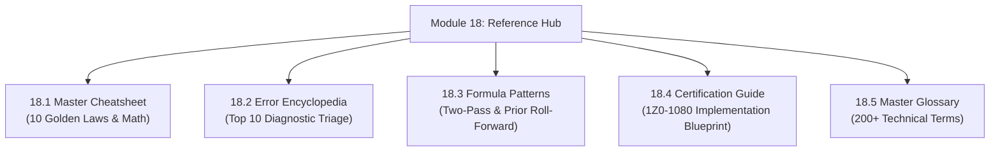

# Module 18: Reference, Error Encyclopedia & Master Glossary

## Navigation & Module Overview

This module serves as the comprehensive technical reference hub, containing the master cheatsheet, the production error diagnostic encyclopedia, member formula templates, certification blueprints, and the complete 200-term glossary.

---

<!-- ===================================================================== -->
<!-- 🎯 LIVE INTERACTIVE VISUAL CARD: MODULE 18 REFERENCE -->
<!-- ===================================================================== -->

<b>🎯 Live Interactive Architecture Card: Reference & Diagnostic Suite (Click to Collapse / Expand)</b>

 

> [!TIP]
> **Consultant High-Yield Summary:** Use this reference module during active project debugging, client architecture reviews, and certification preparation.

| Document | Primary Domain | Core Focus | Direct Link |
| :--- | :--- | :--- | :--- |
| **18.1 Master Cheatsheet** | Rapid Recall | 10 Golden Laws, Block Sizing Math, Security Precedence, EPM Automate | [01_CheatSheets.md](01_CheatSheets.md) |
| **18.2 Error Encyclopedia** | Production Triage | Top 10 Errors (Member not found, Lock timeout, Memory overflow, Unmapped member) | [03_Error_Encyclopedia.md](03_Error_Encyclopedia.md) |
| **18.3 Member Formula Patterns** | Reusable Logic | Two-Pass ratios, Prior period roll-forward, Hybrid BSO compatibility | [04_Member_Formula_Patterns.md](04_Member_Formula_Patterns.md) |
| **18.4 Certification Guide** | Implementation Exam | 1Z0-1080 Exam Blueprint, Scoring Domains, Exam Trap Elimination | [05_Certification_Guide.md](05_Certification_Guide.md) |
| **18.5 Master Glossary** | Terminology | 200+ Architectural and Functional Definitions (A-Z) | [06_Glossary.md](06_Glossary.md) |

---

## Module Documents

1. **[18.1 Master Review Cheatsheet: Golden Laws, Formula Physics & Rapid Recall](01_CheatSheets.md)**
   * Top 10 Golden Laws of Oracle EPM Cloud.
   * Physical storage and block sizing mathematical formula sheet.
   * Security precedence and collision resolution matrix.
   * EPM Automate and REST API command cheatsheet.

2. **[18.2 Production Error Encyclopedia & Diagnostic Triage Guide](03_Error_Encyclopedia.md)**
   * 4-Step diagnostic triage protocol.
   * Top 10 production errors, root cause analysis, and verified technical fixes.
   * Lock timeout remediation and memory sandbox threshold triage.

3. **[18.3 Member Formula Patterns: Reusable Templates & Hybrid BSO Compatibility](04_Member_Formula_Patterns.md)**
   * 5 Proven enterprise member formula patterns.
   * Hybrid BSO compatibility rules for dynamic parent members.
   * Division by zero and `#Missing` protection.

4. **[18.4 Certification Guide: Oracle Cloud EPM Planning Implementation Professional (1Z0-1080)](05_Certification_Guide.md)**
   * 1Z0-1080 Exam blueprint and domain weights.
   * High-yield objective breakdown and trap question elimination strategies.

5. **[18.5 Master Terminology Glossary: 200+ Architectural & Functional Concepts](06_Glossary.md)**
   * Complete A-Z technical glossary covering Essbase storage, calculations, security, and ETL.

---
*Return to [Knowledge Base Master Index](../README.md).*
