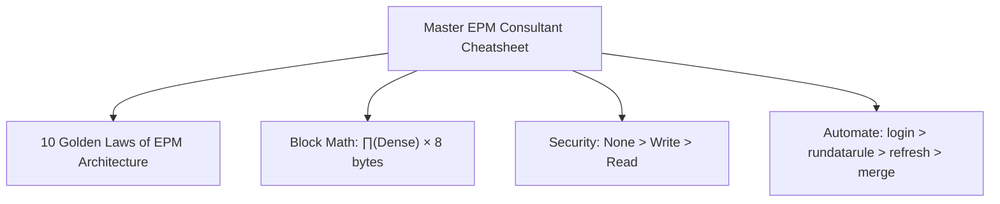

# 18.1 Master Review Cheatsheet: Golden Laws, Formula Physics & Rapid Recall

## Table of Contents
1. [The 10 Golden Laws of Oracle EPM Cloud](#1-the-10-golden-laws-of-oracle-epm-cloud)
2. [Physical Storage & Block Sizing Formula Sheet](#2-physical-storage--block-sizing-formula-sheet)
3. [Calculation Engine & FIX Scoping Quick Reference](#3-calculation-engine--fix-scoping-quick-reference)
4. [Security Precedence & Collision Matrix](#4-security-precedence--collision-matrix)
5. [EPM Automate & REST API Command Cheatsheet](#5-epm-automate--rest-api-command-cheatsheet)

---

<!-- ===================================================================== -->
<!-- 🎯 LIVE INTERACTIVE VISUAL CARD: MASTER REVIEW CHEATSHEET -->
<!-- ===================================================================== -->
<details open>
<summary><b>🎯 Live Interactive Architecture Card: Master Review Cheatsheet (Click to Collapse / Expand)</b></summary>

<br/>

> [!TIP]
> **Consultant High-Yield Summary:** Keep this cheatsheet open during project emergencies and technical review preparation. It condenses the entire Oracle Cloud EPM architecture into 10 fundamental laws and rapid mathematical formulas.

| Operational Domain | The Golden Rule | Fatal Anti-Pattern |
| :--- | :--- | :--- |
| **Storage Engine** | Block Size strictly between **8 KB and 100 KB** | Making high-cardinality sparse dimensions Dense |
| **Hybrid BSO** | Upper summary parents configured as **Dynamic Calc (`~`)** | Storing upper parent blocks in Hybrid cubes |
| **Calc Scripts** | Always `FIX` on **Sparse dimensions** | Fixing on dense dimensions to reduce disk I/O |
| **Security** | Precedence: **`NONE > WRITE > READ`** | Assigning Service Admin to functional planners |
| **Data Movement** | Use **Smart Push on Save** for real-time BSO to ASO | Using cell-by-cell `@XREF` across network sockets |
| **Maintenance** | Automate `mergeslices dropzeros` nightly | Allowing thousands of unmerged ASO micro-slices |



</details>

---

## 1. The 10 Golden Laws of Oracle EPM Cloud

1. **The Block Sizing Law:** $\text{Block Size} = \prod(\text{Dense Members}) \times 8 \text{ bytes}$. Keep between **8 KB and 100 KB**.
2. **The Sparsity Law:** Fixing on Sparse dimensions reduces disk block reads. Fixing on Dense dimensions masks cells in RAM but **never reduces disk I/O**.
3. **The Hybrid Rollup Law:** In Hybrid BSO, upper-level members must be **Dynamic Calc (`~`)**. Never store parent blocks on disk.
4. **The Two-Pass Ratio Law:** Any ratio or percentage account (`[Margin] / [Revenue]`) must be **Dynamic Calc + Two-Pass**. Without Two-Pass, Essbase sums child percentages.
5. **The Implied Share Law:** A parent with only one child automatically shares the child's memory pointer. Writing to the parent overwrites the child. Set to **Never Share** if independent targets are required.
6. **The Multi-Group Security Law:** Group permission collisions resolve as $\text{NONE} \succ \text{WRITE} \succ \text{READ}$. Any group granting `NONE` completely revokes access.
7. **The Data Integrity Law:** **Valid Intersections** are business data filters, NOT security controls. They prevent nonsensical data entry; they do not authorize users.
8. **The Groovy Efficiency Law:** Iterating strictly over edited cells (`dataCellIterator({it.edited})`) reduces calculation runtime by up to **99%**.
9. **The ASO Compaction Law:** Every Smart Push creates an incremental ASO slice. Slices must be merged nightly via `mergeslices dropzeros` to prevent query degradation.
10. **The Production Safety Law:** Never import an LCM migration package into Production without capturing an **on-demand snapshot** immediately beforehand.

---

## 2. Physical Storage & Block Sizing Formula Sheet

$$\text{Block Size (Bytes)} = (\text{Dense}_1 \times \text{Dense}_2 \times \dots \times \text{Dense}_n) \times 8 \text{ bytes}$$
$$\text{Block Size (KB)} = \frac{\text{Block Size (Bytes)}}{1024}$$
$$\text{Potential Blocks} = \text{Sparse}_1 \times \text{Sparse}_2 \times \dots \times \text{Sparse}_n$$
$$\text{Existing Blocks} = \text{Potential Blocks} \times \text{Sparsity Factor (typically 0.1% to 2%)}$$

---

## 3. Calculation Engine & FIX Scoping Quick Reference

* **`SET UPDATECALC OFF;`** : Forces calculation of clean blocks during batch runs.
* **`SET CALCMODE BLOCK;`** : Uses fast vectorized array math within data blocks.
* **`SET CALCPARALLEL 2;`** : Spawns 2 to 4 parallel threads across sparse blocks.
* **`@RELATIVE("Member", 0)`** : Returns Level 0 leaf members.
* **`@PRIOR("Mbr", 1, @RELATIVE("Period", 0))`** : Retrieves previous period cell value.
* **`CLEARBLOCK EMPTY;`** : Scans database and truncates blocks where every cell is `#Missing`.

---

## 4. Security Precedence & Collision Matrix

| Group 1 Grant | Group 2 Grant | Group 3 Grant | Effective Permission |
| :---: | :---: | :---: | :---: |
| `WRITE` | `READ` | *None* | **`WRITE`** (Write trumps Read) |
| `READ` | `READ` | *None* | **`READ`** |
| `WRITE` | `READ` | `NONE` | **`NONE`** (None trumps all!) |
| `WRITE` | `WRITE` | `NONE` | **`NONE`** |

---

## 5. EPM Automate & REST API Command Cheatsheet

```bash
# 1. Login with encrypted password file
epmautomate login admin@company.com C:\EPM\pass.epw https://epm.oraclecloud.com MyKey

# 2. Upload file to Inbox
epmautomate uploadfile "C:\Data\gl_actuals.csv" inbox

# 3. Run Data Integration rule
epmautomate rundatarule Import_GL Oct FY26 MERGE

# 4. Refresh Database
epmautomate refreshcube

# 5. Merge ASO Slices and Drop Zeros
epmautomate mergeslices Plan1 OEP_REP dropzeros

# 6. Export Full Application Backup
epmautomate exportsnapshot "Nightly_Backup_Snapshot"

# 7. Download Snapshot to Local Storage
epmautomate downloadfile "Nightly_Backup_Snapshot"

# 8. Logout
epmautomate logout
```

---
*Proceed to [18.2 Error Encyclopedia & Production Debugging](03_Error_Encyclopedia.md).*
