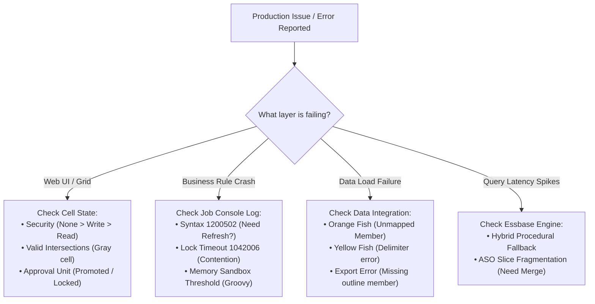

# 18.2 Production Error Encyclopedia & Diagnostic Triage Guide

## Table of Contents
1. [Core Consultant Mental Model](#1-core-consultant-mental-model)
2. [Diagnostic Triage Workflow: The 4-Step Protocol](#2-diagnostic-triage-workflow-the-4-step-protocol)
3. [Top 10 Production Errors, Root Causes & Verified Fixes](#3-top-10-production-errors-root-causes--verified-fixes)
4. [Tough & Twisted Review Questions with Consultant Model Answers](#4-tough--twisted-review-questions-with-consultant-model-answers)

---

<!-- ===================================================================== -->
<!-- 🎯 LIVE INTERACTIVE VISUAL CARD: ERROR ENCYCLOPEDIA -->
<!-- ===================================================================== -->

<b>🎯 Live Interactive Architecture Card: Production Error Diagnostic Matrix (Click to Collapse / Expand)</b>

 

> [!TIP]
> **Consultant High-Yield Summary:** When an emergency occurs in production, senior architects evaluate your ability to systematically diagnose errors using Job Console logs, Essbase error codes, and relational schema states. Never guess; isolate the failure layer.

| Error Code / Symptom | Root Cause | Immediate Diagnostic Action | Verified Resolution |
| :--- | :--- | :--- | :--- |
| **`1200502: Unknown member name`** | Outline member missing or not refreshed | Check spelling in Dimension Editor | Run **Refresh Database** to push member to Essbase |
| **`1042006: Lock timeout`** | Concurrent users or unconstrained calc locks | Check Job Console for running rules | Terminate hanging job; scope rule with Micro-FIX |
| **`Exceeded memory threshold`** | Groovy rule iterating over entire 10k grid | Inspect Groovy iterator syntax | Add `{it.edited}` filter to `dataCellIterator` |
| **Orange Fish in Data Integration** | Source GL account missing mapping rule | Open Workbench -> Filter unmapped | Add Explicit or Like mapping for new account |
| **Data loss on parent save** | Single-child parent triggered Implied Share | Check parent child count in outline | Change parent property to **Never Share** |

---

## 1. Core Consultant Mental Model

When a client production system fails, junior consultants panic and guess. An FTE-ready technical consultant follows a **rigid diagnostic protocol**:
1. **Identify the execution layer:** Is the failure in the Browser Client, WebLogic JVM, Relational HSP Schema, Data Integration Agent, or Essbase Kernel?
2. **Retrieve the exact technical error code:** Inspect Job Console details, Process Details in Data Integration, or EPM Automate exit logs.
3. **Isolate the root cause:** Distinguish between metadata misalignment (unrefreshed member), security restrictions (Approval Unit lock), and physical storage limits.

---

## 2. Diagnostic Triage Workflow: The 4-Step Protocol

1. **Step 1: Reproduce & Capture Log:** Capture the exact user action, form POV, and full error stack trace from the Job Console.
2. **Step 2: Check Relational-to-Essbase Synchronization:** Check if an administrator added metadata or changed properties without executing a **Refresh Database**.
3. **Step 3: Evaluate Concurrent Locks:** Inspect active sessions to determine if a heavy batch rule is holding exclusive block locks.
4. **Step 4: Execute Surgical Fix:** Apply targeted metadata updates, mapping additions, or script refactoring, and verify resolution in the Test environment before promoting to Production.

---

## 3. Top 10 Production Errors, Root Causes & Verified Fixes

### Error 1: `1200502 - Error parsing formula: Unknown member name`
* **Root Cause:** A business rule references a member that exists in the Planning web interface but has not been compiled into the Essbase outline (`.otl`).
* **Fix:** Execute **Application -> Actions -> Refresh Database**. If the member contains spaces or special characters, enclose in quotes: `"Total Expenses"`.

### Error 2: `1042006 - Network error / Lock timeout exceeded`
* **Root Cause:** Two processes (or 50 web form users) are attempting to write to the same physical data blocks simultaneously. One process holds an exclusive write lock, causing others to wait until the timeout threshold expires.
* **Fix:** In Calculation Manager, check active rules in Job Console and cancel the blocking rule. Refactor the business rule to use **targeted Groovy Micro-FIX** instead of monolithic dimension sweeps.

### Error 3: `Script execution exceeded memory threshold (Groovy Sandbox Violation)`
* **Root Cause:** A Groovy rule iterated over an entire web form with thousands of cells, instantiating thousands of Java `DataCell` objects in memory and exhausting the allocated 50 MB - 100 MB JVM sandbox heap.
* **Fix:** Update iterator syntax to filter strictly for edited cells: `operation.grid.dataCellIterator({DataCell cell -> cell.edited})`.

### Error 4: `Data Integration Orange Fish (Validation Failed)`
* **Root Cause:** The General Ledger file contains a new account, department, or cost center that does not match any mapping rule in Data Integration.
* **Fix:** Open Data Integration Workbench, filter for unmapped source values, add an Explicit or Wildcard mapping rule, and re-run the Validate step.

### Error 5: `Silent Data Loss on Parent Cell Save (Implied Share Overwrite)`
* **Root Cause:** A parent member has only one child, triggering an automatic Implied Share. When a user enters data into both parent and child, the last write silently overwrites the other.
* **Fix:** Open Dimension Editor, navigate to the parent member, set **Data Storage to Never Share**, and execute a Refresh Database.

### Error 6: `Query Latency Spike in Hybrid BSO (18-second query)`
* **Root Cause:** A dynamic parent member formula contains a function that is incompatible with the Hybrid vector engine (`@CURRMBRRANGE`, cross-dimensional assignments), forcing procedural BSO fallback.
* **Fix:** Remove procedural formulas from dynamic parent members; replace with standard additive consolidations (`+`, `~`) and calculate detailed logic via on-save business rules.

### Error 7: `Excel Formulas Disappear on Smart View Refresh`
* **Root Cause:** User entered `=SUM()` formulas directly on an ad-hoc grid without enabling formula retention options.
* **Fix:** In Smart View Options -> Member Options, check **"Preserve Formulas and Comments in Ad Hoc Operations"**.

### Error 8: `Cell Read-Only for User with Write Permissions`
* **Root Cause:** The Approval Unit for that Entity/Scenario/Version was promoted to 'Under Review' or 'Approved', or an active Cell-Level Security (CLS) or Valid Intersection rule locks the coordinate.
* **Fix:** Check Approval Unit status in Approvals console; verify if another dimension in the tuple (Scenario or Version) has Read-Only permissions.

### Error 9: `LCM Snapshot Import Schema Version Mismatch`
* **Root Cause:** Attempting to import an LCM snapshot captured on a newer Oracle cloud release (e.g., `24.10`) into an older release (e.g., `24.08`).
* **Fix:** Cloud EPM forbids downward migration. The destination environment must receive the monthly patch before snapshot import.

### Error 10: `ASO Reporting Cube Query Sluggishness`
* **Root Cause:** Thousands of Smart Push form saves accumulated hundreds of unmerged incremental data slices on disk.
* **Fix:** Run EPM Automate command: `epmautomate mergeslices AppName CubeName dropzeros` to consolidate slices and purge zero cells.

---

## 4. Tough & Twisted Review Questions with Consultant Model Answers

### Question 1: "A client reports that every afternoon at 4:30 PM, all web forms freeze and users receive 'Lock timeout exceeded'. What diagnostic steps do you execute?"
**Consultant Model Answer:**
> "I execute a 3-step diagnostic triage:
> 1. **Inspect Job Console:** Immediately open Navigator -> Jobs and filter for running jobs. Identify whether a scheduled batch rule, automated Data Integration load, or heavy allocation rule was triggered at 4:30 PM.
> 2. **Analyze Rule Scoping:** Check if the running rule is a monolithic calc script that locks broad sparse slices (e.g., locking `@DESCENDANTS(\"Total_Entity\")`). If 50 users are saving forms into the same entity slice while this rule executes, Essbase queues block locks, leading to lock timeouts.
> 3. **Remediation:** Kill the hanging job to immediately restore form availability. Reschedule the batch calculation to run outside business hours, or refactor the form calculation to use **Groovy Micro-FIX** so it only locks the individual leaf blocks being edited."

### Question 2: "What is the difference between a Data Integration failure with a Yellow Fish versus an Orange Fish versus a Red Fish?"
**Consultant Model Answer:**
> "* **Yellow Fish (Import Failure):** The ETL engine failed to read or parse the source file. Common causes: missing source file in inbox, incorrect delimiter (comma vs tab), or invalid numeric date formats.
> * **Orange Fish (Validation Failure):** The file was read, but rows contain **unmapped members**. The source accounts or entities have no matching Explicit, Between, In, or Like mapping rule.
> * **Red Fish (Export Failure):** Mapping succeeded, but the target Essbase cube rejected the records during data loading. Common causes: mapped member does not exist in target outline, or target cell is locked by security or dynamic calc properties."

---
*Proceed to [18.3 Member Formula Patterns & Best Practices](04_Member_Formula_Patterns.md).*
