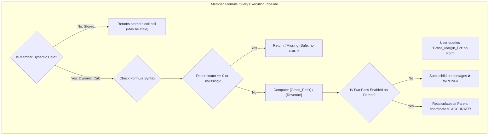

# 18.3 Member Formula Patterns: Reusable Templates & Hybrid BSO Compatibility

## Table of Contents
1. [Core Consultant Mental Model](#1-core-consultant-mental-model)
2. [Hybrid BSO Compatibility Rules for Member Formulas](#2-hybrid-bso-compatibility-rules-for-member-formulas)
3. [5 Proven Enterprise Member Formula Patterns](#3-5-proven-enterprise-member-formula-patterns)
4. [Division by Zero & `#Missing` Handling](#4-division-by-zero--missing-handling)
5. [Tough & Twisted Review Questions with Consultant Model Answers](#5-tough--twisted-review-questions-with-consultant-model-answers)

---

<!-- ===================================================================== -->
<!-- 🎯 LIVE INTERACTIVE VISUAL CARD: MEMBER FORMULA PATTERNS -->
<!-- ===================================================================== -->
<details open>
<summary><b>🎯 Live Interactive Architecture Card: Member Formula Engineering (Click to Collapse / Expand)</b></summary>

<br/>

> [!TIP]
> **Consultant High-Yield Summary:** Member formulas attached to Dynamic Calc accounts execute in memory at query time. Always wrap division in zero-checks (`IF("Denominator" != 0 AND "Denominator" != #Missing)`), enable **Two-Pass Calculation** on ratios, and avoid procedural functions that break Hybrid BSO dynamic vector math.

| Pattern Name | Use Case | Key Functions / Operators | Essential Property |
| :--- | :--- | :--- | :--- |
| **1. Dynamic Margin %** | Gross Margin, EBITDA Margin | `([Operating_Income] / [Revenue]) * 100` | **Dynamic Calc + Two-Pass** |
| **2. Balance Roll-Forward** | Cash & Inventory roll-forward | `@PRIOR("Closing", 1, @RELATIVE("Period", 0))` | Dense Period range required |
| **3. YTD Accumulator** | Cumulative monthly metrics | `@SUMRANGE("Sales", @CURRMBRRANGE("Period", ...))` | Period dimension only |
| **4. Multi-Currency FX** | Dynamic currency reporting | `"Local_Account" / "HSP_Rates"->"Ending_Rate"` | Dynamic Calc on Reporting Currencies |



</details>

---

## 1. Core Consultant Mental Model

Member formulas are mathematical equations attached directly to outline members in the Dimension Editor.
* **When to Use a Member Formula:** Use for dynamic financial metrics that must evaluate on the fly whenever queried (e.g., *Gross Margin %, Headcount per Square Foot, Days Sales Outstanding*).
* **When NOT to Use a Member Formula:** Never attach heavy procedural allocations, multi-step loops, or cross-cube data movements to member formulas. Doing so bogs down query retrieval for every user in Smart View. Procedural logic belongs in **Calculation Manager business rules**.

---

## 2. Hybrid BSO Compatibility Rules for Member Formulas

To maintain sub-second dynamic aggregations in modern Hybrid BSO cubes:
1. **Keep Formulas on Dense Accounts:** Never attach member formulas to sparse parent members in Hybrid BSO outlines.
2. **Avoid Procedural Fallback Triggers:** Avoid `@CURRMBRRANGE`, `@ANCESTVAL`, and cross-dimensional assignments inside dynamic parents.
3. **Use Simple Arithmetic Operators:** Standard additive, subtractive, multiplicative, and divisional formulas execute natively inside the Hybrid vector engine.

---

## 3. 5 Proven Enterprise Member Formula Patterns

### Pattern 1: Dynamic Ratio with Division-by-Zero Protection (Two-Pass):
```essbase
/* Account: Operating_Margin_Pct (Dynamic Calc, Two-Pass Checked) */
IF("Revenue" != 0 AND "Revenue" != #Missing)
    ("Operating_Income" / "Revenue") * 100;
ELSE
    #Missing;
ENDIF
```

### Pattern 2: Prior Period Balance Roll-Forward:
```essbase
/* Account: Ending_Cash (Time Balance: Balance, Skip: Missing) */
IF(@ISMBR("Jan"))
    "Beginning_Cash" + "Net_Cash_Flow";
ELSE
    @PRIOR("Ending_Cash", 1, @RELATIVE("Period", 0)) + "Net_Cash_Flow";
ENDIF
```

### Pattern 3: Budget Variance Dollar Amount:
```essbase
/* Account: Var_Dollar (Dynamic Calc, Variance Reporting: Expense/Non-Expense) */
"Actual" - "Budget";
```

### Pattern 4: Driver-Based Driver Calculation:
```essbase
/* Account: Travel_Expense */
"Headcount" * "Avg_Travel_Rate"->"Total_Entity";
```

### Pattern 5: Cross-Year Shift Handling with `@MDSHIFT`:
```essbase
/* Shifts December closing balance of prior year into January */
@MDSHIFT("Closing_Inventory", -1, "Year", , -11, "Period", );
```

---

## 4. Division by Zero & `#Missing` Handling

In Essbase, dividing by zero or `#Missing` produces `#Error` in reports, which breaks downstream rollups and financial exports:
* Always validate that the denominator is **non-zero and not `#Missing`** before division:
  ```essbase
  IF("Units_Sold" != 0 AND "Units_Sold" != #Missing)
      "Total_Revenue" / "Units_Sold";
  ELSE
      #Missing;
  ENDIF
  ```
* Returning `#Missing` allows Essbase to suppress empty rows cleanly in web forms and Smart View grids.

---

## 5. Tough & Twisted Review Questions with Consultant Model Answers

### Question 1: "Why should you never write a member formula on a Sparse dimension member in a Hybrid BSO application?"
**Consultant Model Answer:**
> "In Hybrid BSO architecture, sparse rollups are computed dynamically by the multi-threaded ASO vector engine. 
> If a formula is assigned to a sparse parent member, the vector engine cannot process the node; it is forced to **fall back to the slow procedural BSO calculation engine**, constructing temporary memory blocks block-by-block. 
> Querying that parent in Smart View or a dashboard suddenly takes 15 to 30 seconds instead of 100 milliseconds. Best practice is to keep all sparse members as standard consolidations (`+`, `~`) and place all member formulas on Dense Account members."

### Question 2: "What is the physical difference between calculating Gross Margin % via a Member Formula versus calculating it via a Business Rule?"
**Consultant Model Answer:**
> "* **Member Formula (Dynamic Calc):** The percentage is **never written to disk**. It is computed dynamically in RAM upon query retrieval. It is always 100% up-to-date with current underlying data, requires zero batch calculation time, and consumes zero disk storage.
> * **Business Rule (Stored Member):** The calculation runs during a batch job or on-save event and writes the physical percentage into `.pag` blocks. If underlying Revenue or COGS changes later without re-running the rule, the stored percentage becomes stale and displays incorrect historical numbers.
> For reporting ratios, Dynamic Calc member formulas are the universal architectural standard."

---
*Proceed to [18.4 Certification Guide: Oracle Implementation Professional (1Z0-1080)](05_Certification_Guide.md).*
