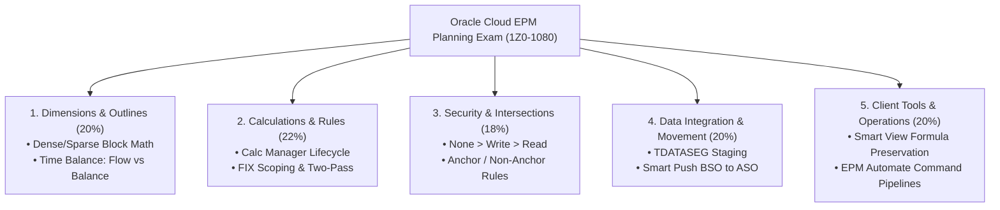

# 18.4 Certification Guide: Oracle Cloud EPM Planning Implementation Professional (1Z0-1080)

## Table of Contents
1. [Core Consultant Mental Model](#1-core-consultant-mental-model)
2. [Exam Blueprint & Scoring Domain Weights](#2-exam-blueprint--scoring-domain-weights)
3. [High-Yield Objective Breakdown](#3-high-yield-objective-breakdown)
4. [Exam Trap Question Formats & Elimination Strategies](#4-exam-trap-question-formats--elimination-strategies)
5. [Tough & Twisted Review Questions with Consultant Model Answers](#5-tough--twisted-review-questions-with-consultant-model-answers)

---

<!-- ===================================================================== -->
<!-- 🎯 LIVE INTERACTIVE VISUAL CARD: CERTIFICATION BLUEPRINT -->
<!-- ===================================================================== -->

<b>🎯 Live Interactive Architecture Card: 1Z0-1080 Certification Exam Blueprint (Click to Collapse / Expand)</b>

 

> [!TIP]
> **Consultant High-Yield Summary:** The Oracle Cloud EPM Planning Certification (1Z0-1080) tests real-world implementation mechanics: configuring dimensions, setting up security and valid intersections, authoring business rules in Calc Manager, managing Smart Push, and executing EPM Automate commands.

| Exam Domain | Scoring Weight | Core Topics Tested | Common Exam Trap |
| :--- | :---: | :--- | :--- |
| **Configuring Planning Dimensions** | 20% | Dimension types, Dense vs. Sparse, Hourglass, Account Types, Time Balance | Implied share triggers on 1-child parents |
| **Managing Security & Intersections** | 18% | OCI IAM roles, group collisions (`None>Write>Read`), Valid Intersections | Confusing Valid Intersections with Security grants |
| **Calculation Manager & Rules** | 22% | Rule components, FIX scopes, `@CALCPARALLEL`, Groovy validation | Scoping FIX on dense dimensions to reduce I/O |
| **Data Integration & Smart Push** | 20% | Data Maps, Smart Push on Save, TDATASEG, Mapping Precedence | Unmapped member failures (Orange fish) |
| **Forms, Dashboards & Smart View** | 20% | Redwood Navigation Flows, Form Cartesian products, Formula preservation | Forgetting "Preserve Formulas in Ad Hoc" |

---

## 1. Core Consultant Mental Model

The **Oracle Cloud EPM Planning Certified Implementation Professional (1Z0-1080)** exam is required by Oracle Partner consulting practices for promotion and client deployment authorization.
* **Format:** 60 Multiple-Choice Questions | 90 Minutes | Passing Score: 64% - 68%.
* The questions are **scenario-based implementation questions**, not generic terminology quizzes. They test what button to click, what property to set, and which command line flag to use.

---

## 2. Exam Blueprint & Scoring Domain Weights

1. **Planning Overview & Architecture (10%):** Application types (Custom vs Modular vs FreeForm), OCI Gen 2 tiers, 28-day monthly update cadence.
2. **Configuring Dimensions & Members (20%):** Universal member properties, Account types, Time balance, Variance reporting, Attribute dimensions, Smart Lists.
3. **Designing Business Rules (22%):** Calculation Manager visual vs script modes, deployment lifecycle, `@RELATIVE`, `@PRIOR`, Top-Down vs Bottom-Up.
4. **Data Integration & Smart Push (20%):** Mapping types and precedence (Explicit > Between > In > Multi-Dim > Like), EPM Integration Agent, Data Maps.
5. **Managing Security (18%):** Role hierarchy, group collision resolution, Cell-Level Security, Valid Intersections.
6. **Client Tools & Lifecycle (10%):** Smart View options, Navigation flows, EPM Automate CLI, LCM migration snapshots.

---

## 3. High-Yield Objective Breakdown

* **Security Precedence:** Be prepared to answer: *"User belongs to Group A (Write), Group B (Read), Group C (None). What is effective access?"* -> **NONE**.
* **Block Size Calculation:** Given member counts, calculate block size using $(D_1 \times D_2 \times \dots) \times 8$ bytes.
* **Valid Intersections:** Remember that Valid Intersections contain the toggle **"Apply to Service Administrator"**.
* **Smart Push:** Remember that Smart Push transfers data from BSO to ASO at form save time when "Run After Save" is enabled.

---

## 4. Exam Trap Question Formats & Elimination Strategies

1. **The "Service Admin Bypass" Trap:**
   * *Question:* "An administrator configures Cell-Level Security to prevent all users from viewing Executive Salary. Why can Jane still see the data?"
   * *Elimination Strategy:* Check Jane's role. If Jane is a **Service Administrator**, she automatically bypasses all cell-level and dimensional security grants!
2. **The "Dense Dimension FIX" Trap:**
   * *Question:* "Which calculation script statement will reduce the number of physical blocks Essbase reads from disk?"
   * *Elimination Strategy:* Eliminate any option that fixes on Dense dimensions (Period or Account). The only correct option will fix on **Sparse dimensions** (Entity, CostCenter, Scenario).

---

## 5. Tough & Twisted Review Questions with Consultant Model Answers

### Question 1: "A candidate is answering an exam question: 'Which feature should be used to restrict data entry to only valid combinations of Entity and Cost Center without granting or revoking user permissions?'"
**Consultant Model Answer:**
> "The correct answer is **Valid Intersections**. 
> The exam question specifically states 'without granting or revoking user permissions'. Cell-Level Security and Member Security are permission authorization controls. Valid Intersections are structural business rules that filter valid combinations without altering user group security grants."

### Question 2: "What is the result if an exam question asks: 'Which command line tool is used to automate administrative tasks in Oracle Cloud EPM?'"
**Consultant Model Answer:**
> "The correct answer is **EPM Automate**. MaxL, EAS, and Essbase CMD are legacy on-premises tools and are not available in Oracle Cloud EPM. EPM Automate is Oracle's sanctioned command-line interface that translates CLI statements into HTTPS REST API calls over port 443."

---
*Proceed to [18.5 Master Terminology Glossary](../18_Reference/06_Glossary.md).*
