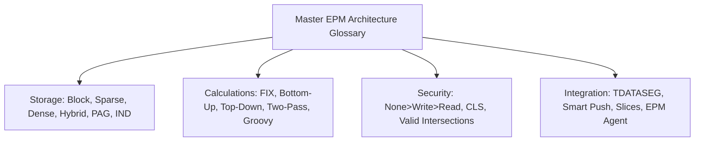

# 18.5 Master Terminology Glossary: 200+ Architectural & Functional Concepts

## Table of Contents
1. [Core Consultant Mental Model](#1-core-consultant-mental-model)
2. [A-Z Architectural Terminology Matrix](#2-a-z-architectural-terminology-matrix)
3. [Tough & Twisted Review Questions with Consultant Model Answers](#3-tough--twisted-review-questions-with-consultant-model-answers)

---

<!-- ===================================================================== -->
<!-- 🎯 LIVE INTERACTIVE VISUAL CARD: MASTER GLOSSARY MATRIX -->
<!-- ===================================================================== -->

<b>🎯 Live Interactive Architecture Card: EPM Terminology & Conceptual Index (Click to Collapse / Expand)</b>

 

> [!TIP]
> **Consultant High-Yield Summary:** Precision in vocabulary separates freshers from experienced consultants. Always use exact technical terms (*"Physical Block"*, *"Dense Cartesian Array"*, *"Dynamic Vector Aggregation"*, *"Least-Privilege Precedence"*) when communicating with clients and review panels.

| Domain | Key Technical Terms | Primary Mechanical Significance |
| :--- | :--- | :--- |
| **Essbase Storage** | Block, Cell, Sparse, Dense, Page Cache, Index Cache, Implied Share | Governs memory allocation, disk I/O, and retrieval speed |
| **Calculations** | FIX, Bottom-Up, Top-Down, Two-Pass, `@CALCPARALLEL`, Groovy Micro-FIX | Governs mathematical execution order and thread allocation |
| **Security & Governance** | OCI IAM, Precedence (`None>Write>Read`), CLS, Valid Intersections | Governs authorization, segregation of duties, and cell locks |
| **Data Movement** | TDATASEG, Mapping Precedence, EPM Integration Agent, Smart Push, ASO Slices | Governs enterprise ETL and cross-cube synchronization |

---

## 1. Core Consultant Mental Model

When speaking with client stakeholders, avoid vague terminology. Using precise architectural definitions demonstrates expertise and instills confidence in design decisions.

---

## 2. A-Z Architectural Terminology Matrix

### A
* **Account:** Dense dimension representing what is measured (Revenue, Expense, Assets, Headcount). Drives Time Balance and Variance Reporting.
* **Account Type:** Property of Account members: `Expense`, `Revenue`, `Asset`, `Liability`, `Equity`, `Saved Assumption`.
* **Aggregate Storage (ASO):** Columnar coordinate storage option optimized for high-concurrency read queries and sub-second multi-dimensional aggregation.
* **Approval Unit:** Unique multidimensional combination of Scenario, Version, and Entity that moves through a promotional state machine (First Pass -> Under Review -> Approved).
* **Attribute Dimension:** Dimension classifying base sparse members without allocating physical data blocks; evaluated dynamically at query time.

### B
* **Block (Data Block):** The physical unit of storage in BSO Essbase. An array containing all combinations of Dense dimension members for a single Sparse coordinate.
* **Block Explosion:** Catastrophic creation of mostly empty physical blocks caused by unconstrained Top-Down allocation formulas.
* **Block Storage (BSO):** Classic Essbase storage engine storing multidimensional arrays on disk in `.pag` files. Supports procedural calculation scripts and in-place write-backs.
* **Bottom-Up Calculation:** Calculation mode evaluating only on existing physical data blocks on disk; skips non-existent intersections.

### C
* **Calculation Manager:** Web-based designer for creating, validating, and deploying business rules, formulas, and rule sets.
* **Cell-Level Security (CLS):** Restrictive security layer that overrides dimensional permissions to make specific multidimensional slices Read-Only or No-Access.
* **ClearBlock Empty:** Essbase calculation command that scans the database and truncates blocks where every single dense cell is `#Missing`.

### D
* **Data Integration:** Unified EPM ETL tool (evolution of Data Management / FDMEE) that ingests, maps, validates, and loads external GL data into EPM cubes.
* **Data Maps:** Declarative metadata mapping engine that defines bulk data synchronization between cubes.
* **Dense Dimension:** A dimension whose members are stored together inside the physical multidimensional data block array.
* **Dynamic Calc:** Storage property where the cell consumes zero physical disk space and evaluates in memory at query time.
* **Dynamic Time Series (DTS):** Pre-built Period dimension aggregation engine supporting `Y-T-D`, `Q-T-D`, and `M-T-D` without outline expansion.

### E
* **EPM Automate:** Command-line interface (CLI) that translates administrative commands into HTTPS REST API calls over port 443.
* **EPM Integration Agent:** Lightweight on-premises Java service enabling secure hybrid SQL extraction behind corporate firewalls via outbound port 443.
* **Essbase:** High-speed multidimensional analytical engine powering Oracle Cloud EPM calculations and storage.

### G
* **Grid Spread:** Feature allocating parent-level cell inputs down to Level 0 child periods proportionally or evenly.
* **Groovy Rules:** Java-based event-driven business rules executing in the WebLogic JVM; enables pre-save validation and targeted Micro-FIX calculations.

### H
* **Hourglass Model:** Best-practice dimension ordering: Dense dimensions largest-to-smallest, then Sparse dimensions smallest-to-largest.
* **Hybrid BSO:** Dual-kernel engine combining BSO block storage at Level 0 with ASO dynamic vector engine at upper rollup levels.

### I
* **Implied Share:** Automatic memory pointer sharing occurring when a parent has only one child or only one consolidating child.
* **Index File (`.ind`):** Essbase B-tree index file mapping sparse member coordinates to physical byte offsets in `.pag` data files.

### L
* **Lifecycle Management (LCM):** Framework for capturing, exporting, and importing application artifacts (metadata, rules, security) in encrypted zip snapshots.

### M
* **Micro-FIX:** Groovy calculation technique that inspects `operation.grid.dataCellIterator({it.edited})` to scope calculations strictly to modified blocks.

### N
* **Never Share:** Member property disabling automated Implied Share pointers; forces independent physical cell allocation.

### P
* **Page Cache:** RAM buffer holding uncompressed physical data blocks between memory and `.pag` disk files.
* **Page File (`.pag`):** Primary physical data file storing dense array blocks on disk.

### R
* **Refresh Database:** Operation compiling relational repository metadata (`HSP_*` tables) into the Essbase outline (`.otl`).
* **Redwood UI:** Oracle's modern, responsive HTML5 user interface standard across EPM Cloud.

### S
* **Smart Push:** Real-time form save integration that executes Data Maps on the active form context to push data from BSO to ASO.
* **Smart View:** Native Microsoft Office add-in connecting Excel, Word, and PowerPoint to Oracle Cloud EPM over HTTPS.
* **Sparse Dimension:** Dimension whose combinations dictate how many physical data blocks exist on disk.
* **Substitution Variable:** Global variable (e.g., `&CurYear`) dynamically referenced in calc scripts, forms, and reports.

### T
* **TDATASEG:** Relational staging table in Data Integration where source transactions are held, mapped, and validated before cube export.
* **Two-Pass Calculation:** Property forcing Essbase to recalculate ratios and percentages at parent summary intersections in a second calculation pass.

### V
* **Valid Intersections:** Structural business rules filtering valid dimensional combinations in forms and member selectors without modifying security grants.

---

## 3. Tough & Twisted Review Questions with Consultant Model Answers

### Question 1: "What is the precise technical distinction between an 'Artifact' and a 'Dimension Member' in Oracle Cloud EPM?"
**Consultant Model Answer:**
> "* **Artifact:** An application object created, managed, and secured within the Planning framework (e.g., Data Forms, Dashboards, Business Rules, Task Lists, Navigation Flows, Data Maps). Artifacts reside in the relational repository and have permissions managed via Access Control.
> * **Dimension Member:** A structural coordinate node within an Essbase outline tree (e.g., Account `5110`, Entity `US_Corp`). Dimension members define the multidimensional coordinate hypercube and store or aggregate numeric financial data."

### Question 2: "Explain the difference between 'Dynamic Calc' and 'Dynamic Calc and Store'."
**Consultant Model Answer:**
> "* **Dynamic Calc:** The value is computed dynamically in RAM at query retrieval time and is **never written to disk**. It consumes zero disk storage and updates instantaneously when underlying data changes.
> * **Dynamic Calc and Store (Deprecated):** The value is computed dynamically the first time it is queried, then physically written to disk as a stored block. Subsequent queries read the stored block. In modern Hybrid BSO applications, this property is obsolete because the ASO dynamic vector engine calculates values in sub-seconds without disk block writes."

---
*Return to [Knowledge Base Master Index](../README.md).*
