# Oracle EPM Cloud Technical Knowledge Base: Enterprise Architecture & Review Mastery

> **Target Audience:** Oracle Cloud EPM Technical Consultants, implementation engineers, and freshers preparing for **Conversion Reviews to Full-Time Employee (FTE)**, senior architect panels, and client technical defense sessions.
>
> **Core Focus:** 100% technical, scenario-driven, and deep. Academic history has been stripped and replaced with **physical storage engine mechanics**, **mathematical collision walkthroughs**, **real-world production crises**, and **bulletproof Consultant Model Answers**.

---

## 🗺️ Master Curriculum & Navigational Flowchart

```mermaid
flowchart TD
    KB["Oracle EPM Technical Knowledge Base"]
    
    KB --> M0["00. Foundation & Architecture"]
    KB --> M1["01. Security, Access & Valid Intersections"]
    KB --> M2["02. Finance Concepts & UI Navigation"]
    KB --> M3["03. Groovy Scripting & Approvals"]
    KB --> M4["04. REST API & System Administration"]
    KB --> M5["05. Calculation Manager & Business Rules"]
    KB --> M6["06. Data Integration & Smart Push"]
    KB --> M7["07. Essbase Architecture & Storage Engines"]
    KB --> M8["08. Dimensions & Metadata Engineering"]
    KB --> M9["09. EPBCS Pre-Built Modules"]
    KB --> M10["10. Smart View & Ad-Hoc Analytics"]
    KB --> M11["11. Smart Lists & Dropdowns"]
    KB --> M12["12. EPM Automate CLI & Batch"]
    KB --> M13["13. Action Menus & Context Navigation"]
    KB --> M14["14. Application Lifecycle & Migration"]
    KB --> M15["15. Professional Review Cracking (FTE Track)"]
    KB --> M16["16. Performance Tuning & Stack Optimization"]
    KB --> M17["17. Hands-On Implementation Labs"]
    KB --> M18["18. Master Cheatsheets, Errors & Glossary"]
```

---

## 🎯 Live Interactive Architecture Cards (HTML Dashboards)

Every module is connected to a dedicated **Live Interactive Architecture Card** with clickable simulators, calculators, and diagnostic engines:

| Card # | Interactive Dashboard Title | Interactive Simulators & Features Included | Direct Link |
| :---: | :--- | :--- | :---: |
| **01** | **EPM Platform Ecosystem** | Interactive business process explorer: Planning, FCCS, ARCS, EDMCS | [Open Card 01](interactive_cards/card_kb_01_ecosystem_architecture.html) |
| **02** | **Security & Valid Intersections** | **Multi-Group Collision Simulator** (`None > Write > Read`) & CLS | [Open Card 02](interactive_cards/card_kb_02_security_intersections.html) |
| **03** | **Groovy Rule Builder** | **Live Performance Benchmark** (99% speedup) & Pre-Save Veto simulator | [Open Card 03](interactive_cards/card_kb_03_groovy_rule_builder.html) |
| **04** | **Calc Manager & Rules** | FIX Statement Scope Evaluator (Sparse blocks vs Dense cells) | [Open Card 04](interactive_cards/card_kb_04_calc_business_rules.html) |
| **05** | **Data Integration & Smart Push** | TDATASEG 4-stage pipeline status & Smart Push on save simulator | [Open Card 05](interactive_cards/card_kb_05_data_integration_maps.html) |
| **06** | **Essbase Deep Dive** | **Live Block Size Calculator** ($D_1 \times D_2 \times \dots \times 8$) & Implied Share simulator | [Open Card 06](interactive_cards/card_kb_06_essbase_deep_dive.html) |
| **07** | **EPM Automate Terminal** | Interactive CLI command runner (Login, Upload, Rule, Refresh, Merge) | [Open Card 07](interactive_cards/card_kb_07_epm_automate_terminal.html) |
| **08** | **Lifecycle & Migration** | Dev-Test-Prod selective migration & disaster recovery simulator | [Open Card 08](interactive_cards/card_kb_08_lifecycle_migration.html) |

---

## 📚 Complete Modular Architecture Matrix

| Module | Directory | Core Technical Topics Covered | Primary Documents |
| :---: | :--- | :--- | :--- |
| **00** | [00_Foundation](00_Foundation/00_INDEX.md) | OLAP vs Relational ERP, 4-Tier Cloud Stack, OCI Gen 2, FTE Review Roadmap | [01_What_Is_EPM](00_Foundation/01_What_Is_EPM.md), [02_Architecture](00_Foundation/02_EPM_Architecture.md), [03_Evolution](00_Foundation/03_EPM_History.md) |
| **01** | [01_Security_and_Access](01_Security_and_Access/00_INDEX.md) | 4-Layer Security, Multi-Group Precedence (`None>Write>Read`), Valid Intersections | [01_Access_Control](01_Security_and_Access/01_Access_Control_and_Roles.md), [02_Valid_Intersections](01_Security_and_Access/02_Valid_Intersections.md) |
| **02A** | [02_Finance_Concepts](02_Finance_Concepts/00_INDEX.md) | Income Statement, Balance Sheet, Cash Flow, Time Balance (`Flow` vs `Balance`), Variance | [01_Financial_Concepts](02_Finance_Concepts/01_Financial_Concepts.md) |
| **02B** | [02_User_Interface_and_Navigation](02_User_Interface_and_Navigation/00_INDEX.md) | Redwood Navigation Flows (Cluster > Card > Tab), Grid Spread Physics, On-Save Pipeline | [01_Forms_and_Navigation](02_User_Interface_and_Navigation/01_Forms_and_Navigation.md) |
| **03A** | [03_Groovy_Scripting](03_Groovy_Scripting/00_INDEX.md) | Event-Driven Groovy, Micro-FIX Scoping, Pre-Save Veto, `DataGridBuilder` | [01_Groovy_Overview](03_Groovy_Scripting/01_Groovy_Overview.md), [02_Groovy_Patterns](03_Groovy_Scripting/02_Groovy_Patterns.md) |
| **03B** | [03_Workflow_and_Task_Management](03_Workflow_and_Task_Management/00_INDEX.md) | Approval Unit Hierarchy (AUH), Promotional State Machine, Security Locking, Task Manager | [01_Workflow_and_Approvals](03_Workflow_and_Task_Management/01_Workflow_and_Approvals.md) |
| **04A** | [04_REST_API](04_REST_API/00_INDEX.md) | OAuth 2.0 / Bearer Tokens, Asynchronous Polling (`jobStatus: -1` -> `0`), Chunked Uploads | [01_REST_API_Guide](04_REST_API/01_REST_API_Guide.md) |
| **04B** | [04_System_Administration](04_System_Administration/00_INDEX.md) | Refresh Database Compilation, Index vs Dense Restructure, Cube Clear Operations, SOX Audit | [01_Administration_Guide](04_System_Administration/01_Administration_Guide.md) |
| **05** | [05_Calc_Manager_and_Business_Rules](05_Calc_Manager_and_Business_Rules/00_INDEX.md) | Rule Lifecycle (Validate > Save > Deploy), Sparse FIX Scopes, Bottom-Up vs Top-Down | [01_Overview](05_Calc_Manager_and_Business_Rules/01_Calc_Manager_Overview.md), [02_Design](05_Calc_Manager_and_Business_Rules/02_Business_Rules_Design.md), [03_Functions](05_Calc_Manager_and_Business_Rules/03_Calculation_Functions_Reference.md) |
| **06** | [06_Data_Integration_and_Exchange](06_Data_Integration_and_Exchange/00_INDEX.md) | 4-Stage ETL Pipeline, TDATASEG, Mapping Precedence, EPM Integration Agent, Smart Push | [01_Integration](06_Data_Integration_and_Exchange/01_Data_Integration_Overview.md), [02_Smart_Push](06_Data_Integration_and_Exchange/02_Data_Maps_and_Smart_Push.md) |
| **07** | [07_Essbase_Architecture](07_Essbase_Architecture/00_INDEX.md) | BSO vs ASO vs Modern Hybrid BSO, Block Math (8-100 KB), Memory Caches, Implied Shares | [01_Overview](07_Essbase_Architecture/01_Essbase_Overview.md), [02_Storage_Performance](07_Essbase_Architecture/02_Essbase_Storage_and_Performance.md) |
| **08** | [08_Dimensions_and_Metadata](08_Dimensions_and_Metadata/00_INDEX.md) | Hourglass Model, Universal Storage Properties, Two-Pass Calculation, Attributes, `HSP_*` | [01_Fundamentals](08_Dimensions_and_Metadata/01_Dimension_Fundamentals.md), [02_Properties](08_Dimensions_and_Metadata/02_Universal_Member_Properties.md), [03_Account](08_Dimensions_and_Metadata/03_Account_Dimension.md), [04_Period](08_Dimensions_and_Metadata/04_Period_Scenario_Version.md), [05_Advanced](08_Dimensions_and_Metadata/05_Advanced_Topics.md) |
| **09** | [09_EPBCS_Modules](09_EPBCS_Modules/00_INDEX.md) | Financials (`OEP_FS`), Workforce (`OEP_WFP`), Capital (`OEP_CPX`), Projects (`OEP_PJT`), FreeForm | [01_EPBCS_Overview](09_EPBCS_Modules/01_EPBCS_Overview.md) |
| **10** | [10_Smart_View](10_Smart_View/00_INDEX.md) | Shared vs Private Providers, Ad-Hoc Operations, Formula Preservation, Submit Debugging | [01_Smart_View_Guide](10_Smart_View/01_Smart_View_Complete_Guide.md) |
| **11** | [11_Smart_Lists](11_Smart_Lists/00_INDEX.md) | Dropdown Modeling without Dimensions, Integer ID Storage, Calc Manager Syntax | [01_Smart_Lists_Guide](11_Smart_Lists/01_Smart_Lists_Complete_Guide.md) |
| **12** | [12_EPM_Automate](12_EPM_Automate/00_INDEX.md) | CLI Wrapper for REST, Password Encryption (`.epw`), Command Matrix, Production Batch Pipeline | [01_EPM_Automate_Guide](12_EPM_Automate/01_EPM_Automate_Complete_Guide.md) |
| **13** | [13_Action_Menus](13_Action_Menus/00_INDEX.md) | Right-Click Coordinate Interception, Runtime Prompt (RTP) Binding, Form Redirection | [01_Action_Menus_Guide](13_Action_Menus/01_Action_Menus_Guide.md) |
| **14** | [14_Application_Lifecycle](14_Application_Lifecycle/00_INDEX.md) | Dev-Test-Prod Pipeline, LCM Snapshots, `cloneenvironment`, Disaster Recovery (RPO/RTO) | [01_Lifecycle_Guide](14_Application_Lifecycle/01_Lifecycle_Guide.md) |
| **15** | [15_Professional_Development](15_Professional_Development/00_INDEX.md) | 5 Technical Review Pillars, 25 Twisted Review Scenarios, First-Principles Reasoning | [01_Interview_Guide](15_Professional_Development/01_Interview_Guide.md) |
| **16** | [16_Performance_Tuning](16_Performance_Tuning/00_INDEX.md) | 4-Layer Performance Stack (Storage, Calculations, Forms, Maintenance), `CLEARBLOCK EMPTY` | [01_Performance_Guide](16_Performance_Tuning/01_Performance_Guide.md) |
| **17** | [17_Labs_and_Case_Studies](17_Labs_and_Case_Studies/00_INDEX.md) | 5 Production Implementation Labs: Sizing, Groovy Veto, Integration, Smart Push, Security | [01_Labs_Collection](17_Labs_and_Case_Studies/01_Labs_Collection.md) |
| **18** | [18_Reference](18_Reference/00_INDEX.md) | Master Cheatsheet, Top 10 Error Diagnostic Triage, Formula Patterns, 1Z0-1080 Blueprint, Glossary | [01_CheatSheets](18_Reference/01_CheatSheets.md), [03_Error_Encyclopedia](18_Reference/03_Error_Encyclopedia.md), [04_Formula_Patterns](18_Reference/04_Member_Formula_Patterns.md), [05_Cert_Guide](18_Reference/05_Certification_Guide.md), [06_Glossary](18_Reference/06_Glossary.md) |

---

## 🔗 Quick Links to Master Reference Tools
* **[Master Cheatsheet: Golden Laws & Formulas](18_Reference/01_CheatSheets.md)**
* **[Production Error Diagnostic Encyclopedia](18_Reference/03_Error_Encyclopedia.md)**
* **[25 Twisted Review Questions & Answers](15_Professional_Development/01_Interview_Guide.md)**
* **[200+ Term Master Architectural Glossary](18_Reference/06_Glossary.md)**
