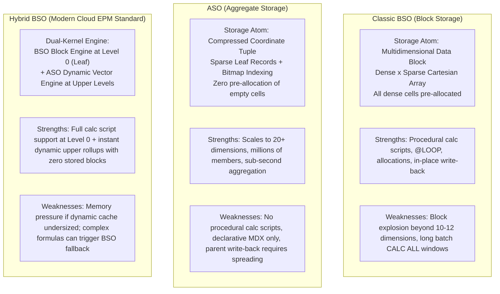

# 1.1 Storage Engines Comparative Deep Dive: BSO vs. ASO vs. Hybrid BSO

## Table of Contents
1. [Core Consultant Mental Model](#1-core-consultant-mental-model)
2. [Architectural Anatomy: Block Array vs. Sparse Tuples](#2-architectural-anatomy-block-array-vs-sparse-tuples)
3. [The Three Engines: Head-to-Head Technical Comparison](#3-the-three-engines-head-to-head-technical-comparison)
4. [Decision Tree: When to Recommend Which Engine](#4-decision-tree-when-to-recommend-which-engine)
5. [Tough & Twisted Review Questions with Consultant Model Answers](#5-tough--twisted-review-questions-with-consultant-model-answers)

---

<!-- ===================================================================== -->
<!-- 📊 LIVE INTERACTIVE VISUAL CARD: BSO vs ASO vs HYBRID BSO MATRIX -->
<!-- ===================================================================== -->
<details open>
<summary><b>📊 Live Interactive Architecture Card: Storage Engines Head-to-Head (Click to Collapse / Expand)</b></summary>

<br/>

> [!TIP]
> **Interactive Standalone Dashboard:** Open [`card_01_storage_engines.html`](../interactive_cards/card_01_storage_engines.html) in your browser for a live interactive 3-way toggle matrix!

| Architectural Dimension | Classic BSO | Aggregate Storage (ASO) | Hybrid BSO (Modern Cloud EPM) |
| :--- | :--- | :--- | :--- |
| **Storage Atom** | Multidimensional Data Block (`.pag`) | Compressed Columnar Tuple (`.dat`) | Level 0 BSO Block + ASO Dynamic Vectors |
| **Density Model** | Dense × Sparse Matrix | No dense/sparse concept (pure sparsity) | Level 0 Dense/Sparse; Dynamic Upper Levels |
| **Calculation Engine** | Procedural Calc Scripts (`@` functions) | Declarative MDX formulas ONLY | Procedural at Level 0; Vector engine for rollups |
| **Upper Rollup Parents** | Stored (`+`) physical disk blocks | Stored or Dynamic hierarchies | **Dynamic Calc (`~`)** (Zero disk blocks!) |
| **Concurrency & Locks** | Exclusive Block Locks (Lock timeouts) | Append-only non-blocking slices | Level 0 block locks; dynamic parents non-blocking |

</details>

---

## 1. Core Consultant Mental Model

As an Oracle Cloud EPM Technical Consultant, you must never give generic answers like *"BSO is for planning and ASO is for reporting."* Reviewers and senior architects will immediately drill into **why**:



---

## 2. Architectural Anatomy: Block Array vs. Sparse Tuples

### 2.1 BSO: The Dense Multidimensional Block
- **How it works**: BSO divides dimensions into **Dense** and **Sparse**.
- For every instantiated combination of sparse members, Essbase allocates an entire contiguous in-memory array containing every combination of dense members.
- **Physical Cell Address**:
  $$\text{Memory Address} = \text{BaseBlockAddress} + (\text{DenseOffset} \times 8 \text{ bytes})$$
- **The Implication**: If you have 3 dense dimensions with $400 \times 16 \times 4 = 25,600$ cells, entering **one single number** causes Essbase to allocate a full 200 KB block on disk ($25,600 \times 8 \text{ bytes}$).

### 2.2 ASO: The Compressed Tuple & Slice Model
- **How it works**: ASO does not use blocks. It stores data as discrete **tuples of Member IDs + Value**:
  $$\tau = \langle m_{\text{Account}}, m_{\text{Period}}, m_{\text{Entity}}, \ldots, m_{\text{Customer}}, \text{Value} \rangle$$
- **The Implication**: Empty cells are never stored. If a customer buys 1 SKU in 1 month, ASO writes **one 48-byte tuple**, not a 200 KB block.
- **Aggregation**: Upper levels are calculated dynamically using bitmap indexing or pre-computed materialized aggregation views.

### 2.3 Hybrid BSO: The Modern Synthesis
- In Oracle Cloud EPM Planning, **Hybrid BSO is the default architecture**.
- **Level 0 (Leaf Data)**: Stored as classic BSO data blocks. Supports full calculation scripts, allocations, and data forms.
- **Upper Levels (Parents)**: **Never stored on disk!** When an executive queries `Total_Entity -> Q1`, the query coordinator routes the rollup to the internal ASO vector engine, summing leaf blocks on-the-fly in RAM in milliseconds.

---

## 3. The Three Engines: Head-to-Head Technical Comparison

| Technical Evaluation Dimension | Classic BSO | Aggregate Storage Option (ASO) | Hybrid BSO (Cloud Default) |
| :--- | :--- | :--- | :--- |
| **Physical Storage Atom** | Dense Data Block | Compressed Coordinate Tuple | Dense Data Block (Level 0 only) |
| **Max Practical Dimensions** | 10 – 12 dimensions | 20+ dimensions (no practical limit)| 12 – 15 dimensions |
| **Sparse Member Cardinality** | Low to Medium (< 10,000) | Massive (100,000+ members) | Medium to High (10,000–50,000) |
| **Procedural Calculations (`FIX`, `LOOP`)**| **Full Support** | **NO SUPPORT** (Declarative MDX only) | **Full Support** at Level 0 |
| **Upper-Level Storage** | Stored on disk via `CALC ALL` | Pre-materialized views or dynamic | **Dynamic in RAM** (Zero stored parent blocks)|
| **Write-Back Concurrency** | Pessimistic Block Locks | Lock-Free Append-Only Slices (MVCC)| Block Locks at Level 0 |
| **Database Size on Disk** | Large (stored parents expand size) | Compact (compressed tuples) | **80%–90% smaller than classic BSO** |
| **Parent-Level Data Entry** | Direct storage at parent | Planning spreading down to L0 | Planning spreading down to L0 |

---

## 4. Decision Tree: When to Recommend Which Engine

```
                                [ Client Business Requirement ]
                                               |
                     +-------------------------+-------------------------+
                     |                                                   |
       [ Heavy Modeling & Allocations ]                         [ High-Volume Reporting ]
       - Driver-based budgeting                                 - 15+ Dimensions
       - Employee-level workforce planning                      - 100,000+ Customers / SKUs
       - Currency translation & eliminations                    - Read-heavy executive ad-hoc
       - Business rules with @PRIOR, @LOOP                      - Pure additive rollups
                     |                                                   |
             [ Hybrid BSO Cube ]                                  [ Pure ASO Cube ]
                     |                                                   |
       - Set Account & Period as Dense                         - Build Materialized Views via Query Tracking
       - Level 0 stored; Parents dynamic                       - Ingest data via incremental slices
       - Calc scripts calculate leaf data                      - MDX calculated members for ratios
                     |                                                   |
                     +-------------------------+-------------------------+
                                               |
                               [ Enterprise Integration ]
                               - Smart Push on Form Save
                               - Automated Data Maps
```

---

## 5. Tough & Twisted Review Questions with Consultant Model Answers

### Question 1 (The Impossible Single-Cube Trap):
> *"A retail client wants a single cube that does employee-level compensation modeling with iterative tax tier calculations (`@LOOP`), but also tracks sales across 15 dimensions including 100,000 retail customers. Can you build this in a single Hybrid BSO cube?"*

**Consultant Answer**:
> **"No, and recommending a single cube here is a critical architectural failure.** 
> While Hybrid BSO supports `@LOOP` calculations, placing 100,000 customers across 15 dimensions will cause severe combinatorial sparse block bloat, leading to slow index traversals and long form save times. 
> The correct enterprise architecture is a **Multi-Cube Architecture**:
> 1. Build a **Hybrid BSO Workforce/Financials Cube** containing core planning dimensions (Account, Period, Entity, Department, Employee) to run the iterative compensation rules.
> 2. Build an **ASO Reporting Cube** containing all 15 dimensions, including the 100,000 customers.
> 3. Use **Smart Push / Data Maps** to automatically push aggregated compensation and expense totals from the Hybrid cube to the ASO reporting cube upon form save."

---

### Question 2 (The Disappearing Parent Storage Trick):
> *"In a classic BSO cube, our database was 80 GB. When we converted it to Hybrid BSO in Cloud EPM, the database size dropped to 9 GB, and our batch aggregation rule (`CALC ALL`) finished in 2 seconds. The client thinks data was lost. How do you explain this to the client?"*

**Consultant Answer**:
> **"Zero data was lost; this is the intended architectural behavior of Hybrid BSO.**
> In classic BSO, running `CALC ALL` physically calculated and wrote millions of upper-level parent data blocks to disk (parent entities, quarters, total products), which accounted for ~85% of the 80 GB footprint.
> In Hybrid BSO, **upper-level parent blocks are never stored on disk**. The 9 GB represents 100% of the true Level 0 input data. When users query parent members in Smart View, the embedded ASO vector engine aggregates the numbers dynamically in RAM in milliseconds. The batch calculation took 2 seconds because upper-level aggregations no longer execute in batch scripts."

---

### Question 3 (The Concurrency Bottleneck Trap):
> *"We have 500 store managers submitting daily sales in Smart View at 5:00 PM. On Hybrid BSO, managers are getting lock timeout errors. If we switch to ASO, why will the lock timeouts vanish?"*

**Consultant Answer**:
> "Because **BSO and ASO use fundamentally different concurrency control models**:
> - **BSO/Hybrid BSO uses pessimistic block-level locking**. When a manager submits data, Essbase locks the entire data block containing all dense cells. If multiple managers submit to overlapping blocks, their sessions are serialized into wait queues. If a transaction holds the lock longer than `LOCKTIMEOUT`, subsequent users receive timeout errors.
> - **ASO uses a lock-free, append-only slice architecture under Multi-Version Concurrency Control (MVCC)**. Each submission streams tuples into an isolated in-memory load buffer and appends a small, immutable incremental slice file (`.dat`) with an atomic pointer update. Writers never lock blocks, and readers never block writers. Lock contention is reduced to zero."

---

*Next: [1.2 Why ASO is Faster & Where It Fails](./1.2_Why_ASO_Is_Faster_And_Where_It_Fails.md)*

