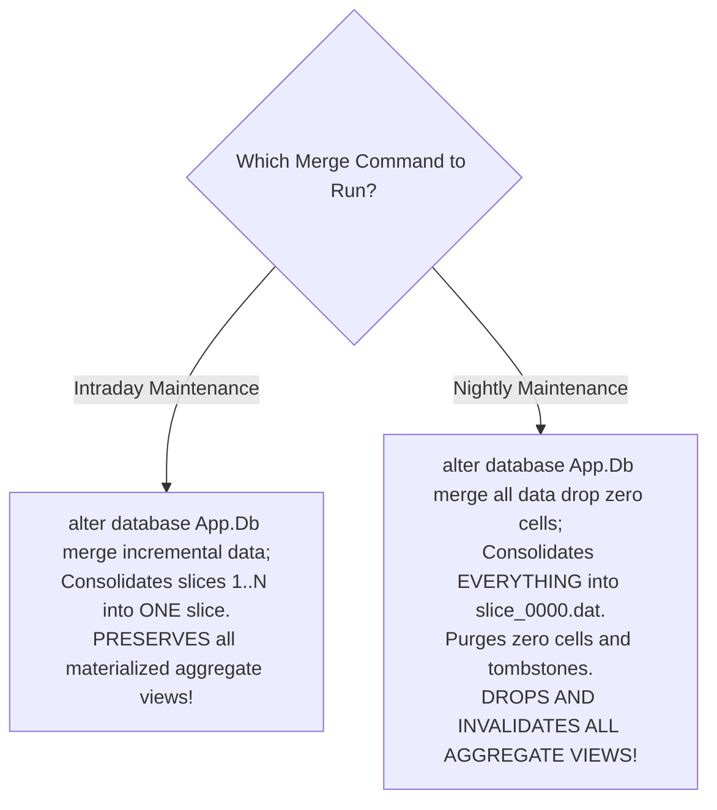

# 1.2 Why ASO is Faster & Where It Fails: Slices, Bitmap Indexing, and Procedural Limitations

## Table of Contents
1. [Why ASO Outperforms BSO in Retrievals](#1-why-aso-outperforms-bso-in-retrievals)
2. [The Three Pillars of ASO Query Velocity](#2-the-three-pillars-of-aso-query-velocity)
3. [Where ASO Fails: The Procedural Calculation Wall](#3-where-aso-fails-the-procedural-calculation-wall)
4. [The Multi-Slice Architecture & Concurrency Dynamics](#4-the-multi-slice-architecture--concurrency-dynamics)
5. [The Slice Fragmentation Pathology & Compaction Protocols](#5-the-slice-fragmentation-pathology--compaction-protocols)
6. [Tough & Twisted Review Questions with Consultant Model Answers](#6-tough--twisted-review-questions-with-consultant-model-answers)

---

## 1. Why ASO Outperforms BSO in Retrievals

In technical interviews, panels will ask: *"Why is ASO so much faster than BSO for ad-hoc retrievals on large dimensions?"*

To answer as a senior consultant, you must explain the physical I/O difference:
- In **BSO**, retrieving an upper-level intersection across 10 sparse dimensions requires navigating a B-Tree index, loading hundreds of 64 KB compressed data blocks from disk into the Data Cache, decompressing each block, reading the dense cell arrays, and summing them up.
- In **ASO**, data is stored as **compressed leaf tuples indexed by bitmaps**. There are no data blocks to decompress. The engine uses high-speed bitwise operations and pre-calculated **materialized aggregation views** to answer queries in $\mathcal{O}(1)$ or memory-bus speeds.

```mermaid
flowchart TD
    subgraph BSO_Query ["BSO Query Path (Heavy I/O)"]
        B_Req[Query Parent Coordinate] --> B_Index[Scan B-Tree Index]
        B_Index --> B_Disk[Fetch 500 Compressed Blocks from .pag]
        B_Disk --> B_Cache[Decompress Blocks in Data Cache]
        B_Cache --> B_Math[Iterate over Dense Cell Arrays]
        B_Math --> B_Out[Return Value: 4.5 seconds]
    end

    subgraph ASO_Query ["ASO Query Path (Vectorized Bitmaps)"]
        A_Req[Query Parent Coordinate] --> A_View{Matches Materialized Aggregate View?}
        A_View -->|Yes| A_Direct[Direct Binary Read: O(1) Speed]
        A_View -->|No| A_Bitmap[Bitmap Index Bitwise AND/OR on Leaf Tuples]
        A_Direct --> A_Out[Return Value: 0.12 seconds]
        A_Bitmap --> A_Out
    end
```

---

## 2. The Three Pillars of ASO Query Velocity

### Pillar 1: Compressed Coordinate Tuples (Zero Block Bloat)
ASO only stores coordinates where data physically exists:
$$\tau = \langle m_1, m_2, \ldots, m_D, v \rangle$$
In a model with 99.999% sparsity, BSO creates empty block shells and dense zeros. ASO allocates zero bytes for empty space, keeping active data small enough to reside in RAM.

### Pillar 2: Bitmap Indexing & Bitwise Aggregation
ASO maps member occurrences to bit vectors. Finding sales for `(Store_US, Q1, Product_A)` is executed via single-cycle CPU bitwise `AND` instructions across bit arrays, pruning billions of unpopulated intersections instantly.

### Pillar 3: Materialized Aggregation Views
Administrators pre-compute selected upper-level summaries using Query Tracking (`query_data`). When an ad-hoc query matches an aggregate view level, ASO does not calculate anything; it reads the pre-aggregated number directly from binary storage.

---

## 3. Where ASO Fails: The Procedural Calculation Wall

Reviewers will test whether you know **when NOT to use ASO**:

| Feature / Business Requirement | ASO Capability | Why It Fails in ASO |
| :--- | :---: | :--- |
| **Procedural Scripts (`FIX`, `LOOP`)** | ❌ **UNSUPPORTED** | ASO has no procedural scripting engine; cannot execute multi-pass procedural logic. |
| **Time-Series Shifts (`@PRIOR`, `@LAG`)**| ⚠️ **Limited MDX** | Can do basic MDX `ParallelPeriod()`, but cannot write results back to stored cells. |
| **Intercompany Eliminations** | ❌ **UNSUPPORTED** | Cannot match buyer/seller cells procedurally and book dynamic plug entries. |
| **Allocations with Offset Accounts** | ⚠️ **Complex MDX** | Requires exporting data out or using complex MDX insert pipelines; lacks native `DATACOPY`. |
| **Parent-Level Data Entry** | ⚠️ **Planning Layer**| ASO cannot physically store data at parent members; requires form spreading down to Level 0. |

> [!WARNING]
> **The Golden Rule**: If the business requirement demands complex financial close logic, depreciation schedules, or multi-step driver allocations, **do NOT use ASO as the primary input cube**. Use Hybrid BSO.

---

## 4. The Multi-Slice Architecture & Concurrency Dynamics

When data is loaded or submitted to an ASO cube, it is **never written in-place** into historical data files. ASO uses an **append-only slice model**:

```
ASO Database Instance
├── Main Slice (slice_0000.dat)       <-- Consolidated baseline data + Aggregate Views
├── Incremental Slice 1 (.dat)        <-- Created by Data Load 1
├── Incremental Slice 2 (.dat)        <-- Created by Smart View Submit 2
└── Incremental Slice 3 (.dat)        <-- Created by REST API Feed 3
```

- **Writers**: Stream tuples into an in-memory load buffer, flush to a new `.dat` slice file, and update the catalog version pointer atomically.
- **Readers**: Under **Multi-Version Read Consistency (MVCC)**, queries bind to the active catalog descriptor at the instant the query begins. Readers experience consistent point-in-time snapshots with **zero read locks**.

---

## 5. The Slice Fragmentation Pathology & Compaction Protocols

### 5.1 The Fragmentation Problem
Every incremental slice adds an independent search pass during queries:
$$T_{\text{query}} \propto \sum_{i=0}^k \text{Scan}(\mathcal{S}_i) + \text{MergeSort}(N_0 \dots N_k)$$
If automated pipelines or frequent Smart View submissions generate **more than 20–30 incremental slices**, ad-hoc retrievals degrade from 200ms to 25 seconds because the engine spends all its CPU cycles merge-sorting tuples across slices!

### 5.2 The Two Compaction Protocols (Interview Trap!)



| Trait | `merge incremental data` | `merge all data drop zero cells` |
| :--- | :--- | :--- |
| **Target Slices** | Consolidates incremental slices only ($\mathcal{S}_1 \dots \mathcal{S}_k$) | Consolidates Main Slice + all incremental slices |
| **Main Slice Impact** | Main slice ($\mathcal{S}_{\text{main}}$) is untouched | Rewrites `slice_0000.dat` from scratch |
| **Aggregate Views** | **PRESERVED 100%** | **COMPLETELY DROPPED & INVALIDATED** |
| **When to Run** | **Intraday (Every 1–2 hours)** | **Nightly Maintenance (with view rebuild)** |

---

## 6. Tough & Twisted Review Questions with Consultant Model Answers

### Question 1 (The Aggregate Vanishing Mystery):
> *"An administrator ran a slice merge script on an ASO reporting cube on Friday night. On Monday morning, all executive dashboards took 30 seconds to load instead of 1 second. What command did the administrator run, and what critical step did they forget?"*

**Consultant Answer**:
> "The administrator executed **`merge all data`** instead of `merge incremental data`.
> While `merge all data` consolidates slices and purges zero cells, **it completely drops and invalidates all existing materialized aggregate views** on the main slice.
> Because the views were deleted, Monday morning's executive queries had to aggregate millions of Level 0 tuples dynamically on-the-fly.
> **The Fix**: Whenever `merge all data` is run, the script must immediately execute a follow-up command to rebuild aggregates:
> ```maxl
> alter database App.Db initialize aggregates;
> alter database App.Db build secondary aggregates using query_data;
> ```
> For intraday automation, they should have used **`merge incremental data`**, which consolidates delta slices without touching aggregate views."

---

### Question 2 (The Slowing Continuous Ingestion Trap):
> *"A client feeds point-of-sale data into an ASO cube every 15 minutes via REST API. In the morning, queries take 150ms. By 4:00 PM, queries take 18 seconds. No outline changes occurred. What is the root cause, and how do you resolve it?"*

**Consultant Answer**:
> "This is the classic **ASO Slice Fragmentation Pathology**. 
> Loading data every 15 minutes generated $4 \times 8 = 32$ incremental data slices by 4:00 PM. 
> Because incremental slices do not contain pre-computed aggregate views, every query must scan all 32 slice files and execute a 32-way merge-sort in memory.
> **Remediation**:
> Schedule an automated job using EPM Automate to run **`mergeDataSlices -sliceType=INCREMENTAL`** every 1 to 2 hours. This merges the accumulated delta slices into a single compact slice without dropping aggregate views, keeping total active slices under 5 and sustaining sub-second queries all day."

---

### Question 3 (The Procedural Limitation Challenge):
> *"The CFO wants an allocation rule in an ASO cube that takes corporate IT expenses, loops through 12 operating entities, and allocates costs using headcount ratios, booking an offsetting credit to corporate. Can you write an Essbase calculation script to do this in ASO?"*

**Consultant Answer**:
> **"No. ASO does not support procedural Essbase calculation scripts (`FIX`, `LOOP`, `DATACOPY`).** 
> If the cube must remain ASO, this allocation can only be achieved by:
> 1. Writing an **MDX member formula** (which only calculates dynamically on read and cannot store persistent offset entries), OR
> 2. Using **Calculation Manager / Data Integration** to execute an MDX insert statement that exports source data, computes ratios in memory, and pushes the resulting tuples into an ASO load buffer.
> **Architectural Recommendation**: The proper design is to perform the allocation inside a **Hybrid BSO Financials cube** using native calculation rules, and then push the calculated numbers to the ASO cube via **Smart Push**."

---

*Next: [1.3 Hybrid BSO Dual-Kernel Execution Internals](./1.3_Hybrid_BSO_Dual_Kernel_Execution_Internals.md)*

