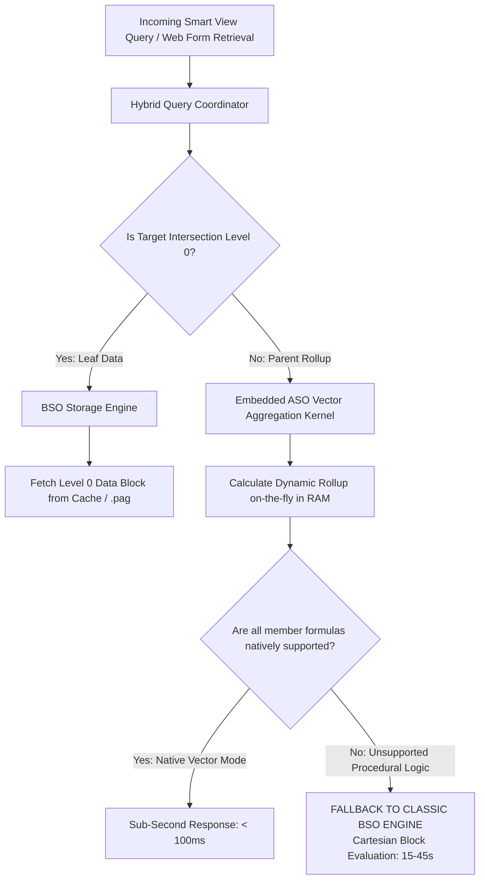

# 1.3 Hybrid BSO Dual-Kernel Execution Internals: Query Coordination, Fallback Triggers, and In-Memory Dynamics

## Table of Contents
1. [The Dual-Kernel Architecture](#1-the-dual-kernel-architecture)
2. [The Query Coordinator & Routing Pipeline](#2-the-query-coordinator--routing-pipeline)
3. [The BSO Fallback Pathology: Why Latency Spikes Occur](#3-the-bso-fallback-pathology-why-latency-spikes-occur)
4. [Calc Scripts in Hybrid: `SET HYBRIDBSOINCALCSCRIPT`](#4-calc-scripts-in-hybrid-set-hybridbsoincalcscript)
5. [Transparent Restructuring in Modern EPM Cloud](#5-transparent-restructuring-in-modern-epm-cloud)
6. [Tough & Twisted Review Questions with Consultant Model Answers](#6-tough--twisted-review-questions-with-consultant-model-answers)

---

## 1. The Dual-Kernel Architecture

In Oracle Cloud EPM Planning, **Hybrid BSO** is not simply "a faster BSO"; it is an integrated **dual-kernel execution engine**:



### The Architectural Split:
1. **The BSO Kernel**:
   - Manages **Level 0 (leaf) data blocks exclusively**.
   - Handles data loading, Smart View submissions, and procedural business rules.
   - Enforces block-level locking for transactions.
2. **The ASO Kernel**:
   - Operates entirely **in server memory (RAM)**.
   - Handles **all upper-level dynamic consolidations and MDX evaluations**.
   - **Never creates or writes parent data blocks to physical `.pag` files on disk**.

---

## 2. The Query Coordinator & Routing Pipeline

When an ad-hoc query requests a multidimensional grid:
1. **Inspection**: The Query Coordinator decomposes the requested coordinates into base leaf dependencies and dynamic parent nodes.
2. **Level 0 Fetch**: The BSO engine fetches the required Level 0 stored blocks into the `DATACACHESIZE`.
3. **In-Memory Vector Rollup**: The ASO kernel reads the leaf array values directly from memory, executes bitwise hierarchical additions across sparse parent trees, and applies active **Solve Orders** to dynamic ratios.
4. **Result Assembly**: The final consolidated grid is streamed to the client without writing a single temporary block to disk.

---

## 3. The BSO Fallback Pathology: Why Latency Spikes Occur

The most common operational issue in Hybrid BSO is when a user complains: *"Most of our parent rollups load in 80ms, but this one specific account takes 40 seconds to retrieve."*

This is the **Hybrid Fallback Pathology**. 

### 3.1 What Causes Fallback?
The ASO dynamic aggregation kernel operates natively on standard mathematical and hierarchical functions (`+`, `-`, simple ratios, basic MDX). If an outline member formula contains **unsupported procedural constructs**, the query coordinator cannot evaluate it in vector mode and **falls back to the classic BSO block engine**:

| Supported in Hybrid Vector Mode (Fast: < 100ms) | Triggers Fallback to Classic BSO (Slow: 15–45s) |
| :--- | :--- |
| Simple ratio arithmetic (`A / B`, `A * B`) | `@MDX` procedural functions embedded in calc formulas |
| `@SUM`, `@COUNT`, `@AVG` over basic sets | Range functions with variable offsets: `@PRIOR(x, -1, Time)` |
| Clean `IF / ELSE` checking dense conditions | Cross-dimensional lookups to non-Level-0 sparse parents |
| Dynamic Calc members with explicit Solve Order | Formulas referencing `@CURRMBRRANGE` across sparse blocks |
| Standard outline unary rollups (`+`, `-`, `~`) | Custom loop iterations or procedural text manipulations |

### 3.2 The Performance Penalty of Fallback
When fallback occurs:
1. The engine abandons in-memory vector math.
2. It initiates a classic BSO **Top-Down Cartesian loop**, scanning the B-Tree index and inspecting potential blocks one-by-one.
3. Query response times degrade from **0.05 seconds to 45 seconds**.

---

## 4. Calc Scripts in Hybrid: `SET HYBRIDBSOINCALCSCRIPT`

In classic BSO, running a business rule that referenced a parent entity (e.g., allocating costs based on total regional revenue) required that `CALC ALL` or `CALC DIM ("Entity")` had previously run to store parent numbers on disk.

In Hybrid BSO, parent blocks do not exist on disk! How does a calc script read parent totals?

### The Configuration Command:
```essbase
SET HYBRIDBSOINCALCSCRIPT FULL;
```

```mermaid
flowchart LR
    Script[Business Rule Execution] --> RefParent[Rule references Parent Member:<br/>"Revenue"->"Total_Entity"]
    
    RefParent --> CheckSetting{SET HYBRIDBSOINCALCSCRIPT?}
    
    CheckSetting -->|FULL| ASO_Engine[ASO Kernel calculates Total_Entity dynamically in RAM<br/>Returns accurate total to script instantly!]
    CheckSetting -->|NONE| BSO_Engine[BSO Kernel searches disk for stored parent block<br/>Block does not exist -> Returns #MISSING or 0.0!]
```

- **`FULL`**: Instructs the calculation engine to utilize the **ASO dynamic aggregation kernel** to compute parent totals on-the-fly in RAM during calc script execution. The script runs accurately without requiring stored parent blocks.
- **`NONE`**: Forces the script to read only stored BSO blocks. Because parent blocks do not exist in Hybrid, the calculation evaluates against `#MISSING` or zero, producing corrupt allocation results.

---

## 5. Transparent Restructuring in Modern EPM Cloud

In classic BSO, outline maintenance was dreaded because of the **Full Database Restructure**:
- Adding a member to a **Dense** dimension altered every block's array structure.
- Essbase had to sequentially read, resize, re-compress, and rewrite every single block on disk, locking the cube for hours.

### The Hybrid Advantage:
1. **85% Fewer Blocks**: Because upper-level parent blocks are never stored, the total block count on disk is drastically smaller (often shrinking from 10,000,000 blocks to 500,000 blocks).
2. **Transparent Structural Updates**: Outline changes that previously required 3-hour offline maintenance windows complete in **under 2 minutes** in Cloud EPM Planning.

---

## 6. Tough & Twisted Review Questions with Consultant Model Answers

### Question 1 (The Fallback Diagnosis):
> *"A financial analyst created a member formula for `[Operating_Margin_%]` in a Hybrid BSO cube. When viewing Level 0 entities, the grid retrieves in 200ms. When zooming out to `Total_Company`, the grid hangs for 45 seconds. How do you diagnose and fix this?"*

**Consultant Answer**:
> "This is a classic **Hybrid BSO Engine Fallback**. 
> At Level 0, the formula evaluates locally within the in-memory block array. At `Total_Company`, the formula contains a construct that the ASO dynamic aggregation kernel cannot evaluate in vector mode (such as an unoptimized `IF` condition checking sparse members or missing Solve Order). 
> The engine is falling back to the classic BSO procedural engine, initiating an expensive top-down block iteration.
> **The Fix**:
> 1. Rewrite the formula using clean ratio algebra:
>    ```essbase
>    "Operating_Margin_%" = @CALCMODE(BOTTOMUP);
>    IF ("Revenue" != 0)
>        "Operating_Income" / "Revenue";
>    ELSE
>        #MISSING;
>    ENDIF
>    ```
> 2. Ensure the member's Data Storage is set to **`Dynamic Calc`**.
> 3. Assign an explicit **Solve Order = 20** in the Planning Dimension Editor so the ASO kernel evaluates it cleanly after base members roll up."

---

### Question 2 (The Zero Allocation Mystery):
> *"A developer wrote a driver-based allocation rule in a Hybrid BSO cube: `"Alloc_Expense" = "Pool"->"Corporate" * ("Headcount" / "Total_Headcount"->"Total_Entity");`. When the rule ran, all departments received zero! But when they look at `Total_Headcount->Total_Entity` on a web form, it displays 5,000. Why did the rule evaluate to zero?"*

**Consultant Answer**:
> "The script is missing **`SET HYBRIDBSOINCALCSCRIPT FULL;`**.
> In Hybrid BSO, `Total_Entity` is calculated dynamically on-the-fly when viewed on a web form. However, inside a calculation script, Essbase defaults to classic BSO block retrieval.
> Because `Total_Entity` does not exist as a physical stored block on disk, the calculation script read `#MISSING` (or 0) for the denominator, causing the allocation to evaluate to zero for all departments.
> **The Fix**: Add `SET HYBRIDBSOINCALCSCRIPT FULL;` at the very top of the calculation script. This allows the script to read dynamically aggregated parent numbers directly from the ASO in-memory kernel."

---

### Question 3 (The Redundant CALC ALL Trap):
> *"A client migrated an on-premises BSO cube to Cloud EPM Hybrid BSO. Their nightly batch maintenance script still executes: `FIX ("Working", "FY25") CALC ALL; ENDFIX`. What architectural advice do you give them?"*

**Consultant Answer**:
> **"Remove `CALC ALL;` from the nightly maintenance script immediately.**
> In Hybrid BSO, upper-level sparse parent blocks are calculated dynamically at query runtime by the ASO kernel. Running `CALC ALL` attempts to force the engine to physically aggregate and store parent blocks on disk, which:
> 1. Defeats the purpose of Hybrid BSO.
> 2. Bloats physical `.pag` disk storage unnecessarily.
> 3. Lengthens the maintenance window with redundant CPU cycles.
> **Recommendation**: Replace `CALC ALL` with targeted scripts that compute *only* Level 0 custom formulas, and let the Hybrid engine aggregate upper levels dynamically."

---

*Next: [1.4 Master Twisted Interview Questions: Architectures](./1.4_Twisted_Interview_Questions_Architectures.md)*

