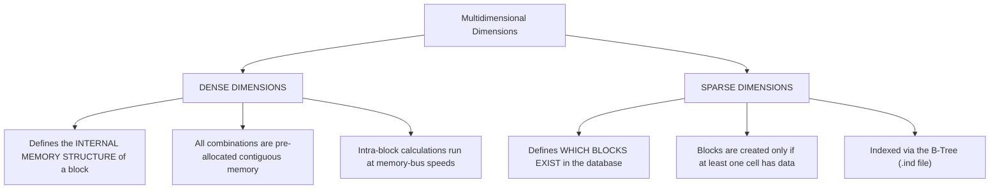

# 2.1 Dense vs. Sparse Dimensions: Block Mathematics, Sizing Limits, and Performance Tuning

## Table of Contents
1. [The Dense/Sparse Architectural Contract](#1-the-densesparse-architectural-contract)
2. [The Block Size Formula & Target Sizing Range](#2-the-block-size-formula--target-sizing-range)
3. [The Oversized Block Pathology (> 100 KB)](#3-the-oversized-block-pathology--100-kb)
4. [The Undersized Block Pathology (< 8 KB)](#4-the-undersized-block-pathology--8-kb)
5. [Step-by-Step Optimization Process for Financial Models](#5-step-by-step-optimization-process-for-financial-models)
6. [Tough & Twisted Review Questions with Consultant Model Answers](#6-tough--twisted-review-questions-with-consultant-model-answers)

---

<!-- ===================================================================== -->
<!-- 📊 LIVE INTERACTIVE VISUAL CARD: DENSE/SPARSE BLOCK SIZER -->
<!-- ===================================================================== -->
<details open>
<summary><b>📊 Live Interactive Architecture Card: Block Sizing &amp; Target Limits (Click to Collapse / Expand)</b></summary>

<br/>

> [!TIP]
> **Interactive Standalone Dashboard:** Open [`card_02_outline_properties.html`](../interactive_cards/card_02_outline_properties.html) in your browser for a live interactive block size calculator!

| Metric / Parameter | Safe Target Range | Pathological Limit | Underlying System Risk |
| :--- | :--- | :--- | :--- |
| **Optimal Block Size** | **50 KB to 100 KB** | $> 100 \text{ MB}$ (Hard engine limit) | Write amplification, cache thrashing, I/O saturation |
| **Undersized Block** | $\ge 8 \text{ KB}$ | $< 1 \text{ KB}$ (e.g. 96 bytes) | Sparse index bloat (`.ind`), pointer traversal overhead |
| **Dense Members Formula** | $\prod (\text{Stored Dense}) \times 8 \text{ B}$ | Excludes Dynamic &amp; Shared | Adding shared dense members adds **0 bytes** to block size |
| **Block Density %** | $10\% \text{ to } 30\%$ | $< 0.1\%$ | Zombie empty blocks; requires `CLEARBLOCK EMPTY;` |

</details>

---

## 1. The Dense/Sparse Architectural Contract

In Essbase Block Storage (BSO) and Hybrid BSO, dimensions are partitioned into two fundamental roles:



- **Dense Dimensions**: Combine to form a single multidimensional array inside each data block. Every stored member in a dense dimension occupies 8 bytes in every block, whether it holds data or `#MISSING`.
- **Sparse Dimensions**: Combine to create the coordinates that address blocks. If a combination of sparse members has no data, **no block is created**.

---

## 2. The Block Size Formula & Target Sizing Range

### 2.1 The Exact Mathematical Formula
Only **stored members** in dense dimensions occupy physical space. Dynamic Calc members are excluded!

$$\text{Block Size (Bytes)} = \left( \prod_{i=1}^{D_{\text{dense}}} |M_{\text{stored}, i}| \right) \times 8 \text{ bytes}$$

Where:
- $D_{\text{dense}}$ = Count of dense dimensions.
- $|M_{\text{stored}, i}|$ = Number of **stored** members in dense dimension $i$.
- $8 \text{ bytes}$ = IEEE 754 64-bit double-precision floating point number.

### 2.2 Sizing Benchmarks

| Block Size Range | Technical Diagnosis | Performance Evaluation |
| :--- | :--- | :--- |
| **< 8 KB** | **Undersized Block** | Severe index overhead, millions of tiny blocks, disk I/O thrashing. |
| **8 KB – 40 KB** | Acceptable / Light | Good for small cubes, but may indicate sparse dimensions could be dense. |
| **50 KB – 80 KB** | **THE SWEET SPOT** | **Optimal balance of I/O throughput, cache residency, and calculation speed.** |
| **80 KB – 100 KB** | Acceptable / Heavy | Upper threshold for high-volume write-back cubes. |
| **> 100 KB** | **Oversized Block** | Severe write amplification, poor cache efficiency, slow form saves. |
| **> 1 MB** | **Critical Antipattern** | Server memory exhaustion, frequent cache evictions, application freezing. |

---

## 3. The Oversized Block Pathology (> 100 KB)

Consider an application where an inexperienced consultant tags `Account` (600 members), `Period` (17 members), and `Product` (5,000 members) as Dense:

$$\text{Dense Cells} = 600 \times 17 \times 5,000 = 51,000,000 \text{ cells}$$
$$\text{Block Size} = 51,000,000 \times 8 \text{ bytes} \approx \mathbf{389 \text{ MB per block!}}$$

### Why this destroys performance:
1. **Write Amplification**: When an analyst edits a single cell in Smart View (8 bytes), Essbase must decompress, update, re-compress, and write **389 Megabytes** back to disk!
2. **Data Cache Starvation**: A 2 GB `DATACACHESIZE` can only hold **5 blocks** at a time. The engine spends 99% of its CPU cycles swapping blocks between disk and memory.
3. **Pessimistic Lock Contention**: The entire 389 MB block is locked during user writes, locking out all other users.

---

## 4. The Undersized Block Pathology (< 8 KB)

Consider an application where only `Period` (12 months) is tagged as Dense, and all other 9 dimensions are Sparse:

$$\text{Dense Cells} = 12 \text{ cells}$$
$$\text{Block Size} = 12 \times 8 \text{ bytes} = \mathbf{96 \text{ bytes per block}}$$

### Why this destroys performance:
1. **Index Bloat**: If the database contains 10,000,000 data points, it must create **833,333 individual data blocks**!
2. **B-Tree Thrashing**: The `.ind` file swells to gigabytes. Essbase spends all its time navigating index tree nodes to find 96-byte blocks rather than doing math.
3. **Calculation Sluggishness**: Aggregating across sparse dimensions requires loading thousands of individual blocks from disk.

---

## 5. Step-by-Step Optimization Process for Financial Models

For standard Oracle Cloud EPM Planning models, follow the **Standard Financial Configuration**:

```
[ Account ]  --> DENSE  (High density; most accounts populated across periods)
[ Period ]   --> DENSE  (High density; 12 months + quarters populated)
[ Years ]    --> SPARSE (Low density; actuals only in past, forecast only in future)
[ Scenario ] --> SPARSE (Low density; Actual, Plan, Forecast are mutually exclusive)
[ Version ]  --> SPARSE (Working, Final, What-If are separate slices)
[ Entity ]   --> SPARSE (Organizational structure; sparse across products)
[ Product ]  --> SPARSE (High cardinality; individual stores sell specific SKUs)
```

### Verification Calculation:
- `Account` Stored Members = 450
- `Period` Stored Members = 18 (12 months + 4 quarters + YearTotal + BegBalance)
$$\text{Block Size} = 450 \times 18 \times 8 \text{ bytes} = \mathbf{64,800 \text{ bytes}} \approx \mathbf{63.28 \text{ KB}} \quad (\text{\textbf{PERFECT SWEET SPOT}})$$

---

## 6. Tough & Twisted Review Questions with Consultant Model Answers

### Question 1: The Sparse vs. Dense Density Test
**Interviewer**: *"You have a cube with 8 dimensions. Dimensions A and B are Dense. How do you prove whether Dimension C should be converted from Sparse to Dense?"*

**Consultant Answer**:
> "You evaluate **Clustering Density**:
> 1. Calculate the current block size: if adding Dimension C pushes block size beyond 100 KB, it **must remain Sparse**.
> 2. Inspect data sparsity in Dimension C: If every sparse block already contains data for almost all members of Dimension C (density $> 80\%$), moving Dimension C to Dense will consolidate multiple sparse blocks into fewer, larger blocks without wasting space.
> 3. If Dimension C is sparsely populated (e.g., customers or products where only 2% of members have data per intersection), moving it to Dense will introduce millions of `#MISSING` zero cells into every block, bloating storage. It must remain **Sparse**."

---

### Question 2: The Block Size Dynamic Calc Trap
**Interviewer**: *"An Account dimension has 1,000 total members: 400 are Stored, 500 are Dynamic Calc, and 100 are Label Only. The Period dimension has 17 stored members. What is the exact block size?"*

**Consultant Answer**:
> "Only **stored members** occupy physical block space. Dynamic Calc and Label Only members allocate zero bytes.
> $$\text{Stored Dense Members} = 400 \times 17 = 6,800 \text{ cells}$$
> $$\text{Block Size} = 6,800 \times 8 \text{ bytes} = \mathbf{54,400 \text{ bytes}} \approx \mathbf{53.125 \text{ KB}}$$
> (A candidate who multiplies by 1,000 gives 132 KB, failing the test)."

---

*Next: [2.2 Implied Sharing, Never Share & Security Traps](./2.2_Implied_Sharing_Never_Share_Security_Traps.md)*

