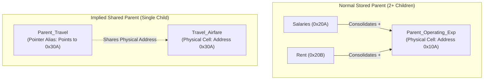
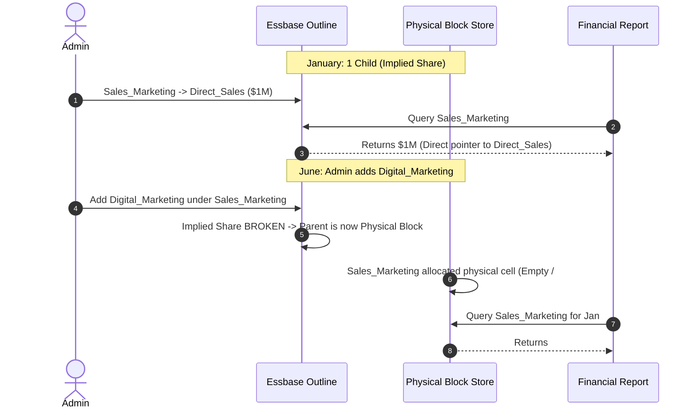

# 2.2 Implied Sharing, Never Share & Security Traps

> **Consultant Focus:** Implied sharing is one of the most frequently asked review topics because it bridges **storage optimization**, **outline design**, and **data security**. An interviewer will ask what happens when security permissions clash with implied sharing, or how adding a child silently corrupts historical reports.

<!-- ===================================================================== -->
<!-- 📊 LIVE INTERACTIVE VISUAL CARD: IMPLIED SHARING & SECURITY TRAPS -->
<!-- ===================================================================== -->
<details open>
<summary><b>📊 Live Interactive Architecture Card: Implied Sharing &amp; Security Leaks (Click to Collapse / Expand)</b></summary>

<br/>

> [!TIP]
> **Interactive Standalone Dashboard:** Open [`card_02_outline_properties.html`](../interactive_cards/card_02_outline_properties.html) in your browser to interactively toggle 1-child vs 2-child implied sharing!

| Structure Condition | Engine Behavior | Historical Impact / Security Risk | Bulletproof Consultant Fix |
| :--- | :--- | :--- | :--- |
| **Parent with 1 Stored Child** | Parent becomes an internal memory alias pointer | Writing to Read-Only child via parent mutates physical data | Set parent to `Never Share` or use Hybrid Dynamic Calc (`~`) |
| **Adding 2nd Child Mid-Year** | Implied sharing is broken instantly | Historical months show `#Missing` because no physical blocks exist | Convert parent to `Dynamic Calc (~)` (re-evaluates automatically) |
| **Cell-Level Security Conflict** | Parent Write + Child Read | Write resolves to child cell; fails or bypasses security audit | Decouple storage boundaries with `Never Share` |
| **Hybrid BSO Upper Parents** | Dynamic Calc (`~`) by default | **Zero risk of implied share corruption** (parents never stored) | Maintain standard Hybrid Dynamic Calc outline design |

</details>

---

## 1. What Is Implied Sharing? (Physical Pointer Mechanism)

In Essbase Block Storage (BSO), **Implied Sharing** is an internal storage optimization where Essbase assumes a parent member and its child member represent the exact same numeric data. 

Instead of allocating physical storage space for both the parent and the child, Essbase treats the parent as a **direct alias (memory pointer)** to the child's data cell.



### The Essbase Storage Reality:
1. No calculation is performed to aggregate the child into the parent.
2. No additional disk space or block cell is consumed by the parent.
3. Reading `Parent_Travel` reads `Travel_Airfare` directly from memory/disk.
4. Writing to `Travel_Airfare` immediately changes `Parent_Travel` without running an aggregation rule (`AGG` or `CALC ALL`).

---

## 2. Exact Trigger Conditions for Implied Sharing

Essbase automatically triggers Implied Sharing in a BSO database when **any** of the following outline conditions occur:

| Outline Structure | Child Consolidation Operator | Resulting Parent Behavior |
| :--- | :--- | :--- |
| **Parent has only 1 child** | Child has `+` (Addition) or `:` (Stored) | **Implied Share** (Parent shares child's cell) |
| **Parent has multiple children**, but only 1 child rolls up | 1 child is `+`, all others are `~` (Ignore) or `Label Only` | **Implied Share** with that single consolidating child |
| **Parent is the first child of a single-child parent** | Cascading single children (`P1 -> P2 -> C1`) | All parents in the single-child chain become implied shared to `C1` |

### When Implied Sharing Does NOT Trigger:
* The parent has two or more children with `+` consolidation.
* The parent consolidation operator is set to `~` (Ignore / Dynamic Calc).
* The parent or child is explicitly marked with the member property **`Never Share`**.
* The application is **Hybrid BSO** and the parent is set to **`Dynamic Calc`** (which is standard practice in Hybrid).

---

## 3. The Single-Child Trap: Silent Historical Corruption

The most insidious production bug caused by implied sharing occurs when metadata updates alter parent-child consolidation hierarchies over time.

### The Real-World Scenario Walkthrough:

#### Step 1: Initial Outline Setup (January)
* Dimension `Department`:
  * `Sales_Marketing` (Parent, Stored `+`)
    * `Direct_Sales` (Single Child, Stored `+`)
* **Behavior:** Essbase marks `Sales_Marketing` as **Implied Shared**.
* Planners submit `$1,000,000` to `Direct_Sales`.
* Financial reports show:
  * `Sales_Marketing` = `$1,000,000`
  * `Direct_Sales` = `$1,000,000`
* **Zero aggregation scripts were run.** Everything balances perfectly.

#### Step 2: The Mid-Year Metadata Change (June)
* Corporate creates a new sub-department: `Digital_Marketing`.
* The admin imports metadata:
  * `Sales_Marketing` (Parent, Stored `+`)
    * `Direct_Sales` (Child 1, Stored `+`)
    * `Digital_Marketing` (Child 2, Stored `+`)
* The admin runs a **Database Refresh (Cube Restructure)**.

#### Step 3: The Disaster (Silent Historical Reporting Corruption)
* Essbase evaluates `Sales_Marketing`: It now has **two** consolidating children (`Direct_Sales` and `Digital_Marketing`).
* **Implied sharing is instantly broken!** `Sales_Marketing` is converted from an alias pointer into a **physical stored cell**.
* In a physical stored cell, the value must be calculated via an aggregation script (`AGG(Department);` or `CALC ALL;`).
* Because the admin only refreshed metadata and did **not** re-aggregate historical months (e.g., Jan-May), what is stored in `Sales_Marketing` for Jan-May?
  * **Result:** `Sales_Marketing` displays **`#Missing`** or stale data!
  * Corporate executives open Q1 Board Reports, and total `Sales_Marketing` has dropped from `$1,000,000` to `$0` or `#Missing`, even though `Direct_Sales` still has `$1,000,000`.



---

## 4. The Security Bypass Trap: Permissions Collision

This is a favorite interview scenario to catch junior consultants who only understand cell-level security in isolation.

### The Vulnerability Setup:
Consider an organization with strict departmental data isolation:
* Dimension `Cost_Center`:
  * `CC_5000_Legal` (Parent, Stored `+`)
    * `CC_5010_General_Counsel` (Single Child, Stored `+`)
* **Security Assignment for User `Junior_Lawyer`:**
  * Assigned **`WRITE`** access to `CC_5010_General_Counsel`.
  * Assigned **`READ`** access (or **`NONE`**) to `CC_5000_Legal`.

### What Happens in Smart View / Planning Web?

#### Scenario A: User writes to Child (`CC_5010`)
* Because `CC_5000` is an implied share pointer to `CC_5010`, updating `CC_5010` instantly updates `CC_5000`.
* A manager opening a form at the parent level sees the modified data immediately, even if the parent was supposed to be locked or read-only for that planning cycle.

#### Scenario B: User writes to Parent (`CC_5000`)
* If security allowed `WRITE` to parent but `READ` to child:
* Essbase routes the write directly to the physical storage of `CC_5010`!
* The security rule on the child is completely undermined because the parent **has no physical storage of its own**—any write to the parent physically overwrites the child cell.

#### Scenario C: Cell-Level Security Inconsistencies
* If `Junior_Lawyer` has `NONE` on `CC_5000` and `WRITE` on `CC_5010`, Smart View grids querying `CC_5000` return `#NoAccess`.
* However, if a calculation script runs at the parent level (`@ISMBR("CC_5000_Legal")`), the engine resolves the pointer to `CC_5010`, potentially exposing or modifying secured data.

---

## 5. The Remediation: Explicit `Never Share`

To eliminate implied sharing vulnerabilities, Oracle provides the **`Never Share`** property.

```
Member Properties -> Data Storage -> Never Share
```

### What Happens When You Set `Never Share`?
1. Essbase forces the parent to allocate an independent physical storage cell in the block.
2. Essbase creates a distinct index entry for the parent.
3. The parent and child now hold completely independent data cells:
   * Data entered into the child does **not** reflect in the parent until an aggregation rule (`CALC ALL` or `AGG`) is executed.
   * Modifying the child does not mutate the parent.
   * Security access rules are strictly isolated between the parent cell and the child cell.

### Where Should You Apply `Never Share` in Production?
1. **Single-Child Rollups Intended for Future Expansion:** If you know a department currently has only one sub-department but more will be added next quarter, set the parent to `Never Share` immediately. This avoids the historical data corruption trap when the second child is added.
2. **KPI and Statistical Parents:** Where a single child represents a baseline ratio or non-additive driver.
3. **Strict Audit / Security Boundaries:** Where parent-level approval locks must not alias child-level operational data entry.

---

## 6. Implied Sharing Across Storage Engines: BSO vs Hybrid vs ASO

| Dimension Feature | Classic BSO | Modern Hybrid BSO | Aggregate Storage (ASO) |
| :--- | :--- | :--- | :--- |
| **Default Parent Storage** | Stored (`+`) | Dynamic Calc (`~`) | Stored / Dynamic hierarchies |
| **Is Implied Sharing Present?** | **YES** (Aggressive, automatic) | **NO** (on standard Dynamic Calc parents) | **NO** (ASO does not use block pointers) |
| **Single-Child Behavior** | Automatically converted to pointer | Calculated on-the-fly dynamically via vector engine | Aggregated dynamically at query time |
| **Risk of Historical Corruption** | **HIGH** | **NONE** (Parents recalculate on retrieval) | **NONE** |
| **Security Leak Risk** | **HIGH** (Pointer alias bypasses cell locks) | **LOW** (Calculated dynamically, respects cell security) | **NONE** |

> [!IMPORTANT]
> In **Hybrid BSO**, standard Oracle Cloud EPM design mandates that all upper-level rollup parents are set to **`Dynamic Calc`**. Because Dynamic Calc members are never stored, **they cannot trigger Implied Sharing**. This is one of the biggest operational stability benefits of migrating from Classic BSO to Hybrid BSO.

---

## 7. Essbase Configuration: `IMPLIED_SHARE` in `essbase.cfg`

In on-premises Essbase, the behavior of implied sharing was governed by the `IMPLIED_SHARE` configuration setting:

```ini
IMPLIED_SHARE [app_name [db_name]] TRUE | FALSE
```

* `TRUE` (Default): Single child parents are treated as implied shares.
* `FALSE`: Implied sharing is disabled globally; all single-child parents get physical storage cells.

> [!WARNING]
> **Cloud EPM Reality:** In Oracle Cloud EPM (Planning SaaS), customers **do not have direct access** to edit `essbase.cfg`. Oracle manages the engine configuration. Therefore, consultants **must manage implied sharing at the metadata level** using outline properties (`Never Share` or `Dynamic Calc`), rather than relying on global server flags.

---

## 8. Twisted Interview Questions & Consultant Model Answers

### Q1: "A client added a single promotional cost center `CC_Promo` under `Marketing_US`. A planner with WRITE access to `Marketing_US` but READ-ONLY access to `CC_Promo` attempts to submit data via Smart View. What happens, why, and what is the underlying engine behavior?"
**Consultant Model Answer:**
> "In a Classic BSO cube where `Marketing_US` is a stored parent with only one child (`CC_Promo`), Essbase automatically triggers **Implied Sharing**. The parent `Marketing_US` does not possess its own physical data cell; it is an internal memory pointer directly referencing the child cell `CC_Promo`.
>
> When the planner submits data to `Marketing_US`, the Planning security layer encounters a fundamental conflict: the user has write rights to the parent member, but the underlying physical cell belongs to `CC_Promo`, where the user is Read-Only. 
> 
> Depending on whether the submission is via Planning Web forms or Smart View ad-hoc:
> 1. In Planning Web with cell-level security enabled, the write is **rejected** because the system recognizes that writing to the implied parent mutates the read-only child.
> 2. In unconstrained Smart View ad-hoc submissions, if Essbase attempts to commit to the physical block offset, it either fails with a security violation error or, if the security filter was defined only at the outline parent level, it silently commits to `CC_Promo`, creating an audit failure.
>
> **The Fix:** Change `Marketing_US` from Stored to **`Dynamic Calc`** (in Hybrid BSO) or set its data storage to **`Never Share`** (in Classic BSO). This allocates an independent cell or dynamic calculation, completely separating the parent from the child's physical storage."

---

### Q2: "A dimension had `Parent_A` with a single child `Child_A`. In June, an administrator adds `Child_B` under `Parent_A` and refreshes the database. Immediately, Q1 financial reports show `Parent_A` as `#Missing`. Why did this happen, and how do you fix it without running a lengthy historical recalculation?"
**Consultant Model Answer:**
> "This is the classic **Single-Child Implied Share Break** pathology:
> 1. In Q1, because `Parent_A` had only one child, Essbase treated it as an implied share. It stored no physical data for `Parent_A`; retrieval queries simply fetched `Child_A`'s cell.
> 2. When `Child_B` was added, `Parent_A` suddenly had two consolidating children. Essbase removed the implied share status and instantiated `Parent_A` as a true physical stored block cell during the database restructure.
> 3. Because the cube restructure only updates metadata structures and does not execute historical data calculations, the newly created physical cells for `Parent_A` across Jan–Mar remain empty (`#Missing`).
>
> **The Immediate Fixes:**
> - **Option 1 (Best Practice in Modern EPM):** Convert `Parent_A` to **`Dynamic Calc`** (assuming a Hybrid BSO cube). `Parent_A` will immediately sum `Child_A + Child_B` dynamically upon query execution for all historical and future periods with zero calculation time.
> - **Option 2 (Classic BSO Fix):** Execute an aggregation rule targeted specifically at the parent and historical periods:
>   ```essbase
>   FIX(@RELATIVE("Parent_A", 0), &HistYears, &HistMonths)
>       CALC AGG("Department");
>   ENDFIX
>   ```
> - **Preventative Design:** Never leave single-child parents as Stored `+`. Always tag single-child parents as `Never Share` or `Dynamic Calc` upon initial creation."

---

### Q3: "Does Hybrid BSO suffer from the Single-Child Implied Share issue? Explain the architectural reason."
**Consultant Model Answer:**
> "In standard Modern Hybrid BSO architecture, **no**, it does not.
>
> In Classic BSO, parents were typically set to `Stored (+)` because dynamic calculation on sparse parents caused severe query retrieval latency. Stored single-child parents are precisely what trigger implied sharing.
>
> In Hybrid BSO, sparse rollups are computed in sub-milliseconds by the integrated ASO dynamic vector engine. Consequently, Oracle's mandatory best practice for Hybrid BSO is to configure **all upper-level consolidation parents as `Dynamic Calc (~)`**. 
>
> Because Dynamic Calc members never store physical data on disk or in the index table, Essbase never creates implied share memory pointers for them. The parent calculates on retrieval regardless of whether it has one child, two children, or ten children. Therefore, adding a second child to a Dynamic Calc parent in Hybrid BSO never corrupts historical data."

---

### Q4: "You configure a member property to `Never Share` in Planning, but during Database Refresh, the process aborts with an Essbase error: `Cannot set Never Share on shared member`. What caused this error?"
**Consultant Model Answer:**
> "An outline member cannot be both a **Shared Member** (`Data Storage = Shared`) and have the **`Never Share`** property applied to it simultaneously.
>
> Here is why:
> - A **Shared Member** is an explicit pointer to a base prototype member. Its entire existence is defined by sharing data with the prototype.
> - The **`Never Share`** property is an instruction commanding Essbase: *'Do not allow this member to act as an implied share pointer; force it to have independent physical storage.'*
>
> Setting `Never Share` on a shared member creates an irreconcilable logical paradox: Essbase is being told to share data with a base member while simultaneously being forbidden from sharing storage. 
> 
> **How it happens:** Often, an administrator applies `Never Share` to a parent member in a primary hierarchy, and then creates a shared instance of that same parent in an alternate reporting hierarchy without overriding the storage property. The database refresh compiler detects this conflicting instruction and aborts the cube refresh to prevent index corruption."

---

### Q5: "Can you turn off implied sharing globally across an entire Oracle Cloud EPM application? What is the backend configuration setting, and why can't a Cloud consultant just toggle it?"
**Consultant Model Answer:**
> "In on-premises Essbase, implied sharing could be globally disabled by placing `IMPLIED_SHARE appname dbname FALSE` in `essbase.cfg`.
>
> In Oracle Cloud EPM (SaaS):
> 1. Customers have **no direct access** to the underlying file system or the server's `essbase.cfg` file.
> 2. Oracle manages the global configuration parameters across multi-tenant and OCI gen-2 architectures to maintain service-level agreements and stability.
> 3. Disabling implied sharing globally across an existing application would cause massive block explosion: every single single-child parent across every dimension would suddenly require a physical block cell, causing database sizes to double or triple and degrading backup/restore times.
>
> Therefore, in Cloud EPM, implied sharing must be managed **architecturally within the application metadata** using the **`Never Share`** property or by adopting **Hybrid BSO Dynamic Calc parents**."

