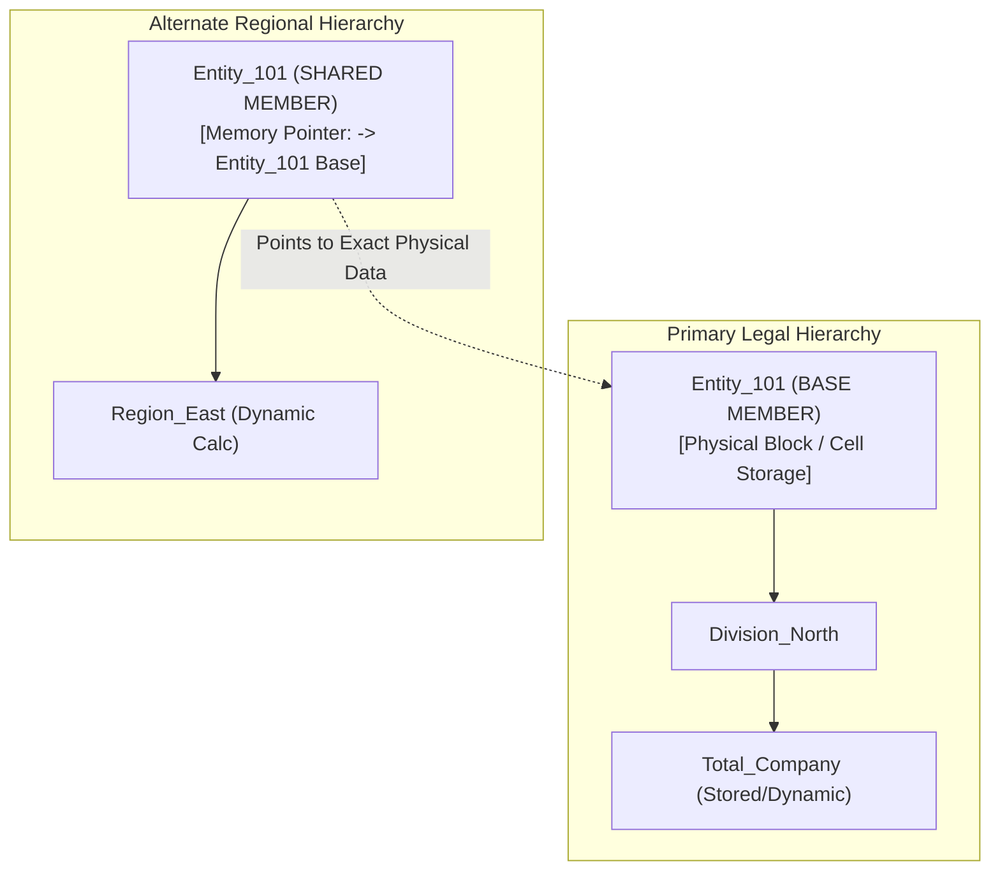
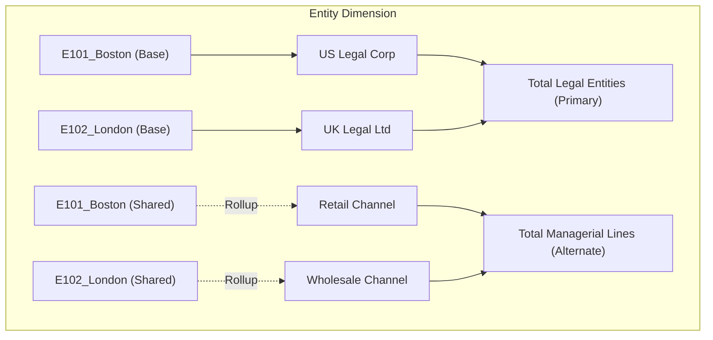

# 2.3 Shared Members and Alternate Hierarchies

> **Consultant Focus:** Interviewers use shared members and alternate hierarchies to test whether you understand **how Essbase indexes data versus how it stores data**. You must know outline precedence rules, block size impacts for Dense vs Sparse, and how Hybrid BSO revolutionized alternate rollups.

<!-- ===================================================================== -->
<!-- 📊 LIVE INTERACTIVE VISUAL CARD: SHARED MEMBERS & ALTERNATE ROLLUPS -->
<!-- ===================================================================== -->
<details open>
<summary><b>📊 Live Interactive Architecture Card: Shared Members &amp; Alternate Hierarchies (Click to Collapse / Expand)</b></summary>

<br/>

> [!TIP]
> **Interactive Standalone Dashboard:** Open [`card_02_outline_properties.html`](../interactive_cards/card_02_outline_properties.html) in your browser to inspect dense vs sparse outline impacts!

| Architecture Feature | Dense Dimension Shared Member | Sparse Dimension Shared Member | Alternate Hierarchy in Hybrid BSO |
| :--- | :--- | :--- | :--- |
| **Physical Storage Impact** | **0 Bytes added to block size** | **0 Blocks created** | Zero stored blocks on disk |
| **Data Synchronization** | Identical array offset | Same sparse coordinate data | Recalculated dynamically in memory |
| **Outline Precedence** | Base **MUST** precede Shared | Base **MUST** precede Shared | Root parent set to `~` (Ignore) to prevent double counting |
| **Batch Calc Window Impact** | Negligible | Negligible | **Dropped from hours to 0 seconds** (skipped in batch calc) |

</details>

---

## 1. Physical Architecture: Base vs Shared Member

In Essbase, a **Shared Member** is not an independent data container. It is a **metadata pointer** that references an existing primary member (known as the **Prototype** or **Base Member**).



### Core Architectural Realities:
1. **Single Physical Storage:** There is only **one physical data cell** for `Entity_101`. Any data written to `Entity_101 (Shared)` is written directly into `Entity_101 (Base)`.
2. **Identical Cell Coordinates:** You **cannot** store different values in a base member and its shared counterpart. They share the identical mathematical coordinates in the database.
3. **Inherited Properties:** A shared member automatically inherits data type, formula (in most cases), and consolidation attributes from the base prototype.

---

## 2. The Outline Precedence Rule (Strict Ordering)

One of the most rigid syntactic rules in Essbase is the **Outline Precedence Rule**:

> **THE RULE:** The **Base (Prototype) Member** must always appear **BEFORE** any of its **Shared Members** in the outline hierarchy order (top-to-bottom, left-to-right).

### Why Essbase Enforces This:
When Essbase parses the outline structure during a Database Refresh (restructure):
1. It builds internal symbol tables and allocates internal member IDs sequentially.
2. If it encounters a member tagged as `Shared`, it immediately looks up the internal symbol table for the base member's definition to copy its dimensions, offsets, and attributes.
3. If the base member has not yet been parsed, Essbase cannot resolve the reference pointer, resulting in a fatal compilation error:
   ```
   Error: Shared member [Member_Name] appears before base member in outline.
   Database refresh aborted.
   ```

---

## 3. Impact on Block Size, Index, and Storage

A classic trick question in consultant conversion interviews: *"If I add 1,000 shared members to a Dense dimension, does the Essbase block size double?"*

### Dense vs Sparse Breakdown:

| Dimension Type | Metric | Impact of Adding Shared Members | Physical Engine Explanation |
| :--- | :--- | :--- | :--- |
| **DENSE Dimension** | **Block Size (Bytes)** | **NO CHANGE (0 Bytes)** | A dense block's physical array is sized by multiplying the count of **Stored Base Members**. Shared dense members do not get an extra 8-byte cell in the block array; they point to the base member's array offset. |
| **DENSE Dimension** | **Memory Footprint** | Negligible | Only the outline symbol table expands slightly to store member names and pointer IDs. |
| **SPARSE Dimension** | **Block Size (Bytes)** | **NO CHANGE (0 Bytes)** | Sparse dimensions define index combinations, not intra-block array dimensions. |
| **SPARSE Dimension** | **Index File (.IND)** | **Zero to Minimal** | In Classic BSO, if a shared sparse member was part of a stored parent rollup, it could generate index pointers. In Hybrid BSO (Dynamic Calc), zero index entries are generated. |
| **SPARSE Dimension** | **Block Count** | **NO INCREASE in Base Blocks** | Shared members point to existing data blocks. They do not spawn new independent physical blocks. |

$$\text{BSO Block Size (Bytes)} = \prod (\text{Count of Stored Dense Members in Dim}_i) \times 8 \text{ bytes}$$
*Notice that Shared Members and Dynamic Calc members are strictly excluded from this formula!*

---

## 4. Alternate Hierarchies: Business Use Cases and Design

An **Alternate Hierarchy** is a secondary aggregation structure built within the same dimension to satisfy different reporting, analytical, or managerial perspectives without duplicating raw data.



### The Double-Counting Trap:
If a dimension root contains both the Primary and Alternate hierarchies rolling into a single super-parent:
* `All_Rollups` (Stored `+`)
  * `Primary_Hierarchy` (Stored `+`) $\rightarrow$ contains `E101`
  * `Alternate_Hierarchy` (Stored `+`) $\rightarrow$ contains `E101 (Shared)`
* **The Disaster:** Querying `All_Rollups` reports **double the actual financial revenue** because Essbase aggregates both branches.
* **The Fix:**
  1. Set alternate hierarchy top parents to **`~` (Ignore / Do Not Consolidate)** or **`Label Only`**.
  2. Keep primary and alternate hierarchies in completely separate branches under a root parent that does not roll up.

---

## 5. Alternate Hierarchies: Classic BSO vs Hybrid BSO

This comparison explains why modern Cloud EPM projects almost exclusively run on Hybrid BSO:

### Classic BSO Alternate Hierarchies (The 4-Hour Calc Window Nightmare):
* In Classic BSO, if alternate hierarchies were set to `Dynamic Calc (~)`:
  * Ad-hoc Smart View queries experienced massive lag and timeouts because sparse dynamic rollups evaluated sequentially cell-by-cell.
* To make queries fast, consultants were forced to make alternate hierarchy parents **`Stored (+)`**.
* **The Cost:** Every nightly batch calculation script had to aggregate all alternate hierarchies:
  ```essbase
  CALC AGG("Entity"); /* Calculated Primary AND Stored Alternate Hierarchies */
  ```
* Every alternate rollup had to write physical blocks to disk. If you had 5 alternate hierarchies, your index size, disk size, and calculation time grew by 300%–500%!

### Modern Hybrid BSO Alternate Hierarchies (Sub-Second Perfection):
* In Hybrid BSO, alternate hierarchy parents are **`Dynamic Calc (~)`**.
* When a user queries `Retail_Channel`, Essbase's ASO dynamic vector engine calculates the sum in **sub-milliseconds** directly in memory from Level 0 blocks.
* **The Result:**
  * **Batch Calculation Time:** Reduced from hours to minutes because alternate hierarchies are completely skipped during batch scripts!
  * **Database Size:** Only Level 0 base blocks exist on disk. Zero disk blocks for alternate parents.
  * **Maintenance:** Adding a new alternate rollup requires zero recalculation of existing data.

---

## 6. Shared Parents (Upper-Level Sharing)

Can you share an entire branch / parent member? **Yes.**

### Strict Rules for Shared Parents:
1. If a parent member is marked as `Shared`, **every single child beneath it must also be shared** and must match the structure of the base parent's children.
2. In Planning Web metadata management, when you share a parent, Planning automatically renders all descendant members as shared pointers to their corresponding base descendants.
3. You cannot add a unique, non-shared child under a shared parent.

---

## 7. Member Formulas on Shared Members: What Is Allowed?

Can a shared member have a different calculation formula than its base member?

* **Essbase Engine Rule:** A shared member **cannot** have its own independent member formula in Essbase. It evaluates the exact data or formula of its base prototype.
* **Planning Web Metadata Interface:** If you view a shared member in Planning, the formula editor is disabled. The shared member automatically displays the base member's formula in read-only mode.
* **Solve Order Exception:** In Hybrid BSO and ASO, while the formula itself cannot differ, you **can** sometimes assign a distinct **`Solve Order`** to a member in different dimensions, but within the same dimension, the shared member shares the calculation behavior of the base prototype.

---

## 8. Twisted Interview Questions & Consultant Model Answers

### Q1: "A developer imports metadata where a shared member `Product_A_Shared` is listed at line 45, and its base prototype `Product_A` is listed at line 120. What happens during Database Refresh, why does Essbase behave this way internally, and how do you resolve it?"
**Consultant Model Answer:**
> "During Database Refresh, the process immediately **aborts** with an Essbase error: `Shared member [Product_A_Shared] appears before base member in outline`.
>
> **Underlying Internal Mechanism:**
> Essbase compiles outlines in a single top-down, depth-first serialization pass. When allocating memory structures and index member IDs, encountering a shared member requires Essbase to resolve an internal pointer to the base member's symbol table address. If the base member has not yet been encountered, that address does not exist. Essbase refuses forward-referencing of shared prototypes to prevent memory corruption and unresolvable pointer cycles.
>
> **The Resolution:**
> In the metadata load file or dimension editor, rearrange the outline sequence so that the primary hierarchy containing the base member is placed **above** the alternate hierarchy containing the shared member. Once the base member precedes the shared member, the refresh compiles cleanly."

---

### Q2: "Does adding 500 shared members to a DENSE dimension increase the Essbase block size from 50 KB to 100 KB? Explain the exact memory storage mechanism."
**Consultant Model Answer:**
> "No, the block size will **not increase by even a single byte**.
>
> **The Mathematical and Architectural Reason:**
> In BSO/Hybrid BSO, block size is strictly determined by the mathematical formula:
> $$\text{Block Size} = \prod (\text{Count of Stored Base Members in Dense Dimensions}) \times 8 \text{ bytes}$$
>
> Dense shared members do not occupy an independent 8-byte cell slot inside the block array. They are metadata pointers that resolve to the exact array offset of the base dense member.
>
> What *does* increase slightly is the outline file (`.otl`) size in memory and on disk, because Essbase must store the 500 member names, parent-child relationships, and pointer IDs in the outline symbol table. However, the data block (`.pag`) size and cell array structure remain completely unchanged."

---

### Q3: "In an alternate hierarchy, a planner enters `$50,000` into a shared member via a Smart View form. The form saves successfully. When a manager opens the primary hierarchy, the base member shows `$50,000`. Can a shared member ever hold a different value from its base member?"
**Consultant Model Answer:**
> "No, a shared member can **never** hold a different value from its base member.
>
> In Essbase, a shared member is purely a virtual pointer alias to the base member's physical data cell. There is no separate physical storage location for a shared member. Whether a user submits data through `Entity_101 (Base)` or `Entity_101 (Shared)`, both write requests resolve to the identical physical block and cell coordinates.
>
> If a business requirement demands that the alternate rollup store a different value (for example, adjusting management allocations without affecting statutory legal entities), the consultant must create a **distinct, non-shared member** (e.g., `Entity_101_Mgmt_Adj`) and use a secondary dimension (like `Consolidation` or `View`) to capture the delta."

---

### Q4: "A Classic BSO cube with 8 alternate reporting hierarchies took 3.5 hours for nightly batch calculation. After migrating the cube to Hybrid BSO, the batch calculation script execution dropped to 8 minutes. What caused this massive performance gain?"
**Consultant Model Answer:**
> "In Classic BSO, dynamic calculations on sparse dimensions caused severe ad-hoc query latency. To achieve acceptable retrieval performance, all 8 alternate reporting hierarchies had to be configured as **`Stored (+)`**. 
>
> Consequently, the nightly batch calculation script had to execute `CALC AGG` across all 8 alternate structures:
> 1. Essbase was forced to physically calculate and write millions of aggregate blocks to disk for every alternate rollup.
> 2. This caused massive disk I/O, index expansion, and block locking.
>
> In Hybrid BSO:
> 1. All 8 alternate hierarchies were converted to **`Dynamic Calc (~)`**.
> 2. In Hybrid BSO, Dynamic Calc sparse parents are computed in sub-milliseconds on-the-fly by the integrated ASO dynamic vector engine upon user retrieval.
> 3. The batch calculation script was updated to only calculate base business logic and Level 0 drivers, completely **skipping the aggregation of alternate hierarchies**.
>
> The batch calculation dropped to 8 minutes because the engine no longer creates, calculates, or writes physical blocks for the 8 alternate hierarchies."

---

### Q5: "What happens if you try to place a unique calculation formula on a shared member in an outline?"
**Consultant Model Answer:**
> "Essbase does not permit independent member formulas on shared members.
>
> 1. **In Planning Web:** The member formula text box for a shared member is read-only and automatically displays the base member's formula.
> 2. **In Essbase Outline Editor:** Attempting to assign a distinct formula directly to a shared member generates a syntax error upon outline validation.
>
> A shared member's mathematical evaluation is strictly governed by the base prototype. If different calculation behavior is required depending on the hierarchy context, the formula must be placed on the **Base Member** using conditional logic:
> ```essbase
> IF (@ISANCEST("Managerial_Rollup"))
>     /* Managerial logic */
> ELSE
>     /* Statutory logic */
> ENDIF
> ```
> However, in Modern Hybrid BSO, conditional outline formulas should be used sparingly because `@ISANCEST` checks can force the Hybrid engine to drop from vector mode to the slower procedural BSO mode."

