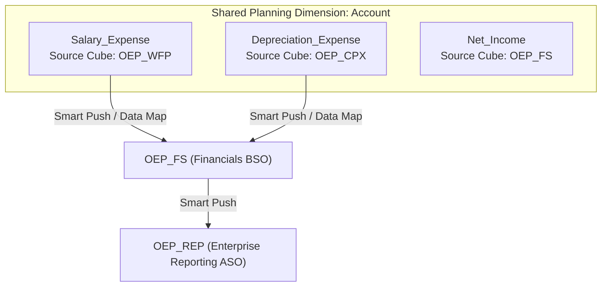
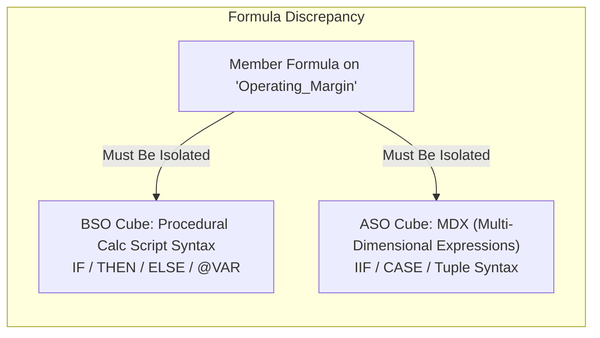
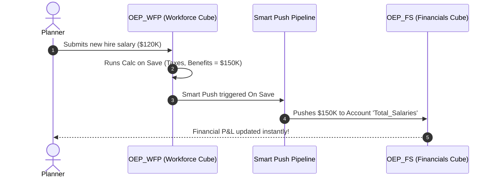

# 2.4 Source Cube Property & Multi-Plan Integrity

> **Consultant Focus:** In Oracle Cloud EPM Planning (Financials, Workforce, Capital, Projects), enterprise applications almost always have multiple cubes (BSO and ASO). Interviewers ask about the **Source Cube** property and multi-plan design to see if you can debug cube-refresh compilation failures, manage formula isolation, and design seamless data movement.

<!-- ===================================================================== -->
<!-- 📊 LIVE INTERACTIVE VISUAL CARD: SOURCE CUBE & MULTI-PLAN INTEGRITY -->
<!-- ===================================================================== -->
<details open>
<summary><b>📊 Live Interactive Architecture Card: Multi-Cube Integrity &amp; Formula Isolation (Click to Collapse / Expand)</b></summary>

<br/>

> [!TIP]
> **Interactive Standalone Dashboard:** Open [`card_02_outline_properties.html`](../interactive_cards/card_02_outline_properties.html) in your browser for multi-plan configuration guidelines!

| Multi-Plan Aspect | Problem / Failure Mode | Compilation Error Message | Consultant Architectural Fix |
| :--- | :--- | :--- | :--- |
| **Formula Isolation** | Formula references member unique to Cube A | `Unknown member [X] in formula for [Y]` | Wrap in `<PlanType: CubeName>` tags |
| **BSO vs ASO Syntax** | Procedural `@` calc syntax deployed to ASO | `Syntax error: Invalid MDX expression` | Split into BSO calc tab and ASO MDX tab |
| **Source Cube Routing** | Auto-Predict doesn't know where to commit | Orphaned forecast numbers | Set **Source Cube** metadata property |
| **Data Movement** | Moving data between calculation &amp; reporting | Double counting or stale summaries | Use **Smart Push** mapped strictly at Level 0 |

</details>

---

## 1. What Is the "Source Cube" Property in Oracle Planning?

In Oracle Cloud EPM Planning, an application typically contains multiple underlying Essbase databases (cubes), such as:
* **`OEP_FS` (Financials BSO / Hybrid):** P&L, Balance Sheet, Cash Flow.
* **`OEP_WFP` (Workforce BSO / Hybrid):** Employee headcount, compensation, benefits.
* **`OEP_CPX` (Capital BSO / Hybrid):** Asset depreciation, leases.
* **`OEP_REP` (Reporting ASO):** Enterprise-wide aggregated reporting.

Dimensions such as **Account**, **Entity**, **Scenario**, and **Version** are shared across multiple cubes. However, not every member exists in or is calculated by every cube.



### The Definition:
The **`Source Cube`** property specifies the **primary plan type (cube) that originates and owns the calculation or data entry** for that specific member.

---

## 2. The Database Refresh Disaster: Formula Syntax Isolation

The most frequent production failure for junior consultants occurs during a **Database Refresh (Cube Restructure)** in multi-cube applications.

### The Scenario:
1. You have two cubes: `FinPlan` (Financials) and `Workforce` (HR/Staffing).
2. You create an Account member: `Headcount_Ratio`.
3. In `FinPlan`, you want `Headcount_Ratio` to evaluate a formula:
   ```essbase
   "Headcount_Ratio" = "Total_Revenue" / "Total_FTE";
   ```
4. Here is the trap:
   * `Total_Revenue` exists **only** in `FinPlan`.
   * `Total_FTE` exists **only** in `Workforce`.
5. You click **Refresh Database**.
6. **Result:** The refresh crashes with a fatal error:
   ```
   Cube: Workforce - Member formula for [Headcount_Ratio] contains unknown member [Total_Revenue].
   Database refresh aborted.
   ```

### Why Did This Happen?
By default, if you attach a member formula to a shared member in Planning, the Planning metadata engine attempts to compile that identical formula text into **every cube where the member is enabled**! 

When compiling `Workforce`, Essbase scans the formula, encounters `Total_Revenue`, searches the `Workforce` outline, fails to find it, and immediately aborts the refresh.

---

## 3. How to Resolve Formula Isolation Across Cubes

Oracle Cloud EPM provides two primary mechanisms to isolate member formulas:

### Method 1: Cube-Specific Formula Blocks (Best Practice)
In the Planning formula editor, you can prefix formula code with explicit cube identifiers. Essbase will only deploy the formula to the designated cube:

```essbase
/* Plan1 (FinPlan) Formula */
"Total_Revenue" / "Total_FTE_Pushed";

/* Workforce Formula */
"Emp_Salary" * "Tax_Rate";
```

In modern Cloud EPM Planning syntax:
```essbase
<PlanType: FinPlan>
"Total_Revenue" / "Fin_Headcount";
</PlanType: FinPlan>

<PlanType: Workforce>
"Salary" * 0.15;
</PlanType: Workforce>
```

When the database refresh engine runs:
* For `FinPlan`, it compiles only the text inside `<PlanType: FinPlan>`.
* For `Workforce`, it compiles only the text inside `<PlanType: Workforce>`.
* If a plan type is not specified, that cube receives an empty formula (treated as stored or standard dynamic calc).

---

## 4. BSO vs ASO Formula Collisions in Multi-Cube Applications

In applications with both a BSO/Hybrid calculation cube (`OEP_FS`) and an ASO reporting cube (`OEP_REP`), member formulas cause severe syntax collisions if not isolated:



* **BSO Engine:** Uses procedural calculation language (e.g., `@PRIOR`, `@VARPER`, `IF / ELSE / ENDIF`).
* **ASO Engine:** Uses **MDX (Multi-Dimensional Expressions)** (e.g., `IIF`, `CASE`, `(Account, Time)`).

> [!CAUTION]
> If you enter a BSO procedural formula (e.g., `IF ("Revenue" > 0) ...`) without an MDX equivalent or plan type tag, the ASO cube refresh will fail with: `Syntax error: Invalid MDX expression`.
>
> In Cloud EPM, you must provide separate BSO and MDX formulas for members enabled in both cube types.

---

## 5. Predictive Planning & Auto-Predict Integration

The **Source Cube** property plays a vital operational role in **Auto-Predict** and **Predictive Planning**:

1. **Historical Data Source Identification:** Auto-Predict runs time-series statistical models (ARIMA, Holt-Winters, Linear Regression). It queries historical actuals from the designated source cube.
2. **Forecast Target Alignment:** When predictions are generated, Auto-Predict must commit the forecast numbers to specific target cells. If a metric belongs to `OEP_WFP`, Auto-Predict uses the Source Cube metadata attribute to ensure write-back commits directly to the workforce cube, preventing orphaned prediction data in general financials.

---

## 6. Smart Push and Data Maps Integration

In multi-cube enterprise applications, data does not magically flow between cubes. Planners enter detailed headcount into `Workforce`, but the P&L in `Financials` needs the resulting total compensation expense.

### The Synchronization Pipeline:
1. **Source Cube:** `OEP_WFP` calculates detailed employee compensation.
2. **Data Map / Smart Push:** A configured pipeline maps `OEP_WFP` compensation accounts to `OEP_FS` summary lines.
3. **Trigger:** Executed automatically **On Save** of a Planning form or via Groovy script:
   ```groovy
   /* Groovy snippet triggering Smart Push */
   DataGrid grid = operation.grid
   Cube sourceCube = operation.application.getCube("OEP_WFP")
   smartPush = operation.application.getSmartPush("Push_Salary_To_FinPlan")
   smartPush.execute(grid)
   ```



---

## 7. Plan Type Property Overrides

Can an account member have different properties across different cubes?

| Member Property | Across Cubes in Planning | Explanation |
| :--- | :--- | :--- |
| **Member Name** | **Identical** | Must be identical across all cubes in the application. |
| **Alias** | **Identical** | Shared across cubes per alias table. |
| **Data Type** | **Identical** | E.g., Currency, Percentage, Date, Smart List (cannot vary by cube). |
| **Data Storage** | **Can Differ** | A member can be `Dynamic Calc` in `FinPlan` and `Stored` in `OEP_REP` or vice versa. |
| **Aggregation Operator** | **Can Differ** | Can be `+` in one cube and `~` (Ignore) in another cube. |
| **Solve Order** | **Can Differ** | Cube-specific solve orders are essential because BSO and ASO evaluate solve order differently. |

---

## 8. Twisted Interview Questions & Consultant Model Answers

### Q1: "A consultant adds an Account `Bonus_Expense` with formula `"Bonus_Expense" = "Salary" * 0.15;`. `Salary` exists only in the `Workforce` cube. During Database Refresh, the `FinPlan` cube fails to refresh. Why did it fail, and how do you fix it?"
**Consultant Model Answer:**
> "The Database Refresh failed because the member formula was entered as a global formula without cube isolation. 
>
> When Planning initiates a Database Refresh, it parses each cube outline sequentially. When parsing `FinPlan`, Essbase encounters the formula for `Bonus_Expense` referencing `"Salary"`. Because `"Salary"` is not enabled in the `FinPlan` outline, the Essbase compiler aborts with an `Unknown member` compilation error.
>
> **The Two-Step Fix:**
> 1. In Planning Web under Dimension Management, open the member formula editor for `Bonus_Expense`.
> 2. Wrap the formula in the appropriate cube-specific tag:
>    ```essbase
>    <PlanType: Workforce>
>    "Salary" * 0.15;
>    </PlanType: Workforce>
>    ```
>    Leave the `FinPlan` formula block empty (or configure it to pull from a pushed driver account). Refresh the database, and both cubes will compile cleanly."

---

### Q2: "In an application with `OEP_FS` (BSO) and `OEP_REP` (ASO), you write a procedural Essbase calculation formula (`@VARPER`) on an Account member. The BSO cube refreshes, but the ASO cube refresh throws an error: `Invalid MDX expression`. Why?"
**Consultant Model Answer:**
> "BSO and ASO utilize completely different underlying calculation engines:
> - BSO uses the procedural Essbase calculation language, which supports macro functions like `@VARPER`, `@PRIOR`, and procedural `IF / ELSE` logic.
> - ASO does not support procedural calculation language; its member formulas must be written in **MDX (Multi-Dimensional Expressions)**.
>
> If a member is enabled in both BSO and ASO, entering a BSO `@` function into the single formula field causes the ASO compiler to reject it immediately because `@VARPER` is illegal MDX syntax.
>
> **The Fix:**
> Separate the formulas into BSO and MDX blocks:
> - In the BSO formula tab: `@VARPER("Actual", "Budget");`
> - In the MDX formula tab (for ASO): 
>   ```mdx
>   IIF([Budget] == 0, MISSING, ([Actual] - [Budget]) / [Budget] * 100)
>   ```
> This satisfies both engine compilers during the database refresh."

---

### Q3: "What is the architectural difference between setting the 'Source Cube' property on a member versus writing a cube-specific formula block?"
**Consultant Model Answer:**
> "While both involve multi-cube applications, they serve fundamentally different functions:
> 1. **Source Cube Property:**
>    - This is an **administrative and routing property** in Planning metadata.
>    - It tells Planning features—such as Data Maps, Predictive Planning, Modules (Workforce, CapEx), and Data Integration—which cube is the master owner of the member's data.
>    - It does **not** stop the Essbase compiler from evaluating formula text across cubes if the formula is shared.
> 2. **Cube-Specific Formula Blocks (`<PlanType>`):**
>    - This is a **compiler directive** for the Essbase database refresh process.
>    - It explicitly commands the metadata compiler to inject formula text into the designated cube outline while leaving other cube outlines unencumbered by invalid member references.
>
> You use 'Source Cube' for data governance and automated module workflows; you use 'Cube-Specific Formula Blocks' for Essbase formula syntax and compilation integrity."

---

### Q4: "Can an Account member have a Data Type of 'Currency' in `FinPlan` and 'Percentage' in `Workforce`? How does Planning handle this?"
**Consultant Model Answer:**
> "No. In Oracle Cloud EPM Planning, the **Data Type** (Currency, Non-Currency, Percentage, Date, Text, Smart List) is a **global member property** stored at the dimension repository level. It cannot be overridden per plan type (cube).
>
> If a metric must be presented as a currency in `FinPlan` but evaluated as a percentage or statistical ratio in `Workforce`, two distinct members must be created (e.g., `Bonus_Pct` with Data Type = Percentage, and `Bonus_Amt` with Data Type = Currency).
>
> What *can* differ across plan types are:
> - **Data Storage** (e.g., Stored in one cube, Dynamic Calc in another).
> - **Aggregation Operator** (e.g., `+` in one, `~` in another).
> - **Solve Order** (independent solve order values per cube)."

---

### Q5: "When executing Smart Push to move data from a BSO calculation cube to an ASO reporting cube, what happens if an upper-level parent in BSO is mapped to a Level 0 member in ASO?"
**Consultant Model Answer:**
> "Smart Push executes a query against the BSO source, extracts the intersections, and submits a data load buffer into the ASO target.
>
> If an upper-level parent in BSO (e.g., `Total_US_Legal`, which is dynamically calculated or stored) is mapped to a Level 0 stored member in ASO:
> 1. Smart Push retrieves the calculated value of `Total_US_Legal` from BSO.
> 2. It pushes that static numeric value into the Level 0 cell of the ASO cube.
> 3. In ASO, this cell is stored as an incremental data slice and aggregates up the ASO hierarchy normally.
>
> **The Risk / Warning:**
> If the ASO cube *also* receives the detailed Level 0 children of `Total_US_Legal` through another data map, ASO will aggregate both the detail children AND the pushed parent total, resulting in **double-counting** at the ASO top level.
> 
> Therefore, Smart Push definitions must strictly push either:
> - Only Level 0 BSO members to Level 0 ASO members (allowing ASO to aggregate dynamically), OR
> - Summary BSO members into dedicated Level 0 'Adjustment/Summary' buckets in ASO without overlapping children."

