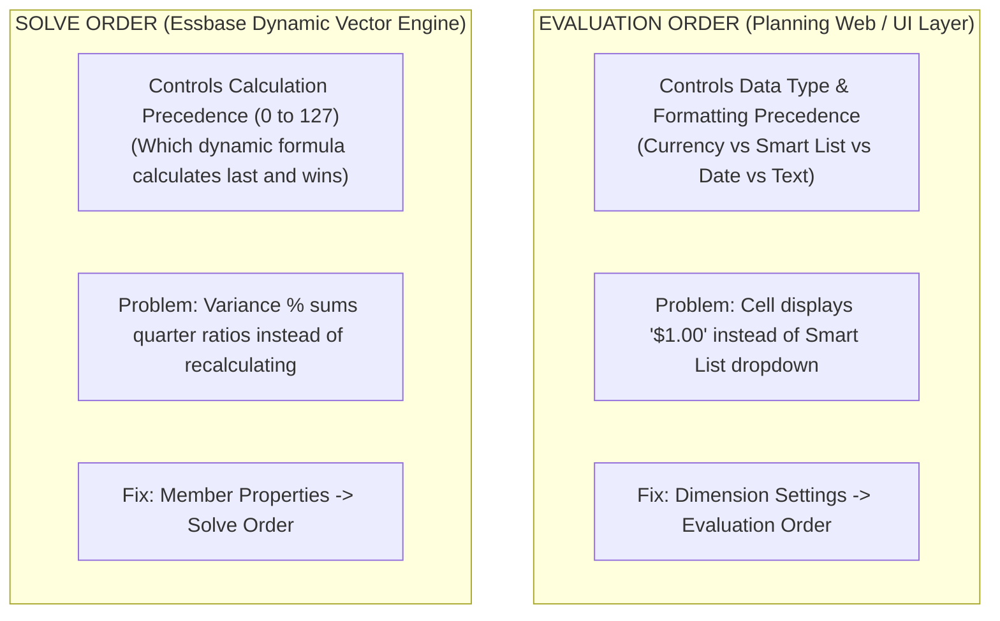
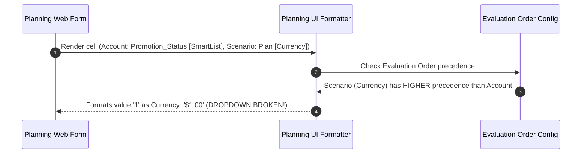
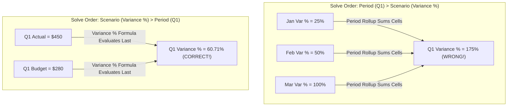

# 2.5 Evaluation Order vs Solve Order: The Classic Trap

> **Consultant Focus:** This is one of the most famous traps in Oracle Cloud EPM interviews. Interviewers deliberately conflate **Evaluation Order** (Planning Web UI data-type precedence) with **Solve Order** (Essbase dynamic calculation precedence). If you confuse them, you immediately reveal a lack of production experience.

<!-- ===================================================================== -->
<!-- 📊 LIVE INTERACTIVE VISUAL CARD: EVALUATION ORDER vs SOLVE ORDER -->
<!-- ===================================================================== -->
<details open>
<summary><b>📊 Live Interactive Architecture Card: The Classic Evaluation vs. Solve Order Trap (Click to Collapse / Expand)</b></summary>

<br/>

> [!TIP]
> **Interactive Standalone Dashboard:** Open [`card_02_outline_properties.html`](../interactive_cards/card_02_outline_properties.html) in your browser to interactively simulate solve order collisions!

| Architecture Layer | Property Name | Configuration Location | What It Controls | Typical Production Bug &amp; Fix |
| :--- | :--- | :--- | :--- | :--- |
| **Planning Presentation Tier** | **Evaluation Order** | Dimension Management &rarr; Evaluation Order | **HOW A CELL LOOKS** (Currency, Smart List, Date, Text) | Bug: Cell displays `$1.00`. Fix: Move `Account` to Priority 1. |
| **Essbase Calculation Kernel** | **Solve Order (0–127)** | Member Properties &rarr; Solve Order | **WHAT VALUE A CELL HAS** (Which formula calculates last) | Bug: Quarter sums ratios (120%). Fix: Account (10) &gt; Time (0). |

</details>

---

## 1. The Core Distinction: UI Display vs Mathematical Math



### The Quick Rule to Remember:
* **Evaluation Order:** Decides **HOW A CELL LOOKS** (Formatting & Data Type). Does it render as a Currency `$`, a Smart List drop-down, a Date calendar picker, or a Text box?
* **Solve Order:** Decides **WHAT VALUE A CELL HAS** (Mathematical Calculation). Which formula calculates first, and which formula executes last to overwrite the intersection?

---

## 2. Deep Dive: Evaluation Order (Planning UI Data Type Precedence)

In Oracle Planning, every member in the **Account** dimension (and optionally other dimensions) is assigned a **Data Type**:
* `Currency`
* `Non-Currency`
* `Percentage`
* `Smart List` (Enumerated text dropdown)
* `Date`
* `Text`

### The Collision Scenario:
What happens when a cell is an intersection of two members with **different data types**?
* Dimension **Account**: `Promotion_Status` (Data Type = **`Smart List`**)
* Dimension **Scenario**: `Current_Forecast` (Data Type = **`Currency`**)

Which data type wins? Does the cell render as a **Smart List drop-down** or a **Currency numeric input field**?

### The Classic Production Bug:
A planner opens a workforce planning form. Under the column `Promotion_Status`, instead of seeing a dropdown menu with choices (`"Promote"`, `"Retain"`, `"Transfer"`), they see:
```
$1.00
```
The planner cannot select an option, and typing text throws an error!

### Why Did This Happen?
Because in the Planning application's **Evaluation Order** settings:
1. `Scenario` was placed **higher** in priority than `Account`.
2. The UI evaluated `Scenario` first: `"Scenario is Currency, so this cell must render as Currency ($)."`
3. The internal numeric ID of the Smart List entry (e.g., ID `1` for `"Promote"`) was formatted as a dollar amount: **`$1.00`**!



### The Remediation:
1. Navigate to: **Dimension Management** $\rightarrow$ **Evaluation Order**.
2. For each plan type, arrange the dimensions in order of data-type priority.
3. **Best Practice Evaluation Order:**
   * **1st Priority:** `Account` (Ensures Smart Lists, Dates, and Text defined on Accounts override general currency dimensions).
   * **2nd Priority:** `Driver Dimension` (if applicable).
   * **Lowest Priority:** `Scenario`, `Version`, `Years`, `Period`.

---

## 3. Deep Dive: Solve Order (Essbase Calculation Precedence)

**Solve Order** is an Essbase calculation property assigned to **Dynamic Calc** members. It resolves **formula collisions** at the intersection of two or more dynamic calculation rules.

### The Mathematical Collision:
Consider the intersection of:
1. **Scenario Dimension:** `Variance_%` (Dynamic Calc)
   $$\text{Variance } \% = \frac{\text{Actual} - \text{Budget}}{\text{Budget}} \times 100$$
2. **Period Dimension:** `Q1` (Dynamic Calc Rollup)
   $$\text{Q1} = \text{Jan} + \text{Feb} + \text{Mar}$$

At the cell coordinate `(Variance_%, Q1)`, which formula should Essbase execute?

```
                     Jan         Feb         Mar         Q1 Rollup
Actual              $100        $150        $200           $450
Budget               $80        $100        $100           $280
Variance %          25.0%       50.0%      100.0%            ???
```

### Case A: If `Q1` has higher priority (or calculated last)
* Essbase sums the monthly variance percentages:
  $$\text{Q1} = 25.0\% + 50.0\% + 100.0\% = \mathbf{175.0\%} \quad \text{\textbf{(MATHEMATICALLY ABSURD!)}}$$

### Case B: If `Variance_%` has higher Solve Order (calculates last)
* Essbase first computes Q1 Actual ($450) and Q1 Budget ($280).
* Then, it executes the `Variance_%` formula on the aggregated quarter totals:
  $$\text{Variance } \% = \frac{450 - 280}{280} \times 100 = \mathbf{60.71\%} \quad \text{\textbf{(MATHEMATICALLY CORRECT)}}$$



---

## 4. Solve Order Rules and Priority Mechanics

1. **Numeric Range:** **`0 to 127`** (Integers).
2. **The Golden Rule:** **Higher Solve Order calculates LAST** (overwrites the lower solve order).
   $$\text{Solve Order } 20 \text{ overrides Solve Order } 10$$
3. **Default Values:**
   * Standard dynamic rollup members (consolidation operators `+`, `-`): Default Solve Order is **`0`**.
   * Dynamic Calc member formulas: Default Solve Order is **`0`** unless explicitly set.

### Enterprise Solve Order Standard Hierarchy:

| Dimension / Member Type | Recommended Solve Order | Rationale |
| :--- | :--- | :--- |
| **Standard Period Dynamic Rollups (`Q1`, `YearTotal`)** | **`0`** | Base time aggregation must occur first. |
| **Sparse Hierarchical Dynamic Rollups (`Total Entity`)** | **`0`** | Base structural consolidations evaluate next. |
| **Simple Account Ratios (`Gross Margin %`)** | **`10`** | Must evaluate after base totals are summed. |
| **Scenario / Version Variances (`Var`, `Var %`)** | **`20`** | Must evaluate after both period rollups and base accounts are calculated. |
| **Complex Cross-Dimensional Metrics (`ROI %`, `WACC`)** | **`30`** | Highest precedence; evaluates after all drivers and variances are settled. |

---

## 5. Summary Comparison Matrix: Evaluation Order vs Solve Order

| Feature | Evaluation Order | Solve Order |
| :--- | :--- | :--- |
| **Engine / Layer** | Planning Web / ADF / UI Layer | Essbase Dynamic Calculation Kernel |
| **Primary Purpose** | Format & Data Type Rendering | Dynamic Formula Calculation Priority |
| **Controls** | Currency, Smart List, Date, Text display | Which intersecting math formula wins |
| **Where Configured** | Dimension Management $\rightarrow$ Evaluation Order | Dimension Management $\rightarrow$ Member Properties |
| **Configured At** | **Dimension Level** (ranked list of dims) | **Member Level** (integer 0–127) |
| **Applies To** | Input forms, Smart View grids, Reports | Dynamic Calc members, MDX member formulas |
| **Impact on Essbase Blocks** | **Zero** (Pure presentation layer) | Determines the mathematical value returned |
| **Typical Bug** | Smart List displays as `$1.00` | Quarter total sums ratios ($175\%$ instead of $60\%$) |

---

## 6. Twisted Interview Questions & Consultant Model Answers

### Q1: "On a Planning web form, a user sees `$1.00` instead of a Smart List drop-down menu for an Account member `Approval_Status`. What caused this, and what is the exact configuration fix?"
**Consultant Model Answer:**
> "This is an **Evaluation Order conflict** in the Planning UI layer.
>
> **The Root Cause:**
> In the application's Evaluation Order settings for that plan type, a dimension formatted as `Currency` (such as `Scenario`, `Version`, or `Entity`) is ranked with a higher priority than the `Account` dimension. When the Planning web engine formats the intersection of `Approval_Status` (Data Type: Smart List) and `Plan` (Data Type: Currency), it applies the currency formatting rule first. Smart Lists store integer keys internally (e.g., ID `1` for 'Approved'); the UI renders this integer as `$1.00`.
>
> **The Exact Fix:**
> 1. Go to **Navigator** $\rightarrow$ **Dimensions** $\rightarrow$ **Evaluation Order**.
> 2. Select the relevant Plan Type / Cube.
> 3. Move the **`Account`** dimension to the top of the evaluation order list (Priority 1).
> 4. Save the configuration and reopen the form. The cell will immediately render as an interactive Smart List dropdown."

---

### Q2: "An interviewer asks: 'I have a calculation formula on `Gross_Margin_%` in the Account dimension and a `Variance_%` formula in the Scenario dimension. How do I configure Evaluation Order to ensure `Variance_%` calculates after `Gross_Margin_%`?' How do you respond?"
**Consultant Model Answer:**
> "I would respectfully clarify that **Evaluation Order cannot be used to resolve calculation order**. 
>
> Evaluation Order operates strictly in the Planning presentation/UI layer to resolve **data-type formatting collisions** (such as Smart List vs Currency). It has zero impact on Essbase mathematical execution.
>
> To control which formula calculates after the other in Essbase, we must use **`Solve Order`**:
> 1. Set the Solve Order of `Gross_Margin_%` in the Account dimension to **`10`**.
> 2. Set the Solve Order of `Variance_%` in the Scenario dimension to **`20`**.
>
> Because Essbase evaluates members with higher solve orders **last**, the engine will first calculate `Gross_Margin_%` across all scenarios, and then evaluate `Variance_%` on the resulting margin percentages, producing mathematically accurate variance ratios."

---

### Q3: "What happens if two intersecting dynamic calculation members have the exact same Solve Order (e.g., both have Solve Order 0 or both have Solve Order 20)?"
**Consultant Model Answer:**
> "When a solve order tie occurs between two intersecting dynamic calc members, Essbase relies on its internal **default outline evaluation sequence**:
> 1. In **Classic BSO and Hybrid BSO**, Essbase breaks the tie using the standard dimension outline order:
>    - `Accounts` dimension evaluates first, followed by `Time`, followed by the remaining dense and sparse dimensions in their outline sequence.
> 2. In **ASO**, solve order ties default to outline sequence or dimensions defined earlier in the MDX query axis.
>
> Relying on default outline tie-breaking is dangerous in enterprise applications because outline reorganizations can silently alter calculation precedence. Best practice is to **explicitly assign distinct solve orders** (e.g., 10 and 20) to eliminate ambiguity."

---

### Q4: "Does Evaluation Order affect the numbers stored in Essbase, or can it cause data corruption?"
**Consultant Model Answer:**
> "Evaluation Order **does not alter or corrupt the underlying numbers stored in Essbase blocks**.
>
> Evaluation Order is purely a presentation-layer rule in Oracle Hyperion Planning / Cloud EPM ADF framework. It instructs the web and Smart View client rendering engines how to display and accept input for an intersection. 
>
> However, an incorrect Evaluation Order can cause **operational input failures**:
> - If an integer Smart List cell is rendered as Currency `$1.00`, users cannot select text options from the dropdown.
> - If a planner types text into a cell formatted as Currency by Evaluation Order, the write request fails with a data validation error.
> 
> The underlying Essbase cell still holds the integer value `1`; only the user interface rendering is affected."

---

### Q5: "What is the difference in Solve Order behavior between Classic BSO and Modern Hybrid BSO / ASO?"
**Consultant Model Answer:**
> "The architectural difference lies in where the formulas are evaluated and what features are supported:
> 1. **In Classic BSO:**
>    - Solve Order was historically limited to ASO. Classic BSO primarily used the **`Two-Pass`** property on the Accounts and Time dimensions to handle ratios.
>    - Classic BSO did not support general solve orders across multiple sparse dimensions; complex calculations required procedural calculation scripts.
> 2. **In Hybrid BSO & ASO:**
>    - Both engines fully support the **Solve Order property (0 to 127)** across **all** dimensions (Account, Time, Scenario, Version, Entity, Custom dims).
>    - The integrated ASO dynamic vector engine evaluates formulas in memory according to solve order priority, completely eliminating the need for Two-Pass tags and batch script aggregations for reporting variances."

