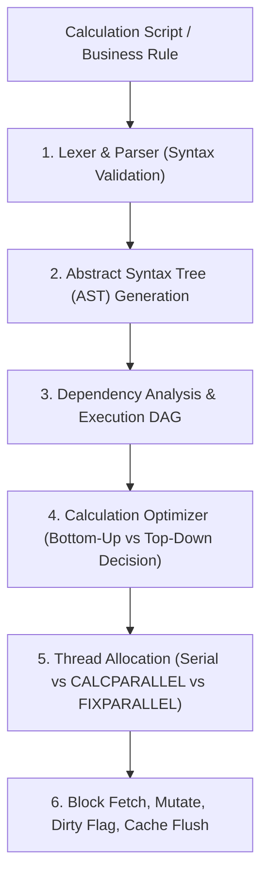
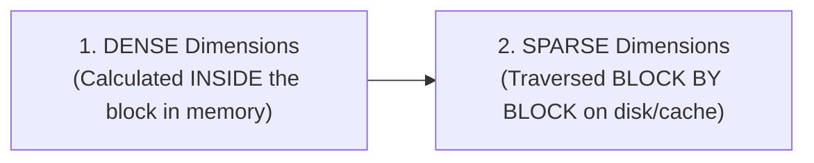
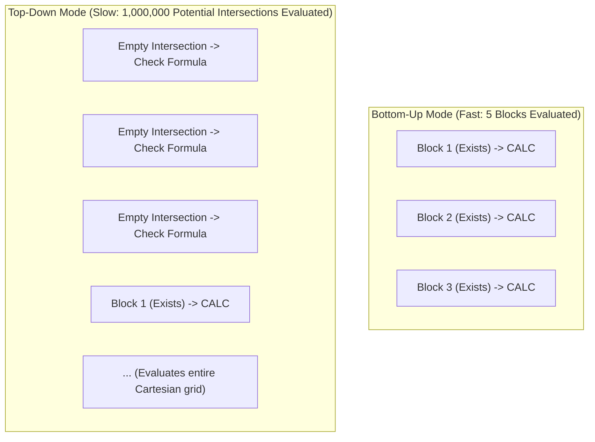

# 3.1 BSO Calculation Engine Execution Order & Internals

> **Consultant Focus:** Understanding how Essbase parses, compiles, and iterates through calculation scripts is the hallmark of an advanced consultant. Interviewers will test your knowledge of **Dense vs Sparse execution order**, **Bottom-Up vs Top-Down** execution modes, and parallel processing bottlenecks (`CALCPARALLEL` vs `FIXPARALLEL`).

<!-- ===================================================================== -->
<!-- 📊 LIVE INTERACTIVE VISUAL CARD: BSO CALC EXECUTION & PARALLEL RULES -->
<!-- ===================================================================== -->
<details open>
<summary><b>📊 Live Interactive Architecture Card: Calculation Engine Lifecycle &amp; Modes (Click to Collapse / Expand)</b></summary>

<br/>

> [!TIP]
> **Interactive Standalone Dashboard:** Open [`card_03_calculations_groovy.html`](../interactive_cards/card_03_calculations_groovy.html) in your browser for an interactive calc execution flow &amp; validation simulator!

| Execution Dimension | Optimal Pattern | Pathological Trap | Consultant Remediation |
| :--- | :--- | :--- | :--- |
| **Calculation Order** | **Dense first (RAM) &rarr; Sparse next (Disk)** | Inverting sequence causes double passes | Dense outline order: Accounts then Period |
| **Calculation Mode** | **Bottom-Up (`@CALCMODE(BOTTOMUP)`)** | Top-Down scans Cartesian space (hours) | Remove sparse `IF` checks from dense formulas |
| **Parallel Processing** | **`FIXPARALLEL(n, MemberList)`** | `CALCPARALLEL` causes thread starvation | Slices independent sparse dimension (Entity) |
| **Empty Prompts** | **`SET EMPTYMEMBERSETS ON;`** | Script runs on entire cube (overwrites data) | Mandatory header in all production scripts |

</details>

---

## 1. The BSO Calculation Engine: Compilation & Execution Lifecycle

When an Essbase calculation script or business rule is executed, Essbase does not simply run line-by-line interpretively. It follows a rigorous multi-stage engine lifecycle:



### Stage 1: Syntax Parsing & AST Generation
* The parser converts `FIX`, `IF`, `@` functions, and formulas into an Abstract Syntax Tree (AST).
* Any unknown member, unbalanced parenthesis, or illegal type conversion halts execution before any data block is accessed.

### Stage 2: Dependency Analysis
* Essbase builds a Directed Acyclic Graph (DAG) to determine member dependencies.
* If member `C = A + B`, Essbase ensures blocks holding `A` and `B` are resolved prior to computing `C`.

---

## 3. The Golden Execution Order: Dense First, Then Sparse

In BSO and Hybrid BSO, Essbase executes calculations in a deterministic sequence dictated by dimensional density:



### 1. Dense Execution (Intra-Block):
* A dense calculation modifies cells **inside the existing 8-byte array** of a data block currently resident in the data cache.
* Because all dense cells reside in a contiguous block of RAM, dense calculations are **pure CPU operations** requiring zero disk I/O once the block is loaded.
* Dense formulas evaluate according to the outline order of the Dense dimensions (typically `Accounts` first, then `Period`).

### 2. Sparse Execution (Inter-Block):
* Sparse dimensions define the **physical block coordinates** (the Index).
* When a calculation formula references or aggregates a sparse dimension, Essbase must:
  1. Look up the sparse combination in the index table (`.ind`).
  2. Locate the physical block offset in the page file (`.pag`).
  3. Load the block into memory (if not cached).
  4. Perform the calculation.
  5. Mark the block header as **Dirty**.
  6. Flush the modified block back to disk upon commit.
* Sparse calculations are heavily **Disk I/O and Memory Bus bound**.

---

## 3. Bottom-Up vs Top-Down Calculation Mode: The Silent Killer

One of the most critical performance diagnostic items in Essbase application logs (`essbase.log`) is the calc mode message:

```
Formula on [Target_Member] will be executed in Top-Down mode.
```

### Detailed Comparison:

| Feature | Bottom-Up Mode (Optimal) | Top-Down Mode (Pathological) |
| :--- | :--- | :--- |
| **How It Executes** | Essbase iterates **only over existing data blocks**. | Essbase evaluates **every possible Cartesian combination** of sparse members, checking whether a block should exist. |
| **Speed** | Blazing fast (milliseconds to seconds). | Extremely slow (minutes to hours). |
| **Block Creation** | Calculates existing blocks; does not create new blocks unless explicitly commanded. | Can evaluate millions of `#Missing` intersections, evaluating formulas unnecessarily. |
| **When Essbase Chooses It** | Simple intra-block formulas, straight arithmetic, formulas with standard dependencies. | Cross-dimensional operators referencing other sparse dimensions, complex `IF` statements referencing non-existent blocks. |
| **Log Indicator** | `Formula ... will be executed in Bottom-Up mode` (or omitted). | `Formula on [...] will be executed in Top-Down mode`. |



### Forcing Bottom-Up Mode:
You can force the calculation engine into bottom-up execution using the compiler directive:
```essbase
@CALCMODE(BOTTOMUP);
```
Example:
```essbase
"Target_Expense"(
    @CALCMODE(BOTTOMUP);
    "Driver_Rate" * "Units";
)
```

> [!WARNING]
> **The Bottom-Up Risk:** If you force `@CALCMODE(BOTTOMUP)` on a formula that is supposed to create new blocks (e.g., allocating costs to departments that currently have no data blocks), **the calculation will silently do nothing**! The target blocks will never be created because Bottom-Up only calculates blocks that already exist.

---

## 4. Parallel Processing: `CALCPARALLEL` vs `FIXPARALLEL`

When running enterprise calculations across millions of blocks, single-threaded processing creates massive batch window delays.

### 1. `SET CALCPARALLEL n;` (Legacy Engine Multithreading)
* Configures Essbase to spawn `n` worker threads during `CALC ALL` or `CALC DIM`.
* **How It Works:** Essbase dynamically splits the sparse block index among threads.
* **The Pitfalls:**
  1. **Thread Starvation:** If the calculation dependencies are complex (e.g., cross-block references), threads must wait on locks, causing high CPU context switching and zero performance gain.
  2. **CALCTASKDIMS Contention:** Essbase picks task dimensions automatically. If it picks a sparse dimension with few members, only 2 out of 8 threads do any work.

### 2. `FIXPARALLEL (n, MemberList)` (Modern Best Practice)
Introduced to provide explicit, deterministic multi-threading:
```essbase
FIXPARALLEL (8, @RELATIVE("Total_Entity", 0))
    FIX("FY24", "Plan", "Working")
        "Operating_Expense" = "Salaries" + "Rent" + "Travel";
    ENDFIX
ENDFIXPARALLEL
```

### Why `FIXPARALLEL` Is Superior:
1. **Explicit Slicing:** You explicitly divide the workload across an independent sparse dimension (e.g., `Entity`).
2. **Zero Lock Contention:** Thread 1 handles Entities 1–10; Thread 2 handles Entities 11–20. Neither thread ever touches the other thread's data blocks, eliminating block locking completely.
3. **Linear Scalability:** Typically achieves near 100% core utilization and 4x–7x speedups on 8-core CPUs.

### Rules and Limitations of `FIXPARALLEL`:
* The parallel dimension **must be SPARSE**.
* You cannot nest `FIXPARALLEL` inside another `FIXPARALLEL`.
* You cannot use cross-slice calculations inside `FIXPARALLEL` (e.g., Thread 1 cannot read data computed by Thread 2).

---

## 5. Critical Calculation Commands & Safeguards

### 1. `SET EMPTYMEMBERSETS ON;`
* **Default Behavior (`OFF`):** If a `FIX` statement resolves to an empty member set (e.g., a Runtime Prompt returns no members), Essbase **ignores the FIX and executes the calculation against the ENTIRE DATABASE**! This can corrupt millions of cells and take hours.
* **With `ON`:** If the `FIX` evaluates to empty, Essbase immediately halts that calculation block cleanly:
  ```essbase
  SET EMPTYMEMBERSETS ON;
  FIX(&RTP_Entities) /* If user selects nothing, script safely stops */
      ...
  ENDFIX
  ```

### 2. `SET CREATENONMISSINGBLK OFF;`
* If set to `ON`, Essbase creates a physical block for **every single non-missing cell combination evaluated**.
* This is the #1 cause of **Block Explosion** in production cubes. Always ensure it is `OFF` unless strictly required within a tightly controlled Level 0 slice.

---

## 6. Twisted Interview Questions & Consultant Model Answers

### Q1: "A calculation script contains `FIX(FY24, Plan, Working)` and runs `"Net_Sales" = "Units" * "Price";`. The log shows: `Formula on [Net_Sales] will be executed in Top-Down mode`. Why did Essbase choose Top-Down, what is the penalty, and how do you fix it?"
**Consultant Model Answer:**
> "Essbase falls back to **Top-Down mode** when the calculation compiler cannot verify that the formula's execution is strictly contained within blocks that already exist. This commonly occurs when:
> 1. One of the referenced members (`Units` or `Price`) resides in a different sparse dimension or is a dynamic calc member with complex cross-dimensional references.
> 2. The target member `Net_Sales` has an outline formula containing an `IF` condition evaluating a sparse member.
>
> **The Performance Penalty:**
> In Top-Down mode, Essbase evaluates the Cartesian product of all sparse dimensions in the scope, inspecting thousands or millions of empty intersections to see if a block should be created or calculated. This increases calculation time from seconds to hours.
>
> **The Fix:**
> 1. First, check if the formula can be forced to **Bottom-Up** mode by adding `@CALCMODE(BOTTOMUP)` inside the formula block:
>    ```essbase
>    "Net_Sales"(
>        @CALCMODE(BOTTOMUP);
>        "Net_Sales" = "Units" * "Price";
>    )
>    ```
> 2. Ensure both `Units` and `Price` exist in the existing blocks before running.
> 3. If new blocks must be created, replace the top-down formula with an explicit, targeted `@CREATEBLOCK` or `DATACOPY` from an existing driver block, followed by a fast bottom-up calculation."

---

### Q2: "A developer writes `FIXPARALLEL (8, @RELATIVE("Total_Entity", 0))` to run an allocation rule where Corporate Overhead ($1M in `Corp_Entity`) is allocated to all child entities based on their respective revenue ratios. The rule runs fast, but the allocated numbers are completely wrong or zero. Why?"
**Consultant Model Answer:**
> "This fails because of a fundamental violation of **parallel execution independence**:
>
> In `FIXPARALLEL`, Essbase partitions the specified dimension (`Entity`) into 8 independent slices and assigns each slice to a separate worker thread. Each thread operates in complete isolation on its allocated subset of entity blocks.
>
> In an allocation rule:
> 1. Each child entity must read `Total_Revenue` from the summary parent `Total_Entity` (or read `Corp_Entity`).
> 2. Because `Entity` is the dimension being parallelized, Thread 1 (calculating `Entity_East`) cannot safely access or synchronize with `Corp_Entity` or the unaggregated parent `Total_Entity` being calculated by another thread.
> 3. If `Total_Revenue` has not been pre-calculated and locked, or if threads attempt to read shared blocks simultaneously, threads read `#Missing` or stale intermediate values.
>
> **The Correct Architecture:**
> 1. **Step 1 (Serial/Pre-Calc):** Pre-calculate and freeze the allocation driver (Total Revenue) and source pool (`Corp_Entity`) in a separate serial pass. Store the scalar driver or percentage in an un-sliced intersection or a dense variable.
> 2. **Step 2 (FIXPARALLEL):** Run `FIXPARALLEL` across `Entity` to perform only the **multiplication** of the pre-calculated driver against the local entity."

---

### Q3: "What is the precise difference between `CALC AGG` and `CALC DIM`? When should you use which?"
**Consultant Model Answer:**
> - **`CALC AGG (DimList);`:**
>   - Executes a pure **hierarchical rollup** across the specified sparse dimensions.
>   - Only processes standard consolidation operators (`+`, `-`, `~`).
>   - **Ignores member formulas!** If a member has a formula, `CALC AGG` skips it and only performs parent-child addition/subtraction.
>   - Extremely fast and optimized for pure aggregation passes.
> - **`CALC DIM (DimList);`:**
>   - Executes a **full dimension calculation**.
>   - Evaluates **both member formulas AND hierarchical aggregations** across the dimension according to outline sequence.
>   - Required whenever sparse dimensions contain members with calculation formulas that must be stored.
>
> **Rule of Thumb:** If sparse dimensions have no member formulas, always use `CALC AGG` for maximum performance."

---

### Q4: "Why should `SET EMPTYMEMBERSETS ON;` be placed at the top of every production business rule?"
**Consultant Model Answer:**
> "By default, Essbase has `SET EMPTYMEMBERSETS OFF;`.
>
> In production Oracle Cloud EPM Planning, calculation scripts use Runtime Prompts (RTPs) where users select members from a form (e.g., `&RTP_Entity`).
>
> If a user launches a rule on a form where no entity is selected, or if an `@INTERSECT` function between user selections yields no common members:
> 1. With `EMPTYMEMBERSETS OFF`: Essbase treats the empty member set as an invalid constraint, **wipes out the FIX boundary, and executes the calculation logic against the ENTIRE CUBE across all entities, all years, and all scenarios**!
>    - This causes massive data corruption (overwriting Actuals or other departments' budgets) and server hangs.
> 2. With `EMPTYMEMBERSETS ON`: Essbase recognizes the empty set, immediately logs an informational message (`Empty member set detected`), and cleanly exits the script without calculating anything.
>
> Therefore, `SET EMPTYMEMBERSETS ON;` is a non-negotiable enterprise safeguard."

---

### Q5: "What is the difference between `DATACOPY` and `@CREATEBLOCK`? When would you use each to prevent block explosion?"
**Consultant Model Answer:**
> - **`DATACOPY Source_Sparse_Comb TO Target_Sparse_Comb;`:**
>   - Copies entire physical data blocks from an existing source sparse combination to a target sparse combination.
>   - Copies all dense values, whether non-missing or `#Missing`.
>   - Extremely fast because it performs direct memory/disk block cloning without evaluating formulas cell-by-cell.
>   - **Drawback:** Copies every cell in the block, including zero/missing cells, creating dense block bloat if the source was sparse.
> - **`@CREATEBLOCK (Sparse_Coordinate);`:**
>   - A function that explicitly instantiates a new empty data block for a specific sparse combination if and only if that block does not already exist.
>   - Initializes the block with all `#Missing` values.
>   - **Advantage:** Allows you to create exactly one target block before running targeted bottom-up calculations on specific cells, avoiding the broad block creation of `DATACOPY` or the dangerous Cartesian explosion of `SET CREATENONMISSINGBLK ON`."

