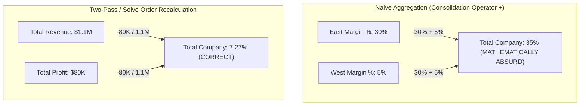
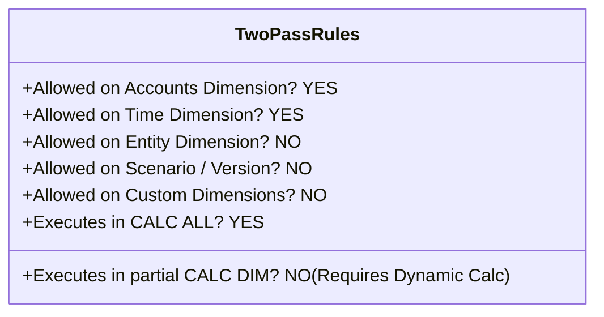

# 3.2 Two-Pass Calculation & The Ratio Fallacy

> **Consultant Focus:** Interviewers use the "Ratio Fallacy" to test whether you understand the mathematical foundation of multidimensional consolidations. You must be able to prove mathematically why parent ratios cannot be summed, explain the exact mechanics and limitations of the **Two-Pass** flag in Classic BSO, and contrast it with **Solve Order** in Modern Hybrid BSO.

---

## 1. The Mathematical Foundation: The Ratio Fallacy

The fundamental flaw in hierarchical rollups of calculated percentages, unit averages, and financial ratios is the **Ratio Fallacy**:

$$\sum_{i=1}^{n} \left(\frac{A_i}{B_i}\right) \neq \frac{\sum_{i=1}^{n} A_i}{\sum_{i=1}^{n} B_i}$$

The sum of individual ratios is mathematically never equal to the ratio of the sums (except in trivial, uniform cases).

### The Concrete Business Example:
Consider a company with two operating divisions:

| Division | Revenue ($) | Gross Profit ($) | Gross Margin % ($\frac{\text{Profit}}{\text{Revenue}}$) |
| :--- | :--- | :--- | :--- |
| **Division East** | \$100,000 | \$30,000 | **30.0%** |
| **Division West** | \$1,000,000 | \$50,000 | **5.0%** |
| **Total Company (True Math)** | **\$1,100,000** | **\$80,000** | **$\frac{\$80,000}{\$1,100,000} = \mathbf{7.27\%}$** |
| **Naive Hierarchical Sum ($+$)** | \$1,100,000 | \$80,000 | **$30.0\% + 5.0\% = \mathbf{35.0\%}$ (NONSENSE)** |



---

## 2. What Is the Two-Pass Calculation Property?

In Classic BSO Essbase, hierarchical consolidation occurs bottom-up:
1. Level 0 children roll into Level 1 parents.
2. Level 1 parents roll into Level 2 parents.
3. During this aggregation, Essbase by default applies the consolidation operator (`+`) across all accounts, including `Margin %`.

To resolve this, Essbase introduced the **Two-Pass Calculation** property.

### How Two-Pass Executes Internally:
1. **Pass 1 (Primary Calculation & Aggregation):**
   - Essbase aggregates the entire database hierarchy.
   - It computes `Total Revenue = $1,100,000` and `Total Gross Profit = $80,000`.
   - On this first pass, `Total Margin %` is either ignored or temporarily aggregated to $35.0\%$.
2. **Pass 2 (Two-Pass Recalculation):**
   - Essbase initiates a second scan specifically targeting members tagged as **`Two-Pass`**.
   - It encounters `Margin %` at `Total Company`.
   - Instead of summing children, it re-executes the member formula on the already-consolidated parent numbers:
     $$\text{Total Margin } \% = \frac{\text{Total Gross Profit}}{\text{Total Revenue}} \times 100 = 7.27\%$$
   - The cell value is overwritten with the mathematically correct ratio.

---

## 3. Strict Rules and Engine Limitations of Two-Pass

The Two-Pass property has rigid architectural constraints that every consultant must memorize:



### The 4 Rigid Constraints:
1. **Dimension Restriction:**
   * Two-Pass can **ONLY** be applied to members in the **Accounts** dimension and the **Time** dimension.
   * Attempting to set Two-Pass on `Scenario` (e.g., `Variance %`) or `Entity` will either be rejected by the outline compiler or silently ignored!
2. **Calculation Script Exclusion:**
   * The Two-Pass property is only honored during a default database consolidation (`CALC ALL;` or standard outline calculation).
   * If a calculation script uses custom `CALC DIM(Entity); CALC DIM(Product);`, the Two-Pass flag on stored accounts is **NOT executed** unless the member is tagged as **`Dynamic Calc`**!
3. **Storage Type Requirement:**
   * In modern practice, Two-Pass members should always be set to **`Dynamic Calc`**.
   * Setting a stored member as Two-Pass requires the engine to write the recalculation back to physical blocks on disk during Pass 2, significantly increasing batch calculation runtimes.

---

## 4. The Two-Dimensional Ratio Trap: Accounts vs Time

A classic interview problem involves ratios that cross both the Account dimension and the Time dimension.

```
                      Jan         Feb         Mar         Q1 Rollup
Sales                $100        $150        $200           $450
Units                  10          15          25             50
Avg Price / Unit      $10         $10          $8            ???
```

### The Problem:
* `Avg Price / Unit` has a formula in the **Accounts** dimension: `"Sales" / "Units"`.
* `Q1 Rollup` has an aggregation in the **Time** dimension: `"Jan" + "Feb" + "Mar"`.
* At intersection `(Avg Price / Unit, Q1)`:
  - If Time aggregates first: $10 + 10 + 8 = \mathbf{\$28}$ (Absurd).
  - If Account calculates: $\$450 / 50 = \mathbf{\$9.00}$ (Correct).

### How Classic BSO Handled This:
In Classic BSO, if `Avg Price / Unit` was marked as `Two-Pass` on the Accounts dimension, Pass 2 ensured that after the Time dimension rolled up `Sales` and `Units` to Q1, the Account formula re-evaluated to yield `$9.00`.

---

## 5. Why Two-Pass Is Deprecated in Modern Hybrid BSO & ASO

In modern Oracle Cloud EPM applications running on **Hybrid BSO** or **ASO**, Two-Pass is largely obsolete and superseded by **`Solve Order`**.

| Architectural Feature | Classic BSO Two-Pass | Modern Hybrid BSO / ASO Solve Order |
| :--- | :--- | :--- |
| **Applicable Dimensions** | Accounts and Time **ONLY** | **ALL Dimensions** (Accounts, Period, Scenario, Version, Entity, Custom) |
| **Granularity of Control** | Binary (On or Off) | **128 Priority Levels (`0 to 127`)** |
| **Multi-Dimensional Collisions** | Fails when 3 or more dimensions have formulas | Deterministically resolves n-way formula collisions |
| **Execution Performance** | Required a 2nd physical scan of stored blocks | Evaluated in memory on-the-fly by dynamic vector engine |
| **Batch Window Impact** | Adds disk I/O and runtime to nightly batch calc | **Zero batch window impact** (evaluated at query time) |

---

## 6. Twisted Interview Questions & Consultant Model Answers

### Q1: "A developer tags `Margin_%` in the Account dimension as `Two-Pass` and marks its Data Storage as `Store`. In a custom calculation script that executes `CALC DIM(Entity); CALC DIM(Product);`, the parent entities still display the sum of child percentages. Why did Two-Pass fail to recalculate the parent?"
**Consultant Model Answer:**
> "Two-Pass failed because of how Essbase handles stored members during custom calculation scripts:
>
> 1. In Essbase, the `Two-Pass` property on **Stored** members is only triggered during a **full database outline consolidation** (i.e., `CALC ALL;`).
> 2. When a calculation script executes discrete, selective commands like `CALC DIM(Entity);`, Essbase calculates the sparse dimension aggregations but **does not initiate Pass 2** for the Accounts dimension. The stored `Margin_%` cells at parent entity intersections retain whatever was aggregated during the entity rollup.
>
> **The Fix:**
> - Change `Margin_%` from `Store` to **`Dynamic Calc (~)`**.
> - When a member is `Dynamic Calc`, Essbase recalculates the formula dynamically in memory upon user retrieval regardless of what calculation script was executed, completely bypassing the stored calculation script limitation."

---

### Q2: "Can you tag a member in the `Scenario` dimension (e.g., `Variance_%`) as `Two-Pass`? If not, how did consultants solve this in Classic BSO before Hybrid BSO existed?"
**Consultant Model Answer:**
> "No. In Essbase, the `Two-Pass` property is syntactically **restricted strictly to the Accounts and Time dimensions**. Essbase outline compilers will reject or ignore Two-Pass flags on Scenario, Version, or Entity.
>
> **How Consultants Solved This in Classic BSO:**
> 1. **Procedural Calculation Scripts:** Consultants wrote explicit batch calc scripts that ran after the main consolidation, targeting the variance members:
>    ```essbase
>    FIX("Variance_%")
>        "Variance_%" = ("Actual" - "Budget") / "Budget";
>    ENDFIX
>    ```
> 2. **Cross-Dimensional Formulas:** Assigning complex formulas on dynamic calc accounts that evaluated scenario differences explicitly.
>
> **The Modern Cloud EPM Solution:**
> In Hybrid BSO, this problem is permanently solved by assigning a **`Solve Order`** (e.g., Solve Order 20) to `Variance_%` in the Scenario dimension, allowing the dynamic vector engine to evaluate it after accounts and time rollups."

---

### Q3: "What happens if an outline is migrated to Hybrid BSO, but the `Two-Pass` checkbox remains checked on several Account members? Does it cause an error?"
**Consultant Model Answer:**
> "It does not cause an error, but its behavior is effectively translated by the engine:
>
> 1. In Hybrid BSO, if a Dynamic Calc Account member has the `Two-Pass` property enabled, the Hybrid engine internally maps this to an elevated **Solve Order priority** relative to standard dynamic rollups (Solve Order 0).
> 2. However, best practice during a Hybrid BSO migration is to **explicitly replace Two-Pass tags with defined Solve Orders** (e.g., setting ratios to Solve Order 10 or 20).
> 3. Relying on legacy Two-Pass flags in Hybrid BSO can lead to subtle ordering conflicts if other dimensions (such as Version or Scenario) have explicit Solve Orders assigned, because Two-Pass does not specify a numerical priority relative to non-Account dimensions."

---

### Q4: "Prove mathematically why a calculation order conflict occurs at the intersection of `Gross_Margin_%` (Account), `Variance_%` (Scenario), and `Q1` (Period), and specify the required Solve Order hierarchy to resolve it."
**Consultant Model Answer:**
> "At the intersection `(Gross_Margin_%, Variance_%, Q1)`, three distinct mathematical operations collide:
> 1. Time Consolidation: $\text{Q1} = \text{Jan} + \text{Feb} + \text{Mar}$
> 2. Account Ratio: $\text{Gross\_Margin\_%} = \frac{\text{Profit}}{\text{Revenue}}$
> 3. Scenario Variance: $\text{Variance\_%} = \frac{\text{Actual} - \text{Budget}}{\text{Budget}}$
>
> If operations evaluate in the wrong sequence:
> - If Time evaluates last, it sums monthly percentages.
> - If Account evaluates last, it calculates margin on variances, which is financially meaningless.
>
> **The Correct Execution Sequence:**
> 1. **1st Priority (Solve Order 0):** `Q1` (Time). Sum base financial dollars across months to establish Q1 Actual Revenue, Q1 Actual Profit, Q1 Budget Revenue, and Q1 Budget Profit.
> 2. **2nd Priority (Solve Order 10):** `Gross_Margin_%` (Account). Compute Q1 Actual Margin % and Q1 Budget Margin % from the consolidated dollars.
> 3. **3rd Priority (Solve Order 20 - Evaluates LAST and Wins):** `Variance_%` (Scenario). Calculate the variance percentage between Q1 Actual Margin % and Q1 Budget Margin %.
>
> This guarantees that the final cell reports the exact variance between the two quarterly margin ratios."

---

### Q5: "Why does running `CALC ALL;` on a large Classic BSO cube with many stored Two-Pass members take significantly longer than running it without Two-Pass?"
**Consultant Model Answer:**
> "Because `CALC ALL` with stored Two-Pass members executes **two complete sequential passes over the database blocks**:
>
> 1. In **Pass 1**, Essbase traverses the sparse block index and evaluates all dense and sparse calculations, writing updated blocks to disk.
> 2. In **Pass 2**, Essbase must re-scan the block index to identify every block containing the Two-Pass stored accounts.
> 3. It re-loads those blocks back into the data cache (causing cache evictions of other blocks), re-executes the Two-Pass formulas, marks the blocks as dirty again, and writes them back to disk a second time.
>
> This creates massive **write amplification** and double disk I/O. This is why modern Cloud EPM completely replaces stored Two-Pass members with **Dynamic Calc members evaluated in memory** via Hybrid BSO."

