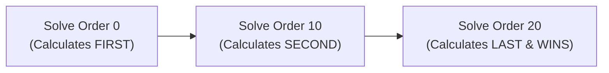
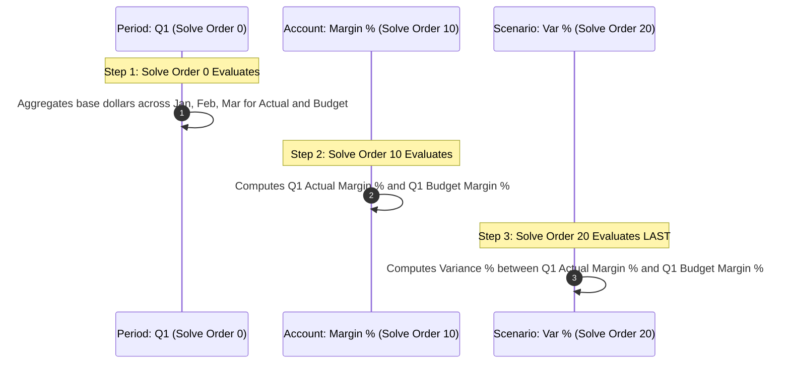

# 3.3 Solve Order Mastery & Collision Resolution

> **Consultant Focus:** Solve Order is the definitive mechanism used by both **Hybrid BSO** and **Aggregate Storage (ASO)** to evaluate dynamic calculations on the fly. Interviewers frequently test your ability to build multi-tier solve order hierarchies, resolve 3-way formula collisions, and troubleshoot query performance disasters caused by misconfigured solve orders.

---

## 1. The Dynamic Calculation Collision Problem

In a multidimensional cube, a single cell represents the intersection of all dimensions in the application. When **two or more intersecting members have dynamic calculation formulas**, a calculation collision occurs:

```
Intersection: (Account: Gross_Margin_%, Scenario: Variance_%, Period: Q1)
- Account Dimension wants to calculate: Gross_Margin_% = Profit / Revenue
- Scenario Dimension wants to calculate: Variance_% = (Actual - Budget) / Budget
- Period Dimension wants to calculate: Q1 = Jan + Feb + Mar
```

Which formula executes first? Which formula executes last and overwrites the cell?

Without explicit ordering, the engine would produce unpredictable, non-deterministic results depending on outline order or query axis sequence. **`Solve Order`** is the exact mathematical priority assigned to resolve this collision.

---

## 2. The Core Engine Rules of Solve Order



### The 3 Immutable Rules:
1. **Range:** Integers from **`0 to 127`**. (Negative numbers and values $> 127$ are rejected by the outline compiler).
2. **The Golden Rule:** **The member with the HIGHEST Solve Order calculates LAST and determines the final cell value.**
3. **Default Assignment:** Standard hierarchical rollup members (`+`, `-`) have an implicit default Solve Order of **`0`**.

---

## 3. Resolving Multi-Dimensional Formula Collisions

Let us walk through concrete collision scenarios step by step:

### Scenario 1: Two-Way Collision (Account vs Period)
* **Account:** `Gross_Margin_%` (Dynamic formula: `Profit / Revenue`)
* **Period:** `Q1` (Dynamic rollup: `Jan + Feb + Mar`)

| Solve Order Configuration | Execution Sequence | Cell Calculation at `(Gross_Margin_%, Q1)` | Financial Result |
| :--- | :--- | :--- | :--- |
| **Q1 (0) > Gross_Margin_% (0)** *(Tie defaults to Outline)* | Time rolls up first, then Account evaluates. | $\frac{\text{Q1 Profit}}{\text{Q1 Revenue}}$ | **CORRECT** |
| **Q1 (10) > Gross_Margin_% (0)** | Account evaluates monthly margins; Time sums them. | $\text{Jan Margin \%} + \text{Feb Margin \%} + \text{Mar Margin \%}$ | **WRONG (Sums Ratios)** |

---

### Scenario 2: Three-Way Collision (Account vs Scenario vs Period)
* **Account:** `Operating_Margin_%` (Dynamic formula: `Operating_Income / Revenue`)
* **Scenario:** `Variance_%` (Dynamic formula: `(Actual - Budget) / Budget`)
* **Period:** `Q1` (Dynamic rollup: `Jan + Feb + Mar`)



### Why This Order Is Mathematically Bulletproof:
1. **At Step 1 (Solve Order 0):** `Q1` sums base dollars. We now have valid quarterly numbers for Actual Revenue, Actual Income, Budget Revenue, and Budget Income.
2. **At Step 2 (Solve Order 10):** `Operating_Margin_%` calculates on the consolidated quarterly dollars:
   $$\text{Q1 Actual Margin } \% = \frac{\text{Q1 Actual Income}}{\text{Q1 Actual Revenue}}$$
   $$\text{Q1 Budget Margin } \% = \frac{\text{Q1 Budget Income}}{\text{Q1 Budget Revenue}}$$
3. **At Step 3 (Solve Order 20 - Highest Wins):** `Variance_%` calculates the variance percentage between the two quarterly margin ratios:
   $$\text{Q1 Margin Variance } \% = \frac{\text{Q1 Actual Margin } \% - \text{Q1 Budget Margin } \%}{\text{Q1 Budget Margin } \%}$$

---

## 4. The Enterprise 5-Tier Solve Order Standard Architecture

To eliminate formula collision bugs across enterprise applications, Oracle Cloud EPM implementations should adhere to the **5-Tier Solve Order Architecture**:

| Tier | Priority Level | Dimension / Member Types | Purpose & Examples |
| :---: | :---: | :--- | :--- |
| **Tier 0** | **`0`** | **Base Hierarchical Rollups** | Time rollups (`Q1`, `YearTotal`), Entity rollups (`Total_Company`), Product rollups (`All_Products`). |
| **Tier 1** | **`10`** | **Intra-Dimension Account Ratios** | `Gross Margin %`, `Operating Margin %`, `Avg Selling Price`, `Revenue per FTE`. |
| **Tier 2** | **`20`** | **Time-Series Calculations** | `Period-to-Date (PTD)`, `Quarter-to-Date (QTD)`, `Year-over-Year Growth %`. |
| **Tier 3** | **`30`** | **Scenario & Version Variances** | `Variance ($)`, `Variance (%)`, `Forecast vs Plan (%)`. |
| **Tier 4** | **`40`+** | **Cross-Dimensional Enterprise KPI Overrides** | `Enterprise ROIC %`, `Economic Value Added (EVA)`, multi-currency overrides. |

> [!TIP]
> Always increment solve orders in multiples of 10 (`10, 20, 30...`). This leaves buffer slots (`15, 25`) for future business logic adjustments without needing to re-index all dimensions.

---

## 5. The Dangerous Anti-Pattern: Solve Order on Sparse Rollups

A classic junior consultant mistake that destroys query performance:

### The Disaster Scenario:
A consultant notices that `Gross_Margin_%` was summing incorrectly at `Total_Department`. To "fix" it, they assign **`Solve Order = 50`** to `Total_Department` (a sparse parent member).

### What Happens Internally:
1. `Total_Department` is a sparse hierarchical consolidation.
2. In Hybrid BSO, sparse consolidations are executed in sub-milliseconds by the dynamic vector engine.
3. By setting `Solve Order = 50` on `Total_Department`, the consultant commands Essbase:
   *"Do NOT aggregate Total_Department using the fast vector engine. Wait until all accounts, scenarios, and time members have calculated, then perform an ad-hoc consolidation of every child department cell-by-cell at runtime!"*
4. **The Performance Crash:**
   - Ad-hoc Smart View queries that previously returned in 0.5 seconds now **hang for 4 minutes or time out**!
   - Essbase is forced to drop from vector calculation to cell-by-cell serial calculation across the entire cube.

> [!CAUTION]
> **Golden Architecture Rule:** Never assign a high Solve Order to a **structural sparse parent rollup member** (`Total_Entity`, `Total_Cost_Center`, `All_Products`). Structural rollup parents must **always remain at Solve Order `0`**! Solve orders $> 0$ should only be assigned to members with **calculated member formulas (ratios, variances)**.

---

## 6. Solve Order in ASO vs Hybrid BSO

While both engines use Solve Order (0–127), there are key differences in formula syntax:

| Engine | Formula Language | Division by Zero Handling in Solve Order |
| :--- | :--- | :--- |
| **Hybrid BSO** | Procedural Calc syntax or MDX | Handles missing/zero gracefully; returns `#Missing`. |
| **ASO** | **MDX (Multi-Dimensional Expressions)** ONLY | If a higher solve order formula divides by zero, ASO returns `#NumericOverflow` or query fails unless wrapped in `IIF([Denominator] == 0, MISSING, ...)`. |

---

## 7. Twisted Interview Questions & Consultant Model Answers

### Q1: "A consultant sets `Solve Order = 50` on `Total_Entity` (a sparse parent member) in a Hybrid BSO cube to 'ensure all entities aggregate last'. What happens to Smart View retrieval performance, and why?"
**Consultant Model Answer:**
> "Smart View retrieval performance will suffer a **catastrophic degradation**, often causing query timeouts.
>
> **The Underlying Engine Breakdown:**
> In Hybrid BSO, sparse hierarchical rollups like `Total_Entity` are evaluated using the integrated ASO dynamic vector engine at Solve Order `0`. The vector engine aggregates blocks in bulk directly in memory at hardware speeds.
>
> When the consultant assigns Solve Order `50` to `Total_Entity`:
> 1. Essbase is forced to postpone the aggregation of `Total_Entity` until every other dimension member (including dynamic accounts, scenarios, and versions) has completed its evaluation.
> 2. This prevents the dynamic vector engine from executing its optimized bulk rollup.
> 3. Instead, Essbase falls back to slow, cell-by-cell procedural evaluation, iterating across all child entity blocks individually for every single cell requested on the Smart View grid.
>
> **The Rule:** Structural rollup parents must always remain at **Solve Order `0`**. To fix ratio calculations at `Total_Entity`, assign the elevated Solve Order (e.g., 10 or 20) to the **Account member (the ratio formula)**, never to the sparse parent."

---

### Q2: "In an ASO cube, a query returns `#NumericOverflow` or `#Error` on a dynamic ratio cell in Smart View. What caused this in relation to Solve Order, and how do you fix it?"
**Consultant Model Answer:**
> "In ASO, dynamic calculations are written in MDX. 
> 
> This error typically occurs when a high Solve Order ratio formula (e.g., `Margin % = [Profit] / [Revenue]`) evaluates at an intersection where the denominator is zero or `#Missing` (for example, in a future forecast period where no revenue has been entered, or at a non-consolidating driver intersection).
>
> Unlike BSO, which often handles division by zero by silently returning `#Missing`, the ASO MDX engine treats unhandled division by zero as an arithmetic exception, returning `#NumericOverflow` or aborting the query.
>
> **The Fix:**
> Wrap the ASO MDX member formula in an explicit conditional check using `IIF`:
> ```mdx
> IIF(
>     [Revenue] == 0 OR [Revenue] == MISSING, 
>     MISSING, 
>     [Profit] / [Revenue] * 100
> )
> ```
> This prevents the division operation from firing on unpopulated intersections."

---

### Q3: "What is the numeric range of Solve Order in Essbase, and what happens if you enter a value greater than 127 during an outline update?"
**Consultant Model Answer:**
> "The valid numeric range for Solve Order in Essbase is **`0 to 127`** (an 8-bit unsigned integer allocation with reserved bits).
>
> If a developer attempts to enter a value outside this range (e.g., `128` or `-1`):
> 1. In Planning Web metadata management, the user interface validation rejects the entry with an error message: `Solve Order must be an integer between 0 and 127`.
> 2. If loaded via an outline XML or dimension load file, the Database Refresh compiler aborts with an Essbase compilation error: `Invalid solve order value specified. Value must be in the range [0, 127]`.
> 3. Database restructure will not proceed until the value is corrected."

---

### Q4: "Walk through a 3-way collision between `Margin_%` (Account), `Variance` (Scenario), and `Variance_%` (Version). How do you configure Solve Orders across all three?"
**Consultant Model Answer:**
> "In this scenario, we must evaluate:
> 1. `Margin_%` (Formula: `Gross_Profit / Revenue`)
> 2. `Variance` (Formula: `Working_Version - Final_Version`)
> 3. `Variance_%` (Formula: `(Working_Version - Final_Version) / Final_Version`)
>
> **The Required Solve Order Hierarchy:**
> - **Solve Order 0:** All standard rollups (`Time`, `Entity`, `Cost Center`).
> - **Solve Order 10 (`Margin_%`):** Computes margin ratios on consolidated base dollars for each individual scenario and version.
> - **Solve Order 20 (`Variance`):** Computes the absolute dollar difference between versions.
> - **Solve Order 30 (`Variance_%` - Highest Wins):** Computes the variance percentage between the resulting version margins.
>
> At intersection `(Margin_%, Variance_%, Q1)`, Solve Order 30 executes last, guaranteeing that the cell calculates the variance percentage of the gross margin ratios rather than taking a margin of dollar variances."

---

### Q5: "What happens if two dynamic calculation formulas intersect and both have the exact same Solve Order (e.g., both are Solve Order 10)?"
**Consultant Model Answer:**
> "When an explicit tie occurs at an intersection of equal Solve Orders:
>
> 1. Essbase falls back to its **internal default dimension tie-breaking sequence**:
>    - In BSO/Hybrid BSO: Dense dimensions take precedence over Sparse dimensions. Within density types, the **dimension order in the outline** dictates evaluation (e.g., Accounts first, followed by Time, then remaining dimensions).
>    - In ASO: Precedence is resolved based on outline sequence or the order of dimensions on the MDX query axes.
> 2. **The Consultant Warning:** Relying on default outline tie-breaking is dangerous because changing dimension order in the outline or altering axis orientation in Smart View can silently flip the calculation outcome, leading to inconsistent financial reporting.
> 3. **The Solution:** Always enforce deterministic outcomes by ensuring intersecting formula members have distinct Solve Orders (e.g., assigning one `10` and the other `20`)."

