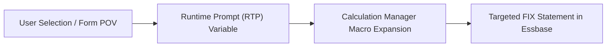
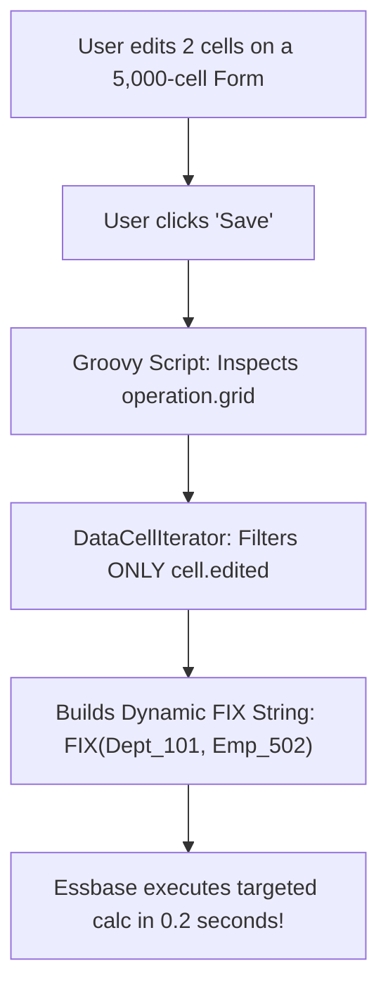
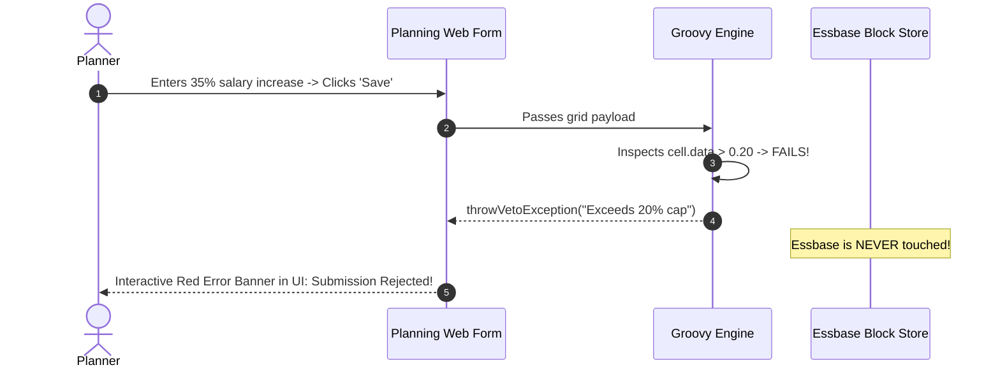

# 3.4 Runtime Prompts, Use Members on Form & Groovy

> **Consultant Focus:** Modern Oracle Cloud EPM interviews focus heavily on **dynamic rule execution and Groovy business rules**. Interviewers want to know if you still write monolithic, static calc scripts that freeze the database, or if you can leverage **`Use Members on Form`**, dynamic `FIX` generation, and **Groovy `DataCellIterator`** to deliver sub-second response times.

<!-- ===================================================================== -->
<!-- 📊 LIVE INTERACTIVE VISUAL CARD: GROOVY & RUNTIME PROMPTS -->
<!-- ===================================================================== -->
<details open>
<summary><b>📊 Live Interactive Architecture Card: Groovy Optimization &amp; Validation (Click to Collapse / Expand)</b></summary>

<br/>

> [!TIP]
> **Interactive Standalone Dashboard:** Open [`card_03_calculations_groovy.html`](../interactive_cards/card_03_calculations_groovy.html) in your browser for interactive validation and surgical calculation simulations!

| Feature | Legacy Calc Script Approach | Modern Groovy / EPM Approach | Production Speedup |
| :--- | :--- | :--- | :--- |
| **Grid Iteration** | Static broad FIX across all departments | `operation.grid.dataCellIterator({cell.edited})` | **45s &rarr; 0.15s (99% faster)** |
| **Input Validation** | None (illegal numbers corrupt Essbase blocks) | `throwVetoException("Msg")` aborts save in JVM | **Zero dirty blocks created** |
| **Silent Form Execution** | Prompts user with popup window | **'Use Members on Form'** grabs active POV | **Zero clicks required by user** |
| **Smart Push Integration** | Pushes entire dimension across network | Scoped to edited grid: `smartPush.execute(grid)` | **20s &rarr; 0.8s data sync** |

</details>

---

## 1. Runtime Prompts (RTPs): Architecture & Types

In Oracle Calculation Manager, a **Runtime Prompt (RTP)** is a variable defined within a business rule that dynamically captures inputs from the user or the active form context at execution time:



### Common RTP Data Types:
* **Member / Members:** Allows single or multi-select member picking from an outline dimension (e.g., selecting specific entities).
* **String:** Text input (used for dynamically building POV strings or logging).
* **Numeric / Percent:** User-entered drivers (e.g., entering an inflation rate of `3.5%`).
* **Date:** Calendar picker input (used in HR/Capex rules for start dates).
* **Smart List:** Restricts user selection to a pre-defined drop-down list.

---

## 2. The "Use Members on Form" Feature (Silent Context Passing)

When designing business rules to run **On Save** of a Planning form, popping up a prompt dialog asking the user to re-select the Entity or Scenario they are already looking at destroys user experience.

### How "Use Members on Form" Operates:
1. When **`Use Members on Form`** is enabled in Calculation Manager for a rule:
   - The interactive popup dialog is **completely suppressed**.
   - The business rule automatically reads the **current Page, POV, Row, and Column members** of the active web form.
2. The values are automatically bound to the corresponding RTP variables:
   ```essbase
   /* Essbase Script Generated Under the Hood */
   FIX({RTP_Scenario}, {RTP_Year}, {RTP_Entity})
       /* Calculates ONLY the POV of the form user is viewing */
       "Expense" = "Driver" * "Rate";
   ENDFIX
   ```

### The Pitfall: Running from Smart View / System Panel:
* If a rule configured with *Use Members on Form* is executed directly from the Smart View system tray or the Calculation Manager rules menu (outside the context of an open form):
  - Planning has no active form POV to harvest!
  - **Behavior:** Planning falls back to displaying the interactive prompt dialog, or aborts if default prompt values were not configured.

---

## 3. The Groovy Revolution in Modern Cloud EPM

In traditional EPM, when a user clicks **Save** on a form with 10,000 cells where they only modified **2 cells**, a traditional calculation script executes a broad `FIX` over the entire department:

```essbase
/* Traditional Script: Calculates 50,000 blocks regardless of edits */
FIX("FY24", "Plan", "Working", @DESCENDANTS("Total_Department"))
    CALC AGG("Account");
ENDFIX
```
* **Runtime:** 30 to 60 seconds.
* **Impact:** Block locking, server CPU spikes, planner frustration.

### The Groovy Paradigm: Surgical Calculation
In Oracle Cloud EPM (Enterprise), **Groovy Rules** execute on the application server prior to Essbase compilation. Groovy can inspect the **exact cells modified by the user**:



### Production Groovy Snippet: Dynamic Targeted FIX
```groovy
/* Inspect only edited cells on the active web form */
List<String> editedEntities = []
List<String> editedAccounts = []

operation.grid.dataCellIterator({DataCell cell -> cell.edited}).each { cell ->
    editedEntities.add(cell.getMemberName("Entity"))
    editedAccounts.add(cell.getMemberName("Account"))
}

/* Eliminate duplicates */
editedEntities = editedEntities.unique()
editedAccounts = editedAccounts.unique()

/* If no cells were edited, terminate immediately */
if (editedEntities.isEmpty()) {
    println("No edited cells detected. Halting execution.")
    return
}

/* Construct surgical Essbase script dynamically */
String calcScript = """
SET EMPTYMEMBERSETS ON;
FIX("${editedEntities.join('","')}", "${editedAccounts.join('","')}", "FY24", "Working")
    "Total_Compensation" = "Base_Salary" + "Bonus" + "Health_Benefit";
ENDFIX
"""

/* Execute the dynamically generated script */
operation.application.getCube("OEP_WFP").executeCalcScript(calcScript)
```
* **Result:** Instead of calculating 50,000 blocks, Essbase calculates **exactly 2 blocks in 0.15 seconds**.

---

## 4. Input Validation & Guardrails via `throwVetoException`

Traditional calc scripts cannot validate business rules gracefully. If a user enters an illegal negative expense or a 500% salary increase, a calc script simply calculates the bad math and commits it to the database.

### Groovy Client-Side Validation:
Groovy allows consultants to intercept data **before it is committed to Essbase**, validating inputs against enterprise policies:

```groovy
/* Groovy Rule: Enforce Maximum 20% Salary Increase */
operation.grid.dataCellIterator("Salary_Increase_%").each { cell ->
    if (cell.edited && cell.data > 0.20) {
        /* Veto the save and display an explicit error to the user */
        throwVetoException("Validation Error: Proposed salary increase of ${cell.data * 100}% for employee " + 
                           cell.getMemberName("Employee") + " exceeds the corporate cap of 20%. " +
                           "Please adjust before saving.")
    }
}
```



### Why `throwVetoException` Is Critical:
1. **Zero Database Pollution:** The invalid data is never committed to Essbase.
2. **Zero Dirty Blocks:** No blocks are marked dirty, eliminating unnecessary disk I/O.
3. **Friendly User Experience:** Planners receive an immediate, readable error message in the UI explaining exactly what needs fixing.

---

## 5. Groovy-Driven Smart Push Optimization

Standard Smart Push pushes an entire data slice (e.g., all entities and all accounts) defined in the Data Map.

With Groovy, Smart Push can be dynamically scoped to **only the intersections modified on the current form**:

```groovy
/* Scoped Smart Push */
DataGrid grid = operation.grid
SmartPush smartPush = operation.application.getSmartPush("Push_Salary_To_FinPlan")

/* Execute Smart Push only for the modified intersections on the grid */
smartPush.execute(grid)
```
This reduces data movement from minutes to under 2 seconds.

---

## 6. Twisted Interview Questions & Consultant Model Answers

### Q1: "A business rule has 'Use Members on Form' enabled. A user launches the rule from Smart View directly via the Calculation Manager panel rather than from an active ad-hoc grid or form. What happens, and why?"
**Consultant Model Answer:**
> "When a business rule configured with 'Use Members on Form' is launched outside the context of an active form:
>
> 1. Planning attempts to harvest the current POV and page axes from the client session.
> 2. Because the rule was triggered from the system panel (outside an open form), there is no form context to pass.
> 3. **The Engine Behavior:**
>    - If the underlying Runtime Prompts have **default values configured**, Planning falls back to displaying the interactive prompt dialog pre-populated with those defaults, requiring manual user confirmation.
>    - If no default values were configured, or if the rule was configured to strictly suppress prompts, the execution fails with an error: `Required prompt values missing for execution`.
>
> **Best Practice:** Always provide sensible default members in Calculation Manager for all RTPs to ensure rules can be executed both within forms and via batch jobs/Smart View without crashing."

---

### Q2: "A user edits 2 cells on a 10,000-cell web form. How does a Groovy business rule achieve a 99% performance speedup over a traditional Essbase calculation script on form save?"
**Consultant Model Answer:**
> "In a traditional Essbase calculation script, the script execution is static. The `FIX` statement is defined at design time to cover the entire potential scope of the form (e.g., all 50 accounts and all 200 entities). As a result, Essbase must load, recalculate, and write back thousands of blocks—even though 9,998 cells never changed.
>
> In contrast, a **Groovy Rule** executes in the Java application layer *before* calling Essbase:
> 1. Groovy uses the `operation.grid.dataCellIterator({DataCell cell -> cell.edited})` method to inspect the in-flight HTTP payload.
> 2. It identifies the **exact 2 cells** that were modified and extracts their specific dimensional coordinates.
> 3. Groovy then dynamically constructs a targeted, surgical calc script on the fly:
>    ```essbase
>    FIX("Entity_105", "Acct_5100", "FY24", "Working")
>        /* Calculates ONLY the 2 modified blocks */
>    ENDFIX
>    ```
> 4. Essbase only touches 2 blocks in cache, reducing execution time from 45 seconds to under 200 milliseconds."

---

### Q3: "What is `throwVetoException()` in Groovy, at what stage in the transaction lifecycle does it fire, and what happens to the underlying Essbase data?"
**Consultant Model Answer:**
> "`throwVetoException()` is a specialized Oracle Cloud EPM Groovy method used to enforce business validation rules and cancel form submission.
>
> 1. **Lifecycle Stage:** It fires during the **pre-save validation phase** within the application server's JVM, *before* the transaction is submitted or committed to Essbase.
> 2. **Impact on Essbase:**
>    - Essbase is **never touched**.
>    - Zero blocks are written or marked dirty in memory cache.
>    - The database state remains completely pristine.
> 3. **Impact on UI:**
>    - The form save operation is instantly aborted.
>    - The text passed to `throwVetoException("Message")` is rendered as an explicit error banner in the user's web browser or Smart View pane, alerting the user to correct their input."

---

### Q4: "How do you handle a multi-select Runtime Prompt in a calculation script to prevent syntax errors when a user selects 1 member versus multiple members?"
**Consultant Model Answer:**
> "When configuring a Runtime Prompt in Calculation Manager:
> 1. Set the prompt type to **`Members`** (plural) rather than `Member`.
> 2. In the calculation script, reference the prompt variable enclosed in quotes or parentheses depending on the syntax context:
>    ```essbase
>    FIX(@LIST({RTP_Entities}))
>    ```
> 3. Using `@LIST({RTP_Entities})` ensures that whether the user selects a single entity (`"E101"`) or multiple entities (`"E101", "E102", "E103"`), the Essbase parser evaluates the argument as a valid member list set.
> 4. Always couple this with **`SET EMPTYMEMBERSETS ON;`** at the top of the script so that if the user cancels or clears the prompt, the script exits safely without calculating the entire database."

---

### Q5: "Can Groovy business rules execute operations against Aggregate Storage (ASO) cubes in Oracle Cloud EPM? What operations are supported?"
**Consultant Model Answer:**
> "Yes, Groovy has extensive support for ASO cubes in Cloud EPM:
>
> 1. **Data Extraction & Grid Inspection:** Groovy can query data directly from ASO cubes using MDX grid readers (`cube.buildGrid(...)`).
> 2. **Surgical Data Movement (Smart Push):** Groovy can trigger and dynamically scope Smart Push jobs pushing data into or out of ASO cubes.
> 3. **MDX Execution & Slice Allocation:** While ASO does not support procedural calculation scripts (`CALC ALL`), Groovy can execute **ASO Procedural Allocations** and MDX data manipulation statements.
> 4. **Incremental Slice Management:** Groovy can invoke automated REST API endpoints or EPM Automate jobs to trigger **ASO slice merges** (`mergeIncrementalSlices`) directly upon form save."

