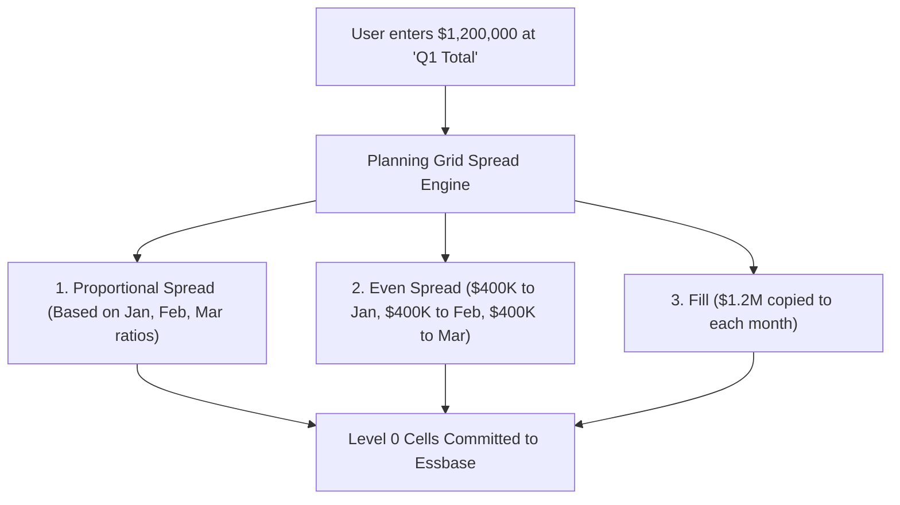
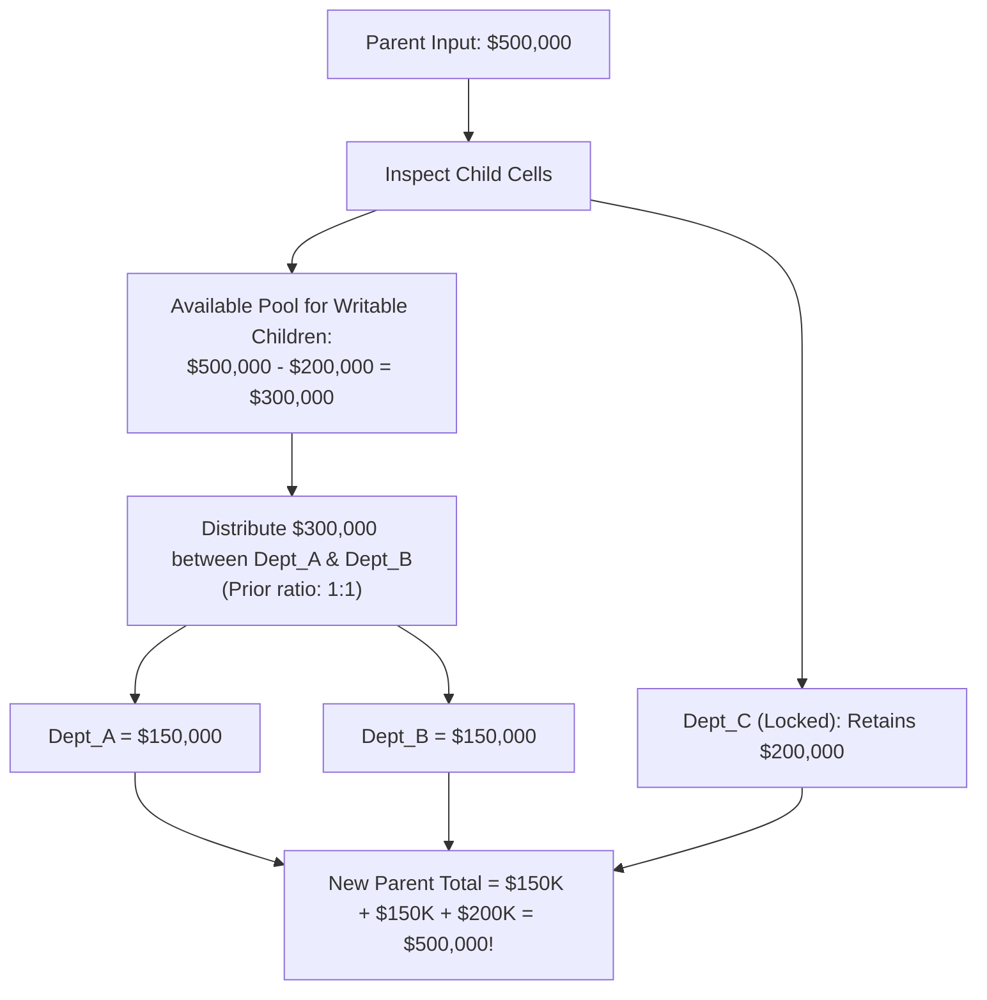

# 4.1 Grid Spread Mechanics & Security Filtering

> **Consultant Focus:** Grid Spread is one of the most critical user-facing features in Oracle Cloud EPM Planning. Interviewers test your understanding of **spreading mathematics** (Proportional, Even, Fill), **residual rounding logic**, and specifically the **Read-Only Child Trap** where security permissions or closed periods cause unexpected parent totals.

<!-- ===================================================================== -->
<!-- 📊 LIVE INTERACTIVE VISUAL CARD: GRID SPREAD & SECURITY FILTERING -->
<!-- ===================================================================== -->
<details open>
<summary><b>📊 Live Interactive Architecture Card: Grid Spread Math &amp; Locked Cells (Click to Collapse / Expand)</b></summary>

<br/>

> [!TIP]
> **Interactive Standalone Dashboard:** Open [`card_04_writeback_transactions.html`](../interactive_cards/card_04_writeback_transactions.html) in your browser for an interactive live grid spread simulator!

| Spreading Scenario | Spreading Math Formula | Locked / Closed Cell Behavior | Residual Penny Balancing |
| :--- | :--- | :--- | :--- |
| **Proportional Spread** | $C_i = P^{\text{new}} \times (C_i^{\text{old}} / \sum C^{\text{old}})$ | Locked cells held constant; deducted from spread pool | 1-cent residual added to first writable child |
| **Even Spread** | $C_i = (P^{\text{new}} - \sum \text{Locked}) / N_{\text{open}}$ | Open cells divide remaining pool equally | First child absorbs $+0.01$ rounding delta |
| **Fill Spread** | $C_i = P^{\text{new}} \quad \forall i$ | Writable children get exact value; locked untouched | Not applicable |
| **Zero/Missing Baseline** | Divide by zero condition | Planning automatically falls back to **Even Spread** | Ensures parent ties back exactly |

</details>

---

## 1. What Is Grid Spread in Oracle Planning?

In Oracle Cloud EPM Planning and Smart View, planners often need to adjust high-level budgets without manually calculating individual child line items. **Grid Spread** allows a user to input a single summary number at an aggregate or parent-level cell and distribute it across descendant Level 0 cells.



---

## 2. Spreading Algorithms & Mathematical Mechanics

Planning supports three fundamental spreading methods:

### 1. Proportional Spread (Default)
Distributes the entered parent amount based on the existing relative proportions of the underlying writable child cells:

$$C_i^{\text{new}} = P^{\text{new}} \times \left( \frac{C_i^{\text{old}}}{\sum_{k \in \text{Writable}} C_k^{\text{old}}} \right)$$

* Where $P^{\text{new}}$ is the newly entered parent value, and $C_i$ represents each writable child.
* **The Zero-Base Problem:** If all children currently equal `0` or `#Missing`, proportional spread has no historical base ratios to compute. In this case, Planning automatically falls back to **Even Spread**.

### 2. Even Spread
Divides the entered parent value equally among all writable target children:

$$C_i^{\text{new}} = \frac{P^{\text{new}}}{N_{\text{writable}}}$$

* Where $N_{\text{writable}}$ is the count of writable Level 0 cells.

### 3. Fill
Copies the exact parent value into every single descendant child cell:

$$C_i^{\text{new}} = P^{\text{new}} \quad \forall i$$

---

## 3. The Read-Only Child Trap & Security Filtering

This is the most common interview scenario regarding write-back integrity.

### The Scenario:
* `Total_Expense` (Parent) has 3 child departments:
  * `Dept_A`: `$100,000` (Writable)
  * `Dept_B`: `$100,000` (Writable)
  * `Dept_C`: `$200,000` (**Read-Only** due to Cell-Level Security, approval lock, or closed period)
* **Current Parent Total:** `$100,000 + $100,000 + $200,000 = \$400,000`.
* A planner types **`$500,000`** into `Total_Expense` using Proportional Spread.

### How Does the Planning Spread Engine Handle the Locked Child?



### The Math Walkthrough:
1. Planning identifies that `Dept_C` is **Read-Only** and cannot be modified.
2. It subtracts the read-only locked value from the target parent total:
   $$\text{Target Pool for Writable Cells} = \$500,000 - \$200,000 = \mathbf{\$300,000}$$
3. The remaining \$300,000 is distributed across the writable children (`Dept_A` and `Dept_B`) based on their existing ratio ($100K : 100K = 50\% : 50\%$):
   * `Dept_A` receives $50\% \times \$300,000 = \mathbf{\$150,000}$
   * `Dept_B` receives $50\% \times \$300,000 = \mathbf{\$150,000}$
4. **Final Result:**
   $$\text{Total\_Expense} = \$150,000 + \$150,000 + \$200,000 = \mathbf{\$500,000}$$

### What If the Entered Total Is Less Than Locked Values?
If the user inputs **`$150,000`** at `Total_Expense`, but the locked child `Dept_C` already holds **`$200,000`**:
* Planning cannot write negative amounts to writable children unless negative spreads are explicitly permitted.
* If negative values are prohibited, the spread **fails with an error**:
  ```
  Error: The spread value entered ($150,000) is less than the sum of read-only/locked cells ($200,000). Spread rejected.
  ```

---

## 4. The Residual Penny Balancing Algorithm

When an uneven dollar amount is spread equally across children, rounding discrepancies inevitably arise:

$$\frac{\$100.00}{3} = \$33.333333...$$

If each child receives \$33.33, the sum of children is:
$$\$33.33 + \$33.33 + \$33.33 = \mathbf{\$99.99} \neq \$100.00$$

### How Oracle Planning Resolves the 1-Cent Residual:
1. Planning rounds each cell to the configured precision (e.g., 2 decimal places).
2. It calculates the **Residual Difference**:
   $$\text{Residual} = \$100.00 - \$99.99 = \mathbf{+\$0.01}$$
3. Planning allocates the residual penny to the **first writable child cell** (or the child with the largest magnitude depending on application settings):
   * Child 1: **`$33.34`** *(Absorbs +$0.01)*
   * Child 2: **`$33.33`**
   * Child 3: **`$33.33`**
   * **Total:** **`$100.00`** (Guaranteed mathematical tie-back).

---

## 5. Grid Spread on Dynamic Calc Parents vs Stored Parents

| Parent Storage Property | Can User Execute Grid Spread? | How Engine Executes the Write |
| :--- | :--- | :--- |
| **Stored Parent (Classic BSO)** | **YES** | User writes to parent $\rightarrow$ Planning calculates child values $\rightarrow$ Submits Level 0 cells to Essbase $\rightarrow$ Batch aggregation script updates stored parent block. |
| **Dynamic Calc Parent (Hybrid BSO)** | **YES** | User writes to dynamic parent $\rightarrow$ Planning middle tier computes child shares $\rightarrow$ Submits Level 0 cells to Essbase $\rightarrow$ Dynamic vector engine recalculates parent immediately upon retrieval! |
| **Label Only Parent** | **NO** | Label Only members have no data storage or dynamic calculation; grid spread is disabled. |

> [!IMPORTANT]
> Grid Spread is **orchestrated in the Planning Application Layer (ADF Middle Tier)**, not inside the Essbase engine itself. Planning intercepts the parent input, executes the spreading arithmetic, validates cell security, and submits a multi-cell update **strictly to Level 0 stored cells in Essbase**.

---

## 6. Twisted Interview Questions & Consultant Model Answers

### Q1: "A planner inputs \$600,000 at `YearTotal` using Proportional Grid Spread on a Planning form. Closed historical months (Jan–Mar) hold \$150,000 total and are set to Read-Only via form layout. What values are written to Apr–Dec, and what does `YearTotal` display upon form save?"
**Consultant Model Answer:**
> "The Planning Grid Spread engine handles this through **locked-cell exclusion**:
>
> 1. Planning identifies that Jan–Mar are Read-Only cells with a locked sum of \$150,000.
> 2. It deducts the locked amount from the user's requested parent target:
>    $$\text{Remaining Spread Pool} = \$600,000 - \$150,000 = \mathbf{\$450,000}$$
> 3. The remaining \$450,000 is distributed across the remaining 9 open months (Apr–Dec) proportional to their existing baseline values. If Apr–Dec were previously empty, it distributes \$50,000 evenly to each of the 9 months ($\frac{\$450,000}{9} = \$50,000$).
> 4. Upon form save:
>    - Jan–Mar remain completely untouched at \$150,000.
>    - Apr–Dec receive their calculated portions totaling \$450,000.
>    - `YearTotal` calculates dynamically as:
>      $$\text{YearTotal} = \$150,000 + \$450,000 = \mathbf{\$600,000}$$
> The parent total matches the user's exact requested number while preserving historical closed periods."

---

### Q2: "A user has Read-Only access to `Entity_Europe` and Write access to `Entity_US`. If they execute an Even Spread of \$200,000 at `Total_Entity`, does `Entity_Europe` get modified? How does Planning enforce the security boundary?"
**Consultant Model Answer:**
> "No, `Entity_Europe` will **never be modified**.
>
> **The Security Enforcement Mechanism:**
> 1. Grid Spread is an application-tier function. Before generating write payloads, Planning runs a security filtering check across all descendant cells.
> 2. Any cell where the active user has `READ` or `NONE` access is flagged as **immutable**.
> 3. Planning takes `Entity_Europe`'s current stored value, holds it constant, and excludes it from the spreading pool.
> 4. If the user selected **Even Spread**, the target pool ($\$200,000 - \text{Entity\_Europe}$) is divided equally among the writable siblings (in this case, `Entity_US` receives the full remaining amount).
> 5. If `Entity_US` is the *only* writable child, `Entity_US` receives the entire remaining balance to achieve the \$200,000 parent total."

---

### Q3: "What happens when a planner uses Proportional Grid Spread on a parent whose children all currently hold `#Missing` or `0`?"
**Consultant Model Answer:**
> "When all child cells are `#Missing` or `0`, a mathematical divide-by-zero condition occurs because the sum of existing child ratios is zero ($\sum C_k^{\text{old}} = 0$).
>
> In this scenario, Planning does not fail. Instead, it **automatically falls back to an Even Spread**:
> 1. Planning counts the number of writable Level 0 child cells ($N$).
> 2. It divides the entered parent amount equally by $N$:
>    $$C_i = \frac{P^{\text{new}}}{N}$$
> 3. Any rounding residual is assigned to the first child cell.
> 4. The user is prompted with an informational notification stating that because no historical proportions existed, an even spread was applied."

---

### Q4: "Where does Planning apply residual pennies when spreading an uneven amount like \$100.00 across 3 months evenly?"
**Consultant Model Answer:**
> "When dividing \$100.00 by 3:
> - Base division yields: $\$33.333333...$
> - Rounded to 2 decimal places: $\$33.33 \times 3 = \$99.99$.
> - The residual discrepancy is: $\$100.00 - \$99.99 = \mathbf{+\$0.01}$.
>
> Planning's residual rounding algorithm adds the $+\$0.01$ to the **first writable child cell in the grid sequence** (January).
> - January = **`$33.34`**
> - February = **`$33.33`**
> - March = **`$33.33`**
> - Sum = **`$100.00`**
> This ensures that financial totals tie back to the exact cent without creating rounding variance."

---

### Q5: "Can Grid Spread be executed in Smart View ad-hoc grids, or is it strictly confined to Planning Web forms?"
**Consultant Model Answer:**
> "Grid Spread **can be executed in both Planning Web forms and Smart View**:
>
> 1. **In Planning Web Forms:** Planners can enter numbers directly into parent cells (if the form property 'Enable Grid Spread' is enabled) or right-click a cell and select **Grid Spread** to configure Proportional, Even, or Fill parameters.
> 2. **In Smart View Forms:** Planners right-click an aggregate cell and select **Planning Provider** $\rightarrow$ **Grid Spread**. The Smart View dialog allows the user to specify spreading type and execute.
> 3. **In Smart View Free-Form Ad-Hoc Grids:** Grid Spread is **not supported** in free-form ad-hoc grids because ad-hoc grids communicate directly with the Essbase query provider rather than the Planning ADF middle-tier spreading processor. Ad-hoc submissions can only submit values directly to Level 0 stored cells."

