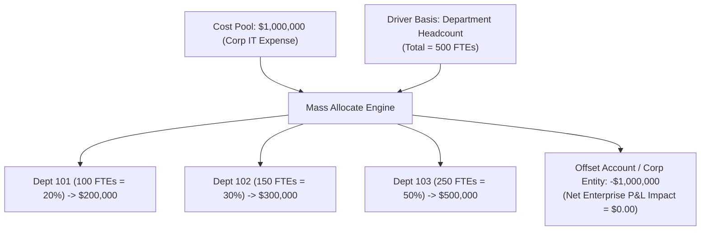

# 4.2 Mass Allocate & Driver-Based Distribution

> **Consultant Focus:** While Grid Spread is primarily a hierarchical UI input convenience, **Mass Allocate** is an enterprise computational engine designed for cross-dimensional, driver-based cost allocations. Interviewers expect you to know how Mass Allocate differs from Grid Spread, how driver mathematics handle edge cases (negative drivers, missing drivers), and how offset contra-accounts maintain double-entry financial integrity.

<!-- ===================================================================== -->
<!-- 📊 LIVE INTERACTIVE VISUAL CARD: MASS ALLOCATE & OFFSETS -->
<!-- ===================================================================== -->
<details open>
<summary><b>📊 Live Interactive Architecture Card: Mass Allocate vs Grid Spread &amp; Offsets (Click to Collapse / Expand)</b></summary>

<br/>

> [!TIP]
> **Interactive Standalone Dashboard:** Open [`card_04_writeback_transactions.html`](../interactive_cards/card_04_writeback_transactions.html) in your browser for transaction and allocation architecture!

| Architectural Aspect | Grid Spread | Mass Allocate | Double-Entry Offset Rule |
| :--- | :--- | :--- | :--- |
| **Dimension Scope** | Single dimension hierarchy (parent to child) | Cross-dimensional (Entity &times; Product &times; Project) | Debits (+Expense) across divisions |
| **Distribution Driver** | Current child ratios, Even, or Fill | External statistical driver (FTE, Sq Ft, Revenue) | Credits (-Expense) at Corporate Entity |
| **Offset Account** | None (natural hierarchical rollup) | **Mandatory Contra-Account** | Net Enterprise Impact = **$0.00** |
| **Negative Drivers** | Ignored | Can allocate negative expenses | Sanitize drivers using `@MAX(Driver, 0)` |

</details>

---

## 1. What Is Mass Allocate?

**Mass Allocate** is an allocation feature in Oracle Cloud EPM Planning and Smart View that distributes an amount (or cost pool) across multiple target dimensions and members using a **mathematical driver** (such as Headcount, Square Footage, Revenue, or Machine Hours).



---

## 2. Mass Allocate Mathematical Architecture

The standard driver-based allocation formula executed by the engine:

$$\text{Allocated Amount}_i = \text{Source Pool} \times \left( \frac{\text{Driver}_i}{\sum_{k=1}^{n} \text{Driver}_k} \right)$$

### Components of the Allocation Specification:
1. **Source Pool:** The member intersection containing the funds to distribute (e.g., `Acct: IT_Expense`, `Entity: Corp_Headquarters`).
2. **Driver Basis:** The statistical or financial metric dictating the distribution percentages (e.g., `Acct: FTE_Headcount`, `Period: YearTotal`).
3. **Target Intersections:** The range of Level 0 members receiving the expense (e.g., `@RELATIVE("Total_Operating_Depts", 0)`).
4. **Offset Location:** The contra-account or corporate clearing location that absorbs the credit matching the debits.

---

## 3. Double-Entry Integrity: The Offset Clearing Account

A common failure in amateur EPM design is allocating costs to departments without booking an **Offset**.

### Why an Offset Is Mandatory:
* If Corporate incurs \$1,000,000 in IT costs and you allocate \$1,000,000 across operating departments *without* an offset:
  - Corporate shows: \$1,000,000 IT Expense.
  - Operating departments show: \$1,000,000 IT Expense.
  - **Consolidated Enterprise P&L shows:** **\$2,000,000 IT Expense!**
  - The company has artificially doubled its expenses!

### The Double-Entry Mechanism:
To maintain zero-sum financial integrity:
1. Debits: Target operating entities receive positive expenses totaling **`+$1,000,000`**.
2. Credits: The source entity (or an allocation clearing account) receives **`-$1,000,000`**.
3. **Enterprise Result:** At `Total_Entity`, the sum of debits and credits is:
   $$\text{Enterprise Total} = (+\$1,000,000) + (-\$1,000,000) = \mathbf{\$0.00}$$
   The corporate cost is fully absorbed by the divisions without altering enterprise net income.

---

## 4. Grid Spread vs Mass Allocate: Detailed Architectural Comparison

| Architectural Feature | Grid Spread | Mass Allocate |
| :--- | :--- | :--- |
| **Primary Scope** | **Hierarchical** (Parent down to immediate children in 1 dimension) | **Cross-Dimensional** (Can distribute across Entity, Product, and Project simultaneously) |
| **Distribution Basis** | Proportional to current child values, Even, or Fill | **External Driver Metric** (e.g., Headcount, Sq Ft, Revenue %) |
| **Offset Account** | None (Values roll up directly into the parent) | **Mandatory Offset** (Contra-account or clearing entity to maintain P&L balance) |
| **Execution Layer** | Planning Web / ADF Middle Tier | Calculation Manager Business Rule / Essbase Procedural Engine |
| **Target Data Level** | Must be descendants of the selected parent | Can allocate across completely unrelated dimensions and entities |
| **Typical Use Case** | Planner adjustments to quarterly departmental budgets | Corporate shared-services cost allocations (IT, HR, Facilities) |

---

## 5. Driver Math Pathologies & Edge Cases

When designing driver-based allocations, consultants must anticipate data exceptions:

### 1. Missing Driver Sum ($\sum \text{Driver} = 0 \text{ or } \#\text{Missing}$)
* If HR has not entered headcount and the total driver evaluates to `0`:
* Division by zero occurs: $\frac{\text{Driver}}{0}$.
* **Engine Response:** If unhandled, the calculation script evaluates to `#Missing`. Zero dollars are allocated, and the cost pool remains stranded in Corporate.
* **The Fix:** Implement fallback logic in Calculation Manager:
  ```essbase
  IF ("Total_Headcount" > 0)
      "IT_Expense" = "Corp_Pool" * ("Headcount" / "Total_Headcount");
  ELSE
      /* Fallback to Even Distribution */
      "IT_Expense" = "Corp_Pool" / @COUNT(SKIPNONE, @RELATIVE("Total_Entity", 0));
  ENDIF
  ```

### 2. Negative Drivers
* If an operating division has a negative driver (e.g., negative headcount due to an adjustment, or negative net income):
* The division receives a **negative expense (credit)**, while other divisions receive an inflated expense!
* **The Fix:** Wrap the driver in `@MAX` or filter for non-negative drivers:
  ```essbase
  "Driver_Clean" = @MAX("Raw_Driver", 0);
  ```

---

## 6. Twisted Interview Questions & Consultant Model Answers

### Q1: "What is the primary architectural difference between Grid Spread and Mass Allocate?"
**Consultant Model Answer:**
> "The primary difference lies in **scope and engine execution**:
>
> 1. **Grid Spread:**
>    - Operates **hierarchically within a single dimension** (spreading from a parent member down to its descendant children).
>    - Executed in the **Planning ADF presentation layer**, distributing numbers proportionally, evenly, or by fill.
>    - Does not utilize external statistical drivers and does not require an offset clearing account.
> 2. **Mass Allocate:**
>    - Operates **cross-dimensionally**, distributing funds across multiple unrelated dimensions (e.g., from Corporate Entity to operating entities, broken out by product line).
>    - Executed by the **Essbase calculation engine** via business rules or Smart View allocation providers.
>    - Requires an **external driver** (e.g., Headcount or Revenue) and an **offset contra-account** to maintain double-entry balance."

---

### Q2: "A Mass Allocate rule allocates \$1,000,000 of Corporate Facilities Expense across 10 entities based on `Square_Footage`. Entity 105 has a recorded square footage of `-500` sq ft due to a data entry error. What happens to the allocation math?"
**Consultant Model Answer:**
> "Because the driver contains a negative value:
> 1. The denominator $\sum \text{Square\_Footage}$ will be understated by 500 sq ft.
> 2. When the formula computes Entity 105's share:
>    $$\text{Ratio}_{105} = \frac{-500}{\sum \text{SqFt}} < 0$$
> 3. Entity 105 will receive a **negative expense** (an expense credit/income), effectively being paid facilities dollars rather than charged.
> 4. The remaining 9 entities will absorb more than 100% of the \$1,000,000 cost pool to offset the negative allocation.
>
> **The Fix:**
> Production allocation scripts must sanitize drivers using `@MAX` or conditional logic:
> ```essbase
> "SqFt_Basis" = @MAX("Square_Footage", 0);
> ```
> This forces negative drivers to zero, preventing negative cost allocations."

---

### Q3: "Why is an Offset Account or Clearing Entity mandatory in an enterprise Mass Allocate rule?"
**Consultant Model Answer:**
> "An offset is mandatory to preserve **double-entry accounting and avoid financial statement inflation**:
>
> If a shared service cost of \$5,000,000 resides in Corporate, and a business rule allocates \$5,000,000 across operating divisions:
> - Without an offset, Corporate still reports \$5M in expense, and the divisions report another \$5M in expense. Total consolidated company expense would be reported as \$10M, artificially halving net income.
> - With an offset contra-account (`IT_Allocation_Offset` = `-$5,000,000`) at the Corporate entity, the net impact on Corporate is zeroed out, and the consolidated company expense remains exactly \$5,000,000. Net enterprise income is preserved."

---

### Q4: "If the total driver sum evaluates to `#Missing` or `0` across all target entities, how does Mass Allocate behave in a Calculation Manager script?"
**Consultant Model Answer:**
> "In Essbase, division by `0` or `#Missing` evaluates to **`#Missing`**.
>
> If the denominator $\sum \text{Driver}$ is `0` or `#Missing`:
> 1. The allocation ratio evaluates to `#Missing`.
> 2. The formula multiplies the cost pool by `#Missing`, resulting in `#Missing`.
> 3. The target entities receive `#Missing` (any prior allocated amounts are wiped out).
> 4. If an offset was configured to match the pool, the offset may still post or fail, leaving the financial statements completely out of balance.
>
> **Best Practice:** Always guard allocation scripts with validation checks:
> ```essbase
> IF (@SUM(@RELATIVE("Total_Entity", 0), "Driver") > 0)
>     /* Run Allocation */
> ELSE
>     /* Log Error or Trigger Alert */
> ENDIF
> ```"

---

### Q5: "Can Mass Allocate be triggered automatically via Groovy or REST API in Oracle Cloud EPM?"
**Consultant Model Answer:**
> "Yes, in modern Oracle Cloud EPM:
>
> 1. **Via Groovy Rules:** A Groovy business rule can evaluate data modifications, execute driver validation, dynamically construct the allocation parameters, and invoke `executeCalcScript()` or call an allocation job directly.
> 2. **Via REST API:** The Planning REST API endpoint `POST /HyperionPlanning/rest/v3/applications/{app}/jobs` can execute any configured business rule or rule set (including Mass Allocate jobs) asynchronously with runtime prompt parameters passed in the JSON payload.
> 3. **Via EPM Automate:** The command `epmautomate runbusinessrule <RuleName> [params]` is standard for scheduling automated nightly mass allocation batches."

