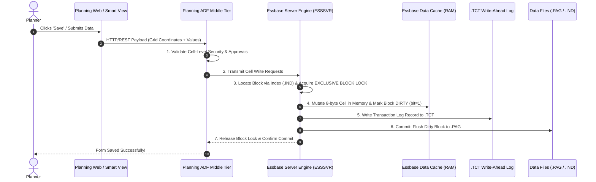
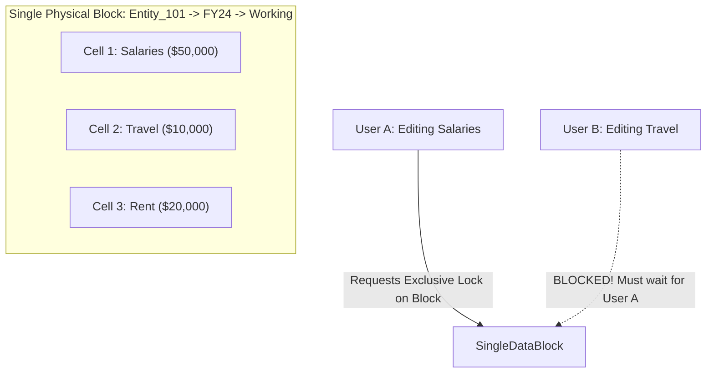
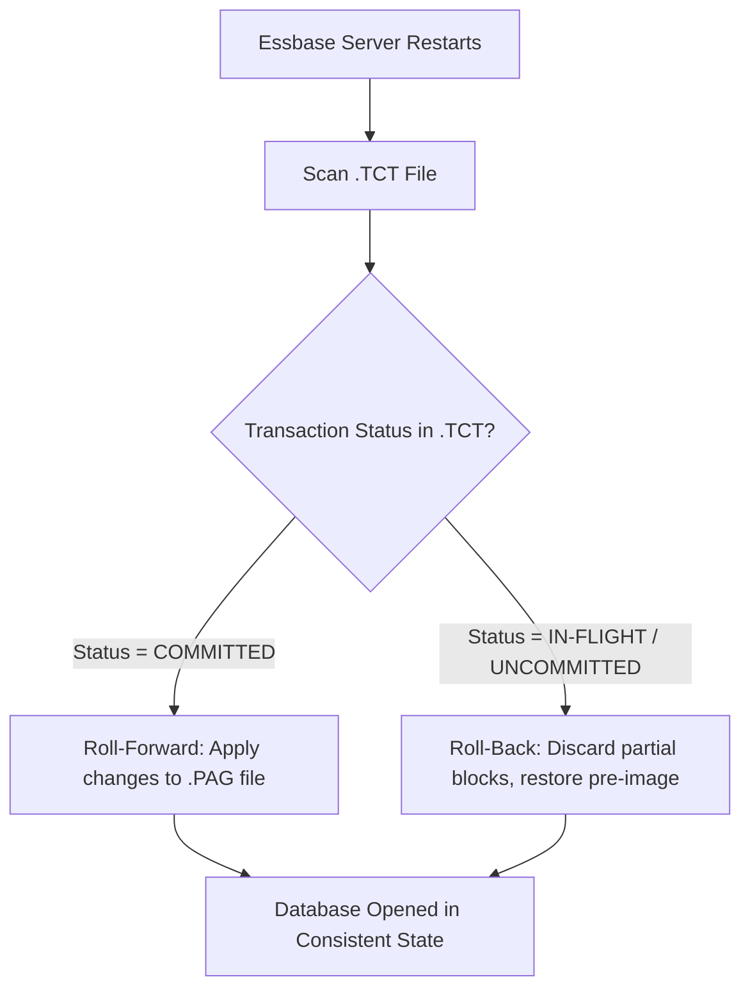

# 4.3 BSO & Hybrid Transaction Pipeline and the .TCT File

> **Consultant Focus:** Data write-back is not a magic instant update. In BSO and Hybrid BSO, write-back is an ACID-compliant transaction pipeline moving from the client UI through middle-tier validation, Essbase block-level locking, dirty cache mutation, the **`.TCT` (Transaction Control Table) write-ahead log**, and finally to disk commit. Understanding block locks and `.TCT` crash recovery is essential for diagnosing production lock contention and server recovery failures.

---

## 1. The End-to-End Write-Back Lifecycle

When a planner enters numbers into Smart View or a Planning Web form and clicks **Save**, data travels through seven distinct pipeline stages:



---

## 2. Block-Level Locking vs Cell-Level Locking: The Lock Contention Trap

One of the most important concepts to understand is that **Essbase does NOT lock individual cells; it locks ENTIRE DATA BLOCKS**.

### The Multi-User Collision Scenario:
* Consider `Entity_101` (Sparse), `FY24` (Sparse), `Working` (Sparse).
* All dense accounts (`Salaries`, `Travel`, `Rent`, `Supplies`) for `Entity_101` reside **inside the exact same physical data block**.



### The Production Failure:
1. **User A** opens a workforce form and submits a change to `Salaries` for `Entity_101`.
2. Essbase acquires an **Exclusive Write Lock** on the entire `Entity_101` data block.
3. At the exact same second, **User B** opens an operational expense form and submits a change to `Travel` for `Entity_101`.
4. Even though User A and User B modified **completely different accounts**, User B's transaction is halted:
   ```
   Error: Waiting for lock on block [Entity_101, FY24, Working] held by session 4029.
   Transaction timed out after 30 seconds.
   ```
5. User B's submission fails because **both accounts reside in the same physical block**, and only one session can hold the block write lock at a time.

---

## 3. The `.TCT` (Transaction Control Table) File & Crash Recovery

In the underlying Essbase database directory on disk, you will find files with extensions `.otl` (outline), `.ind` (index), `.pag` (data pages), and **`.tct`**.

### What Is the `.TCT` File?
The **`.TCT` (Transaction Control Table)** is Essbase's **Write-Ahead Log (WAL)**. It ensures **ACID (Atomicity, Consistency, Isolation, Durability)** transaction compliance:
1. Before any modified block in the memory cache is written permanently to disk (`.pag`), the transaction metadata and intent are written to the `.tct` file.
2. The `.tct` records transaction ID, active block addresses, before-and-after checksums, and commit status.

### Crash Recovery Protocol (Server Power Loss / Crash):
If the server suffers an abrupt power outage or process termination (`kill -9`) mid-transaction:



1. Upon restart, Essbase inspects the `.tct` file.
2. Any transaction marked as `COMMITTED` in the `.tct` but not yet fully flushed to `.pag` is **rolled forward** (redo).
3. Any transaction that was `IN-FLIGHT` when the crash occurred is **rolled back** (undo), restoring the block to its pre-transaction state.
4. This prevents database corruption.

---

## 4. Corrupted or Orphaned `.TCT` Files: The Startup Failure

If an Essbase process crashes violently, the `.tct` file can be left in an **orphaned lock state**.

### The Production Pathology:
When attempting to start the database or refresh the cube, the administrator sees:
```
Cannot load database [app/db]. Error: [1008106] Transaction control file is corrupted or locked by another process.
```

### The Consultant Recovery Workflow:
1. **Verify No Orphaned Processes:** Ensure no zombie `ESSSVR` or `agent` processes are lingering in the background holding file handles on `.tct`.
2. **Backup the Cube:** Take a snapshot of the database directory.
3. **Recovery Command / File Removal:**
   - In Cloud EPM: Restarting the environment through the Service Console or running `epmautomate resetService` clears locks safely.
   - In on-premises/managed Essbase: If the database refuses to recover, renaming the orphaned `.tct` file (with database offline) forces Essbase to start from the last clean checkpoint recorded in `.ind`/`.pag` (though in-flight transactions are lost).

---

## 5. Commit Parameters: `COMMITBLOCKS` vs `COMMITROWS`

During heavy batch data loads or calculations, how frequently Essbase writes changes from cache to disk is controlled by commit parameters:

| Parameter | Default | Trade-Off (Too Low vs Too High) |
| :--- | :--- | :--- |
| **`COMMITBLOCKS n`** | Typically 3,000 to 10,000 blocks | - **Too Low (e.g., 10):** Massive disk I/O thrashing; severe write slowdown.<br/>- **Too High (e.g., 100,000):** If script fails, rollback takes excessive time and uncommitted cache consumes large RAM. |
| **`COMMITROWS n`** | Typically 5,000 to 10,000 rows | Controls commit frequency during rule-file data loads. |

---

## 6. Twisted Interview Questions & Consultant Model Answers

### Q1: "Two users submit data at the exact same second. User A updates `Salaries` in `Entity_101`. User B updates `Travel` in `Entity_101`. User B receives an error: `Transaction timed out waiting for lock`. Why did User B fail when they updated a completely different account?"
**Consultant Model Answer:**
> "User B failed because **Essbase concurrency control operates at the physical block level, not at the cell level**.
>
> 1. In a BSO/Hybrid cube, `Entity_101` is a sparse dimension member, while `Salaries` and `Travel` are dense account members.
> 2. All dense cells for `Entity_101` reside inside the **same contiguous physical data block**.
> 3. When User A clicks submit, Essbase places an **Exclusive Write Lock** on the entire `Entity_101` data block while it mutates the memory cache, writes to the `.tct` log, and executes any Run-on-Save business rules.
> 4. When User B attempts to write to `Travel`, Essbase attempts to acquire an exclusive lock on that same block. Because User A already holds the block lock, User B's request is queued.
> 5. If User A's transaction (or associated business rule) takes longer than the configured lock timeout (default 30–60 seconds), User B's session aborts with a lock timeout error."

---

### Q2: "What is the `.tct` file in an Essbase database directory, and how does it prevent database corruption during a server crash?"
**Consultant Model Answer:**
> "The `.tct` file is the **Transaction Control Table**, acting as Essbase's **Write-Ahead Log (WAL)**.
>
> 1. It records every active, committed, and in-flight transaction before changes are permanently flushed to the primary data page files (`.pag`).
> 2. If the physical server or Essbase process crashes abruptly mid-transaction:
>    - Upon restart, the Essbase recovery manager scans the `.tct` file.
>    - If a transaction was committed in the `.tct` but not fully written to disk, the engine **rolls forward** the changes to ensure durability.
>    - If a transaction was in-flight (uncommitted), the engine **rolls back** the partial updates using pre-image logs, restoring the blocks to their pristine state.
> 3. This guarantees ACID atomicity and prevents half-written blocks from corrupting the `.pag` and `.ind` files."

---

### Q3: "What happens if an administrator manually deletes the `.tct` file while the Essbase application is actively running?"
**Consultant Model Answer:**
> "Deleting the `.tct` file while the application is active causes an **immediate database crash or severe data corruption**:
>
> 1. When an active transaction attempts to commit, the engine issues a file write call to the `.tct` handle. Finding the file handle invalid or missing, Essbase raises an unrecoverable I/O exception (`Error 1008106: File system error`).
> 2. To prevent writing unlogged, non-ACID data to disk, the database process immediately terminates itself or places the database in an emergency **Read-Only / Corrupt** state.
> 3. Subsequent attempts to restart the cube will fail because Essbase cannot verify the transactional integrity of the index without the `.tct` control file. Recovery requires restoring from the most recent backup or restructuring the database."

---

### Q4: "How does setting `COMMITBLOCKS` to `1` impact a heavy batch calculation script?"
**Consultant Model Answer:**
> "Setting `COMMITBLOCKS 1;` will cause **catastrophic performance degradation**:
>
> 1. For every single block calculated, Essbase must pause execution, write transaction logs to `.tct`, flush the dirty block to the physical disk page (`.pag`), wait for disk I/O confirmation, and release file locks.
> 2. Instead of batching thousands of block mutations in fast RAM cache and writing them in large sequential disk I/O bursts, the system performs millions of synchronous, random disk writes.
> 3. A calculation script that normally completes in 2 minutes will take **several hours**, causing severe I/O wait spikes on the server."

---

### Q5: "What is the architectural difference in write-back locking between Classic BSO and Modern Hybrid BSO?"
**Consultant Model Answer:**
> "While both Classic BSO and Hybrid BSO use block-level locking for Level 0 stored data writes:
> 1. **In Classic BSO:** When data is submitted, if parent rollups are stored, those parent blocks must also be locked and recalculated during batch scripts, extending the lock footprint across the entire dimension tree.
> 2. **In Modern Hybrid BSO:** Upper-level parents are **`Dynamic Calc (~)`** and do not exist as physical blocks on disk. Therefore:
>    - Lock contention is **strictly isolated to Level 0 stored blocks**.
>    - Rollup queries never lock blocks because the dynamic vector engine reads Level 0 data blocks concurrently using non-blocking read snapshots.
>    - This dramatically reduces user-to-user lock collisions in enterprise environments."

