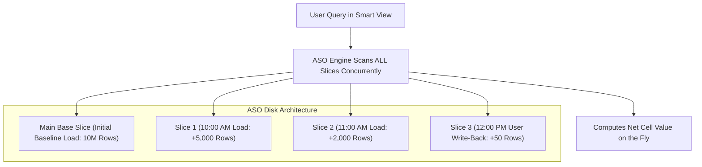
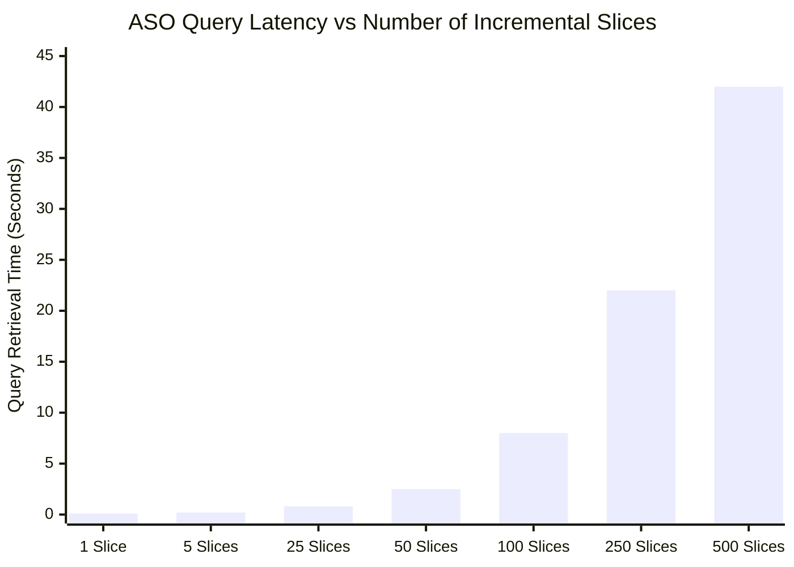

# 4.4 ASO Write-Back, Append-Only Slices & Compaction

> **Consultant Focus:** Aggregate Storage (ASO) operates on a fundamentally different storage architecture than BSO. Instead of modifying blocks in place, ASO uses an **append-only, immutable slice architecture**. Interviewers heavily test your knowledge of **slice fragmentation**, **merge strategies (Incremental vs All)**, **"Drop Zero Cells" compaction**, and why ASO provides superior write concurrency.

<!-- ===================================================================== -->
<!-- 📊 LIVE INTERACTIVE VISUAL CARD: ASO SLICES & MERGE PROTOCOLS -->
<!-- ===================================================================== -->
<details open>
<summary><b>📊 Live Interactive Architecture Card: ASO Slices &amp; Compaction Protocols (Click to Collapse / Expand)</b></summary>

<br/>

> [!TIP]
> **Interactive Standalone Dashboard:** Open [`card_04_writeback_transactions.html`](../interactive_cards/card_04_writeback_transactions.html) in your browser to inspect slice fragmentation and compaction!

| Merge Operation | Target Data Slice | Aggregate Views Impact | Recommended Production Schedule |
| :--- | :--- | :--- | :--- |
| **Merge Incremental** | Consolidates delta slices into 1 incremental slice | **PRESERVED** (views remain valid) | Intraday (every 1–2 hours after data loads) |
| **Merge All Slices** | Consolidates all slices into **Main Slice** | **DROPPED / INVALIDATED** | Nightly batch maintenance window only |
| **Drop Zero Cells** | Purges offsetting zero and deleted records | Frees disk space; shrinks bitmap index | **Always enable** during Merge All |

</details>

---

## 1. The ASO Storage Paradigm: Append-Only Immutable Slices

In Block Storage (BSO), when you change a cell from `$100` to `$150`, Essbase loads the physical block, modifies the 8-byte float in RAM, and writes it back to the exact same disk offset in the `.pag` file.

In **Aggregate Storage (ASO)**, physical data on disk is **immutable**:



### Key Architectural Realities:
1. **Zero In-Place Overwrites:** ASO never modifies existing disk files during a load.
2. **Every Load Is a New Slice:** Every Data Management load, Smart Push execution, or form write-back creates a new, independent **Incremental Data Slice** (`.dat` file).
3. **Delta Accounting:** If an initial load recorded `Revenue = $100`, and a subsequent load updates it to `$150`, ASO writes an incremental delta record (`+$50` or replacing record) into a new slice.
4. **Query Reconstruction:** When a query is executed, the ASO engine scans the Main Slice and all Incremental Slices, summing and reconciling deltas on the fly.

---

## 2. The Slice Fragmentation Pathology

While append-only writing makes data loading blazing fast, it creates a severe operational problem over time known as **Slice Fragmentation**.

### The Production Pathology Walkthrough:
1. An organization configures an automated pipeline pushing data from an ERP into an ASO cube every 15 minutes.
2. Planners are also submitting data through Smart View forms continuously.
3. By the end of the week, the ASO cube accumulates **over 350 incremental slices**.
4. **The Performance Crash:**
   - Ad-hoc Smart View queries that previously returned in **0.1 seconds** now take **35 to 50 seconds** or time out!
   - Why? Because for every single cell requested, the ASO query engine must read 350 separate physical slice files, decompress their bitmap indexes, and reconcile duplicate coordinates.



---

## 3. ASO Slice Merge Protocols: Incremental vs All

To eliminate fragmentation, administrators must execute an **ASO Slice Merge**. Oracle Cloud EPM provides two distinct merge modes:

```mermaid
flowchart TD
    subgraph IncrementalMerge ["1. Merge Incremental Slices"]
        I_Slices["Slice 1 + Slice 2 + ... + Slice 50"] -->|Merged Into| SingleInc["Single New Incremental Slice"]
        I_Main["Main Base Slice (Untouched)"]
    end

    subgraph MergeAll ["2. Merge All Slices (with Drop Zero Cells)"]
        A_Main["Main Slice"] + A_Slices["All Incremental Slices"] -->|Consolidated & Compacted| NewMain["Brand New Compacted Main Slice<br/>(Zero/Deleted Cells Purged)"]
    end
```

### Detailed Comparison:

| Feature | Merge Incremental Slices | Merge All Slices |
| :--- | :--- | :--- |
| **What Gets Merged** | Only the incremental slices are consolidated into 1 slice. | Merges **all** incremental slices directly into the **Main Base Slice**. |
| **Main Slice Impact** | **Untouched** (Fastest execution). | The Main Slice is completely rewritten and compacted. |
| **Materialized Views** | **PRESERVED** (Aggregate views remain intact). | **INVALIDATED / DROPPED** (Aggregate views must be rebuilt). |
| **Execution Duration** | Seconds to minutes (Non-blocking). | Minutes to hours depending on cube size. |
| **Drop Zero Cells** | Not applicable. | **Mandatory** (Purges obsolete/zero rows). |
| **Scheduling Frequency** | Hourly / Multiple times per day. | Nightly batch window or weekly maintenance. |

---

## 4. The Critical Role of "Drop Zero Cells"

When data is cleared or zeroed out in ASO, Essbase does not delete the physical row. It appends a record with a value of `0.0` or an offsetting negative number.

### The Storage Impact of Zero Cells:
* Over months of data loads, up to **40% to 60% of all rows in an ASO cube may be zero-value records**!
* These phantom zero cells consume disk space, inflate bitmap indexes, and degrade query memory caches.

### The Remediation:
When executing **Merge All Slices**, you must always enable the option:
```
Drop Zero Cells = TRUE
```
The merge engine inspects the net mathematical value of every coordinate. If the net sum of a cell across all slices is `0.0`, the cell is **permanently purged from physical disk storage**, shrinking database size significantly and accelerating query retrieval.

---

## 5. Write Concurrency: Why ASO Outperforms BSO in Multi-User Input

In consultant reviews, a common question is: *"Why can ASO support 200 concurrent users writing data without locking, while BSO fails?"*

| Concurrency Dimension | BSO / Hybrid BSO | Aggregate Storage (ASO) |
| :--- | :--- | :--- |
| **Write Mechanism** | In-place block modification. | **Append-only delta streaming**. |
| **Locking Granularity** | **Exclusive Block Lock** on entire sparse block. | **Non-blocking slice append**; optimistic concurrency. |
| **User Collision** | If 2 users write to the same sparse block $\rightarrow$ 1 user stalls/fails. | Users write simultaneously into independent write-back buffers. |
| **Throughput Limit** | Highly constrained by block lock contention. | Extremely high write throughput. |

---

## 6. Twisted Interview Questions & Consultant Model Answers

### Q1: "An ASO reporting cube receives continuous intraday data feeds every 10 minutes via Data Management. By 3 PM, user queries in Smart View that normally take 0.2 seconds take 45 seconds. The data volume has not increased significantly. What is causing the query lag, and how do you resolve it?"
**Consultant Model Answer:**
> "The query latency is caused by **severe ASO slice fragmentation**.
>
> **The Root Cause:**
> Every 10-minute automated data feed generates a new, independent physical data slice (`.dat` file). By 3 PM, the ASO cube has accumulated dozens or hundreds of discrete incremental slices. When a user runs a Smart View query, the ASO query engine must dynamically scan every single slice, decompress multiple bitmap indexes, and reconcile duplicate intersections in memory.
>
> **The Immediate Resolution:**
> Execute an **Incremental Slice Merge**:
> - In Cloud EPM Job Console or via EPM Automate:
>   `epmautomate mergeDataSlices <CubeName> incremental`
> - This consolidates all incremental slices into a single unified slice in under 30 seconds without invalidating aggregate views. Query performance will instantly return to sub-second speeds.
>
> **The Long-Term Architecture:**
> 1. Schedule an automated Incremental Slice Merge job to run every 1–2 hours during the business day.
> 2. Schedule a full **Merge All Slices with Drop Zero Cells** nightly during the batch maintenance window, followed by an aggregate view build."

---

### Q2: "What is the difference between 'Merge Incremental Slices' and 'Merge All Slices'? When should each be scheduled?"
**Consultant Model Answer:**
> "1. **Merge Incremental Slices:**
>    - Consolidates only the small incremental slices into a single aggregate incremental slice.
>    - **Does not touch the Main Base Slice**, meaning existing materialized aggregate views remain valid.
>    - Runs quickly (seconds) with minimal system overhead.
>    - **Schedule:** Intraday (e.g., every 2 hours or immediately following automated data loads).
>
> 2. **Merge All Slices:**
>    - Consolidates all incremental slices directly into the Main Base Slice, rewriting and compacting the entire database.
>    - Enables the **'Drop Zero Cells'** option to permanently purge cleared and offsetting zero records.
>    - **Invalidates all materialized aggregate views**, which must subsequently be regenerated.
>    - **Schedule:** Nightly batch maintenance window or weekly maintenance cycle."

---

### Q3: "What happens if you do NOT enable 'Drop Zero Cells' when executing a full ASO slice merge?"
**Consultant Model Answer:**
> "If 'Drop Zero Cells' is omitted:
> 1. Every historical transaction where a cell was cleared, overwritten with zero, or offset by an equal-and-opposite adjustment will **continue to occupy physical storage on disk**.
> 2. The main slice will remain bloated with millions of zero-value rows.
> 3. Bitmap index files remain oversized, consuming unnecessary RAM in the aggregate cache and increasing ad-hoc query scan times.
>
> By enabling 'Drop Zero Cells', ASO evaluates the net sum of each coordinate; if the sum is zero, the row is discarded entirely, achieving optimal database compaction."

---

### Q4: "Why does ASO handle 100 concurrent data-entry users with virtually zero lock contention, whereas BSO frequently encounters lock timeout errors?"
**Consultant Model Answer:**
> "The difference stems from **storage architecture and concurrency design**:
> - **In BSO:** Concurrency is governed by **exclusive block locks**. If two users submit data to different accounts that share the same sparse coordinate, both requests compete for an exclusive lock on that physical block. One user is blocked until the first finishes.
> - **In ASO:** Data storage is **append-only**. Write-back operations do not modify existing data blocks in place. Instead, write operations append new delta rows into memory load buffers. Because writes are append-based rather than in-place updates, multiple user sessions can submit data simultaneously into the buffer without contending for locks. The engine merges these records into a new slice upon commit."

---

### Q5: "What happens to ASO materialized aggregate views when you execute 'Merge All Slices' versus 'Merge Incremental Slices'?"
**Consultant Model Answer:**
> "- **When executing 'Merge Incremental Slices':**
>   - Materialized aggregate views built on the Main Slice **remain 100% intact and valid**. 
>   - The engine continues to use the aggregate views to answer summary queries instantly.
> - **When executing 'Merge All Slices':**
>   - Because the Main Slice is completely rebuilt and compacted, all existing materialized aggregate views are **automatically dropped and invalidated**.
>   - Summary queries immediately fall back to dynamic aggregation, which can cause query lag until the aggregate views are regenerated.
>   - **Best Practice:** Always chain the batch job sequence: `Merge All Slices (Drop Zero Cells)` $\rightarrow$ `Execute Aggregate Storage Outline Optimization (Rebuild Views)`."

