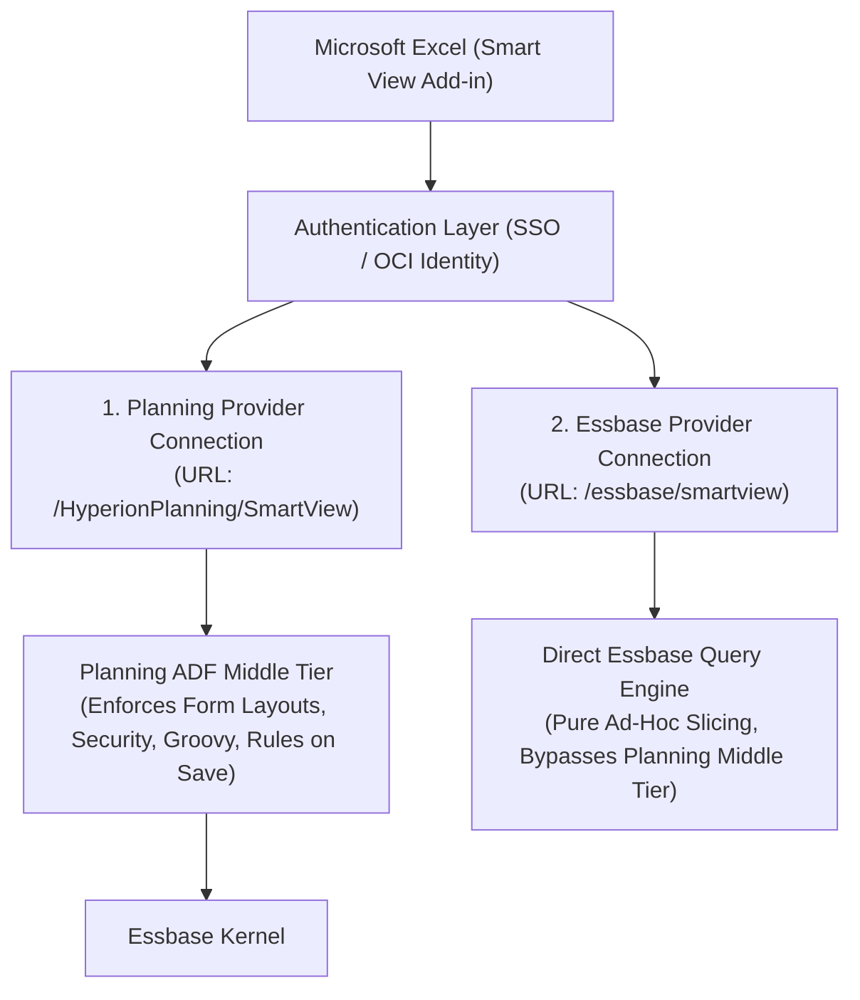
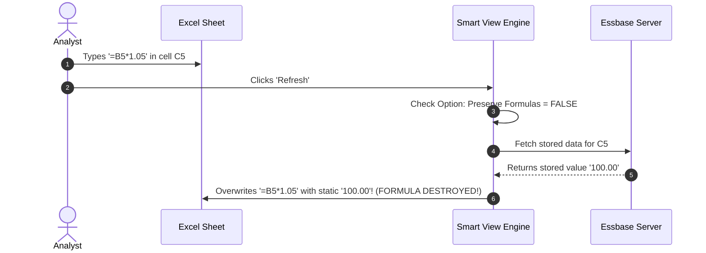

# 5.1 Smart View Architecture, Options & VBA Automation

> **Consultant Focus:** Smart View is the primary interface for 95% of finance executives and planners. Interviewers expect you to know the architectural difference between **Planning Providers and Essbase Providers**, how to prevent the disastrous **Preserve Formulas wipeout trap**, how **Cell Styles** visually enforce security, and how to automate corporate workbooks using the **Smart View VBA Toolkit**.

---

## 1. Smart View Physical Architecture & Provider Types

Oracle Smart View for Office is a COM-based add-in embedded inside Microsoft Excel, Word, and PowerPoint. It connects to Oracle Cloud EPM through two distinct communication pathways:



### Detailed Provider Comparison:

| Feature | Planning Provider Connection | Essbase Provider Connection (Direct) |
| :--- | :--- | :--- |
| **Primary Use Case** | Interacting with structured Planning Web forms, task lists, and approvals. | Free-form ad-hoc multidimensional slicing, pivoting, and drilling. |
| **Business Rules on Save** | **YES** (Executes 'Run On Save' rules and Groovy scripts). | **NO** (Only submits raw numbers to Level 0 stored cells). |
| **Grid Spread Support** | **YES** (Spreads down from parent cells via ADF layer). | **NO** (Parent cells are rejected as non-writable). |
| **Cell-Level Security** | Enforced at form rendering and write-back. | Enforced at Essbase query filter level. |
| **Dynamic Calc Parents** | User can enter data if Grid Spread is enabled. | Completely read-only; write-back prohibited. |

---

## 2. Critical Smart View Options & Formatting Traps

Misconfigured client options represent over 40% of helpdesk tickets logged by finance users.

### 1. The "Preserve Formulas" Wipeout Disaster
* **The Scenario:** A financial analyst builds a model inside an ad-hoc grid, entering Excel formulas:
  ```excel
  =D10 * 1.05   (Projecting 5% revenue increase)
  ```
* The analyst clicks **Refresh**.
* **The Disaster:** Every single Excel formula **vanishes**! They are overwritten by whatever static number was stored in Essbase.
* **The Root Cause:** In Smart View Options $\rightarrow$ **Member Options**, the checkbox:
  ```
  [ ] Preserve Formulas and Comments in Ad-Hoc Operations
  ```
  was **UNCHECKED**. When unchecked, Smart View treats every cell in the grid as a pure data retrieval coordinate, wiping out local Excel formulas during the refresh payload processing.



### 2. "Use Excel Formatting" vs "Use Cell Styles"
* **Use Cell Styles:**
  - Smart View reads metadata flags from the server and color-codes cells dynamically:
    - **Read-Only / Locked Cells:** Shaded Gray.
    - **Writable Input Cells:** White / Yellow.
    - **Dirty / Modified Cells:** Shaded Orange.
    - **Drill-Through Available:** Underlined Blue.
  - Crucial for user experience because planners immediately see which cells can be edited.
* **Use Excel Formatting:**
  - Preserves user fonts, colors, and borders, but **completely disables Cell Styles**. Planners cannot visually distinguish writable cells from read-only cells.

### 3. Missing and Zero Suppression:
* **Suppress Rows / Columns:** Eliminates `#Missing` or `0` rows.
* **Repeated Members:** If unchecked, Smart View merges identical row headers. If checked, it repeats member names on every row—**mandatory** if the sheet is referenced by Excel `VLOOKUP`, `INDEX/MATCH`, or `XLOOKUP` formulas!

---

## 3. Worksheet Functions: `HsGetValue` and `HsSetValue`

Beyond ad-hoc grids, enterprise reporting packages (such as Board of Directors Books) use explicit Smart View functions embedded into formatted Excel models:

### 1. `HsGetValue` (Dynamic Data Retrieval)
Fetches data from an Essbase intersection directly into an individual Excel cell without creating a grid:
```excel
=HsGetValue("Planning_Conn", "Scenario#Actual", "Version#Final", "Year#FY24", "Period#Dec", "Account#Net_Income", "Entity#Total_US")
```

### 2. `HsSetValue` (Targeted Data Submission)
Submits a specific value to an Essbase coordinate:
```excel
=HsSetValue(50000, "Planning_Conn", "Scenario#Plan", "Version#Working", "Year#FY25", "Period#Jan", "Account#Salaries", "Entity#E101")
```

> [!WARNING]
> **The `HsSetValue` Trap:** Entering a value into an `HsSetValue` formula does **NOT** automatically submit data to the database upon typing. The user must explicitly click the **Submit Data** button in the Smart View ribbon to flush `HsSetValue` functions to the server.

---

## 4. Smart View VBA Automation Toolkit

For recurring monthly finance closes, consultants automate workbook generation using the Smart View VBA API library (`SmartView.bas`).

### Core VBA Functions:
```vba
Declare PtrSafe Function HypConnect Lib "HsAddin" (ByVal vtSheetName As Variant, ByVal vtUserName As Variant, ByVal vtPassword As Variant, ByVal vtFriendlyName As Variant) As Long
Declare PtrSafe Function HypRetrieve Lib "HsAddin" (ByVal vtSheetName As Variant) As Long
Declare PtrSafe Function HypSubmitData Lib "HsAddin" (ByVal vtSheetName As Variant) As Long
Declare PtrSafe Function HypExecuteCalcScript Lib "HsAddin" (ByVal vtSheetName As Variant, ByVal vtCalcScript As Variant) As Long
Declare PtrSafe Function HypDisconnect Lib "HsAddin" (ByVal vtSheetName As Variant) As Long
```

### Production Macro Template: Automated Batch Refresh & Calculate
```vba
Sub RunMonthlyFinancialPackage()
    Dim status As Long
    Dim sheetName As String
    sheetName = "Executive_Summary"
    
    ' 1. Establish Secure Connection to Planning Application
    status = HypConnect(sheetName, Empty, Empty, "Vision_Planning_Connection")
    If status <> 0 Then
        MsgBox "Connection failed with error code: " & status, vbCritical
        Exit Sub
    End If
    
    ' 2. Execute Data Retrieval across the active sheet
    status = HypRetrieve(sheetName)
    If status <> 0 Then
        MsgBox "Data retrieval failed with error code: " & status, vbCritical
        Exit Sub
    End If
    
    ' 3. Execute Run-On-Save Business Rule or Aggregation
    status = HypExecuteCalcScript(sheetName, "Agg_Entities")
    
    ' 4. Clean up and terminate session
    status = HypDisconnect(sheetName)
    MsgBox "Monthly Financial Package refreshed and calculated successfully!", vbInformation
End Sub
```

---

## 5. Twisted Interview Questions & Consultant Model Answers

### Q1: "A finance user has written complex Excel formulas (`=B5*C5`) inside a Smart View ad-hoc grid. They click 'Refresh', and all their Excel formulas vanish, replaced by static numbers. What Smart View option was unchecked, and how does Smart View handle formulas during ad-hoc?"
**Consultant Model Answer:**
> "The formulas were destroyed because the option **'Preserve Formulas and Comments in Ad-Hoc Operations'** was **unchecked** in Smart View Options $\rightarrow$ Member Options.
>
> **The Underlying Mechanism:**
> When this setting is disabled, Smart View treats the entire spreadsheet grid as a pure data retrieval array. During a refresh, the client replaces the entire contents of every cell with the numerical float returned from the Essbase query payload, completely overwriting local Excel formula strings.
>
> **The Fix:**
> 1. In Excel, go to **Smart View** ribbon $\rightarrow$ **Options** $\rightarrow$ **Member Options**.
> 2. Check **'Preserve Formulas and Comments in Ad-Hoc Operations'**.
> 3. Under **Formatting Options**, select **'Use Excel Formatting'** and check **'Move formatting on operations'**.
> Once enabled, Smart View will preserve Excel calculation formulas across pivots, zooms, and refreshes."

---

### Q2: "What is the difference between connecting to an Oracle Cloud EPM cube via the 'Planning Provider' versus the 'Essbase Provider' in Smart View?"
**Consultant Model Answer:**
> "1. **Planning Provider Connection (`/HyperionPlanning/SmartView`):**
>    - Routes through the Planning ADF middle tier.
>    - Allows opening structured **Planning Web forms**, accessing **Task Lists**, and managing **Approvals**.
>    - Automatically triggers **'Run On Save' business rules** and Groovy validation scripts upon data submission.
>    - Supports **Grid Spread** down from parent members.
> 2. **Essbase Provider Connection (`/essbase/smartview`):**
>    - Bypasses the Planning middle-tier logic and communicates directly with the underlying Essbase query engine.
>    - Optimized for pure, unconstrained **multidimensional ad-hoc slicing and pivoting**.
>    - Does **not** execute Planning web business rules on save.
>    - Parent cells are strictly read-only; Grid Spread is unsupported."

---

### Q3: "In Smart View, a user enters `=HsSetValue(15000, "Conn", "Account#Acct_100", ...)` into cell D10. They click 'Refresh', but the value in the database does not change. Why?"
**Consultant Model Answer:**
> "The value was not committed because the user clicked **'Refresh'** instead of **'Submit Data'**:
>
> 1. `HsSetValue` is a specialized write function. Typing a value into `HsSetValue` simply stages the value in Excel memory.
> 2. Clicking **'Refresh'** commands Smart View to execute an inbound read query. It pulls stored data from the server, which can actually overwrite the typed `HsSetValue` input!
> 3. To commit data staged in `HsSetValue` functions, the user must explicitly click **Submit Data** (or execute `HypSubmitData` in VBA). This triggers an outbound HTTP POST payload transmitting the staged values to Essbase."

---

### Q4: "Why does checking 'Use Cell Styles' override Excel's standard formatting, and how do you configure visual cues for Read-Only versus Writable cells?"
**Consultant Model Answer:**
> "In Smart View:
> 1. **Cell Styles** are dynamic metadata visual cues controlled by the Planning server. When enabled, Smart View scans the dimensional properties of every cell in the grid (e.g., whether it is Dynamic Calc, secured as Read-Only via Cell-Level Security, or an input cell).
> 2. It applies configured background fills (e.g., Shaded Gray for Read-Only, White for Input, Orange for Dirty).
> 3. Because Cell Styles apply at runtime based on server permissions, they **override standard Excel fill colors and fonts**.
> 4. To configure them: Go to **Smart View Options** $\rightarrow$ **Cell Styles** $\rightarrow$ Expand **Planning** $\rightarrow$ Set custom colors for **Read-Only**, **Writable**, and **Calculated** cells, and ensure **'Use Cell Styles'** is checked under Formatting Options."

---

### Q5: "When writing VBA automation for Smart View, what is the purpose of `HypDisconnectAll()`, and what happens if an automated scheduled macro fails to terminate connections?"
**Consultant Model Answer:**
> "`HypDisconnectAll()` terminates all active HTTP sessions and COM provider connections established by the Excel process to Oracle Cloud EPM.
>
> **What Happens If It Fails to Disconnect:**
> 1. In unattended automated scheduled tasks (e.g., refreshing reports via Windows Task Scheduler), failing to disconnect leaves **orphaned user sessions** on the Cloud EPM application server.
> 2. These abandoned sessions consume server JVM thread pools and memory handles until session timeout thresholds are reached.
> 3. Furthermore, the Excel application process (`EXCEL.EXE`) may remain hung in memory as a background zombie process, blocking subsequent scheduled tasks from launching."

