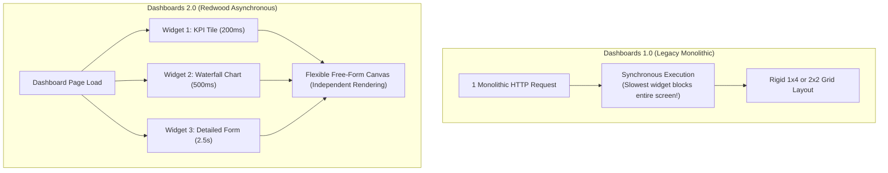
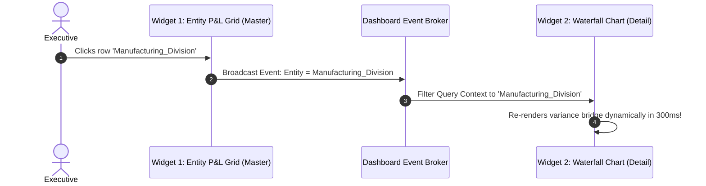
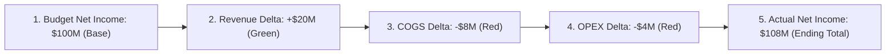
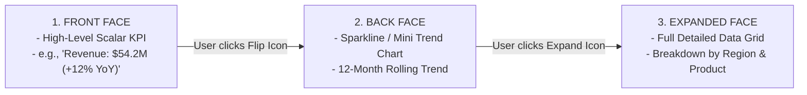

# 5.2 Dashboards 2.0, Redwood Experience & Infolets

> **Consultant Focus:** Modern Oracle Cloud EPM applications rely on **Dashboards 2.0** and the **Redwood Design System** for executive visualization and interactive planning. Interviewers test whether you understand the **asynchronous multi-widget rendering engine**, dynamic **cross-widget POV synchronization**, and how to build executive **Waterfall variance bridges** and **3-sided Infolets**.

---

## 1. Dashboards 1.0 vs Dashboards 2.0: The Redwood Evolution

In older Cloud EPM releases (Dashboards 1.0), dashboards were rigid, slow, and monolithic. With the release of **Dashboards 2.0** and the **Redwood Experience**, Oracle re-engineered the front-end architecture from the ground up:

### Architectural Comparison:

| Feature | Dashboards 1.0 (Legacy) | Dashboards 2.0 (Modern Redwood) |
| :--- | :--- | :--- |
| **Rendering Engine** | Synchronous (Monolithic request) | **Asynchronous (Per-widget independent REST calls)** |
| **Screen Layout** | Fixed grid slots (up to 4 items) | **Free-form responsive grid canvas** (resize & drag freely) |
| **Chart Types** | Basic (Bar, Line, Pie) | **Advanced (Waterfall, Radar, Sunburst, Bubble, Pyramid, Gauge)** |
| **User Write-Back** | Very limited | **Full Form Write-Back, Grid Spread, and Rule Execution** |
| **Cross-Widget Linking** | Static page POV | **Dynamic Master-Detail filtering (Click cell $\rightarrow$ updates chart)** |
| **Performance** | Slowest form blocks all widgets | **Fast widgets render immediately; zero screen freeze** |

---

## 2. Asynchronous Multi-Widget Performance Architecture

The primary performance breakthrough in Dashboards 2.0 is **independent, non-blocking asynchronous REST execution**:

1. When a user opens a dashboard with four widgets (two KPI cards, a waterfall chart, and a large financial statement form):
   - The browser sends **4 concurrent, independent REST API requests** to the Cloud EPM application server.
2. The two KPI cards require simple Level 0 lookups:
   - They complete in **150 milliseconds** and render immediately.
3. The waterfall chart requires a small MDX query:
   - It completes in **400 milliseconds** and animates into view.
4. The large financial form contains complex dynamic calculations and takes **3.0 seconds**:
   - The form displays an isolated spinning loader without freezing the rest of the dashboard.
5. **Result:** The user experiences instant interactivity rather than staring at a blank, locked white screen.

---

## 3. Dynamic POV Synchronization & Master-Detail Linking

Dashboards 2.0 allows you to configure interactive **Master-Detail relationships** between adjacent widgets:

### Configuration Steps:
1. In the Dashboard 2.0 designer, set the **Entity P&L Grid** as the **Master Widget**.
2. Set the **Waterfall Chart** as the **Detail Widget**.
3. Under widget interactions, link the `Entity` dimension.
4. When an executive clicks any entity row in the grid, the waterfall chart automatically updates to display that specific entity's budget-to-actual variance bridge!

---

## 4. Building the CFO Waterfall Variance Bridge

The **Waterfall Chart** is the gold standard for executive financial review. It illustrates how an initial base metric (e.g., Budget Operating Income) bridges to a final metric (Actual Operating Income) through positive and negative intermediate variances.

### The Configuration Trap: Expense Sign Conventions
* In financial accounting, an increase in Revenue is positive (green bar pointing up).
* An increase in Expense (overspending budget) is **negative for net income**!
* **The Trap:** If expenses are plotted directly without sign inversion, higher expenses appear as green bars climbing upward, giving the false impression that overspending increased company profits!
* **The Fix:** In Dashboard 2.0 chart properties:
  - Configure the chart series to invert expense signs or use a dedicated `Variance_Impact` calculated account where:
    $$\text{Variance Impact}_{\text{Expense}} = \text{Budget} - \text{Actual}$$

---

## 5. Infolets: The Executive 3-Sided Card Architecture

**Infolets** are lightweight, high-impact KPI visualization cards embedded directly onto the Cloud EPM Home Page or dedicated Infolet pages.

### The 3 Faces of an Infolet:
1. **Front Face (Summary):** Designed for at-a-glance consumption. Displays a single primary number (e.g., Cash Balance, Headcount, Gross Margin %) and a colored status indicator.
2. **Back Face (Secondary / Trend):** Flipping the card reveals a compact sparkline or secondary comparison (e.g., trailing 12 months trend or target variance).
3. **Expanded Face (Detail):** Expanding the card pops out a full-width interactive chart or detailed data grid for deep-dive investigation.

---

## 6. Twisted Interview Questions & Consultant Model Answers

### Q1: "A Dashboard 2.0 contains 3 forms and 1 chart. Form 1 executes a slow dynamic calculation taking 12 seconds. In Dashboards 1.0, the entire page froze for 12 seconds. What happens in Dashboards 2.0, and why?"
**Consultant Model Answer:**
> "In Dashboards 2.0, **the page does not freeze**:
>
> 1. Dashboards 2.0 utilizes an **asynchronous REST execution model** where each widget operates as an independent execution thread.
> 2. The other two forms and the chart send their REST requests concurrently, receive their responses in under 500 milliseconds, and render immediately on the screen.
> 3. Form 1 displays an isolated loading indicator within its widget container while Essbase computes the dynamic formula.
> 4. Users can interact with, scroll through, and analyze the other widgets while Form 1 completes in the background. Once finished, Form 1 populates seamlessly without disrupting the user interface."

---

### Q2: "How do Master-Detail relationships operate in Dashboards 2.0, and what happens when an executive clicks a cell in a master grid?"
**Consultant Model Answer:**
> "Master-Detail linking in Dashboards 2.0 operates via a client-side **event-broker architecture**:
> 
> 1. When an executive clicks a row or cell in a Master widget (e.g., clicking `Entity_105` in a P&L grid), the master widget dispatches an event containing the dimensional context (`Entity = Entity_105`).
> 2. The dashboard event coordinator intercepts this payload and broadcasts it to any connected Detail widgets (such as an adjacent Waterfall or Bar chart).
> 3. The Detail widget automatically updates its POV or query filter to `Entity_105` and re-queries the server via an asynchronous REST call.
> 4. The chart re-renders dynamically, displaying the specific cost breakdown or variance bridge for `Entity_105` without requiring a full page reload."

---

### Q3: "What is an Infolet, and what is the architectural difference between an Infolet and a standard Dashboard 2.0 widget?"
**Consultant Model Answer:**
> "1. **Scope and Placement:**
>    - **Infolets** are self-contained executive KPI cards designed primarily for embedding directly onto the **EPM Home Page** or dedicated Infolet pages. They deliver micro-content for executive-level scanning.
>    - **Dashboard 2.0 Widgets** are modular components (grids, waterfall charts, gauges) built inside comprehensive operational dashboard pages for analytical exploration.
> 2. **Card Architecture:**
>    - Infolets feature a unique **3-sided progressive disclosure model**:
>      - *Front Face:* Single high-level KPI and indicator.
>      - *Back Face:* Mini sparkline or secondary metric (accessed by flipping).
>      - *Expanded Face:* Full data view or detailed chart (accessed by expanding).
>    - Standard dashboard widgets are single-faced components embedded on a free-form canvas."

---

### Q4: "Can users submit data and trigger business rules directly from a Dashboard 2.0 form, or is Dashboard 2.0 strictly read-only?"
**Consultant Model Answer:**
> "Yes, Dashboards 2.0 provides **full read-write interactivity**:
>
> 1. Users can enter numbers directly into writable cells within any form widget embedded on a Dashboard 2.0 canvas.
> 2. **Grid Spread** can be executed directly from parent cells inside the dashboard widget.
> 3. When the user clicks the dashboard **Save** button, Planning commits the data to Essbase and automatically triggers any configured **'Run On Save' business rules** or Groovy scripts.
> 4. Furthermore, any linked chart widgets on the dashboard automatically refresh post-save to visualize the newly submitted data."

---

### Q5: "In a Waterfall variance chart comparing Budget to Actuals, an increase in Operating Expense appears as a green bar climbing upward, confusing the CFO. How do you correct this in the design?"
**Consultant Model Answer:**
> "This occurs because the chart is plotting raw positive expense amounts rather than the **financial impact on profitability**:
>
> 1. An increase in revenue improves profit (positive variance), but an increase in expense reduces profit (negative financial impact).
> 2. **The Consultant Fix:**
>    - In the underlying form feeding the Waterfall chart, create a calculated column or formula row for **Variance Impact**.
>    - For Revenue accounts: $\text{Impact} = \text{Actual} - \text{Budget}$.
>    - For Expense accounts: $\text{Impact} = \text{Budget} - \text{Actual}$ (inverting the sign).
>    - In Dashboard 2.0 chart properties, map the Waterfall series to this calculated impact metric and designate the initial and final bars as totals.
> 3. Expenses that exceed budget will now render as **red bars dropping downward**, correctly illustrating the erosion of net income."

