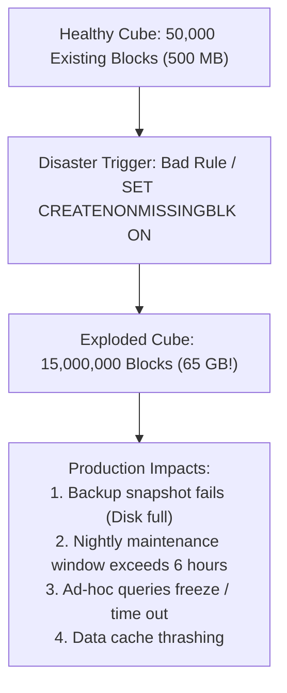

# 6.1 The Block Explosion Pathology & Fixes

> **Consultant Focus:** Block Explosion is the most catastrophic production disaster in Essbase Block Storage (BSO) and Hybrid BSO. A single poorly written calculation script or un-sanitized data load can explode a 500 MB database into 60 GB overnight, causing nightly maintenance window timeouts, server disk exhaustion, and query freezing. Interviewers test your diagnostic methodology and surgical remediation workflows.

---

## 1. What Is Block Explosion?

In Essbase BSO/Hybrid BSO, a physical data block is instantiated only when at least one dense cell within a unique sparse combination holds data. 

**Block Explosion** occurs when calculation scripts, data loads, or member formulas create millions of **unintended, empty, or near-empty physical data blocks** on disk, inflating the database footprint exponentially.



---

## 2. The 5 Root Causes of Block Explosion

### 1. `SET CREATENONMISSINGBLK ON;` Inside Broad `FIX` Statements
This is the **#1 cause of block explosion** in production:
* `SET CREATENONMISSINGBLK ON;` commands Essbase: *'If a formula evaluates to a non-missing number, instantiate a physical block on disk.'*
* **The Trap:** When applied inside a broad `FIX` over multiple sparse dimensions (e.g., all 500 entities and all 1,000 products), Essbase evaluates the Cartesian product ($500 \times 1,000 = 500,000$ potential blocks). If an unconstrained formula or driver evaluates to a non-missing value (even `0.0`), Essbase physically instantiates **all 500,000 blocks**!

### 2. Careless `DATACOPY` Statements Across Cartesian Products
```essbase
/* The Disaster: Copies every block in the cube to a new scenario */
DATACOPY "Actual" TO "Forecast";
```
* If `Actual` had 500,000 blocks across 10 years, copying it blindly into `Forecast` instantiates 500,000 new blocks, doubling the database size instantly.
* **The Fix:** Always restrict `DATACOPY` within a tightly scoped `FIX`:
  ```essbase
  FIX("FY25", @RELATIVE("Total_Entity", 0))
      DATACOPY "Actual"->"Dec" TO "Forecast"->"Jan";
  ENDFIX
  ```

### 3. Top-Down Calculation Mode Instantiation
When a formula has cross-dimensional references (`->`) or complex `IF` statements evaluating non-existing blocks, Essbase switches to **Top-Down mode**. If the formula assigns default values, it creates physical blocks for every intersection evaluated.

### 4. Loading Raw Zeros from External ERP Feeds
* Relational ERP systems (SAP, Oracle Fusion) often export records with explicit zero balances (`0.00`).
* In Essbase, `0.00` is **NOT `#Missing`**! A zero is a valid numeric float.
* Loading 2,000,000 zero-value rows from an ERP creates **2,000,000 physical blocks**, even though there is no actual financial activity!

### 5. Dense/Sparse Configuration Inversion
Marking a large, highly populated dimension (such as `Entity` or `Cost Center`) as **DENSE** instead of **SPARSE** explodes the block size from 80 KB to 50 MB, causing instant memory exhaustion.

---

## 3. Diagnostic Workflow: How to Detect and Quantify Block Explosion

When an application suddenly experiences severe performance degradation, follow this 4-step diagnostic checklist:

```mermaid
sequenceDiagram
    autonumber
    actor Admin
    participant Stats as Database Statistics Panel
    participant Log as Essbase Application Log (essbase.log)
    participant Console as Planning Job Console

    Admin->>Stats: 1. Check 'Existing Blocks' vs 'Block Density'
    Stats-->>Admin: Block count jumped from 50K to 12M! Block density = 0.05%
    Admin->>Log: 2. Inspect calc script runtimes & 'Top-Down' warnings
    Log-->>Admin: Warning: Formula executed in Top-Down mode; SET CREATENONMISSINGBLK was active
    Admin->>Console: 3. Correlate timestamp with Job Console executions
    Console-->>Admin: Rule 'Allocate_Corporate_Expenses' ran at 2:00 AM (Duration: 3.5 hrs)
    Note over Admin: Root Cause Identified: Allocation Rule created 11.95M empty blocks!
```

### Key Statistical Indicators of Block Explosion:
1. **Existing Blocks Metric:** If block count spikes by an order of magnitude (e.g., $10\times$ or $100\times$) overnight.
2. **Block Density Percentage:** Drops to near zero (e.g., $< 0.1\%$). This indicates millions of blocks exist where 99.9% of their internal dense cells are `#Missing`.
3. **Database File Size (.PAG):** Explodes from megabytes to gigabytes.

---

## 4. Surgical Remediation & Cube Deflation Protocols

Once block explosion is identified, follow this phased recovery procedure to shrink the database back to normal size:

### Step 1: Purge Zombie Blocks with `CLEARBLOCK EMPTY;`
If the exploded blocks contain all `#Missing` cells, execute:
```essbase
SET EMPTYMEMBERSETS ON;
FIX("Plan", "FY25", "Working")
    CLEARBLOCK EMPTY;
ENDFIX
```
* **What This Does:** Essbase scans the target slice and physically deletes any block where all cells are `#Missing` from the index table (`.ind`), reclaiming disk space.

### Step 2: Clear Erroneous Data Slices (`CLEARBLOCK ALL;`)
If the bad rule created blocks containing zeros or invalid numbers, wipe the affected scenario/version:
```essbase
FIX("Corrupted_Scenario", "Corrupted_Version")
    CLEARBLOCK ALL;
ENDFIX
```

### Step 3: Rewrite the Offending Rule
Eliminate `SET CREATENONMISSINGBLK ON;` and replace it with **Targeted Bottom-Up Execution** or `@CREATEBLOCK`:
```essbase
/* PREVENTATIVE DESIGN: Create ONLY blocks that have active driver activity */
FIX(@RELATIVE("Total_Entity", 0), "FY25", "Working")
    "Target_Expense"(
        @CALCMODE(BOTTOMUP);
        IF ("Driver_Headcount" > 0)
            "Target_Expense" = "Corp_Pool" * ("Driver_Headcount" / "Total_Headcount");
        ENDIF
    )
ENDFIX
```

---

## 5. How Hybrid BSO Fundamentally Protects Against Block Explosion

| Dimension Type | Classic BSO | Modern Hybrid BSO |
| :--- | :--- | :--- |
| **Upper-Level Sparse Parents** | Configured as `Stored (+)`; physically created millions of aggregate blocks on disk. | Configured as **`Dynamic Calc (~)`**; **ZERO physical blocks exist on disk** for upper-level parents. |
| **Alternate Reporting Rollups** | Required stored physical blocks for every alternate hierarchy. | Calculated dynamically in RAM; **zero disk block footprint**. |
| **Risk of Block Explosion** | **EXTREMELY HIGH** (Any aggregation or allocation script could trigger explosion). | **CONFINED STRICTLY TO LEVEL 0** (Upper-level explosion is architecturally impossible). |

---

## 6. Twisted Interview Questions & Consultant Model Answers

### Q1: "A nightly allocation rule ran, and the database size jumped from 600 MB to 52 GB overnight. Smart View retrievals now take 3 minutes. How do you diagnose which dimension combination caused the block explosion, and what is your immediate remediation plan?"
**Consultant Model Answer:**
> "1. **Immediate Diagnosis:**
>    - Review the **Database Statistics** in the Planning / Essbase administration console to inspect the new block count and block density percentage. A block count jumping from 60,000 to 15,000,000 with density dropping below 0.1% confirms block explosion.
>    - Inspect `essbase.log` and the Planning Job Console around the 2:00 AM batch window to identify the exact business rule that executed and inspect its log for `Top-Down mode` or `SET CREATENONMISSINGBLK ON` warnings.
>    - Review the rule's `FIX` statement to identify the sparse dimensions involved in the Cartesian explosion.
>
> 2. **Immediate Remediation Plan:**
>    - **Step 1:** Place the application in Maintenance Mode to prevent user access.
>    - **Step 2:** If the rule populated blocks with `#Missing`, run a targeted script with **`CLEARBLOCK EMPTY;`** scoped to the affected Scenario, Year, and Version.
>    - **Step 3:** If the blocks contain erroneous zeros or garbage numbers, execute **`CLEARBLOCK ALL;`** on the affected scenario slice to physically purge all blocks.
>    - **Step 4:** Execute a **Database Refresh (Cube Restructure)** to compact the `.pag` and `.ind` files on disk.
>    - **Step 5:** Rewrite the allocation rule to remove `SET CREATENONMISSINGBLK ON;` and enforce Bottom-Up calculation mode."

---

### Q2: "Why does `SET CREATENONMISSINGBLK ON;` cause block explosion when used in conjunction with cross-dimensional references (`->`)?"
**Consultant Model Answer:**
> "`SET CREATENONMISSINGBLK ON;` forces Essbase to evaluate every potential sparse cell intersection within the `FIX` scope.
>
> When combined with a cross-dimensional reference (e.g., `Allocation = Driver * Pool->"Corp_Entity"`):
> 1. Essbase cannot determine beforehand which target entity blocks need to exist.
> 2. The compiler switches to **Top-Down execution**, looping through the entire Cartesian product of all sparse dimensions in the scope.
> 3. If `Pool->"Corp_Entity"` is a non-zero number, Essbase evaluates the formula at every single empty intersection. If the formula evaluates to any non-missing result (or if `IF` logic fails to suppress missing drivers), `SET CREATENONMISSINGBLK ON` forces Essbase to **physically instantiate a brand-new data block on disk for every single intersection evaluated**!
> 4. In a cube with 500 entities, 200 cost centers, and 50 products, this creates $500 \times 200 \times 50 = \mathbf{5,000,000 \text{ physical blocks}}$ in seconds."

---

### Q3: "What is the difference between an 'Empty Block' and a 'Sparse Block'? How does `CLEARBLOCK EMPTY;` know which blocks to delete?"
**Consultant Model Answer:**
> "- **Sparse Block:** A physical data block whose coordinates are defined by a unique combination of members from the sparse dimensions. A sparse block is considered valid as long as at least one dense cell inside it contains a legitimate numeric value.
> - **Empty Block (Zombie Block):** A physical block that exists in the index table (`.ind`) and page file (`.pag`), but **every single dense cell inside its 8-byte array contains the IEEE value for `#Missing`**.
>
> **How `CLEARBLOCK EMPTY;` Operates:**
> Essbase traverses the sparse block index table. For each block, it inspects the dense cell array. If all dense cells are `#Missing`, Essbase deletes the block's entry from the `.ind` index table and flags the block's physical space in the `.pag` file as deallocated. The block is wiped without touching blocks that contain valid data."

---

### Q4: "A data load file from an ERP system contains 1,000,000 rows where 700,000 rows have a value of `0.00`. If loaded into a BSO cube, what happens to the block count, and how do you prevent it?"
**Consultant Model Answer:**
> "In Essbase, `0.00` is a valid floating-point number, **not `#Missing`**.
>
> 1. **What Happens:** Essbase will physically create up to 700,000 unnecessary data blocks on disk to store the `0.00` values, causing severe block explosion and index bloat.
> 2. **Prevention Methods:**
>    - **Method 1 (Data Integration / Data Management):** In the Data Management import format or mapping rules, apply a source filter or conditional expression that maps `0.00` to `NULL` or skips zero rows during extraction.
>    - **Method 2 (Essbase Load Rule):** In the Essbase load rule, configure **Data Cleansing / Zero Suppression** to ignore records with zero values.
>    - **Method 3 (Post-Load Cleanup):** If zeros were already loaded, run a business rule converting zeros to `#Missing`:
>      ```essbase
>      IF ("Amount" == 0)
>          "Amount" = #Missing;
>      ENDIF
>      ```
>      Followed immediately by `CLEARBLOCK EMPTY;` to purge the blocks."

---

### Q5: "Can block explosion occur in an Aggregate Storage (ASO) cube? Why or why not?"
**Consultant Model Answer:**
> "No, **block explosion cannot occur in ASO** because ASO does not use the block architecture:
>
> 1. ASO does not have dense/sparse dimensions, data blocks, or `.pag` files.
> 2. ASO stores data as individual non-missing cell coordinates (tuples) in compressed columnar / bitmap slices.
> 3. If an intersection has no data, ASO simply stores nothing; there is no fixed-size block structure allocated for empty space.
> 4. However, ASO suffers from its own distinct operational pathology: **Slice Fragmentation** (accumulating too many incremental data slices from repeated data loads), which is resolved by running slice merges."

