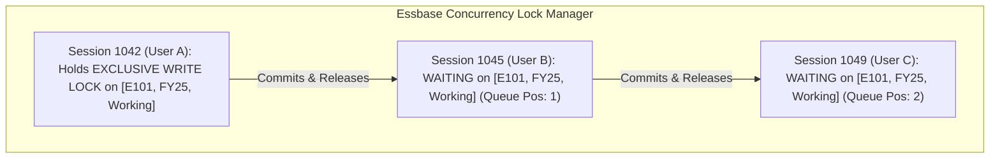
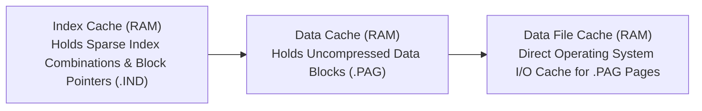

# 6.2 Lock Contention & Performance Bottlenecks

> **Consultant Focus:** In high-concurrency enterprise planning cycles, system freezes and lock timeouts are common. Interviewers test your knowledge of **Essbase block-level locking queues**, **shared corporate block bottlenecks**, **Cache Thrashing** (`DATACACHESIZE` vs `INDEXCACHESIZE`), and why server-side missing suppression can paradoxically slow down queries if improperly architected.

---

## 1. Concurrency Architecture & The Block-Lock Queue

In Essbase BSO and Hybrid BSO, write transactions do not lock individual cells; they lock **entire physical data blocks**:



### The Two Types of Locks:
1. **Shared Read Lock (S-Lock):** Multiple users can read the same block simultaneously for queries and reports.
2. **Exclusive Write Lock (X-Lock):** Acquired when a user submits data, when a business rule modifies cells, or during a data load. **Only one session can hold an X-Lock on a block at a time.**

### The Classic Production Disaster: The Shared Corporate Block
During annual budgeting, 100 planners across 100 different departments submit their travel and expense budgets.
* Planners report that their forms are hanging for 60 seconds and failing with:
  ```
  Error: Transaction timed out waiting for lock on block held by another session.
  ```
* **Why?** Each department form has an automated 'Run On Save' rule that calculates an allocation or writes an audit stamp to a **shared corporate intersection** (e.g., `Entity: Corp_Headquarters` or `Account: Last_Updated_Timestamp`).
* Even though all 100 planners were editing different departmental entities, **all 100 sessions queued up to acquire an exclusive lock on that single Corporate block**! Session 1 got the lock, while Sessions 2 through 100 stalled in the queue until timeouts were triggered.

---

## 2. Memory Cache Tuning: Preventing Cache Thrashing

The Essbase storage engine relies on dedicated memory caches to prevent slow disk I/O:



### 1. `INDEXCACHESIZE` (Index Cache)
* Stores the sparse index entries and block memory pointers.
* **Tuning Target:** The Index Cache should ideally be sized to **fit the entire `.ind` file in RAM**.
* If the index fits in RAM, finding any block in the database is an instantaneous $O(1)$ memory lookup.

### 2. `DATACACHESIZE` (Data Cache)
* Holds decompressed data blocks currently being read or modified by calculations and queries.
* Blocks are managed using a **Least Recently Used (LRU)** eviction algorithm.

### 3. The Cache Thrashing Pathology:
When `DATACACHESIZE` is too small to hold the working set of blocks required by a calculation script:
1. Essbase reads Block 1 from disk into the Data Cache.
2. The cache fills up immediately.
3. To load Block 2, Essbase must **evict Block 1** back to disk.
4. Two milliseconds later, the calculation script needs Block 1 again! Essbase must re-read Block 1 from disk, evicting Block 2!
5. **The Symptom:** Server CPU utilization is low (e.g., 10%), but **Disk I/O Wait is 100%**. Calculations that should take 20 seconds take 45 minutes because the server is constantly swapping blocks between disk and RAM.

---

## 3. Query Retrieval Bottlenecks & Suppression Traps

### The Paradoxical "Missing Suppression" Slowdown
Finance users often enable **'Suppress Missing Rows'** to clean up reports. However, in certain outline designs, missing suppression can make queries **significantly slower**:

```
Scenario: A query requests 10,000 sparse entity rows across 100 periods.
- Without Suppression: Essbase returns all 10,000 rows directly from index definitions in 0.5s.
- With Suppression: Essbase cannot rely on the index alone. It MUST load all 10,000 blocks into memory, inspect every single dense cell in each block to verify whether it is empty, and filter out missing rows!
```
If the cube has low density, checking millions of dense cells across thousands of blocks creates massive CPU and cache overhead.

---

## 4. Troubleshooting Workflow: Diagnosing & Terminating Hung Sessions

When users report application freezing in Oracle Cloud EPM:

```mermaid
sequenceDiagram
    autonumber
    actor Admin
    participant JC as Planning Job Console
    participant SM as System Maintenance / Sessions
    participant OCI as Oracle Cloud EPM Infrastructure

    Admin->>JC: 1. Inspect Job Console for active/running jobs
    JC-->>Admin: Identifies Rule 'Full_Allocation' running for 180 minutes (HUNG)
    Admin->>SM: 2. Navigate to System Maintenance -> Active Sessions
    SM-->>Admin: Displays Session ID 4082 holding lock on Essbase cube
    Admin->>SM: 3. Click 'End Session' / Terminate Job
    SM-->>Admin: Session killed cleanly; locks released instantly!
```

### What If the Session Refuses to Die?
1. In Cloud EPM, if a runaway query or deadlock does not terminate via the Job Console:
2. Use **EPM Automate**:
   ```bash
   epmautomate stopApp
   epmautomate startApp
   ```
3. Restarting the application process unloads the database, clears the memory cache, and releases all block locks cleanly.

---

## 5. Twisted Interview Questions & Consultant Model Answers

### Q1: "During peak budget season, 40 planners report that forms hang for 60 seconds and fail with 'Lock Timeout'. In the logs, all 40 sessions are waiting on a single block. What is that single block, and why are 40 planners competing for it?"
**Consultant Model Answer:**
> "The 40 planners are competing for a **Shared Corporate Block (Lock Contention Bottleneck)**:
>
> 1. Even though each planner is submitting data to their own independent department entity, the Planning form layout or associated 'Run On Save' business rule contains a calculation statement writing to a **single common sparse intersection**.
> 2. Common culprits include:
>    - Writing an audit timestamp into a shared administrative entity: `Last_Update_Date->"Corp_Admin"`.
>    - Calculating a company-wide summary allocation driver that writes an offset to a central corporate entity: `Offset->"Corporate"`.
>    - Updating a global exchange rate or control flag inside the form save rule.
> 3. Because Essbase uses **exclusive block-level locking**, only one session can write to the `Corporate` block at a time. The remaining 39 sessions form a sequential queue; when wait times exceed the 30–60 second lock timeout, the sessions abort.
>
> **The Fix:**
> - Remove shared-entity writes from the form's 'Run On Save' rule.
> - Decouple corporate allocations from user form saves, executing them asynchronously in a scheduled batch job."

---

### Q2: "What is 'Cache Thrashing' in Essbase, how do you diagnose it from the application log, and what configuration setting resolves it?"
**Consultant Model Answer:**
> "1. **What It Is:** Cache thrashing occurs when the **`DATACACHESIZE`** is too small to accommodate the active working set of blocks required by a calculation script or query. Essbase is forced to continuously load a block into RAM, evict it to disk to make space for another block, and immediately re-read the first block from disk again.
> 2. **Diagnosis:**
>    - In `essbase.log`, you will observe abnormally high cache misses and frequent buffer flushes.
>    - Server performance monitors show very high Disk I/O Wait (90–100%) paired with very low CPU utilization (10–15%).
> 3. **The Configuration Fix:**
>    - Increase **`DATACACHESIZE`** (Data Cache) to allow a larger working set of blocks to reside in RAM simultaneously.
>    - In Classic BSO, setting Data Cache to at least 2–3 times the size of the sparse dimension slice being calculated eliminates swapping and restores CPU-bound execution speed."

---

### Q3: "What is the difference between `INDEXCACHESIZE` and `DATACACHESIZE`? Which one should be larger in a typical BSO cube?"
**Consultant Model Answer:**
> "- **`INDEXCACHESIZE` (Index Cache):**
>   - Holds the sparse index table entries (`.ind` file), which map sparse member combinations to physical block page offsets on disk.
>   - Sized in relation to the `.ind` file size.
> - **`DATACACHESIZE` (Data Cache):**
>   - Holds the decompressed physical data blocks (`.pag` file) containing the dense cell arrays currently being processed in RAM.
>
> **Which Should Be Larger?**
> In almost all enterprise BSO cubes, **`DATACACHESIZE` should be significantly larger than `INDEXCACHESIZE`**.
> - The index file contains lightweight 8-byte pointer keys, while data blocks contain full multidimensional cell arrays (typically 80 KB to 200 KB per block).
> - While an index cache of 50 MB to 256 MB can often hold the entire index table of a large cube, the data cache typically requires 500 MB to 2 GB+ to hold sufficient active data blocks and prevent cache thrashing."

---

### Q4: "A financial report with 10,000 rows takes 4 minutes to run. When missing suppression is turned OFF, it takes 3 seconds. Why did turning ON suppression make the report 80x slower?"
**Consultant Model Answer:**
> "This happens because of the difference between **Index-Only Querying** and **Block-Inspection Querying**:
>
> 1. **Without Suppression:** The reporting engine looks strictly at the outline structure and grid dimensions. It quickly constructs the grid shell and retrieves existing data, returning empty cells where data is missing in 3 seconds.
> 2. **With Missing Suppression Enabled:** The engine cannot assume a row is empty based on the index alone. It is forced to:
>    - Physically read every single candidate data block from disk into memory.
>    - Traverse all 10,000 rows across all dense columns cell-by-cell to verify whether every single cell in each row is `#Missing`.
>    - If thousands of blocks must be decompressed and scanned just to verify they contain no data, disk I/O and CPU scan times explode, taking 4 minutes.
>
> **The Architectural Fix:** Restrict the query POV using targeted user selections or dynamic member filters rather than relying on brute-force suppression over massive empty sparse outlines."

---

### Q5: "How do you kill a hung or runaway Essbase session in Oracle Cloud EPM without restarting the entire environment?"
**Consultant Model Answer:**
> "1. **Via Planning Web UI (Job Console):**
>    - Navigate to **Application** $\rightarrow$ **Jobs**.
>    - Locate the running job (Business Rule, Data Map, or Import).
>    - Click the three dots icon next to the job and select **Cancel**.
> 2. **Via System Maintenance / Activity Console:**
>    - As a Service Administrator, check active user sessions and terminate the specific offending thread.
> 3. **Via EPM Automate (If UI is unresponsive):**
>    - If the user interface is completely locked, use the EPM Automate CLI to stop and restart the application cleanly:
>      ```bash
>      epmautomate stopApp
>      epmautomate startApp
>      ```
>    - This restarts only the specific application service on OCI without recycling the underlying infrastructure, clearing locks in under 60 seconds."

