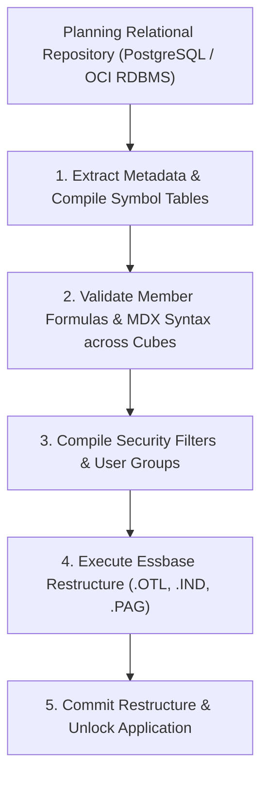
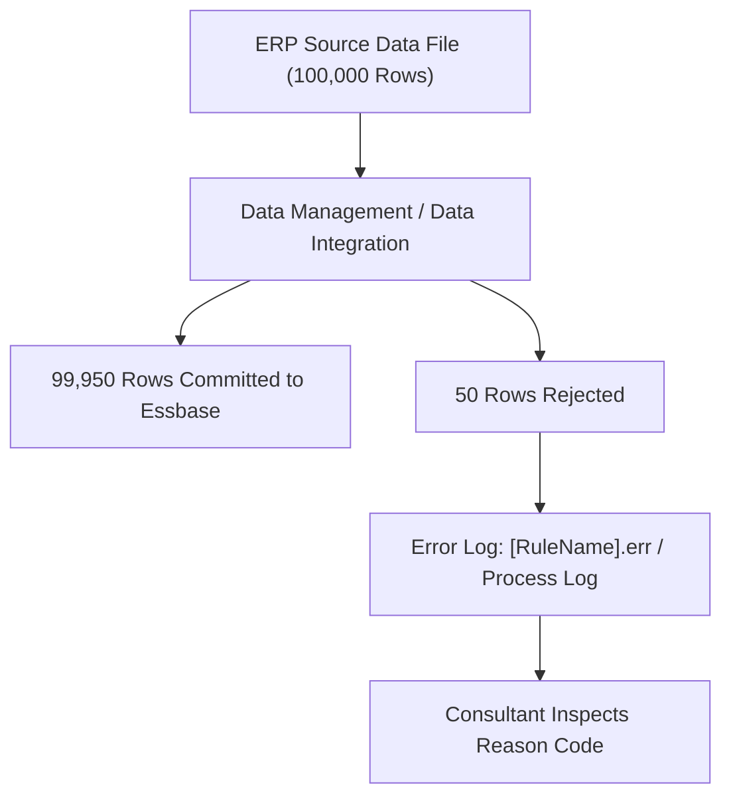

# 6.3 Database Refresh & Data Load Failures

> **Consultant Focus:** Database Refresh (Cube Restructure) and Data Load errors are high-visibility production emergencies. When a refresh fails during a morning deployment, the entire application can be locked out for hundreds of users. Interviewers test your ability to diagnose **compilation errors**, **shared member precedence violations**, **insufficient disk space during dense restructures**, and **data load rejection logs**.

---

## 1. What Happens During a Database Refresh (Cube Restructure)?

In Oracle Cloud EPM Planning, metadata changes (adding accounts, modifying formulas, changing dimension properties) are initially saved to the **relational repository**.

When an administrator clicks **Refresh Database**, Planning synchronizes the relational repository with the underlying **Essbase multidimensional engine**:



---

## 2. Top 5 Database Refresh Failure Modes & Fixes

### 1. The Precedence Violation
* **Error:** `Shared member [Product_X_Shared] appears before base member in outline.`
* **Root Cause:** In the metadata load file or outline editor, the alternate hierarchy containing the shared member is positioned **above** the primary hierarchy containing the base prototype.
* **The Fix:** Move the base member's hierarchy above the shared member in the outline hierarchy, then re-run refresh.

### 2. Formula Syntax Isolation Failure
* **Error:** `Cube: Workforce - Member formula for [Total_Revenue] contains unknown member [Product_Sales].`
* **Root Cause:** A formula referencing `Product_Sales` (which exists only in `FinPlan`) was applied globally to `Total_Revenue`, which is enabled in both `FinPlan` and `Workforce`.
* **The Fix:** Wrap the formula in cube-specific plan type tags:
  ```essbase
  <PlanType: FinPlan>
  "Product_Sales" * "Volume";
  </PlanType: FinPlan>
  ```

### 3. Insufficient Disk Space During Dense Restructure
* **Error:** `Cannot perform dense restructure on database [app/db]. Error [1008106]: Insufficient disk space on server.`
* **Root Cause:** A Dense dimension was modified (members added or reordered). A Dense restructure requires **at least 2.5 times the current database size** in free disk space because Essbase writes a new temporary `.pag` file while preserving the old one until commit.
* **The Fix:** In Cloud EPM, contact Oracle Support or clean up historical snapshots via EPM Automate (`epmautomate deletefile <snapshot>`) to free storage on the OCI instance.

### 4. Duplicate Member Name Conflict
* **Error:** `Member [Administration] already exists in dimension [Cost_Center].`
* **Root Cause:** Two different parents have a child named `Administration`, but **Duplicate Member Names** are not enabled for the application.
* **The Fix:** Rename the member to a unique technical name (e.g., `Admin_HR` and `Admin_IT`) and use the Alias property to display 'Administration' on reports.

### 5. Conflicting Member Properties
* **Error:** `Cannot set Never Share on shared member [Entity_101].`
* **Root Cause:** A member was marked as `Data Storage = Shared` while simultaneously having the `Never Share` property assigned.
* **The Fix:** Remove the `Never Share` tag from the shared member.

---

## 3. Data Load Failures & Rejection Log Diagnostics

When loading data via Data Management, Data Integration, or rule files, partial or complete load failures occur:



### Common Data Load Error Codes & Resolutions:

| Error Message in Process Log | Root Cause | Consultant Remediation |
| :--- | :--- | :--- |
| **`Member [Acct_9999] does not exist in outline`** | The ERP generated a new GL account that was not yet imported into Planning metadata. | Add `Acct_9999` to the Account dimension metadata, refresh the database, and re-run data load. |
| **`Data value [N/A] is not numeric`** | The text file contains non-numeric strings or un-sanitized headers in the data column. | Adjust the Import Format to skip header rows or map non-numeric entries to `#Missing`. |
| **`Cannot load data to a dynamic calc member [Gross_Margin]`** | The target cell has Data Storage = `Dynamic Calc`. | Dynamic members cannot store physical data. Remap the load to the underlying Level 0 input driver accounts (`Gross_Profit` and `Revenue`). |
| **`Transformation failed for dimension Entity`** | Data Management mapping rules failed to resolve a source ERP entity code to a target Planning member. | In Data Management, open **Data Load Mapping** $\rightarrow$ add explicit or wildcard mapping for the missing entity. |

---

## 4. The Consultant Production Recovery Runbook

When a Database Refresh aborts in a live enterprise production environment, follow this 4-step emergency recovery protocol:

### Step 1: Download Diagnostic Error Logs
* Navigate to: **Application** $\rightarrow$ **Jobs** $\rightarrow$ Click on the failed **Refresh Database** job $\rightarrow$ Click **Job Details**.
* Download the full diagnostic log or error text. Identify the exact dimension and member name triggering the failure.

### Step 2: Run "Validate Metadata" Utility
* Navigate to: **Application** $\rightarrow$ **Overview** $\rightarrow$ **Actions** $\rightarrow$ **Validate Metadata**.
* This built-in validator scans the relational repository for:
  - Orphaned members.
  - Invalid parent-child relationships.
  - Illegal formula characters.
  - Broken alias references.
* It reports all structural errors *before* you attempt another refresh.

### Step 3: Roll Back Offending Metadata Changes
* If an administrator loaded bad metadata that crashed the refresh, delete the offending member or revert the formula edit directly in Dimension Management.

### Step 4: Execute Refresh with User Disconnect
* Click **Refresh Database**.
* **CRITICAL:** Check the option:
  ```
  [X] Log off all users before refresh
  ```
* This terminates open Smart View and web user sessions, releases block and outline file locks, and allows the Essbase restructure engine to acquire exclusive file handles cleanly.

---

## 5. Twisted Interview Questions & Consultant Model Answers

### Q1: "A Database Refresh fails at 90% completion with the error: `Cannot perform dense restructure: Insufficient disk space on server`. The application is left in Maintenance Mode, and users cannot log in. How do you recover?"
**Consultant Model Answer:**
> "1. **Why It Failed:**
>    A Dense dimension was modified. A Dense restructure rebuilds every single physical data block (`.pag`), requiring up to 2.5x the current database size in temporary disk space. The OCI server partition ran out of free storage before completing the write.
>
> 2. **Emergency Recovery Steps:**
>    - **Step 1 (Free Disk Space Immediately):** Log into the Cloud EPM environment via **EPM Automate** or the Migration Console. Delete obsolete LCM snapshots, temporary export files, and old data management logs:
>      ```bash
>      epmautomate listfiles
>      epmautomate deletefile <Old_Backup_Snapshot.zip>
>      ```
>    - **Step 2 (Revert Dense Changes if Possible):** If disk space remains constrained, revert the metadata changes made to the Dense dimension (e.g., move newly added members to a Sparse dimension or keep them as Dynamic Calc).
>    - **Step 3 (Re-Run Refresh with User Disconnect):** Re-launch the Database Refresh with **'Log off all users'** checked. With free disk space available, Essbase compiles the `.pag` files and unlocks the application."

---

### Q2: "During a daily automated metadata import, 10 new accounts are added, but Database Refresh fails because an existing business rule syntax validation fails on an unrelated member. Why does Database Refresh validate business rules, and how do you bypass this?"
**Consultant Model Answer:**
> "During a Database Refresh, Planning performs a **global application integrity check**:
> 
> 1. It validates all member formulas and Calculation Manager business rules enabled for the refreshed plan types to guarantee that the cube can compile into a coherent mathematical model.
> 2. If a business rule references a member that was previously deleted or renamed, the compiler detects an unresolved reference and aborts the refresh to prevent cube corruption.
>
> **How to Resolve/Bypass:**
> - In Calculation Manager, locate the offending rule, open it, and fix or comment out the invalid member reference.
> - If the rule is not needed immediately, **un-deploy the rule** from the application or remove it from the Planning menu.
> - Once the invalid rule is un-deployed, re-run the Database Refresh. It will compile cleanly."

---

### Q3: "In Data Management, a data load from Fusion GL finishes with 'Status: Error'. The process log shows 25,000 records imported, but 12 records rejected. Where do you find the exact rejected records and the reason for rejection?"
**Consultant Model Answer:**
> "To isolate the rejected records:
> 1. In Data Management, navigate to **Process Details**.
> 2. Select the failed process ID and click **Show Log**.
> 3. Click the icon to download the **Process Log (`.log`)** and the **Error File (`.err`)**:
>    - The `.err` file lists the **exact source lines** that were rejected by the Essbase data loader.
>    - Each line shows the rejected dimensional coordinates and an Essbase error code (e.g., `Error 3303: Member [CostCenter_999] does not exist`).
> 4. Additionally, check the **Data Load Workbench**:
>    - Cells with unmapped members are highlighted in **Orange (Validation Error)**.
>    - You can directly map the missing member in the Workbench and re-push the data."

---

### Q4: "What is the difference between running 'Database Refresh' with 'Log Off All Users' checked versus unchecked?"
**Consultant Model Answer:**
> "- **With 'Log Off All Users' UNCHECKED:**
>   - Active user sessions in Smart View and Planning Web remain connected.
>   - If an active user session is executing a business rule, running a query, or holding an open lock on an Essbase data block, the Database Refresh cannot acquire the **exclusive outline file lock (`.otl`)**.
>   - The refresh will stall and fail with: `Cannot lock database for restructure; database is in use by another session`.
> - **With 'Log Off All Users' CHECKED (Mandatory Best Practice):**
>   - Planning terminates all active user sessions and places the application in **Maintenance Mode**.
>   - All Essbase memory buffers are flushed to disk, and file handles are released.
>   - The restructure engine acquires exclusive access, completes the compile safely, and automatically reopens the application to users upon completion."

---

### Q5: "How does the 'Validate Metadata' utility in Planning prevent catastrophic Database Refresh failures?"
**Consultant Model Answer:**
> "The **Validate Metadata** utility acts as a pre-flight compiler before any changes touch the live Essbase engine:
>
> 1. It scans the relational metadata repository and checks for:
>    - **Cyclical Hierarchies:** Parent listed as a child of its own descendant.
>    - **Invalid Storage Assignments:** Stored members with dynamic children in incompatible configurations.
>    - **Duplicate Aliases:** An alias matching an existing member name.
>    - **Precedence Violations:** Shared members appearing before base prototypes.
> 2. It outputs an itemized error report detailing the exact dimension, member, and property violation.
> 3. By running Validate Metadata prior to clicking Refresh Database, consultants can fix metadata defects in advance, avoiding failed restructures and application downtime during production maintenance windows."

