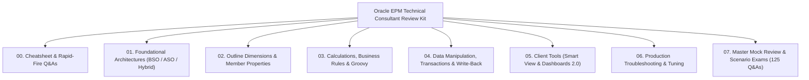

# Oracle Cloud EPM & Essbase: Technical Consultant Review & Interview Cracking Kit

> **Target Audience:** Oracle Cloud EPM Technical Consultant Freshers preparing for high-stakes **Conversion Reviews to Full-Time Employee (FTE)**, technical panel interviews, and client-facing architecture exams.
>
> **Core Focus:** 100% practical, scenario-driven, and deep. Every academic history lesson, 1992 Arbor software trivia, and theoretical proof has been eliminated. In their place are **physical storage engine mechanics**, **mathematical collision walkthroughs**, **real-world production crises**, and **bulletproof Consultant Model Answers**.

---

## 📚 Master Modular Curriculum & Navigational Index

---

### [Module 0: Review & Interview Cheatsheet](00_CRACK_THE_REVIEW_INTERVIEW_CHEATSHEET.md)
* **[00_CRACK_THE_REVIEW_INTERVIEW_CHEATSHEET.md](00_CRACK_THE_REVIEW_INTERVIEW_CHEATSHEET.md)**
  * *Top 10 Golden Laws of Oracle EPM & Essbase*
  * *25 Rapid-Fire Twisted Q&As for Instant Recall*
  * *5 Emergency Production Debugging Workflows*

---

### [Module 1: Foundational Architectures (BSO, ASO & Hybrid BSO)](01_Foundational_Architectures_BSO_ASO_Hybrid/)
* **[1.1 Storage Engines Comparative Deep Dive](01_Foundational_Architectures_BSO_ASO_Hybrid/1.1_Storage_Engines_Comparative_Deep_Dive.md)**
  * Physical array storage vs columnar bitmap coordinates.
  * Trade-off matrix: Calculations, write-back, sparsity, dimensional scaling.
  * Architectural decision tree for enterprise plan types.
* **[1.2 Why ASO Is Faster & Where It Fails](01_Foundational_Architectures_BSO_ASO_Hybrid/1.2_Why_ASO_Is_Faster_And_Where_It_Fails.md)**
  * Bitmap indexing and dynamic vector aggregations.
  * Where ASO fails: Procedural calculation limits, slice fragmentation, write-back locks.
  * Incremental vs All Slice Merges (`Drop Zero Cells`).
* **[1.3 Hybrid BSO Dual-Kernel Execution Internals](01_Foundational_Architectures_BSO_ASO_Hybrid/1.3_Hybrid_BSO_Dual_Kernel_Execution_Internals.md)**
  * Dual-kernel coordinator: BSO block store + ASO dynamic vector engine.
  * What causes fallback to slow procedural BSO mode.
  * `SET HYBRIDBSOINCALCSCRIPT FULL;` command.
* **[1.4 Master Question Bank: Foundational Architectures](01_Foundational_Architectures_BSO_ASO_Hybrid/1.4_Twisted_Interview_Questions_Architectures.md)**
  * 15 Master twisted interview questions with deep consultant model answers.

---

### [Module 2: Outline Dimensions & Member Properties](02_Outline_Dimensions_Member_Properties/)
* **[2.1 Dense vs Sparse Block Math & Tuning](02_Outline_Dimensions_Member_Properties/2.1_Dense_vs_Sparse_Block_Math_and_Tuning.md)**
  * Block sizing formula: The 8 KB to 100 KB target range.
  * Oversized block write amplification vs undersized block index bloat.
* **[2.2 Implied Sharing, Never Share & Security Traps](02_Outline_Dimensions_Member_Properties/2.2_Implied_Sharing_Never_Share_Security_Traps.md)**
  * Single-child pointer aliasing and historical reporting corruption.
  * The Security Leak Trap: Writing to Read-Only child via parent.
  * Remediation using explicit `Never Share` and Hybrid Dynamic Calc.
* **[2.3 Shared Members & Alternate Hierarchies](02_Outline_Dimensions_Member_Properties/2.3_Shared_Members_and_Alternate_Hierarchies.md)**
  * Outline precedence rules: Base must precede shared in outline sequence.
  * Block size impact: Why 1,000 shared dense members add 0 bytes to block size.
  * Zero-block alternate rollups in Hybrid BSO.
* **[2.4 Source Cube Property & Multi-Plan Integrity](02_Outline_Dimensions_Member_Properties/2.4_Source_Cube_Property_Multi_Plan_Integrity.md)**
  * Multi-cube metadata management (`FinPlan`, `Workforce`, `CapEx`, `Reporting`).
  * Isolating formulas using `<PlanType>` tags to prevent refresh crashes.
* **[2.5 Evaluation Order vs Solve Order: The Classic Trap](02_Outline_Dimensions_Member_Properties/2.5_Evaluation_Order_vs_Solve_Order_The_Classic_Trap.md)**
  * The Classic Trap: UI Data-Type Precedence vs Essbase Math Precedence.
  * Step-by-step fix for Smart Lists displaying as `$1.00`.
* **[2.6 Master Question Bank: Outline Properties](02_Outline_Dimensions_Member_Properties/2.6_Twisted_Interview_Questions_Outline_Properties.md)**
  * 15 Master twisted interview questions with deep consultant model answers.

---

### [Module 3: Calculations, Business Rules & Groovy](03_Calculations_Business_Rules_and_Groovy/)
* **[3.1 BSO Calculation Engine Execution Order & Internals](03_Calculations_Business_Rules_and_Groovy/3.1_BSO_Calculation_Engine_Execution_Order.md)**
  * Dense first (intra-block RAM) then Sparse (inter-block disk).
  * Bottom-Up vs Top-Down execution modes; parallel processing (`CALCPARALLEL` vs `FIXPARALLEL`).
* **[3.2 Two-Pass Calculation & The Ratio Fallacy](03_Calculations_Business_Rules_and_Groovy/3.2_Two_Pass_Calculation_and_The_Ratio_Fallacy.md)**
  * Mathematical proof of why ratios sum wrong ($\sum A/B \neq \sum A / \sum B$).
  * Rules and dimension restrictions of the legacy Two-Pass flag.
* **[3.3 Solve Order Mastery & Collision Resolution](03_Calculations_Business_Rules_and_Groovy/3.3_Solve_Order_Mastery_and_Collision_Resolution.md)**
  * The 0–127 integer scale (highest calculates LAST and wins).
  * Multi-dimensional collision resolution and the Enterprise 5-Tier Architecture.
* **[3.4 Runtime Prompts, Use Members on Form & Groovy](03_Calculations_Business_Rules_and_Groovy/3.4_Runtime_Prompts_Use_Members_on_Form_and_Groovy.md)**
  * Silent POV context passing via 'Use Members on Form'.
  * Groovy surgical calculation (`cell.edited`) and pre-save validation (`throwVetoException`).
* **[3.5 Master Question Bank: Calculations & Groovy](03_Calculations_Business_Rules_and_Groovy/3.5_Twisted_Interview_Questions_Calculations_Groovy.md)**
  * 15 Master twisted interview questions with deep consultant model answers.

---

### [Module 4: Data Manipulation, Transactions & Write-Back](04_Data_Manipulation_Transactions_WriteBack/)
* **[4.1 Grid Spread Mechanics & Security Filtering](04_Data_Manipulation_Transactions_WriteBack/4.1_Grid_Spread_Mechanics_and_Security_Filtering.md)**
  * Spreading algorithms: Proportional, Even, Fill.
  * The Read-Only Child Trap: How locked periods/cells alter parent totals.
  * Residual penny balancing algorithm.
* **[4.2 Mass Allocate & Driver-Based Distribution](04_Data_Manipulation_Transactions_WriteBack/4.2_Mass_Allocate_Driver_Based_Distribution.md)**
  * Cross-dimensional driver allocation math.
  * Mandatory offset contra-accounts for double-entry financial integrity.
* **[4.3 BSO & Hybrid Transaction Pipeline and the .TCT File](04_Data_Manipulation_Transactions_WriteBack/4.3_BSO_Hybrid_Transaction_Pipeline_and_TCT_File.md)**
  * End-to-end write-back stages: Client $\rightarrow$ ADF $\rightarrow$ Cache $\rightarrow$ WAL $\rightarrow$ Disk.
  * Block-level locking vs cell-level locking; `.tct` crash recovery.
* **[4.4 ASO Write-Back, Append-Only Slices & Compaction](04_Data_Manipulation_Transactions_WriteBack/4.4_ASO_WriteBack_Append_Only_Slices_and_Compaction.md)**
  * Append-only slice architecture and optimistic concurrency.
  * Slice fragmentation pathology and 'Drop Zero Cells' compaction.
* **[4.5 Master Question Bank: Write-Back & Transactions](04_Data_Manipulation_Transactions_WriteBack/4.5_Twisted_Interview_Questions_WriteBack_Transactions.md)**
  * 15 Master twisted interview questions with deep consultant model answers.

---

### [Module 5: Client Tools, Smart View & Dashboards](05_Client_Tools_SmartView_and_Dashboards/)
* **[5.1 Smart View Architecture, Options & VBA Automation](05_Client_Tools_SmartView_and_Dashboards/5.1_Smart_View_Architecture_Options_and_VBA.md)**
  * Planning Provider vs Essbase Provider; the Preserve Formulas wipeout trap.
  * Cell Styles vs Excel Formatting; `HsGetValue` / `HsSetValue` and VBA templates.
* **[5.2 Dashboards 2.0, Redwood Experience & Infolets](05_Client_Tools_SmartView_and_Dashboards/5.2_Dashboards_2_0_Redwood_and_Infolets.md)**
  * Asynchronous per-widget loading; dynamic cross-widget POV synchronization.
  * CFO Waterfall variance bridge design; 3-sided Infolet progressive disclosure.
* **[5.3 Master Question Bank: Smart View & Dashboards](05_Client_Tools_SmartView_and_Dashboards/5.3_Twisted_Interview_Questions_SmartView_Dashboards.md)**
  * 15 Master twisted interview questions with deep consultant model answers.

---

### [Module 6: Production Troubleshooting & Performance Tuning](06_Production_Troubleshooting_and_Performance_Tuning/)
* **[6.1 The Block Explosion Pathology & Fixes](06_Production_Troubleshooting_and_Performance_Tuning/6.1_The_Block_Explosion_Pathology_and_Fixes.md)**
  * `SET CREATENONMISSINGBLK ON;` disaster scenarios.
  * Detection via Block Density %; surgical deflation with `CLEARBLOCK EMPTY;`.
* **[6.2 Lock Contention & Performance Bottlenecks](06_Production_Troubleshooting_and_Performance_Tuning/6.2_Lock_Contention_and_Performance_Bottlenecks.md)**
  * Shared corporate block locking bottlenecks; Cache Thrashing (`DATACACHESIZE`).
  * Diagnosing and safely terminating hung sessions via Job Console / EPM Automate.
* **[6.3 Database Refresh & Data Load Failures](06_Production_Troubleshooting_and_Performance_Tuning/6.3_Database_Refresh_and_Data_Load_Failures.md)**
  * Precedence errors, insufficient disk space during dense restructures.
  * Rejection log analysis (`.err`) and emergency recovery protocols.

---

### [Module 7: Master Mock Review & Scenario Exams](07_Master_Mock_Review_and_Scenario_Exams/)
* **[7.1 Fresher-to-FTE Conversion Panel Interview Exam (50 Master Scenarios)](07_Master_Mock_Review_and_Scenario_Exams/7.1_Fresher_to_FTE_Conversion_Panel_Interview_Exam.md)**
  * 50 Toughest Scenario-Based Questions covering storage edge cases, implied sharing leaks, Groovy guardrails, solve order collisions, and server recovery.
* **[7.2 The Ultimate Consultant Interview Master Q&A Bank (75 Deep-Dive Questions)](07_Master_Mock_Review_and_Scenario_Exams/7.2_The_Ultimate_Consultant_Interview_Master_QnA.md)**
  * 75 Exhaustive technical questions spanning all 5 technical domains.

---

## 🎯 How to Use This Kit to Crack Your FTE Conversion Review

1. **Step 1:** Read **[00_CRACK_THE_REVIEW_INTERVIEW_CHEATSHEET.md](00_CRACK_THE_REVIEW_INTERVIEW_CHEATSHEET.md)** to internalize the Top 10 Golden Laws and 25 Rapid-Fire Q&As.
2. **Step 2:** Deep-dive into specific modules where you feel less confident (e.g., Module 2 for Implied Sharing & Solve Order, Module 3 for Groovy & Parallel calculations, Module 4 for Write-Back & Spreading).
3. **Step 3:** Practice answering the questions in **[7.1 Fresher-to-FTE Exam](07_Master_Mock_Review_and_Scenario_Exams/7.1_Fresher_to_FTE_Conversion_Panel_Interview_Exam.md)** out loud without looking at the model answers. Compare your responses against the consultant answers.
4. **Step 4:** Review **[7.2 Master Q&A Bank](07_Master_Mock_Review_and_Scenario_Exams/7.2_The_Ultimate_Consultant_Interview_Master_QnA.md)** for exhaustive edge case mastery.
