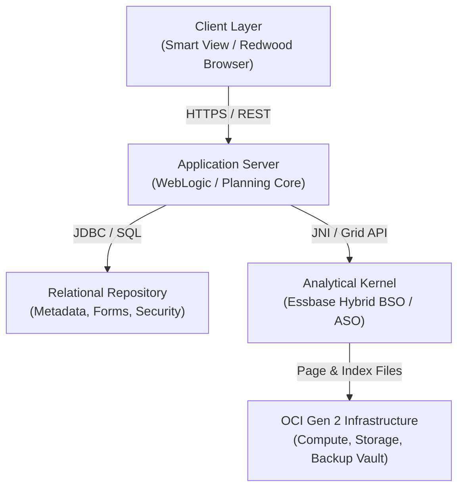

# 01. Foundation and Overview — Architecture, Ecosystem & 7 Pillars

> **Consultant High-Yield Summary:**  
> Enterprise Performance Management (EPM) in Oracle Cloud is a unified SaaS ecosystem running on OCI Gen 2 infrastructure. As a technical consultant, understanding the interaction between the Java Relational Repository (Planning) and the multidimensional Essbase C-Kernel is the foundation of all design, configuration, and performance tuning.

---

## 🎯 Live Interactive Visual Architecture Card

<b>🎯 Live Interactive Architecture Card: Cloud EPM Multi-Tier Platform Topology</b>

| Tier / Component | Technology Engine | Consultant Review Defense & Physics |
| :--- | :--- | :--- |
| **Presentation Tier** | Oracle JET / Redwood UX | Stateless web interface delivering zero-footprint forms, dashboards, and approvals. |
| **Application Tier** | WebLogic / Java JVM | Manages business security, metadata catalogs, navigation flows, and relational repository tables. |
| **Analytical Kernel** | Oracle Essbase C-Kernel | High-performance multidimensional analytical engine (BSO, ASO, Hybrid) executing calculations and sparse queries. |
| **Automation Tier** | EPM Automate & REST API | Headless CLI and OAuth2 HTTP endpoints driving daily batch, data synchronization, and snapshot lifecycle. |

---

## 🏛️ Architectural Comparison & Design Patterns

| Architecture Layer | Hyperion On-Premises Legacy | Oracle Cloud EPM (SaaS) |
| :--- | :--- | :--- |
| Infrastructure Management | Manual server patching, Windows/Linux OS, EAS console | Fully managed OCI Gen 2 pod; monthly automated updates |
| Analytical Engine | Classic BSO (batch CALC ALL required for parent storage) | Hybrid BSO by default (dynamic Upper Sparse rollups in-memory) |
| Scripting & Extensibility | Static MaxL batch scripts and proprietary calc syntax | Event-driven Java Groovy API + REST API + EPM Automate CLI |

---

## 💼 Tough & Twisted Review Scenarios (Consultant Review Defense)

### Question 1: "When an administrator creates a new member in the Redwood Dimension Editor, is it immediately queryable in Essbase via Smart View?"
> **Consultant Model Answer:**  
> No. In Oracle Cloud EPM, metadata changes are committed first to the underlying relational repository (Application Tier). The analytical Essbase cube is only updated when a 'Database Refresh' (Cube Refresh) job is executed. Until the refresh finishes, Essbase does not have the new member in its outline index, and queries against it will throw member not found errors.

### Question 2: "Explain the architectural difference between PBCS and EPBCS in terms of customization boundaries."
> **Consultant Model Answer:**  
> PBCS (Standard Planning) is a custom application framework where the consultant designs dimensions, cubes, and rules from scratch. EPBCS (Enterprise Planning) includes pre-built functional modules (Financials, Workforce, Capital, Projects, Strategic Modeling) with out-of-the-box dimensions, forms, and business rules. In EPBCS, standard module artifacts are protected: you can customize configurable parameters, but you cannot alter core locked rules directly; you must extend them via custom business rules or Groovy hooks.

---

## 📑 Complete Document Catalog

| # | Document File | Topic Description |
|---|---------------|-------------------|
| 01 | [01.01_Enterprise_Performance_Management.md](./01.01_Enterprise_Performance_Management.md) | 01.01 Enterprise Performance Management — Complete Guide |
| 02 | [01.01_EPM_Architecture_Overview.md](./01.01_EPM_Architecture_Overview.md) | 01.01 EPM Architecture Overview — Complete Technical Guide |
| 03 | [01.02_Business_Concepts.md](./01.02_Business_Concepts.md) | 01.02 Business Concepts in EPM — Complete Guide |
| 04 | [01.03_Center_of_Excellence.md](./01.03_Center_of_Excellence.md) | 01.03 Center of Excellence (CoE) — Complete Guide |
| 05 | [01.03_Oracle_EPM_Ecosystem.md](./01.03_Oracle_EPM_Ecosystem.md) | 01.03 Oracle EPM Ecosystem and Products |
| 06 | [01.04_EPM_Terminology.md](./01.04_EPM_Terminology.md) | 01.04 EPM Terminology — 100+ Terms Every Consultant Must Know |
| 07 | [01.04_Navigation_Flows_Screen.md](./01.04_Navigation_Flows_Screen.md) | 01.04 Navigation Flows Screen Configuration |
| 08 | [01.05_Hyperion_History_and_Cloud_Evolution.md](./01.05_Hyperion_History_and_Cloud_Evolution.md) | 01.05 Hyperion History and Cloud Evolution — Complete Timeline |
| 09 | [01.06_Cloud_Architecture_and_OCI.md](./01.06_Cloud_Architecture_and_OCI.md) | 01.06 Cloud Architecture and OCI |
| 10 | [01.07_Implementation_Lifecycle.md](./01.07_Implementation_Lifecycle.md) | 01.07 Implementation Lifecycle — Complete Project Guide |
| 11 | [01.08_CoE_and_Governance.md](./01.08_CoE_and_Governance.md) | 01.08 Center of Excellence (CoE) and Governance |
| 12 | [01.09_Design_Principles_and_Best_Practices.md](./01.09_Design_Principles_and_Best_Practices.md) | 01.09 Design Principles and Best Practices |
| 13 | [01.10_EPM_Foundations.md](./01.10_EPM_Foundations.md) | 01.10 EPM Foundations |
| 14 | [01.11_Seven_Pillars.md](./01.11_Seven_Pillars.md) | 01.11 Seven Pillars |
| 15 | [01.12_Hyperion_Evolution.md](./01.12_Hyperion_Evolution.md) | 03 — Product History: Hyperion to Oracle EPM Cloud |
| 16 | [01.13_EPM_Cloud_Architecture.md](./01.13_EPM_Cloud_Architecture.md) | 04 — Oracle EPM Cloud Architecture |
| 17 | [01.14_Design_Best_Practices_Oracle_Reference.md](./01.14_Design_Best_Practices_Oracle_Reference.md) | Design Best Practices — Oracle Official Reference |
| 18 | [01.15_CoE_and_Governance_Deep_Reference.md](./01.15_CoE_and_Governance_Deep_Reference.md) | Center of Excellence (CoE) & Governance — Oracle Deep Reference |
| 19 | [01.16_Roles_and_Careers.md](./01.16_Roles_and_Careers.md) | 01.16 Roles and Careers |
| 20 | [01.20_EPM_Master_Overview_Deep_Dive.md](./01.20_EPM_Master_Overview_Deep_Dive.md) | 01.20 EPM Master Overview — Deep Dive |
| 21 | [CONCEPT_AND_PROCEDURE_INDEX.md](./CONCEPT_AND_PROCEDURE_INDEX.md) | 📑 Oracle EPM Cloud: Master Concept & Procedure Index |
| 22 | [COURSE_INDEX.md](./COURSE_INDEX.md) | COURSE INDEX |
| 23 | [GLOSSARY.md](./GLOSSARY.md) | Oracle EPM Learning Glossary |
| 24 | [GLOSSARY_AND_TERMINOLOGY.md](./GLOSSARY_AND_TERMINOLOGY.md) | 📖 Oracle EPM Cloud & Essbase: Master Glossary & Terminology |
| 25 | [GLOSSARY_v2.md](./GLOSSARY_v2.md) | 📚 GLOSSARY — Oracle EPM A-Z Terminology Dictionary |
| 26 | [LEARNING_ROADMAP.md](./LEARNING_ROADMAP.md) | Oracle EPM Learning Roadmap |
| 27 | [LEARNING_ROADMAP_v2.md](./LEARNING_ROADMAP_v2.md) | 🗺️ Oracle EPM Cloud & Essbase: Comprehensive Learning Roadmap |
| 28 | [ORACLE_SOURCES_REGISTER.md](./ORACLE_SOURCES_REGISTER.md) | 📚 Official Oracle Documentation Sources Register |
| 29 | [PROJECT_DECISIONS_AND_ASSUMPTIONS_REGISTER.md](./PROJECT_DECISIONS_AND_ASSUMPTIONS_REGISTER.md) | 📋 Project Register: Architectural Decisions, Assumptions, Risks, and Open Questions |
| 30 | [PROJECT_REGISTER.md](./PROJECT_REGISTER.md) | Project Evidence, Assumptions, and Open Questions |
| 31 | [README.md](./README.md) | Oracle EPM Cloud Learning Library |
| 32 | [README_v2.md](./README_v2.md) | Oracle EPM Cloud & Essbase Engineering Bible |
| 33 | [README_v3.md](./README_v3.md) | 🏛️ Oracle EPBCS Mastery — Unified Knowledge Base 2.0 |
| 34 | [START_HERE.md](./START_HERE.md) | 🚀 Start Here: The Definitive Oracle EPM Cloud Learning Guide |

---

> **Consultant Implementation Note:** Master the architectural comparison and review defense questions in this module before presenting designs to client stakeholders or senior review panels.