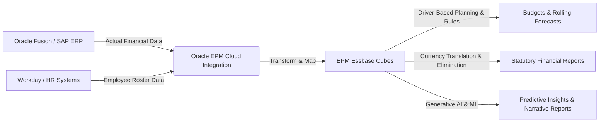

# 01 — Introduction to Oracle EPM Cloud

> **Module:** Foundation  
> **Last Updated:** 2026-07-23  
> **Oracle Cloud Version:** 24.10+ (with 2025 AI/IPM Enhancements)  
> **Difficulty:** Beginner to Intermediate  

---

## Overview

**EPM** stands for **Enterprise Performance Management**. It is a comprehensive suite of software applications designed to help organizations plan, budget, forecast, and report on their financial and operational performance. Unlike transactional systems, EPM focuses on driving strategic and operational decision-making. 

Oracle EPM Cloud represents the industry standard for enterprise-grade financial planning and consolidation, combining market-leading applications with cloud-based flexibility, built-in best practices, and advanced technologies like machine learning (ML) and Generative AI.

---

## Business Purpose

The primary business purpose of Oracle EPM Cloud is to provide a unified, secure, and highly scalable platform for enterprise financial processes. It replaces disparate, error-prone manual processes and disconnected point solutions with a centralized, multidimensional database (powered by Essbase) that serves as the **single source of truth** for the Office of the CFO.

Key business drivers for adopting EPM include:
- **Agility:** Moving from annual budgeting to rolling forecasts and continuous planning.
- **Accuracy:** Eliminating manual data entry errors and broken spreadsheet formulas.
- **Alignment:** Connecting financial plans (FP&A) with operational plans (Sales, HR, IT, Supply Chain) through Connected Planning.
- **Compliance:** Ensuring statutory and regulatory reporting (like GAAP, IFRS, OECD Pillar Two) is accurate, auditable, and timely.

---

## Business Problem: The "Spreadsheet Crisis"

If a company is small, they can manage their finances in a spreadsheet. However, global Fortune 100 enterprises face severe, systemic problems when attempting to scale Excel-based processes:

1. **Version Control Chaos:** Finance teams waste countless hours asking, "Is `Budget_v15_Final_Real_v2.xlsx` the right one—
2. **Data Security Risks:** In Excel, anyone can accidentally delete a complex macro or view sensitive data like executive salaries.
3. **Consolidation Delays:** It takes weeks to manually combine thousands of Excel files submitted by hundreds of cost center managers globally, often requiring currency translations and intercompany eliminations done by hand.
4. **Accuracy and Material Weaknesses:** One broken cell reference can result in millions of dollars of miscalculation, leading to incorrect guidance given to Wall Street and potential audit failures.

---

## Where Used

Oracle EPM Cloud is used primarily by the **Finance Department** (FP&A - Financial Planning & Analysis, Controllers, Tax, and Accounting). However, its usage increasingly extends to operational departments to achieve a holistic view of the business:
- **HR:** For detailed workforce planning (headcount, salary, benefits).
- **IT:** For IT financial management (allocating technology costs to business units).
- **Sales:** For quota planning and sales forecasting.
- **Supply Chain:** For demand planning and cost-of-goods-sold (COGS) modeling.

---

## Project Lifecycle (The EPM Journey)

Implementing Oracle EPM Cloud is a major business transformation. A typical project lifecycle involves:
1. **Requirements & Discovery:** Understanding the current state and identifying pain points. (e.g., "Why does the close take 15 days—)
2. **Solution Design:** Creating the Blueprint. Defining Dimensions, Hierarchies, and Data flows.
3. **Build & Configuration:** Setting up the Cloud pods, configuring modules, and writing Business Rules (Calculation Manager/Groovy).
4. **Data Integration:** Building pipelines using Data Integration or EPM Integration Agent to automate data loads from ERP.
5. **Testing:** 
   - *SIT (System Integration Testing):* Ensuring systems talk to each other.
   - *UAT (User Acceptance Testing):* Having finance users validate the numbers.
6. **Training & Go-Live:** Migrating the application from Test to Production and shifting users off legacy systems.

---

## Navigation Path

Most administrative and user tasks in EPM Cloud start from the unified Home page (Springboard), designed for intuitive navigation across devices.

```text
Web Browser → EPM Cloud URL → SSO Login → Home Page (Springboard)
```

> **Screenshots Placeholder:**  
> [EPM Cloud Springboard showing the home page clusters: Application, Tools, Reports, Tasks, and new AI Insights]

---

## Prerequisites & Glossary

Before diving into EPM Cloud, you should understand:
- **Enterprise Operations:** How a company generates revenue, manages expenses, and measures profitability.
- **Accounting Fundamentals:** Actuals vs. Budgets, Chart of Accounts, Income Statements, and Balance Sheets.
- **ERP Systems:** High-level awareness of systems like Oracle Fusion, SAP, or Workday.

**Quick Glossary:**
- **Metadata (Dimensions):** The structure of the data (e.g., Account, Entity, Period, Year, Scenario).
- **Members:** The individual items within a dimension (e.g., "Jan" in the Period dimension, or "Total Revenue" in the Account dimension).
- **Intersection:** A specific combination of members across all dimensions that holds a single data value.
- **Cube:** The multidimensional database (Essbase) where data is stored and calculated.

---

## Architecture & Data Flow

At a high level, the flow of data within a Fortune 100 enterprise utilizing Oracle EPM looks like this:



---

## Concept Explanation

### ERP vs EPM — The Critical Difference

A fundamental concept for any EPM consultant is the difference between ERP and EPM. They are highly complementary but serve completely different purposes.

**ERP (Enterprise Resource Planning)**
- **The "Past"**: Records what *already* happened.
- **Transactional**: "We paid John Smith $5,000 on Tuesday for Invoice #9982."
- **Examples**: Oracle Fusion Cloud Financials, SAP S/4HANA, Workday.
- **Nature**: Highly detailed (individual invoices, receipts, journal entries, sub-ledgers).

**EPM (Enterprise Performance Management)**
- **The "Future" & The "Big Picture"**: Plans what *will* happen and summarizes overall performance.
- **Summary / Analytical**: "We plan to spend $60,000 on salaries this quarter in the IT Cost Center."
- **Examples**: Oracle EPM Cloud, Anaplan, OneStream.
- **Nature**: Aggregated (Total Revenue by Region, Total Expense by Department).

> **Important Workflow:** Data flows from **ERP → EPM**. We take the *Actuals* (past data) from ERP, load them into EPM, and use them as a baseline to create the *Budget/Forecast* (future data). EPM is the analytical layer sitting on top of the transactional layer.

---

### EPM Cloud AI Capabilities (2025 Updates)

Oracle has heavily embedded AI and Machine Learning into the EPM Foundation:
1. **IPM (Intelligent Performance Management) Insights:** Automatically analyzes huge volumes of data to detect anomalies, hidden biases, and variances (e.g., detecting if a specific region consistently under-forecasts revenue).
2. **Predictive Planning:** Uses statistical time-series algorithms (like ARIMA) to generate baseline forecasts based on historical actuals, which planners can then tweak.
3. **Generative AI for Narrative Reporting:** Automatically generates textual commentary and executive summaries explaining data variances, saving controllers hours of manual writing.

---

## Configuration

Setting up EPM Cloud at a macro level involves configuring:
1. **SSO Integration**: Configuring Oracle Identity Cloud Service (IDCS) or Azure AD for single sign-on.
2. **Application Initialization**: Creating the application container, enabling specific modules (like Financials or Workforce), and defining the underlying Essbase cubes (BSO/ASO).
3. **Connections**: Establishing EPM Integration Agent or direct REST API connections to source ERPs to automate nightly data loads.

---

## Every Property, Menu, Button, Option, Checkbox, Dialog

*Note: As this is a conceptual foundational document, there are no specific UI configurations detailed here. Subsequent modules will detail properties exhaustively.*

---

## Step-by-Step Instructions

To begin interacting with Oracle EPM Cloud for the first time:
1. Receive your Identity Domain and SSO credentials from IT.
2. Navigate to the unique EPM Cloud pod URL provided by Oracle.
3. Authenticate via SSO.
4. Arrive at the EPM Springboard.
5. Verify your assigned roles (Service Administrator, Power User, User, or Viewer) by checking available clusters.

---

## Examples

**Data Aggregation Example:**
*ERP Level (Transactional)*
- Row 1: Invoice #1234 - $50 - Office Supplies
- Row 2: Invoice #1235 - $100 - Office Supplies

*EPM Level (Aggregated)*
- Account: `60000_Office_Supplies`
- Total: `$150`

---

## Hands-on Exercise

**Objective:** Understand the analytical vs transactional paradigm.
1. Open Excel.
2. Create 10 rows of "transactions" (Date, Item, Cost). This represents ERP.
3. Create a pivot table summarizing the total cost by Item. This represents EPM.
4. **Expected Result:** You will visually grasp how EPM aggregates data for high-level decision making.

---

## Real Client Scenario

> **Client:** Global Hotel Chain with 500 properties.  
> **Challenge:** Taking 3 months to finalize the annual budget using 5,000 Excel sheets. By the time the budget is approved, it's outdated. Planners were using "gut feelings" rather than data.  
> **EPM Solution:** Implemented Oracle EPM Planning. Connected their Oracle Fusion ERP to load actuals nightly. Built driver-based models (Occupancy % × Average Daily Rate). Enabled Predictive Planning to give managers an ML-generated baseline.  
> **Result:** Reduced budget cycle from 3 months to 3 weeks. Centralized security ensured General Managers only saw their own hotel's data. Forecast accuracy improved by 15%.

---

## Implementation Notes

- Always map EPM design back to a distinct business requirement. Do not build dimensions or features just because the software supports them.
- Establish a single source of truth for metadata (e.g., Oracle EDMCS) early in the project lifecycle to prevent synchronization issues between ERP and EPM.

---

## Production Support Notes

- When users complain that "EPM doesn't tie to ERP," the first step is to verify the data integration mappings. Often, a new account was added in ERP but is mapped to an `Ignore` bucket in EPM Data Management.

---

## Troubleshooting

- **Issue:** Users cannot see specific application clusters on the Springboard.
- **Resolution:** Check their provisioned roles in Oracle Cloud Identity Console and their assigned Data Access in the application.

---

## Performance

Treating EPM like a data warehouse or ERP will cause severe performance degradation. EPM is an OLAP (Online Analytical Processing) system, built for fast multidimensional aggregation. Loading millions of transactional rows will result in slow retrieval times, massive database sizes, and aborted rules. **Always aggregate data in the ERP or ETL layer before pushing to EPM.**

---

## Common Errors

| Error Code / Message | Root Cause | Resolution |
|----------------------|------------|------------|
| Conceptual Disconnect | Users asking "Where is the invoice number— in a Planning form. | Remind users EPM holds aggregated data. Utilize "Drill-Through to Source" functionality if invoice details are truly required. |

---

## Debugging

When debugging conceptual misunderstandings during UAT (User Acceptance Testing), use Smart View ad-hoc to show the user exactly how the data is stored at the intersection level to prove that EPM does not store row-level transaction IDs.

---

## Best Practices

### Do
- Design EPM solutions to be flexible and driver-based rather than hard-coding static inputs.
- Ensure strict naming conventions are established on Day 1 of the project (e.g., prefixing all variables with `v_`).
- Leverage Oracle's out-of-the-box (OOTB) frameworks whenever possible to reduce maintenance.

### Don't
- Don't try to make EPM act like an ERP.
- Don't "lift-and-shift" broken Excel processes directly into EPM. Re-engineer the business process first.

---

## Interview Questions

- **Q: Explain the difference between ERP and EPM.**
  - *A: ERP is for transactional data and recording the past (Actuals). EPM is for analytical data, aggregations, and planning for the future (Budgets/Forecasts).*

- **Q: Why would a Fortune 100 company buy Oracle EPM instead of just using Excel—**
  - *A: EPM provides a single source of truth, centralized security, audit trails, fast consolidation of massive data, automated integration with ERP, predictive AI insights, and complex calculation engines (Essbase) that Excel fundamentally lacks.*

- **Q: What is the typical flow of data in a financial ecosystem—**
  - *A: Transactional data originates in ERP, HR, and CRM systems. It is extracted, transformed, and loaded (ETL) into EPM via tools like Data Integration. In EPM, it is used as a baseline for planning, consolidated for reporting, and analyzed using Smart View.*

---

---

## Related Topics

### Internal Repository Links
- [02 The 7 Pillars](./02_Seven_Pillars.md) — The suite of modules within EPM Cloud.
- [03 Hyperion Evolution](./03_Hyperion_Evolution.md) — Evolution from Hyperion to Cloud.
- [04 EPM Architecture](./04_EPM_Cloud_Architecture.md) — Infrastructure and maintenance model.

### Related Concepts
- [01 Finance Basics](../01_Finance/01_Finance_Basics.md) — The financial outputs EPM produces.
- [01 Essbase Complete Guide](../02_Essbase/01_Essbase_Complete_Guide.md) — The Essbase engine powering EPM.

### Related Functions
- [04 BSO vs ASO](../02_Essbase/04_BSO_vs_ASO.md) — Core storage and calculation engines.

### Related APIs
- [01 REST API Complete Guide](../13_REST_API/01_REST_API_Complete_Guide.md) — Programmatic EPM access.

### Related Workflows
- [01 ERP Integration](../11_Data_Integration/01_ERP_Integration.md) — Loading ERP data into EPM.
- [01 EPM Automate Complete Guide](../14_EPM_Automate/01_EPM_Automate_Complete_Guide.md) — Automating EPM operations.

### Related Best Practices
- [01 Performance Complete Guide](../15_Performance/01_Performance_Complete_Guide.md) — Avoiding OLAP anti-patterns.
- [01 Admin Tools](../16_Administration/01_Admin_Tools.md) — Day-to-day management.

### Related Troubleshooting
- [01 Debugging Complete Guide](../17_Debugging/01_Debugging_Complete_Guide.md) — General EPM troubleshooting.

---

## Summary

| Key Point | Detail |
|-----------|--------|
| **What** | Enterprise Performance Management (EPM). |
| **Why** | To replace messy, insecure Excel-based budgeting and reporting, driving strategic agility and AI-powered insights for large enterprises. |
| **When** | Used daily for operational tracking, and heavily during budgeting, forecasting, and month-end close cycles. |
| **How** | By providing a centralized, secure multidimensional database (Essbase) linked to source ERPs, equipped with automated workflows and AI agents. |
