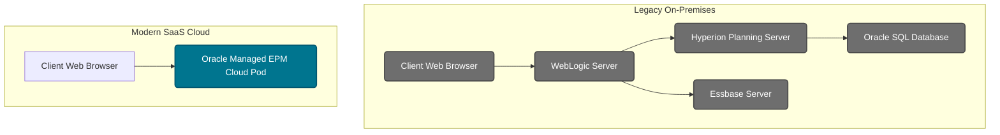

# 03 — Product History: Hyperion to Oracle EPM Cloud

> **Module:** 00_Foundation  
> **Last Updated:** 2026-07-23  
> **Oracle Cloud Version:** 24.10+  
> **Difficulty:** Beginner  

## 🎯 Table of Contents
- [Overview](#overview)
- [Business Purpose](#business-purpose)
- [Business Problem](#business-problem)
- [Where Used](#where-used)
- [Navigation Path](#navigation-path)
- [Prerequisites](#prerequisites)
- [Architecture](#architecture)
- [Concept Explanation](#concept-explanation)
- [Configuration](#configuration)
- [Properties & Options](#properties-options)
- [Step-by-Step Instructions](#step-by-step-instructions)
- [Examples](#examples)
- [Hands-on Exercise](#hands-on-exercise)
- [Real Client Scenario](#real-client-scenario)
- [Implementation Notes](#implementation-notes)
- [Production Support Notes](#production-support-notes)
- [Troubleshooting](#troubleshooting)
- [Performance](#performance)
- [Common Errors](#common-errors)
- [Debugging](#debugging)
- [Best Practices](#best-practices)
- [Interview Questions](#interview-questions)
- [Oracle Documentation](#oracle-documentation)
- [Related Topics](#related-topics)
- [Summary](#summary)

---

## 🏢 Overview

Understanding the history of Oracle EPM is crucial for an enterprise architect or consultant, because you will frequently interact with Fortune 100 clients migrating from legacy on-premises systems to the cloud. You must understand their legacy architecture to map it correctly to modern Oracle Cloud infrastructure.

---

## 🎯 Business Purpose

When a corporate controller states, *"We are using Hyperion Planning 11.1.2.4 and want to move to EPBCS,"* you need to know exactly what they are talking about. Understanding the historical context allows you to accurately assess their current hardware limitations, predict their pain points, and map their legacy terms and scripts to the new cloud ecosystem.

---

## 🎯 Business Problem

Legacy on-premises Hyperion environments required massive IT overhead. Companies had to buy servers, install WebLogic, patch Oracle databases, and hire DBAs just to keep the finance software running. Upgrades took months and cost millions. Oracle EPM Cloud solves this by shifting to a SaaS (Software as a Service) model, eliminating hardware maintenance and providing continuous monthly updates.

---

## 🎯 Where Used

This historical knowledge is used during the **Presales** and **Discovery** phases of an implementation project, specifically when dealing with clients executing a "Cloud Migration."

---

## 🎯 Navigation Path

*Note: This is a historical/conceptual document. There is no specific navigation path in the cloud application related to product history.*

```text
N/A - Conceptual Topic
```

> [!NOTE]
> **Screenshots Placeholder:**  
> [Diagram contrasting the old Hyperion Workspace vs the modern EPM Cloud Springboard]

---

## 🎯 Prerequisites

Before reading this document, you should understand:
- Concepts of Enterprise Performance Management: [01 EPM Foundations](./01_EPM_Foundations.md)
- The core modules available in the cloud: [02 The 7 Pillars](./02_Seven_Pillars.md)

---

## 🏗️ Architecture

The architectural shift from On-Premises to Cloud is profound:


*In the modern architecture, Oracle manages the WebLogic, Essbase, and SQL layers transparently.*

---

## 🎯 Concept Explanation

### The Evolution Timeline

1. **Pre-2007: Hyperion Solutions Corporation**
   - An independent software company created "Hyperion Essbase" and "Hyperion Planning."
   - Known as the absolute gold standard in financial multidimensional software.

2. **2007: Oracle Acquires Hyperion**
   - Oracle bought Hyperion for $3.3 Billion.
   - Rebranded as **Oracle Hyperion EPM**. These were **On-Premises** applications requiring heavy IT infrastructure.
   - Major versions: 11.1.2.3, 11.1.2.4, 11.2.x.

3. **2014: PBCS (Planning and Budgeting Cloud Service)**
   - Oracle moved Hyperion to the cloud (SaaS model).
   - No hardware needed. Oracle handled servers and patching.
   - Essentially "Hyperion Planning in the Cloud."

4. **2016: EPBCS (Enterprise PBCS)**
   - Oracle released a premium version.
   - Included **OOTB (Out of the Box) Modules**: Financials, Workforce, Capital, Projects.
   - Introduced **Groovy scripting** for advanced calculations.

5. **2019"Present: Oracle EPM Cloud (EPM Standard & Enterprise)**
   - Oracle merged PBCS and EPBCS branding.
   - Now sold as "EPM Standard Cloud" or "EPM Enterprise Cloud," granting access to the 7 pillars based on license tier.

### 🎯€ Confusion Resolution
> **Misconception:** "We are migrating to EPM Cloud, so we just need to install the cloud software on our servers instead of the old Hyperion software."
> **Reality:** EPM Cloud is Software-as-a-Service (SaaS). You do not install anything on your local servers. Oracle hosts the servers, databases, and application layer in their data centers. You access it entirely through a web browser.

### 😈 Twisted Interview Question
**Question:** A client migrating from Hyperion 11.1.2.4 insists that their DBA needs backend SQL access to the Essbase repository tables to write custom reports. How do you respond—
> **Answer:** In Oracle EPM Cloud, direct backend SQL access to the relational repository or Essbase server is strictly prohibited and physically impossible. Oracle locks down the backend. The client must rewrite their custom SQL reports using standard EPM Reports, Smart View, or Data Export scripts (via EPM Automate) to extract the data via supported APIs.

### ⚖️ Comparison / Difference
**Lift & Shift vs Re-implementation**
- **Lift & Shift:** Migrating the exact same application structure, flaws and all, from on-prem to cloud. Usually a bad idea because it ignores modern cloud features (like Hybrid Essbase).
- **Re-implementation:** Rebuilding the application in the cloud from scratch, using the old system only as a reference, to take advantage of out-of-the-box modules and modern best practices.

---

## 🎯¸ Configuration

When migrating from legacy Hyperion to Oracle Cloud, configuration involves mapping old tools to new paradigms.

### Translation Guide: Legacy vs Cloud

| Legacy On-Premises Name | Modern Oracle Cloud Name |
|-------------------------|--------------------------|
| Hyperion Planning | Planning / EPBCS |
| HFM (Hyperion Financial Management) | FCCS |
| FDMEE | Data Management / Data Integration |
| DRM (Data Relationship Management) | EDMCS |
| EAS (Essbase Administration Services) | Calculation Manager |
| Hyperion Shared Services | Access Control / IDCS |
| MaxL Scripts | EPM Automate / REST API |

---

## 🎯¸ Properties & Options

*Note: This is a conceptual history document. Specific configurations are not applicable.*

---

## 🎯 Step-by-Step Instructions

**Standard Migration Strategy from Hyperion to Cloud:**
1. Extract metadata from Hyperion On-Premises.
2. Re-architect dimensions for Cloud (leveraging Hybrid BSO/ASO).
3. Extract data from Essbase using MaxL or Data Management.
4. Convert MaxL automation scripts to EPM Automate.
5. Load metadata and data into the EPM Cloud pod.

---

## 🎯 Examples

*Legacy MaxL Script (Obsolete):*
```maxl
login admin password on localhost;
export database Sample.Basic data to data_file 'data.txt';
logout;
```

*Modern EPM Automate Equivalent:*
```cmd
epmautomate login admin password url domain
epmautomate exportData JobName FileName=data.txt
epmautomate logout
```

---

## 🏋️ Hands-on Exercise

**Objective:** Map legacy terminology to cloud terminology.
1. Write down: HFM, FDMEE, MaxL, EAS, DRM.
2. Next to each, write the modern Oracle EPM Cloud equivalent without looking at the table.
3. **Expected Result:** Familiarity with the terms a legacy client will use in meetings.

---

## 🏢 Real Client Scenario

> [!NOTE]
> **Client:** A Fortune 100 retail bank running Hyperion Planning 11.1.2.4 on-premises.  
> **Challenge:** Their physical servers were failing, and their IT team spent 20 hours a week patching WebLogic and resolving hardware crashes. They relied on complex, brittle MaxL scripts for automation.  
> **EPM Solution:** Migrated them to EPM Enterprise Cloud.  
> **Result:** Zero hardware maintenance (Oracle handles patching automatically every month). MaxL scripts were completely rewritten into modern REST API and Groovy-triggered EPM Automate scripts, reducing processing time by 40%.

---

## 🏗️ Implementation Notes

> [!TIP]
> Use a cloud migration as an opportunity to redesign and improve (e.g., using new Hybrid BSO or Groovy). Do not simply "lift and shift" bad legacy design.

> [!TIP]
> Assess the client's current reliance on EAS (Essbase Administration Services); they will need extensive training on Calculation Manager.

---

## 🏥 Production Support Notes

> [!TIP]
> In the cloud, Oracle patches environments on the first Friday (Test) and third Friday (Production) of every month. Legacy clients must adapt their change management processes to this new forced-update schedule.

---

## 🎯 Troubleshooting

- **Issue:** Old Hyperion developers claim a calculation is "impossible" in the Cloud because they don't have access to the EAS console.
- **Resolution:** Direct them to **Calculation Manager**. Show them how Groovy scripting in EPM Cloud can execute API calls and dynamic logic that EAS never could.

---

## âš¡ Performance

Legacy on-premises environments often suffered from cube fragmentation and required scheduled downtime for restructuring. Oracle EPM Cloud utilizes the Hybrid Essbase engine, which drastically reduces database restructuring times and allows for dynamic calculation of massive data sets without the performance penalty seen in legacy Block Storage (BSO) cubes.

---

## ⚠️ Common Errors

| Error Code / Message | Root Cause | Resolution |
|----------------------|------------|------------|
| EPM Automate `EPMAT-1` | Old MaxL scripts failing on local agent because MaxL is no longer supported for cloud automation. | Rewrite script using `epmautomate` commands or REST APIs. |

---

## 🐛 Debugging

When a client migrating from on-prem to cloud claims data is missing, the debugging process involves tracing back through the new Data Management integration points, as the legacy FDMEE mapping tables may not have migrated perfectly.

---

## ⭐ Best Practices

### Do
- Assure clients migrating from Hyperion that the core engine (Essbase) is still there, just significantly faster (Hybrid engine) and managed by Oracle.
- Learn EPM Automate and REST APIs. They are the direct replacements for legacy automation tools.

### Don't
- Don't do a "Lift and Shift" (replicating their on-premise application 1:1 in the cloud). 
- Don't try to use MaxL in EPM Cloud; it is entirely deprecated for SaaS.

---

## 🎯 Interview Questions

- **Q: A client wants to migrate from FDMEE to the cloud. What tool will they use—**
  - *A: Data Management (or the modern Data Integration interface).*

- **Q: A client asks if they can still use MaxL scripts in EPBCS. How do you respond—**
  - *A: No, MaxL is deprecated in the SaaS cloud environment. Automation must transition to EPM Automate or the REST API.*

---

## 🎯 Related Topics

### Internal Repository Links
- [02 The 7 Pillars](./02_Seven_Pillars.md) — Modern cloud pillars that replaced legacy products.
- [04 Cloud Architecture](./04_EPM_Cloud_Architecture.md) — The SaaS infrastructure that replaced on-premises servers.
- [01 EPM Foundations](./01_EPM_Foundations.md) — Core EPM concepts.

### Related Concepts
- [01 Essbase Complete Guide](../02_Essbase/01_Essbase_Complete_Guide.md) — The Essbase engine that survived the migration to cloud.
- [01 Calc Manager Basics](../07_Calculation_Manager/01_Calc_Manager_Overview.md) — Replacement for EAS (Essbase Administration Services).
- [01 Groovy Basics](../08_Groovy/01_Groovy_Complete_Guide.md) — Groovy scripting introduced in EPBCS era.

### Related Functions
- [04 Essbase Functions](../02_Essbase/05_Essbase_Calculations.md) — Functions that persisted from legacy to cloud.

### Related APIs
- [04 REST API via Groovy](../13_REST_API/01_REST_API_Complete_Guide.md) — REST API replacing MaxL.

### Related Workflows
- [01 EPM Automate Complete Guide](../14_EPM_Automate/01_EPM_Automate_Complete_Guide.md) — Modern replacement for MaxL automation.
- [02 EPM Automate Oracle Deep Reference](../14_EPM_Automate/02_EPM_Automate_Oracle_Deep_Reference.md) — Batch scripting in the cloud era.
- [03 Data Management Basics](../11_Data_Integration/01_Data_Integration_Complete_Guide.md) — Modern replacement for FDMEE.

### Related Best Practices
- [01 Performance Complete Guide](../15_Performance/01_Performance_Complete_Guide.md) — Hybrid BSO performance gains.
- [01 Implementation Methodology](../19_Projects/01_Implementation_Methodology.md) — Cloud migration project approach.

### Related Troubleshooting
- [01 Debugging Complete Guide](../17_Debugging/01_Debugging_Complete_Guide.md) — Cloud-specific troubleshooting.

---

## 🎯 Summary

| Key Point | Detail |
|-----------|--------|
| **What** | The transition from Hyperion On-Premises to Oracle EPM Cloud SaaS. |
| **Why** | To understand legacy architectures and map old terms to new technologies during enterprise cloud migrations. |
