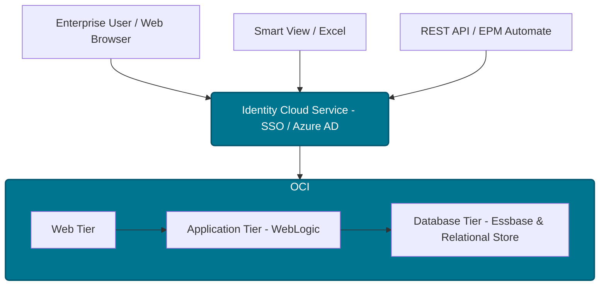

# 04 — Oracle EPM Cloud Architecture

> **Module:** 00_Foundation  
> **Last Updated:** 2026-07-23  
> **Oracle Cloud Version:** 24.10+  
> **Difficulty:** Beginner  

## 🎯 Table of Contents
- [Overview](#overview)
- [Business Purpose](#business-purpose)
- [Business Problem](#business-problem)
- [Where Used](#where-used)
- [Navigation Path](#navigation-path)
- [Prerequisites](#prerequisites)
- [Architecture](#architecture)
- [Concept Explanation](#concept-explanation)
- [Configuration](#configuration)
- [Properties & Options](#properties-options)
- [Step-by-Step Instructions](#step-by-step-instructions)
- [Examples](#examples)
- [Hands-on Exercise](#hands-on-exercise)
- [Real Client Scenario](#real-client-scenario)
- [Implementation Notes](#implementation-notes)
- [Production Support Notes](#production-support-notes)
- [Troubleshooting](#troubleshooting)
- [Performance](#performance)
- [Common Errors](#common-errors)
- [Debugging](#debugging)
- [Best Practices](#best-practices)
- [Interview Questions](#interview-questions)
- [Oracle Documentation](#oracle-documentation)
- [Related Topics](#related-topics)
- [Summary](#summary)

---

## 🏢 Overview

Oracle EPM Cloud is a Software as a Service (SaaS) solution hosted natively on Oracle Cloud Infrastructure (OCI). As an enterprise consultant or architect, you do not manage the physical servers, but you must intimately understand how environments are provisioned, maintained, and updated to design a resilient, compliant enterprise solution.

---

## 🎯 Business Purpose

Fortune 100 CIOs and CISOs will frequently ask: "Where is our highly sensitive financial data stored— How often does the system update— What if it crashes— Understanding the SaaS architecture allows you to confidently answer security, maintenance, data residency, and infrastructure questions, assuring the client that the platform meets enterprise-grade compliance.

---

## 🎯 Business Problem

Legacy on-premise environments required massive hardware investments, complex disaster recovery implementations, and frequent, costly upgrades. SaaS architecture solves this by offloading hardware management, security patching, and disaster recovery entirely to Oracle, transforming a massive Capital Expenditure (CapEx) into a predictable Operating Expenditure (OpEx).

---

## 🎯 Where Used

This foundational architecture knowledge is utilized by EPM Architects during the **Design Phase** of an implementation to define backup strategies, maintenance windows, and SSO (Single Sign-On) integrations with enterprise IT.

---

## 🎯 Navigation Path

Infrastructure configuration (like setting the maintenance window) is done via the Oracle Cloud web interface.

```text
EPM Cloud Springboard → Tools → Daily Maintenance
```

> [!NOTE]
> **Screenshots Placeholder:**  
> [EPM Cloud Springboard → Tools → Daily Maintenance showing the 1-hour window configuration]

---

## 🎯 Prerequisites

Before reading this document, you should understand:
- The historical shift from on-premises to cloud: [03 Product History](./03_Hyperion_Evolution.md)

---

## 🏗️ Architecture

The logical flow of accessing and securing the cloud architecture:



---

## 🎯 Concept Explanation

### SaaS Architecture (Software as a Service)

In the modern SaaS model:
- **Oracle Manages:** Physical servers, network, storage, operating systems, database software, application software (WebLogic/Essbase), security patching, disaster recovery, and daily automated backups.
- **You (The Client) Manage:** Application design (dimensions, forms, business rules), data loading, user provisioning, and role-based access control.

### Pods and Environments

When a company buys EPM Cloud, they don't buy "a server"; they buy a **Pod** (Point of Delivery).
- A standard purchase includes **Two Environments**:
  1. **Test Environment** (e.g., `epm-test-companyname.pbcs.us2.oraclecloud.com`)
  2. **Production Environment** (e.g., `epm-companyname.pbcs.us2.oraclecloud.com`)
- Both environments run on independent, physically separated infrastructure.

### The Maintenance Window (AMW)

Oracle enforces a daily 1-hour Automated Maintenance Window (AMW).
- During this hour, the system runs backups, maintenance, and database restructuring.
- Users **cannot** log in during this window. Running jobs will be killed.
- The administrator can choose *when* this hour occurs (e.g., 2:00 AM local time).

### Monthly Patching Cycle

Oracle pushes mandatory updates to the software **every month**.
- **First Friday of the month:** Updates are pushed to the **Test** environment.
- **Third Friday of the month:** Updates are pushed to the **Production** environment.
- This provides exactly two weeks to test new features or catch regressions before production is impacted.

### 🎯€ Confusion Resolution
> **Misconception:** "We have a critical board meeting on the third Friday, so we will tell Oracle to skip our monthly patch this month."
> **Reality:** You cannot skip a patch. Oracle applies patches uniformly to all EPM Cloud pods worldwide to maintain a single code base. If a patch conflicts with a critical business event, you can request a one-time "Delay" via a Service Request (SR), but you can only delay it by a maximum of two months, and it requires aggressive justification.

### 😈 Twisted Interview Question
**Question:** A client complains that every night at 2:30 AM, their massive 3-hour data load job from the data warehouse randomly fails with a "Session Terminated" error. What is causing this, and how do you fix it—
> **Answer:** The client's Automated Maintenance Window (AMW) is likely set to 2:00 AM. When the AMW begins, Oracle automatically kills any running jobs (including EPM Automate data loads) to perform the daily backup and Essbase restructuring. To fix it, you must either move the data load to a different time or change the AMW start time in the Tools menu to a window when no jobs are running.

### ⚖️ Comparison / Difference
**OCI vs AWS/Azure for EPM**
- **OCI (Oracle Cloud Infrastructure):** Oracle EPM is a SaaS product natively hosted on Oracle's own Gen 2 Cloud. You cannot host EPM Cloud on AWS or Azure.
- **IaaS (Infrastructure as a Service):** If a client insists on using AWS, they can only do so by purchasing legacy *on-premises* Hyperion licenses and installing the software on AWS virtual machines (IaaS). They lose all the benefits of EPM Cloud SaaS.

---

## 🎯¸ Configuration

**Setting the Daily Maintenance Window:**
1. Navigate to **Tools → Daily Maintenance**.
2. Select the start time (e.g., 02:00 AM).
3. Select the time zone (e.g., UTC or EST).
4. Save. The window will run from 02:00 to 03:00.

---

## 🎯¸ Properties & Options

### Daily Maintenance Dialog

| Property | Description | When to Use | Impact / Best Practice |
|----------|-------------|-------------|------------------------|
| `Maintenance Start Time` | The hour the AMW begins. | Configured on Day 1. | Set to the lowest usage hour (e.g., 2 AM) for the primary user base. |
| `Skip Update` | An SR (Service Request) flag to delay a monthly patch. | Only in extreme emergencies. | Oracle allows a maximum 2-month delay. Not a permanent solution. |
| `Apply Update` | Forces the pending update to apply immediately. | During emergency bug fix verification. | N/A |

---

## 🎯 Step-by-Step Instructions

**Creating a Resilient Backup Snapshot Strategy:**
1. Configure EPM Automate on a local secure server or OCI compute instance.
2. Write a batch/shell script to log in using an encrypted password file.
3. Execute `epmautomate downloadfile "Artifact Snapshot"`.
4. Move the downloaded zip to enterprise long-term storage (e.g., AWS S3 or Azure Blob).
5. Schedule this script via a scheduler (Control-M/Autosys) to run immediately *after* the AMW ends.

---

## 🎯 Examples

*Example of a resilient EPM Automate architecture backup script:*

```cmd
REM EPM Cloud Nightly Backup Script
call epmautomate login %ADMIN_USER% %PASSWORD_FILE% %URL%
call epmautomate downloadfile "Artifact Snapshot"
move "Artifact Snapshot.zip" "\\NAS-SERVER\EPM_Backups\Snapshot_%date:~-4,4%%date:~-10,2%%date:~-7,2%.zip"
call epmautomate logout
```

---

## 🏋️ Hands-on Exercise

**Objective:** Understand the patching cycle.
1. Look at a calendar for the current month.
2. Identify the First Friday and the Third Friday.
3. Calculate how many business days you have to run UAT (User Acceptance Testing) between the Test update and the Prod update.
4. **Expected Result:** You will realize you typically have exactly 10 business days to validate the Oracle patch before it hits Production.

---

## 🏢 Real Client Scenario

> [!NOTE]
> **Client:** Fortune 100 Retailer with global operations.  
> **Challenge:** Users in Tokyo were getting kicked out of the system at 4:00 PM local time because the AMW was set to 2:00 AM EST (US Time).  
> **EPM Solution:** Conducted a global user-activity heat map analysis. Identified that 9:00 PM EST was the only true "dead zone" across all global time zones.  
> **Result:** Shifted the AMW to 9:00 PM EST. Zero downtime complaints from the APAC and EMEA regions during their core working hours.

---

## 🏗️ Implementation Notes

> [!TIP]
> Network latency between the client's corporate network and the Oracle OCI data center can severely impact Smart View performance. When purchasing EPM Cloud, ensure the client selects the Oracle data center region closest to their primary user base.

---

## 🏥 Production Support Notes

> [!TIP]
> If integrations are suddenly failing at the same time every day, check the Job Console to verify if the jobs are colliding with the Automated Maintenance Window. If they are, reschedule the jobs to trigger after the AMW completion notification.

---

## 🎯 Troubleshooting

- **Issue:** Users cannot log in; system returns `System is currently in Maintenance mode`.
- **Resolution:** The user is attempting to log in during the AMW. Inform the user of the maintenance schedule and advise them to wait until the 1-hour window completes.

---

## âš¡ Performance

Avoid running complex, long-running calc scripts or Data Management loads immediately prior to the AMW. If the AMW starts while a job is running, Oracle will aggressively terminate the job, which can lead to data corruption or orphaned locks on the Essbase database.

---

## ⚠️ Common Errors

| Error Code / Message | Root Cause | Resolution |
|----------------------|------------|------------|
| `EPMAT-1: Login failed` | The AMW is currently running. | Wait 1 hour and retry the script. |
| `System is currently in Maintenance mode` | User attempting to log in via web during AMW. | Wait 1 hour. |

---

## 🐛 Debugging

If a monthly patch breaks a critical business rule in the Test environment, immediately file an urgent SR (Service Request) with Oracle Support and request a "Skip Update" for the Production environment until the bug is resolved.

---

## ⭐ Best Practices

### Do
- Schedule your heavy data loads (via Data Integration) and automation scripts to run *outside* the 1-hour maintenance window. 
- Setup SSO (Single Sign-On) immediately to ensure EPM complies with enterprise MFA (Multi-Factor Authentication) policies.

### Don't
- Do not assume Oracle's daily backup is a replacement for your own archiving strategy. Oracle's backup is highly ephemeral (overwritten daily). You must use EPM Automate to download the backup snapshot to your own servers for long-term retention.
- Do not share the default `epm_default_admin` account. Create named service accounts for integrations.

---

## 🎯 Interview Questions
## 🎓 Interview Questions

- **Q: A client asks when they should schedule their daily Oracle updates. What do you tell them—**
  - *A: Oracle pushes software updates automatically on the first Friday (for Test) and third Friday (for Prod) of every month. The client cannot change the date; they can only set the daily 1-hour maintenance window time.*

- **Q: How many environments does a standard EPM Cloud subscription come with, and why—**
  - *A: Two environments: Test and Production. This allows developers to build and test changes, and Oracle to deploy patches to Test two weeks before Production.*

---

## 🔗 Related Topics

### Internal Repository Links
- [01 EPM Automate Complete Guide](../14_EPM_Automate/01_EPM_Automate_Complete_Guide.md) — How to script the daily download of the cloud backup snapshot.
- [01 Admin Tools](../16_Administration/01_Admin_Tools.md) — Managing migrations between Test and Prod environments.
- [03 Product History](./03_Hyperion_Evolution.md) — Architectural shift from on-premises to cloud.

### Related Concepts
- [01 EPM Foundations](./01_EPM_Foundations.md) — Core EPM concepts and SaaS model.
- [02 The 7 Pillars](./02_Seven_Pillars.md) — How pillars are deployed across environments.
- [01 Essbase Complete Guide](../02_Essbase/01_Essbase_Complete_Guide.md) — The Essbase engine managed by Oracle in the cloud.

### Related Functions
- [04 Essbase Functions](../02_Essbase/05_Essbase_Calculations.md) — Functions affected by monthly patching.

### Related APIs
- [04 REST API via Groovy](../13_REST_API/01_REST_API_Complete_Guide.md) — REST API access to cloud environments.

### Related Workflows
- [02 EPM Automate Oracle Deep Reference](../14_EPM_Automate/02_EPM_Automate_Oracle_Deep_Reference.md) — Automation scripts for backup and maintenance.
- [01 Support Runbook](../18_Production_Support/01_Production_Support_Complete_Guide.md) — Production support procedures around AMW and patching.

### Related Best Practices
- [01 Performance Complete Guide](../15_Performance/01_Performance_Complete_Guide.md) — Scheduling loads outside AMW.
- [01 Access Control](../12_Security/01_Security_Complete_Guide.md) — SSO and identity management for cloud access.

### Related Troubleshooting
- [01 Debugging Complete Guide](../17_Debugging/01_Debugging_Complete_Guide.md) — AMW-related login failures and maintenance mode errors.

---

## 🎯 Summary

| Key Point | Detail |
|-----------|--------|
| **What** | EPM Cloud SaaS Infrastructure hosted on OCI. |
| **Why** | To understand how environments are provisioned and updated without physical servers. |
| **When** | Daily maintenance (1 hour), monthly patching (1st & 3rd Fridays). |
| **How** | Oracle manages the infrastructure; clients manage the application and data. |

---
