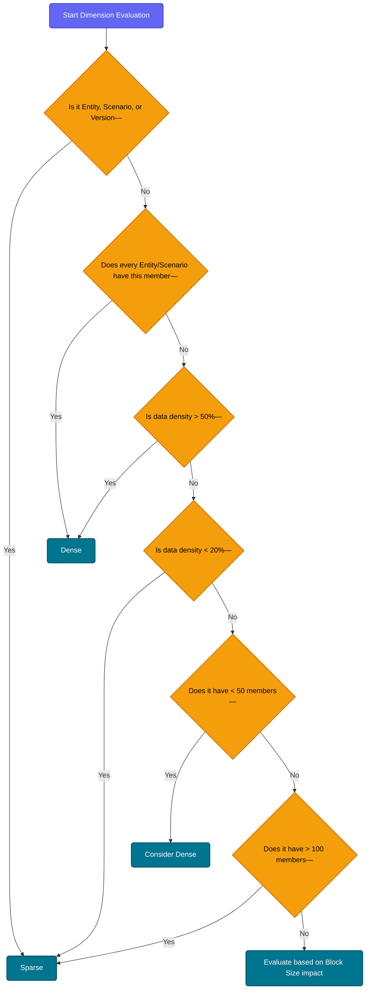
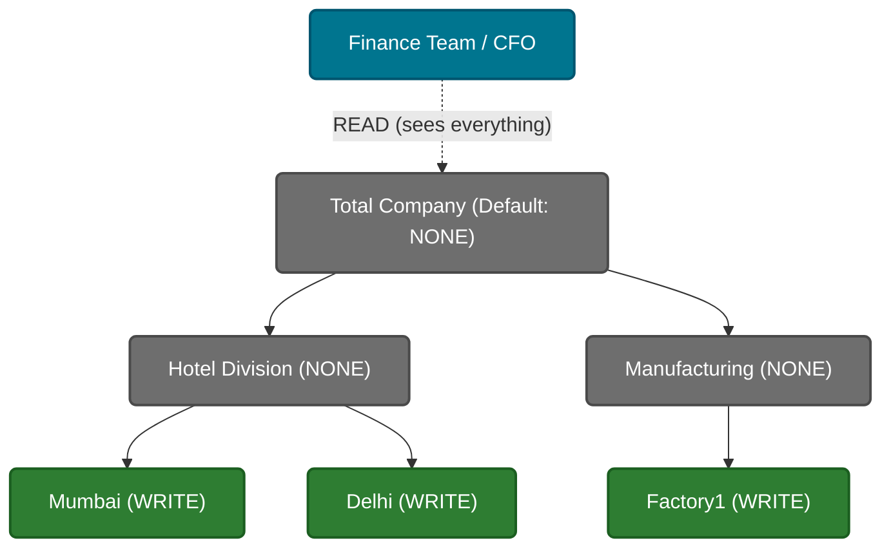
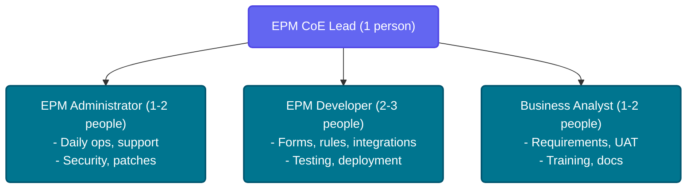

# Design Best Practices — Oracle Official Reference

> **Module:** 00_Foundation  
> **Last Updated:** 2026-07-23  
> **Oracle Cloud Version:** 24.10+  
> **Difficulty:** Intermediate → Advanced  
> **Source:** Design_Best_Practices.pdf (5.6MB, ~200 pages)  

## 📑 Table of Contents
- [Why This Document Matters](#why-this-document-matters)
- [Dimension Design Best Practices](#dimension-design-best-practices)
- [Form Design Best Practices](#form-design-best-practices)
- [Calculation Best Practices](#calculation-best-practices)
- [Integration Best Practices](#integration-best-practices)
- [Security Best Practices](#security-best-practices)
- [EPM Center of Excellence (CoE)](#epm-center-of-excellence-coe)
- [Interview Questions](#interview-questions)
- [Summary](#summary)

---

## 📌 Why This Document Matters

This is Oracle's OFFICIAL guide for designing EPBCS applications correctly from Day 1. Bad design = slow performance, frustrated users, expensive rework. Good design = fast forms, quick calculations, happy CFO.

---

## 📐 Dimension Design Best Practices

### Dense vs Sparse — Decision Matrix



### Block Size Formula

```
Block Size (bytes) = (Dense Dim1 L0 members) × (Dense Dim2 L0 members) × ... × 8 bytes

Example:
Account: 200 L0 members
Period: 12 L0 members
Block Size = 200 × 12 × 8 = 19,200 bytes = ~19 KB ✅ (Optimal: 10-100 KB)

BAD Example:
Account: 500 L0 members
Period: 12 members
Custom1: 50 members (Dense)
Block Size = 500 × 12 × 50 × 8 = 2,400,000 bytes = ~2.3 MB ❌ (Too large!)
Fix: Move Custom1 to Sparse → Block = 500 × 12 × 8 = ~47 KB ✅
```

### 🌀 Confusion Resolution
> **Misconception:** "Making a dimension Dense makes calculations faster, so I should make as many dimensions Dense as possible."
> **Reality:** Making too many dimensions Dense creates massive block sizes (often gigabytes per block). Since Essbase loads the *entire* block into RAM to change a single cell, giant blocks will cause instantaneous out-of-memory crashes and completely halt the application. Only Account and Period should be Dense in standard BSO applications.

### 😈 Twisted Interview Question
**Question:** An architect creates a new custom dimension called "Cost Center" with 5,000 members and sets it to Dense. The application instantly crashes when users try to save a form. Why, and what is the fix—
> **Answer:** Setting a 5,000-member dimension to Dense exploded the Block Size to hundreds of megabytes. The fix is to change the "Cost Center" dimension from Dense to Sparse, restructure the database, and verify the Block Size returns to the 10 KB - 100 KB range.

### Member Design Rules

| Rule | Reason |
|------|--------|
| Level 0 members → **Store** | Where data is entered/loaded |
| Parent members → **Dynamic Calc** | Aggregate on-the-fly, save disk space |
| Grouping headers → **Label Only** | No data, just organization |
| Ratios/percentages → **Never Share** | Prevent meaningless aggregation |
| Shared members → **Shared** | Alternate hierarchies without duplication |
| Calculated KPIs → **Dynamic Calc + Two-Pass** | Recalculate after aggregation |

### Naming Convention Standards

| Object | Convention | Example |
|--------|-----------|---------|
| Account members | Numeric code | `100110`, `200220` |
| Account aliases | Descriptive name | `Rooms Revenue`, `Salary Expense` |
| Entity members | Code prefix + number | `E10001`, `E10002` |
| Entity aliases | Business name | `Hotel Pvt Ltd`, `Mumbai Branch` |
| Forms | `FR_Category_Name` | `FR_Revenue_Input` |
| Business Rules | `BR_Action_Target` | `BR_Calculate_Revenue` |
| Rule Sets | `RS_Process_Name` | `RS_Monthly_Close` |
| Sub Variables | `PascalCase` | `CurrentMonth`, `BudgetYear` |

> **⚠️ Naming Restrictions & Limits (Crucial for Interviews/Exams)**
> - **Maximum Length:** By EPM best practice, member and alias names should be **80 characters or less**. While Essbase technically supports up to 1024 characters (or bytes) in certain contexts, sticking to 80 characters ensures cross-module compatibility. (Note: ASO keys max at 8 bytes / 35 bits under the hood, but this is an internal engine limit).
> - **Prohibited Prefix:** Do not use `OEP_`, `OFS_`, `OCX_`, `OWP_`, `OPF_`, `FCCS_`, `TRCS_`, `ARCS_`, `OQP_`, or `OGS_` (reserved for system objects). Avoid `sb` prefix as it is reserved for Sandbox dimensions.
> - **Prohibited Characters:** Do NOT use spaces at the beginning or end. Avoid special characters like `@`, `&`, `\`, `/`, `[`, `]`, `=`, `<`, `"`, `_`, `|`, `'`, `{`, `}` at the beginning of names.
> - **Reserved Words:** Never use Essbase calculation commands (e.g., `FIX`, `ENDFIX`), operators, or function names (`Descendants`, `Sum`, `Count`).

### 🎯 Hands-On: Evaluate Your Application Design

```
Exercise 1: Block Size Audit
1. Count Level 0 members in each Dense dimension
2. Calculate block size: product × 8 bytes
3. Is it between 10-100 KB— If not, what would you change—
4. Document: "Our block size is ___ KB because Dense dims have ___ × ___ members"

Exercise 2: Dimension Evaluation
For each custom dimension in your application:
1. Count Level 0 members
2. Estimate data density (% of intersections with data)
3. Is it Dense or Sparse— Is that correct based on the decision matrix—
4. If wrong → what would be the impact of changing it—
5. Document findings and recommendations

Exercise 3: Storage Audit
1. List all Account members
2. For each, note: Store / Dynamic Calc / Label Only / Shared / Never Share
3. Are parents set to Dynamic Calc— (they should be)
4. Are rate/percentage members set to Never Share— (they should be)
5. Are grouping headers set to Label Only— (they should be)
6. Document any corrections needed
```

---

## 📋 Form Design Best Practices

### The 5,000-Cell Rule

```
Maximum comfortable form size = 5,000 cells
Rows × Columns ≤ 5,000

Bad: 500 accounts × 24 columns (months × 2 scenarios) = 12,000 cells ❌
Good: 50 accounts × 12 columns (months) = 600 cells ✅

If you need more data → use multiple forms or Composite Forms
```

### Form Design Checklist

```
□ Suppress Missing Data → ON (always)
□ Suppress Missing Blocks → ON (always)
□ Cell count < 5,000
□ Dense dimensions on Rows/Columns, Sparse on POV/Pages
□ Most-switched dimension on Pages (lazy-load)
□ Minimal rules on form load (slows opening)
□ Read-only columns for calculated members
□ Cell-level validation rules where needed
□ Business rule buttons for on-demand calculations
□ Meaningful page order (Entity first, then Scenario)
```

### 🎯 Hands-On: Form Performance Test

```
Exercise 4: Compare Form Performance
1. Create Form A: 200 accounts × 12 months = 2,400 cells, suppression OFF
2. Create Form B: Same layout, suppression ON
3. Open both → time how long each takes to load
4. Document: "Without suppression: __ seconds. With suppression: __ seconds"
5. Expected: Form B loads 2-5x faster

Exercise 5: Optimize a Slow Form
1. Create a deliberately large form: 100 accounts × 24 columns = 2,400 cells
2. Add a Business Rule on Load
3. Time the load → likely 10+ seconds
4. Optimize:
   - Enable suppression (Missing + Blocks)
   - Remove rule from Load
   - Reduce to 50 accounts
5. Time again → target < 3 seconds
```

---

## 🧮 Calculation Best Practices

### The FIX Optimization Ladder

```
Level 0 (Worst):  No FIX → calculates EVERYTHING
Level 1 (Bad):    FIX on Scenario only → still too broad
Level 2 (OK):     FIX on Scenario + Version → better
Level 3 (Good):   FIX on Scenario + Version + Year → good
Level 4 (Best):   FIX on Scenario + Version + Year + @RELATIVE(Entity, 0) → optimal
```

### Calculation Order Matters

```
CORRECT ORDER (Bottom-Up):
1. Calculate Level 0 formulas
2. Aggregate children → parents
3. Calculate parent-level formulas (Two-Pass)

WRONG ORDER:
1. Calculate parent totals (wrong — children not ready)
2. Then calculate children (parent is now wrong)
3. No recalculation → STALE DATA
```

### 🎯 Hands-On: Optimization Practice

```
Exercise 6: FIX Scope Impact
1. Write a simple rule: "Revenue" = "Units" * "Price"
2. Version 1: No FIX → run → note duration in Job Console
3. Version 2: FIX("Budget", "Working", &BudgetYear) → run → note duration
4. Version 3: Add @RELATIVE("Entity", 0) to FIX → run → note duration
5. Compare: Version 3 should be dramatically faster
6. Document: "No FIX: __ sec, Partial FIX: __ sec, Full FIX: __ sec"
```

---

## 🔌 Integration Best Practices

### Data Load Design Rules

| Rule | Reason |
|------|--------|
| Aggregate in source before loading | EPM is OLAP, not transactional |
| Load to Level 0 members only | Parents aggregate automatically |
| Use REPLACE mode for full reloads | Prevents duplicates |
| Use APPEND for incremental loads | Add new data to existing |
| Map ALL source accounts | Unmapped = lost data |
| Validate totals after every load | Catch mapping issues early |

### 🎯 Hands-On: Data Quality Checks

```
Exercise 7: Post-Load Validation
1. Load a data file with 100 rows
2. Sum the Amount column in Excel → note the total
3. After load, check the same total in EPM:
   - Use Smart View ad-hoc → zoom to total
   - Compare: Excel total vs EPM total
4. If they DON'T match:
   - Check rejected rows in Data Management log
   - Check for unmapped members
   - Check for duplicate intersections
5. Fix any issues → reload → verify totals match
```

---

## 🔒 Security Best Practices

### The Least-Privilege Principle

Default: **NONE** for all entities → Then grant **READ/WRITE** only where needed.



### 🎯 Hands-On: Security Design

```
Exercise 8: Design Security for a 3-Entity Company
1. Draw the entity hierarchy
2. List 5 user groups (Budget Preparers A, B, C, Reviewers, Executives)
3. Assign Read/Write/None for each group × entity combination
4. Set Scenario security: Actual=Read for all, Budget=Write for preparers
5. Test: Can Preparer A see Preparer B's data— (Should be NONE)
6. Test: Can Executive see all data— (Should be READ)
```

---

## 🏛️ EPM Center of Excellence (CoE)

### What is a CoE—

An EPM Center of Excellence is a dedicated team that manages the EPM platform across the organization. Oracle strongly recommends establishing one.

### CoE Responsibilities

| Area | Tasks |
|------|-------|
| **Governance** | Standards, naming conventions, change control |
| **Operations** | Daily monitoring, incident management, backups |
| **Development** | Form/rule/report creation, testing, deployment |
| **Training** | User training, documentation, knowledge transfer |
| **Strategy** | Roadmap, new module adoption, optimization |

### CoE Team Structure



### 🎯 Hands-On: CoE Planning

```
Exercise 9: Design Your CoE
1. For a company with 500 EPM users across 10 entities:
   - How many people do you need on the CoE team—
   - What roles would you hire for—
   - What tools/processes would you establish—
2. Create a "CoE Charter" document with:
   - Mission statement
   - Team structure
   - Responsibilities matrix
   - Communication plan
   - SLA definitions (response times for P1-P4)
```

---

## 🎓 Interview Questions (Oracle Best Practices Level)

**Q: How do you determine optimal block size—**
> Multiply Level 0 member counts of all Dense dimensions, then multiply by 8 bytes. Target 10-100 KB. If too large, consider moving a Dense dimension to Sparse or reducing Dense dimension members.

**Q: What are the top 3 performance killers in EPBCS—**
> (1) CALC ALL instead of targeted FIX statements. (2) Wrong Dense/Sparse assignment causing massive blocks or too many blocks. (3) Forms without suppression loading millions of empty cells.

**Q: What is an EPM Center of Excellence and why does Oracle recommend it—**
> A dedicated team managing the EPM platform — governance, operations, development, training. Oracle recommends it because without a CoE, EPM implementations often degrade over time as knowledge leaves with consultants. A CoE ensures sustained platform health.

**Q: How would you approach designing dimensions for a new client—**
> (1) Map to their Chart of Accounts (Account dimension). (2) Map to their org structure (Entity). (3) Identify planning scenarios (Scenario, Version). (4) Identify custom analysis needs (Custom dimensions). (5) Calculate block size. (6) Validate Dense/Sparse assignment. (7) Design naming conventions. (8) Document in a Dimension Design Document.

---

## 📝 Summary

| Key Point | Detail |
|-----------|--------|
| **Block Size** | 10-100 KB optimal. Dense L0 count × 8 bytes |
| **Dense** | Account, Period (always). High-density custom dims |
| **Sparse** | Entity, Scenario, Version, Year (always). Low-density dims |
| **Form Rule** | < 5,000 cells, suppression ON, minimal on-load rules |
| **Calc Rule** | Always FIX narrowly, bottom-up order, use sub variables |
| **Security** | Default=NONE, grant minimally, use groups |
| **CoE** | Dedicated team for governance, ops, dev, training |
