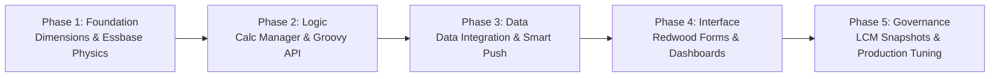

# 02. Study Path and Roadmap — Junior to Senior Technical Progression

> **Consultant High-Yield Summary:**  
> Transitioning from a Technical Consultant Fresher to a billable Full-Time Employee (FTE) requires mastering five distinct operational planes: Dimensional Outlines, Calculation Engineering (Calc Manager & Groovy), Data Pipeline Integration, Security & Valid Intersections, and Redwood UI Form Design.

---

## 🎯 Live Interactive Visual Architecture Card

<b>🎯 Live Interactive Architecture Card: Consultant Technical Competency Progression</b>

| Competency Stage | Core Technical Milestone | Review Panel Evaluation Gate |
| :--- | :--- | :--- |
| **Fresher (0-6 Mo)** | Navigation, Metadata load, Web Form creation, Basic Rules | Understands dense/sparse settings, Smart View ad-hoc retrieval, EPM Automate CLI. |
| **Junior Consultant (6-18 Mo)** | Data Management mappings, Groovy Micro-FIX, Hybrid BSO outlines | Able to diagnose block explosion, resolve Smart Push errors, design Valid Intersections. |
| **Senior / Lead (18+ Mo)** | Multi-cube enterprise architecture, REST pipelines, Performance tuning | Designs end-to-end multi-currency solutions, optimizes Dynamic Calc cache, leads client CRPs. |

---

## 🏛️ Architectural Comparison & Design Patterns

| Skill Domain | Fresher / Trainee Level | FTE Billable Consultant Level |
| :--- | :--- | :--- |
| Calculation Design | Relies on graphical Calc Manager drag-and-drop templates | Writes scoped Essbase calc scripts with FIX/ENDFIX and Groovy Micro-FIX |
| Data Movement | Manual file import via Planning web interface | Automates end-to-end Data Integration pipelines with EPM Automate |
| Troubleshooting | Escalates errors blindly to senior team members | Analyzes Essbase log files, job console stacks, and activity reports |

---

## 💼 Tough & Twisted Review Scenarios (Consultant Review Defense)

### Question 1: "What is the single most critical technical skill a fresher must demonstrate during an FTE conversion review?"
> **Consultant Model Answer:**  
> The ability to trace how business logic executes at the Essbase storage kernel layer. A junior consultant who only knows which web buttons to click fails when performance degrades or calculations produce incorrect numbers. You must be able to explain block allocation, dense/sparse combinatorics, and how a formula impacts calculation time and memory.

---

## 📑 Complete Document Catalog

| # | Document File | Topic Description |
|---|---------------|-------------------|
| 01 | [00.01_Master_Learning_Roadmap.md](./00.01_Master_Learning_Roadmap.md) | 00.01 Master Learning Roadmap — Your 12-Week Path to Oracle EPM Mastery |
| 02 | [00.02_Career_Pathways.md](./00.02_Career_Pathways.md) | 00.02 Career Pathways in Oracle EPM — Complete Guide |
| 03 | [00.03_Certification_Tracker.md](./00.03_Certification_Tracker.md) | 00.03 Oracle EPM Certification — Complete Guide |
| 04 | [00.04_Progress_Tracker.md](./00.04_Progress_Tracker.md) | 00.04 Progress Tracker — Module-by-Module Self-Assessment |
| 05 | [00.05_What_Is_EPM_For_Absolute_Beginners.md](./00.05_What_Is_EPM_For_Absolute_Beginners.md) | 00.05 What Is EPM For Absolute Beginners |

---

> **Consultant Implementation Note:** Master the architectural comparison and review defense questions in this module before presenting designs to client stakeholders or senior review panels.