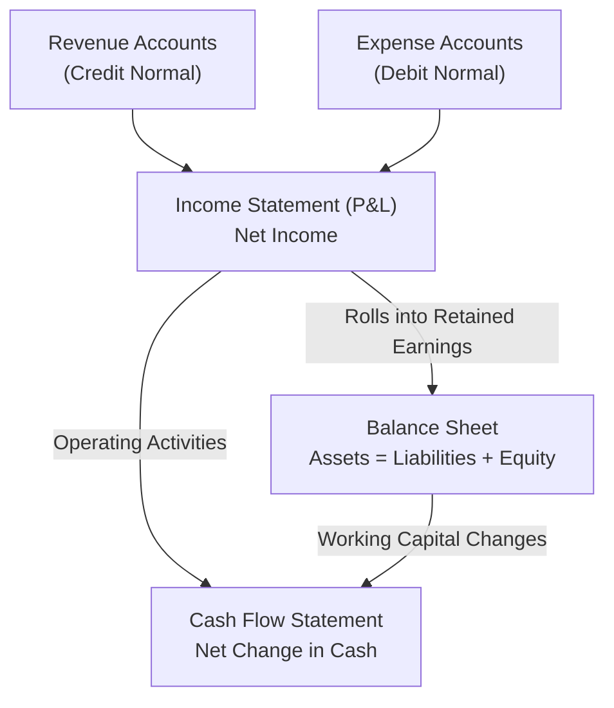

# 03. Finance Concepts — P&L, Balance Sheet, Cash Flow & Accounting Mechanics

> **Consultant High-Yield Summary:**  
> Technical EPM consultants must speak the language of corporate finance. Every dimension, member formula, and data map directly reflects general ledger accounting, trial balance consolidations, rolling forecasts, and GAAP/IFRS reporting structures.

---

## 🎯 Live Interactive Visual Architecture Card

<b>🎯 Live Interactive Architecture Card: Financial Statement Mechanics & Dimensional Flow</b>

| Statement | Core Accounting Equation | EPM Dimension Storage Physics |
| :--- | :--- | :--- |
| **Profit & Loss (P&L)** | `Revenue - Expenses = Net Income` | Periodic or YTD flow accounts; resets to zero at the start of each fiscal year. |
| **Balance Sheet (BS)** | `Assets = Liabilities + Equity` | Time Balance = Balance (Last/First); cumulative closing balances carry forward year-over-year. |
| **Cash Flow (CF)** | `Operating + Investing + Financing = Net Cash` | Derived dynamically from P&L Net Income and working capital deltas across Balance Sheet accounts. |

---

## 🏛️ Architectural Comparison & Design Patterns

| Financial Statement | Account Type | Time Balance Setting |
| :--- | :--- | :--- |
| Revenue / Sales | Revenue (Credit normal, rolls positively to Net Income) | Flow (sums across periods: Jan + Feb + Mar = Q1) |
| Cost of Goods Sold (COGS) | Expense (Debit normal, reduces Net Income) | Flow (sums across periods) |
| Bank Cash / Inventory | Asset (Debit normal, balance sheet item) | Balance (Q1 ending balance is March's ending balance) |

---

## 💼 Tough & Twisted Review Scenarios (Consultant Review Defense)

### Question 1: "Why does an Asset account show as negative in Smart View when loaded from an ERP trial balance, and how does the Account Type property solve this?"
> **Consultant Model Answer:**  
> In general ledger accounting, trial balances use debit/credit conventions (+/-). If the EPM Account dimension is not configured with the correct Account Type (e.g. Asset vs Liability vs Expense vs Revenue), Essbase consolidation operators (+ or -) will invert the financial logic. Setting Account Type to 'Asset' instructs Planning that positive values represent debits, ensuring that revenue minus expenses correctly computes net income without manual sign-inversion.

---

## 📑 Complete Document Catalog

| # | Document File | Topic Description |
|---|---------------|-------------------|
| 01 | [02.01_Financial_Statements_and_Accounting.md](./02.01_Financial_Statements_and_Accounting.md) | 02.01 Financial Statements and Accounting — Complete Guide for EPM |
| 02 | [02.02_Driver_Based_Planning_and_KPIs.md](./02.02_Driver_Based_Planning_and_KPIs.md) | 02.02 Driver-Based Planning and KPIs — Complete Guide |
| 03 | [02.03_Rolling_Forecast_Architecture.md](./02.03_Rolling_Forecast_Architecture.md) | 02.03 Rolling Forecast Architecture |

---

> **Consultant Implementation Note:** Master the architectural comparison and review defense questions in this module before presenting designs to client stakeholders or senior review panels.