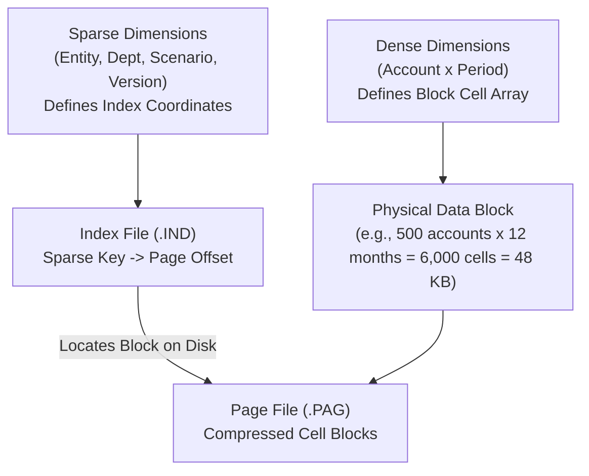

# 04. Essbase Architecture — Multidimensional Kernel, Block Storage & Hybrid Engine

> **Consultant High-Yield Summary:**  
> Oracle Essbase is the multidimensional engine powering Cloud EPM. Understanding the physics of data blocks, sparse and dense dimensions, index (.IND) and page (.PAG) files, and Hybrid BSO in-memory vector aggregation is essential for high-performance outline design.

---

## 🎯 Live Interactive Visual Architecture Card

<b>🎯 Live Interactive Architecture Card: Essbase Storage Kernel & Block Allocation Architecture</b>

| Storage Dimension | Technical Physics | Review Defense & Design Rule |
| :--- | :--- | :--- |
| **Dense Dimensions** | Defines the internal cell matrix of each data block | All intersections are physically pre-allocated in memory (8 bytes per double-precision cell). |
| **Sparse Dimensions** | Defines which data blocks exist on disk | Blocks are only created when at least one non-missing data coordinate is loaded or calculated. |
| **Block Size Target** | `(Product of Dense Members) * 8 bytes` | Optimal size is **8 KB to 100 KB**. Exceeding 200 KB causes buffer thrashing; under 8 KB causes index bloat. |
| **Hybrid BSO** | Dual-engine: BSO at Level 0 + ASO dynamic Upper | Upper sparse parent members must be **Dynamic Calc (~)**; eliminates batch aggregation calcs completely. |

---

## 🏛️ Architectural Comparison & Design Patterns

| Storage Architecture | Block Storage Option (BSO) | Aggregate Storage Option (ASO) |
| :--- | :--- | :--- |
| Data Model | Dense x Sparse multidimensional Cartesian blocks | Table-like compressed leaf coordinate tuples with bitmap indexing |
| Calculation Capability | Full procedural calc scripts (@ALLOC, @PRIOR, loop recursion) | Declarative MDX member formulas only; no procedural calc scripts |
| Ideal Application | Detailed driver-based budgeting, planning, and allocations | High-concurrency enterprise financial reporting and historical analysis |

---

## 💼 Tough & Twisted Review Scenarios (Consultant Review Defense)

### Question 1: "A client adds a 50,000-member Customer dimension and configures it as DENSE. What happens to Essbase?"
> **Consultant Model Answer:**  
> Catastrophic block explosion and memory crash. Making a 50,000-member dimension dense multiplies the block size by 50,000. If Account x Period was 50 KB, adding 50,000 dense customers makes each block 2.5 GB! Essbase will fail to allocate memory buffers, crash during cube refresh, or freeze on any data retrieve. Large, low-density dimensions MUST always be configured as SPARSE.

### Question 2: "In a Hybrid BSO cube, why does an upper-level sparse parent calculation suddenly run 100x slower?"
> **Consultant Model Answer:**  
> Procedural BSO fallback. Hybrid BSO calculates upper sparse parents dynamically using the fast ASO vector engine. However, if an upper-level member formula uses unsupported procedural functions (such as @CURRMBRRANGE, complex @ALLOC, or cross-dimensional assignments), the engine falls back to the legacy single-threaded BSO calculation engine, causing severe query degradation.

---

## 📑 Complete Document Catalog

| # | Document File | Topic Description |
|---|---------------|-------------------|
| 01 | [01_What_Is_Essbase.md](./01_What_Is_Essbase.md) | 01 — What Is Essbase: The Complete Foundation |
| 02 | [01_What_Is_Essbase_v2.md](./01_What_Is_Essbase_v2.md) | 01 — What Is Essbase: The Complete Foundation |
| 03 | [02_Essbase_Data_Storage_Architecture.md](./02_Essbase_Data_Storage_Architecture.md) | 02 — Essbase Data Storage Architecture: How Data Is Physically Stored |
| 04 | [03.05_Calculations_Top_Down_vs_Bottom_Up.md](./03.05_Calculations_Top_Down_vs_Bottom_Up.md) | 03.05 — Calculations: Top-Down vs Bottom-Up: Complete Guide |
| 05 | [03.07_Application_Statistics_Screen.md](./03.07_Application_Statistics_Screen.md) | 03.07 — Application Statistics Screen: Complete Guide |
| 06 | [03.08_Essbase_Caches_and_Tuning.md](./03.08_Essbase_Caches_and_Tuning.md) | 03.08 — Essbase Caches and Tuning: Complete Guide |
| 07 | [03.08_MDX_Query_Engine.md](./03.08_MDX_Query_Engine.md) | 03.08 MDX Query Engine and ASO Calculations |
| 08 | [03.15_Essbase_Oracle_Deep_Reference.md](./03.15_Essbase_Oracle_Deep_Reference.md) | Essbase — Oracle Official Deep Reference |
| 09 | [03.20_Essbase_Architecture_Deep_Dive.md](./03.20_Essbase_Architecture_Deep_Dive.md) | 03.20 Essbase Architecture — Deep Dive |
| 10 | [03_Sparse_vs_Dense_Complete_Guide.md](./03_Sparse_vs_Dense_Complete_Guide.md) | 03 — Sparse vs Dense Dimensions: The Complete Guide |
| 11 | [03_Sparse_vs_Dense_Complete_Guide_v2.md](./03_Sparse_vs_Dense_Complete_Guide_v2.md) | 03 — Sparse vs Dense Dimensions: The Complete Guide |
| 12 | [04_Block_Storage_Deep_Dive.md](./04_Block_Storage_Deep_Dive.md) | 04 — Block Storage Deep Dive: The Physics of Essbase Data |
| 13 | [05_Index_and_Page_Files.md](./05_Index_and_Page_Files.md) | 05 — Index Files (.IND) and Page Files (.PAG): The Filing System of Essbase |
| 14 | [06_Hourglass_Principle.md](./06_Hourglass_Principle.md) | 06 — The Hourglass Principle: Optimal Outline Design |
| 15 | [07_Data_Operations_and_Performance.md](./07_Data_Operations_and_Performance.md) | 07 — Data Operations and Performance: How Things Work Internally |
| 16 | [08_Sparse_Dense_Interchange_Impact.md](./08_Sparse_Dense_Interchange_Impact.md) | 08 — Sparse-Dense Interchange Impact: What Happens When You Swap |
| 17 | [09_EPM_Forms_Rules_Data_Storage.md](./09_EPM_Forms_Rules_Data_Storage.md) | 09 — EPM Forms, Rules, and Data Storage: Where Everything Lives |
| 18 | [10_Behind_The_Scenes_Complete.md](./10_Behind_The_Scenes_Complete.md) | 10 — Behind the Scenes: Complete End-to-End Walkthroughs |
| 19 | [11_Kernel_and_Memory_Architecture.md](./11_Kernel_and_Memory_Architecture.md) | 11 — Essbase Kernel and Memory Architecture |
| 20 | [12_Quick_Reference_Cheat_Sheet.md](./12_Quick_Reference_Cheat_Sheet.md) | 12 — Quick Reference and Cheat Sheet |
| 21 | [13_Hybrid_BSO_Engine_Internals.md](./13_Hybrid_BSO_Engine_Internals.md) | 13 — Hybrid BSO Engine: Architecture, Mechanics, & Tuning |
| 22 | [14_Compression_Algorithms_and_Bitmaps.md](./14_Compression_Algorithms_and_Bitmaps.md) | 14 — Essbase Compression Algorithms & Bitmap Internals |
| 23 | [15_Fragmentation_Defrag_and_Corruption_Recovery.md](./15_Fragmentation_Defrag_and_Corruption_Recovery.md) | 15 — Fragmentation, Defragmentation, & Corruption Recovery |
| 24 | [16_Dynamic_Calc_Cache_and_MDX_Query_Engine.md](./16_Dynamic_Calc_Cache_and_MDX_Query_Engine.md) | ⚡ Essbase Kernel — Dynamic Calc Cache & MDX Query Engine Internals |
| 25 | [17_Calculation_Engine_Internals_and_Parallelism.md](./17_Calculation_Engine_Internals_and_Parallelism.md) | ⚙️ Essbase Kernel — Calculation Engine Internals, Thread Scheduling & Parallelism |

---

> **Consultant Implementation Note:** Master the architectural comparison and review defense questions in this module before presenting designs to client stakeholders or senior review panels.