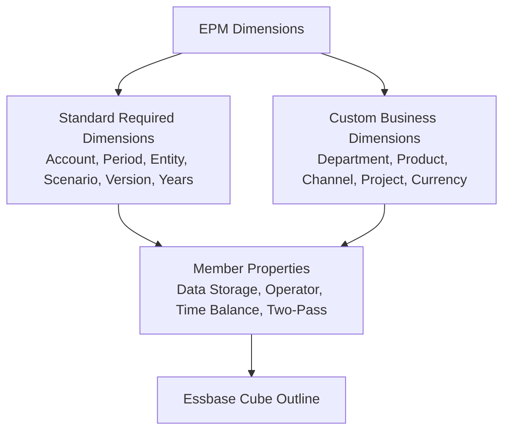

# 05. Dimensions and Metadata — 12-Dimension Architecture & Member Properties

> **Consultant High-Yield Summary:**  
> Metadata forms the structural backbone of every EPM application. Correctly configuring data storage properties (Store, Dynamic Calc, Shared, Never Share), time balance attributes, consolidation operators, and two-pass calculations determines cube size, query speed, and financial accuracy.

---

## 🎯 Live Interactive Visual Architecture Card

<b>🎯 Live Interactive Architecture Card: Dimensional Properties & Implied Share Governance</b>

| Property | Technical Mechanism | Implementation Best Practice |
| :--- | :--- | :--- |
| **Data Storage** | Store, Dynamic Calc, Dynamic Calc and Store, Shared, Never Share | Leaf cells store data; Upper Hybrid parents must be Dynamic Calc. Shared members reuse existing blocks. |
| **Consolidation Operator** | `+`, `-`, `*`, `/`, `%`, `~` (Ignore), `^` (Never) | Use `~` for informational drivers to prevent unintended parent rollups. |
| **Two-Pass Calculation** | Forces Essbase to calculate ratios AFTER full hierarchy aggregation | Mandatory on dynamic margin % and ratio accounts in Account dimension to prevent wrong rolled-up averages. |
| **Implied Share** | Essbase converts a parent with 1 child or 1 consolidatable child into a shared pointer | Set parent to 'Never Share' if direct data entry or distinct parent storage is required. |

---

## 🏛️ Architectural Comparison & Design Patterns

| Property / Setting | Dynamic Calc (~) | Stored (+) |
| :--- | :--- | :--- |
| Storage Footprint | Zero physical disk space; computed in memory during query | Allocates physical cells in .PAG files; persists until cleared |
| Calculation Timing | Evaluated on retrieval by end user or Smart View query | Pre-calculated during batch business rules or data save |
| Write-Back Eligibility | Cannot accept direct user input (unless overridden by Groovy) | Fully editable in web forms and Smart View ad-hoc grids |

---

## 💼 Tough & Twisted Review Scenarios (Consultant Review Defense)

### Question 1: "A user enters data into a level 0 member, but the parent shows the exact same value even though there are other sibling members. What happened?"
> **Consultant Model Answer:**  
> Implied Share. When a parent has only one child that consolidates (e.g. all other siblings are set to ~ or dynamic calc), Essbase treats the parent and child as sharing the exact same cell coordinate. If a second child is later loaded with data, the parent may fail to roll up properly or display confusing results unless the parent's storage property is explicitly set to 'Never Share'.

---

## 📑 Complete Document Catalog

| # | Document File | Topic Description |
|---|---------------|-------------------|
| 01 | [01_Universal_Member_Properties.md](./01_Universal_Member_Properties.md) | 01 — Universal Member Properties: The Complete Foundation |
| 02 | [02_Account_Dimension_Deep_Dive.md](./02_Account_Dimension_Deep_Dive.md) | 02 — Account Dimension Deep Dive: Financial Logic & Storage |
| 03 | [03_Period_and_Scenario_Dimensions.md](./03_Period_and_Scenario_Dimensions.md) | 03 — Period and Scenario Dimensions: Time Bounding & Lifecycles |
| 04 | [04_Version_Dimension_and_Sandboxes.md](./04_Version_Dimension_and_Sandboxes.md) | 04 — Version Dimension and Sandboxes: Workflow & Target Modeling |
| 05 | [05.08_Account_Dimension_Exhaustive.md](./05.08_Account_Dimension_Exhaustive.md) | 05.08 Account Dimension — Exhaustive Property Reference |
| 06 | [05.09_Entity_Dimension_Exhaustive.md](./05.09_Entity_Dimension_Exhaustive.md) | 05.09 Entity Dimension — Exhaustive Property Reference |
| 07 | [05.10_Period_Scenario_Version_Year_Dimensions.md](./05.10_Period_Scenario_Version_Year_Dimensions.md) | 05.10 Period, Scenario, Version & Year Dimensions — Exhaustive Reference |
| 08 | [05.12_Custom_Dimensions_Design_Patterns.md](./05.12_Custom_Dimensions_Design_Patterns.md) | 05.12 Custom Dimensions — Design Patterns & Best Practices |
| 09 | [05.20_Dimensions_Reference.md](./05.20_Dimensions_Reference.md) | 📒 Document 06 — Dimensions — The Complete Reference |
| 10 | [05.21_Account_Dimension.md](./05.21_Account_Dimension.md) | 📔 Document 07 — Account Dimension — Deep Dive |
| 11 | [05.28_Member_Formulas_Intro.md](./05.28_Member_Formulas_Intro.md) | 🧮 Member Formulas — Introduction |
| 12 | [05.30_Dimensions_Bible_Deep_Dive.md](./05.30_Dimensions_Bible_Deep_Dive.md) | 05.30 Dimensions Bible — Deep Dive |
| 13 | [05_Currency_and_Custom_Dimensions.md](./05_Currency_and_Custom_Dimensions.md) | 05 — Currency and Custom Dimensions: Multi-Cube Modeling |
| 14 | [06_System_Approval_Dimensions_and_17_Metric_Types.md](./06_System_Approval_Dimensions_and_17_Metric_Types.md) | 06 — System Approval Dimensions & The 17 Metric Types |
| 15 | [07_Troubleshooting_Dos_and_Donts_and_Interview_Guide.md](./07_Troubleshooting_Dos_and_Donts_and_Interview_Guide.md) | 07 — Dimension Properties: Troubleshooting, Dos & Donts, and Interview Bible |
| 16 | [08_Attribute_Dimensions_vs_UDAs_Deep_Dive.md](./08_Attribute_Dimensions_vs_UDAs_Deep_Dive.md) | 08 — Attribute Dimensions vs. UDAs: Deep Architecture |
| 17 | [09_Relational_Schema_Internals_and_HSP_Tables.md](./09_Relational_Schema_Internals_and_HSP_Tables.md) | 09 — Relational Schema Internals & The `HSP_` Database Tables |
| 18 | [10_Advanced_Solve_Order_and_Formula_Execution.md](./10_Advanced_Solve_Order_and_Formula_Execution.md) | 10 — Advanced Solve Order & Formula Collision Mathematics |
| 19 | [11_Member_Formula_Compilation_and_Execution_Internals.md](./11_Member_Formula_Compilation_and_Execution_Internals.md) | ⚡ Dimension Properties — Member Formula Compilation & Execution Internals |
| 20 | [12_Smart_Push_Data_Maps_and_Dimensional_Mapping.md](./12_Smart_Push_Data_Maps_and_Dimensional_Mapping.md) | 🔄 Dimension Properties — Smart Push, Data Maps & Dimensional Mapping Mechanics |

---

> **Consultant Implementation Note:** Master the architectural comparison and review defense questions in this module before presenting designs to client stakeholders or senior review panels.