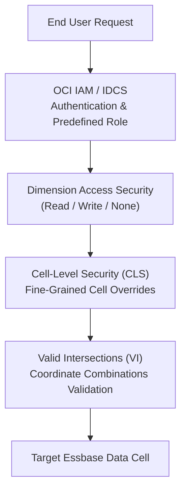

# 06. Security and Access — Predefined Roles, Cell-Level Security & Valid Intersections

> **Consultant High-Yield Summary:**  
> Security in Cloud EPM is enforced across two complementary layers: Functional Roles (Service Administrator, Power User, User, Viewer) managed via Identity Cloud Service (IDCS/OCI IAM), and Data Security (Cell-Level Security, Dimension Permissions, and Valid Intersections) managed in Planning.

---

## 🎯 Live Interactive Visual Architecture Card

<b>🎯 Live Interactive Architecture Card: Cloud EPM Multi-Layer Security Architecture</b>

| Security Layer | Enforcement Point | Technical Precedence & Physics |
| :--- | :--- | :--- |
| **Functional Roles** | OCI IAM / IDCS Pod Authentication | Governs application capabilities (e.g. Power User can create forms; User can only enter data). |
| **Dimension Security** | Planning Relational Security Tables | Grants Read, Write, or None on dimensional branches. **Least Privilege** precedence applies across conflicting groups. |
| **Cell-Level Security (CLS)** | Essbase Kernel Query Interceptor | Overrides dimension security at multi-dimensional cell coordinates; renders restricted cells read-only. |
| **Valid Intersections (VI)** | Planning Form & Smart View UI | Validates coordinate combinations; suppresses invalid combinations from forms and blocks data entry. |

---

## 🏛️ Architectural Comparison & Design Patterns

| Security Mechanism | Cell-Level Security (CLS) | Valid Intersections (VI) |
| :--- | :--- | :--- |
| Primary Purpose | Restrict read/write permissions on specific data cell intersections | Prevent end users from viewing or entering invalid business combinations |
| Underlying Effect | Cell shows #NoAccess or grayed-out read-only cell | Cell is cleared/hidden or flagged as 'Invalid Intersection' |
| Essbase Impact | Data still exists in cube; user is denied access | Prevents creation of empty, useless sparse data blocks |

---

## 💼 Tough & Twisted Review Scenarios (Consultant Review Defense)

### Question 1: "A user belongs to Group A (Write access to Entity 'East') and Group B (None access to Entity 'East'). Can the user enter data for East?"
> **Consultant Model Answer:**  
> No. In Oracle Cloud EPM, when group permissions conflict on the same dimension member, **None** takes precedence over **Read**, and **Read** takes precedence over **Write**. The user receives **None** access and cannot see or write to Entity 'East'.

---

## 📑 Complete Document Catalog

| # | Document File | Topic Description |
|---|---------------|-------------------|
| 01 | [12.01_Security_and_Roles.md](./12.01_Security_and_Roles.md) | 12.01 — Security and Roles: Complete Guide |
| 02 | [12.02_Dimension_Security_Patterns.md](./12.02_Dimension_Security_Patterns.md) | 12.02 — Dimension Security Patterns: Complete Guide |
| 03 | [12.03_Security_Audit_and_Compliance.md](./12.03_Security_Audit_and_Compliance.md) | 12.03 — Security Audit and Compliance: Complete Guide |
| 04 | [12.10_Security_Complete_Guide.md](./12.10_Security_Complete_Guide.md) | Security — Complete Guide |
| 05 | [12.11_Security_Oracle_Deep_Reference.md](./12.11_Security_Oracle_Deep_Reference.md) | Security & Access Control — Oracle Official Deep Reference |
| 06 | [Oracle_EPM_Access_Control_Master_Guide.md](./Oracle_EPM_Access_Control_Master_Guide.md) | Oracle EPM Planning Security: Beginner-to-Consultant Guide |
| 07 | [Oracle_EPM_Access_Control_Master_Guide_v2.md](./Oracle_EPM_Access_Control_Master_Guide_v2.md) | Oracle EPM Cloud: The Ultimate Master Guide to Access Control |
| 08 | [Oracle_EPM_Valid_Intersections_Master_Guide.md](./Oracle_EPM_Valid_Intersections_Master_Guide.md) | Planning Valid Intersections: Beginner-to-Consultant Guide |
| 09 | [Oracle_EPM_Valid_Intersections_Master_Guide_v2.md](./Oracle_EPM_Valid_Intersections_Master_Guide_v2.md) | Oracle EPM Cloud: The Ultimate Master Guide to Valid Intersections |

---

> **Consultant Implementation Note:** Master the architectural comparison and review defense questions in this module before presenting designs to client stakeholders or senior review panels.