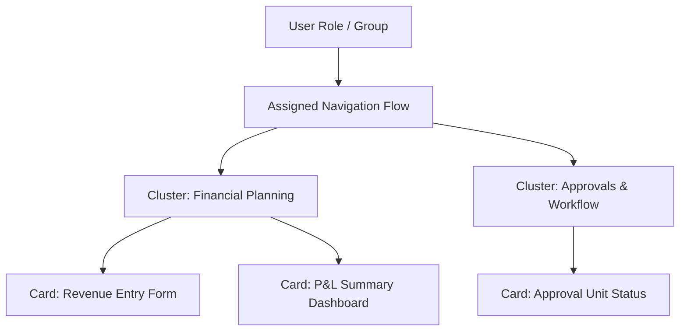

# 07. User Interface and Navigation — Redwood UX, Navigation Flows & Card Customization

> **Consultant High-Yield Summary:**  
> Oracle Redwood is the standard user experience design system for Cloud EPM. Technical consultants configure customized Navigation Flows, Cards, Tabs, and Clusters to deliver role-specific user journeys for Planners, Approvers, and Executives.

---

## 🎯 Live Interactive Visual Architecture Card

<b>🎯 Live Interactive Architecture Card: Redwood Navigation Flow Architecture</b>

| UI Component | Purpose & Configuration | Consultant Design Rule |
| :--- | :--- | :--- |
| **Navigation Flow** | Role-based portal layout containing cards and clusters | Create distinct flows for 'Finance Planner', 'HR Manager', and 'Executive Approver'. |
| **Clusters** | Top-level visual containers grouping related sub-cards | Limit clusters to 4-6 per navigation flow to prevent visual cognitive overload. |
| **Cards & Tabs** | Direct launch points for forms, dashboards, reports, and URLs | Set default POV dimensions and enable dynamic tab switching. |
| **Global Header** | Pod switcher, Navigator menu, Announcements, Settings | Standardize environment banner colors (DEV = Green, TEST = Yellow, PROD = Blue). |

---

## 🏛️ Architectural Comparison & Design Patterns

| Navigation Component | Default Navigation Flow | Custom Navigation Flow |
| :--- | :--- | :--- |
| Scope | Out-of-the-box system flow containing all enabled modules | Tailored flow restricted to specific business roles and tasks |
| Modifiability | Cannot be modified directly; must be cloned first | Fully customizable: hide cards, reorder tabs, bind custom icons |
| Role Binding | Applies to all users without a specific role assignment | Assigned explicitly to Groups (e.g. Sales_Users, Cost_Center_Owners) |

---

## 💼 Tough & Twisted Review Scenarios (Consultant Review Defense)

### Question 1: "A consultant modifies a navigation flow in DEV and migrates it to PROD, but end users in PROD do not see the changes. Why?"
> **Consultant Model Answer:**  
> Two frequent causes: 1) The custom navigation flow was not set to **Active** state in PROD after import. 2) The user has an active session caching the old navigation flow; the user must log out and log back in, or the browser cache must be cleared.

---

## 📑 Complete Document Catalog

| # | Document File | Topic Description |
|---|---------------|-------------------|
| 01 | [Oracle_EPM_Dashboards_Master_Guide.md](./Oracle_EPM_Dashboards_Master_Guide.md) | Oracle EPM Cloud: The Ultimate Master Guide to Dashboards 2.0 |
| 02 | [Oracle_EPM_Grid_Spread_Master_Guide.md](./Oracle_EPM_Grid_Spread_Master_Guide.md) | Oracle EPM: The Ultimate Deep-Dive Guide to Grid Spread (Data Forms) |
| 03 | [Oracle_EPM_Mass_Allocate_Master_Guide.md](./Oracle_EPM_Mass_Allocate_Master_Guide.md) | Oracle EPM: The Ultimate Deep-Dive Guide to Mass Allocate (Data Forms) |
| 04 | [Oracle_EPM_Navigation_Flows_Master_Guide.md](./Oracle_EPM_Navigation_Flows_Master_Guide.md) | Oracle EPM Cloud: The Ultimate Master Guide to Navigation Flows |

---

> **Consultant Implementation Note:** Master the architectural comparison and review defense questions in this module before presenting designs to client stakeholders or senior review panels.