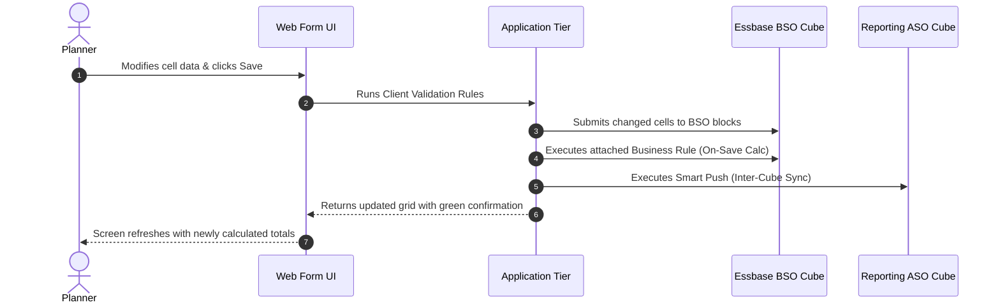

# 08. Forms — Data Form Design, Dynamic Calculations & Performance Governance

> **Consultant High-Yield Summary:**  
> Data Forms are the primary interactive data-entry interface in Cloud EPM. Designing high-performing forms requires strict governance over grid dimensions, row/column suppression, dynamic calc formulas, Smart Push on save, and validation rules.

---

## 🎯 Live Interactive Visual Architecture Card

<b>🎯 Live Interactive Architecture Card: High-Performance Form Architecture & Event Lifecycle</b>

| Form Design Factor | Best Practice Specification | Production Risk & Failure Mode |
| :--- | :--- | :--- |
| **Grid Dimensions** | Max **500 rows** and **30 columns** per active page | Exceeding 10,000 cells causes browser lag, high memory consumption, and slow render. |
| **Data Suppression** | Enable 'Suppress Missing Data' and 'Suppress Missing Blocks' | Disabled suppression forces Essbase to query and return empty blocks, destroying performance. |
| **Smart Push on Save** | Push only edited form slices to reporting ASO cube | Pushing entire dimensional ranges stalls form save and locks users out during peak budget windows. |
| **Validation Rules** | Use color-coded thresholds (Yellow = Warning, Red = Error) | Evaluated on the client/web tier before data submit; guides user without executing heavy calc scripts. |

---

## 🏛️ Architectural Comparison & Design Patterns

| Form Feature | Standard Calc Manager Rule on Save | Groovy Dynamic Rule on Save |
| :--- | :--- | :--- |
| Calculation Scope | Static FIX statement on entire dimension or RTP range | Dynamically scoped strictly to edited grid cells (`operation.grid`) |
| Save Latency | 5 to 45 seconds depending on cube block density | Under 1 second by avoiding unedited block recalculations |
| Input Validation | Cannot cancel form save with custom user message | Throws `VetoException` to reject save and display precise error |

---

## 💼 Tough & Twisted Review Scenarios (Consultant Review Defense)

### Question 1: "A user enters data into a data form, clicks Save, receives a success message, but the numbers immediately revert to empty or their previous values. What happened?"
> **Consultant Model Answer:**  
> The user entered data on **Dynamic Calc** members or cells restricted by an attached on-save business rule. Dynamic Calc members cannot store physical data. When the form saves, the cell does not persist to disk, and upon grid refresh, Essbase recalculates the dynamic formula, wiping out the user's unsaved input.

---

## 📑 Complete Document Catalog

| # | Document File | Topic Description |
|---|---------------|-------------------|
| 01 | [01_Grid_and_Display_Properties.md](./01_Grid_and_Display_Properties.md) | 01 — Form properties, precision, suppression, and display |
| 02 | [01_Grid_and_Display_Properties_v2.md](./01_Grid_and_Display_Properties_v2.md) | 01 — Form Properties, Instructions, Precision, & Grid Engine |
| 03 | [02_Dimension_and_Segment_Properties.md](./02_Dimension_and_Segment_Properties.md) | 02 — Dimension axes, member display, and segments |
| 04 | [02_Dimension_and_Segment_Properties_v2.md](./02_Dimension_and_Segment_Properties_v2.md) | 02 — Dimension and Segment Properties: Layout Architecture |
| 05 | [03_Business_Rules_and_Smart_Push_on_Forms.md](./03_Business_Rules_and_Smart_Push_on_Forms.md) | 03 — Form business rules and Smart Push |
| 06 | [03_Business_Rules_and_Smart_Push_on_Forms_v2.md](./03_Business_Rules_and_Smart_Push_on_Forms_v2.md) | 03 — Business Rules & Smart Push on Forms: Automation Architecture |
| 07 | [04_Smart_View_Prediction_and_Printing_Options.md](./04_Smart_View_Prediction_and_Printing_Options.md) | 04 — Smart View, Predictive Planning, and printing |
| 08 | [04_Smart_View_Prediction_and_Printing_Options_v2.md](./04_Smart_View_Prediction_and_Printing_Options_v2.md) | 04 — Smart View, Prediction, & Printing Options |
| 09 | [05_Format_and_Validation_Rules_Engine.md](./05_Format_and_Validation_Rules_Engine.md) | 05 — Format rules and data validation |
| 10 | [05_Format_and_Validation_Rules_Engine_v2.md](./05_Format_and_Validation_Rules_Engine_v2.md) | 05 — Format & Validation Rules Engine |
| 11 | [06.01_Form_Design_and_Grid_Properties.md](./06.01_Form_Design_and_Grid_Properties.md) | 06.01 — Form Design and Grid Properties: Complete Guide |
| 12 | [06.02_Smart_Push_and_Data_Maps.md](./06.02_Smart_Push_and_Data_Maps.md) | 06.02 — Smart Push and Data Maps: Complete Guide |
| 13 | [06.03_Runtime_Prompts_and_Variables.md](./06.03_Runtime_Prompts_and_Variables.md) | 06.03 — Runtime Prompts and Variables on Forms: Complete Guide |
| 14 | [06.04_Composite_Forms_vs_Dashboards.md](./06.04_Composite_Forms_vs_Dashboards.md) | 06.04 Composite Forms vs Dashboards |
| 15 | [06.05_Form_Formatting_and_Validation_Rules.md](./06.05_Form_Formatting_and_Validation_Rules.md) | 06.05 — Form Formatting and Validation Rules: Complete Guide |
| 16 | [06.06_Flex_Forms_in_Smart_View.md](./06.06_Flex_Forms_in_Smart_View.md) | 06.06 — Flex Forms in Smart View: Complete Guide |
| 17 | [06.07_Form_Business_Rules_Screen.md](./06.07_Form_Business_Rules_Screen.md) | 06.07 — Form Business Rules: Complete Guide |
| 18 | [06.08_Advanced_Form_Templates_and_Dashboards.md](./06.08_Advanced_Form_Templates_and_Dashboards.md) | 06.08 — Advanced Form Templates and Dashboards: Complete Guide |
| 19 | [06.09_FreeForm_Forms_Admin.md](./06.09_FreeForm_Forms_Admin.md) | 06.09 — FreeForm Forms: Complete Guide |
| 20 | [06.10_Form_Grid_Properties_Expert_Hacks.md](./06.10_Form_Grid_Properties_Expert_Hacks.md) | 06.10 — Form Grid Properties: Expert Hacks and Performance Tips |
| 21 | [06.11_Form_Precision_and_Validation.md](./06.11_Form_Precision_and_Validation.md) | 06.11 — Form Precision and Other Options: Complete Guide |
| 22 | [06.12_Composite_Forms_and_Cell_Attachments.md](./06.12_Composite_Forms_and_Cell_Attachments.md) | 06.12 — Composite Forms and Cell Attachments: Complete Guide |
| 23 | [06.13_Form_Security_and_Folder_Design.md](./06.13_Form_Security_and_Folder_Design.md) | 06.13 — Form Security and Folder Design: Complete Guide |
| 24 | [06.14_Form_Properties_Tab_Exhaustive.md](./06.14_Form_Properties_Tab_Exhaustive.md) | 06.14 Form Properties Tab — Exhaustive Reference |
| 25 | [06.15_Form_Layout_Tab_Exhaustive.md](./06.15_Form_Layout_Tab_Exhaustive.md) | 06.15 Form Layout Tab — Exhaustive Reference |
| 26 | [06.17_Form_Business_Rules_Tab_Exhaustive.md](./06.17_Form_Business_Rules_Tab_Exhaustive.md) | 06.17 Form Business Rules Tab — Exhaustive Reference |
| 27 | [06.18_Form_Types_Complete_Comparison.md](./06.18_Form_Types_Complete_Comparison.md) | 06.18 Form Types Complete Comparison |
| 28 | [06.20_Forms_Design_and_Properties_Guide.md](./06.20_Forms_Design_and_Properties_Guide.md) | 📋 Document 08 — Forms — Design & Properties |
| 29 | [06.24_Form_Performance.md](./06.24_Form_Performance.md) | 06.24 — Form Performance Optimization: Complete Guide |
| 30 | [06.25_Form_Best_Practices.md](./06.25_Form_Best_Practices.md) | 06.25 — Form Best Practices Bible |
| 31 | [06.26_Forms_Oracle_Deep_Reference.md](./06.26_Forms_Oracle_Deep_Reference.md) | Forms — Oracle Official Deep Reference |
| 32 | [06.27_Reports_Oracle_Deep_Reference.md](./06.27_Reports_Oracle_Deep_Reference.md) | Reports & Financial Reporting — Oracle Official Deep Reference |
| 33 | [06.28_Reports_and_Dashboard_Tiles_Deep_Dive.md](./06.28_Reports_and_Dashboard_Tiles_Deep_Dive.md) | 06.28 Reports and Dashboard Tiles Deep Dive |
| 34 | [06.29_Reports_Official_Complete_Reference.md](./06.29_Reports_Official_Complete_Reference.md) | EPM Reports — Oracle Official Complete Reference (Designing with Reports E94364-89) |
| 35 | [06.30_Forms_Master_Reference_Deep_Dive.md](./06.30_Forms_Master_Reference_Deep_Dive.md) | 06.30 Forms Master Reference — Deep Dive |
| 36 | [06_Troubleshooting_Performance_and_Design_Patterns.md](./06_Troubleshooting_Performance_and_Design_Patterns.md) | 06 — Form troubleshooting and design patterns |
| 37 | [06_Troubleshooting_Performance_and_Design_Patterns_v2.md](./06_Troubleshooting_Performance_and_Design_Patterns_v2.md) | 06 — Form Properties: Performance Tuning & Interview Bible |
| 38 | [07_Cell_Level_Security_and_Valid_Intersections_on_Forms.md](./07_Cell_Level_Security_and_Valid_Intersections_on_Forms.md) | 07 — Cell-level security and valid intersections on forms |
| 39 | [07_Cell_Level_Security_and_Valid_Intersections_on_Forms_v2.md](./07_Cell_Level_Security_and_Valid_Intersections_on_Forms_v2.md) | 🛡️ Form Properties — Cell-Level Security (CLS) & Valid Intersections (VIC) |
| 40 | [08_Groovy_Rules_and_Form_Context_API.md](./08_Groovy_Rules_and_Form_Context_API.md) | 08 — Groovy rules and form context |
| 41 | [08_Groovy_Rules_and_Form_Context_API_v2.md](./08_Groovy_Rules_and_Form_Context_API_v2.md) | ☕ Form Properties — Groovy Rules & Form Context API Deep Dive |
| 42 | [09_Form_Layout_Internals_and_XML_Repository.md](./09_Form_Layout_Internals_and_XML_Repository.md) | 09 — Form artifact lifecycle and technical boundaries |
| 43 | [09_Form_Layout_Internals_and_XML_Repository_v2.md](./09_Form_Layout_Internals_and_XML_Repository_v2.md) | 🏛️ Form Properties — Form Layout Internals, XML Repository & LCM Structure |

---

> **Consultant Implementation Note:** Master the architectural comparison and review defense questions in this module before presenting designs to client stakeholders or senior review panels.