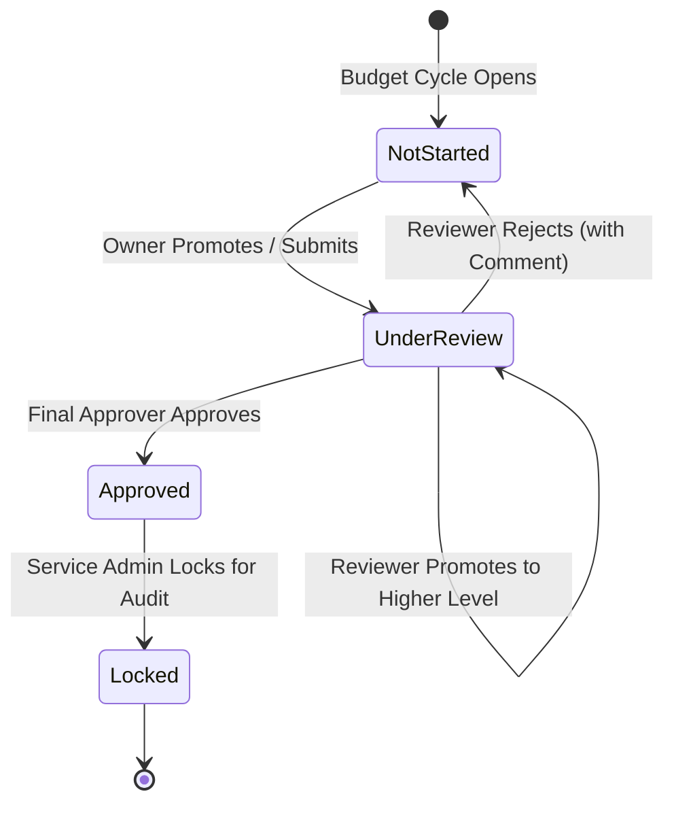

# 09. Workflow and Approvals — Approval Units, Promotional Paths & Lock Governance

> **Consultant High-Yield Summary:**  
> Approval Workflow manages the formal review, submission, approval, and locking of budgets and forecasts across organizational hierarchies. Configuring Approval Unit Hierarchies (AUH), promotional paths, and validation rules enforces corporate budget governance.

---

## 🎯 Live Interactive Visual Architecture Card

<b>🎯 Live Interactive Architecture Card: Approval Unit Lifecycle & State Machine Architecture</b>

| Workflow State | User Permissions | State Transition Action |
| :--- | :--- | :--- |
| **Not Started (First Pass)** | Owner has Write access; Reviewer has Read access | Owner prepares budget; clicks **Promote** or **Submit**. |
| **Under Review** | Owner becomes Read-Only; Reviewer has Write access | Reviewer reviews numbers; can **Approve**, **Reject**, or **Promote** higher. |
| **Approved / Locked** | All users (except Service Admin) are **Read-Only** | Final approver locks the Approval Unit; data becomes immutable for audit compliance. |

---

## 🏛️ Architectural Comparison & Design Patterns

| Workflow Aspect | Bottom-Up Approval Unit Hierarchy | Distributed / Freeform Hierarchy |
| :--- | :--- | :--- |
| Rollup Flow | Level 0 entities roll up strictly through parent tree to top executive | Selected entity groups approve independently without strict parent dependency |
| Data Locking | Promoting child entity locks child data while parent remains editable | Locking can be configured per individual cost center or business unit |
| Ideal Use Case | Traditional corporate budgeting with strict hierarchical sign-off | Decentralized divisions with autonomous review cycles |

---

## 💼 Tough & Twisted Review Scenarios (Consultant Review Defense)

### Question 1: "A planner complains they cannot edit numbers on a form even though they have 'Write' access to all dimension members. What is the first thing to check?"
> **Consultant Model Answer:**  
> Check the **Approval Unit Status** for that entity, scenario, and version combination. If the Approval Unit has been promoted to 'Under Review', 'Approved', or 'Locked', the Planning workflow engine places an absolute lock on the intersection, overriding dimensional write permissions for that owner.

---

## 📑 Complete Document Catalog

| # | Document File | Topic Description |
|---|---------------|-------------------|
| 01 | [Oracle_EPM_Approval_Flow_Master_Guide.md](./Oracle_EPM_Approval_Flow_Master_Guide.md) | Planning Approvals: Beginner-to-Consultant Guide |
| 02 | [Oracle_EPM_Approval_Flow_Master_Guide_v2.md](./Oracle_EPM_Approval_Flow_Master_Guide_v2.md) | Oracle EPM Cloud: The Ultimate Master Guide to Approval Flows |
| 03 | [Oracle_EPM_Task_Lists_Master_Guide.md](./Oracle_EPM_Task_Lists_Master_Guide.md) | Planning Task Lists and Task Manager: Learning Guide |
| 04 | [Oracle_EPM_Task_Lists_Master_Guide_v2.md](./Oracle_EPM_Task_Lists_Master_Guide_v2.md) | Oracle EPM Cloud: The Ultimate Master Guide to Task Lists |

---

> **Consultant Implementation Note:** Master the architectural comparison and review defense questions in this module before presenting designs to client stakeholders or senior review panels.