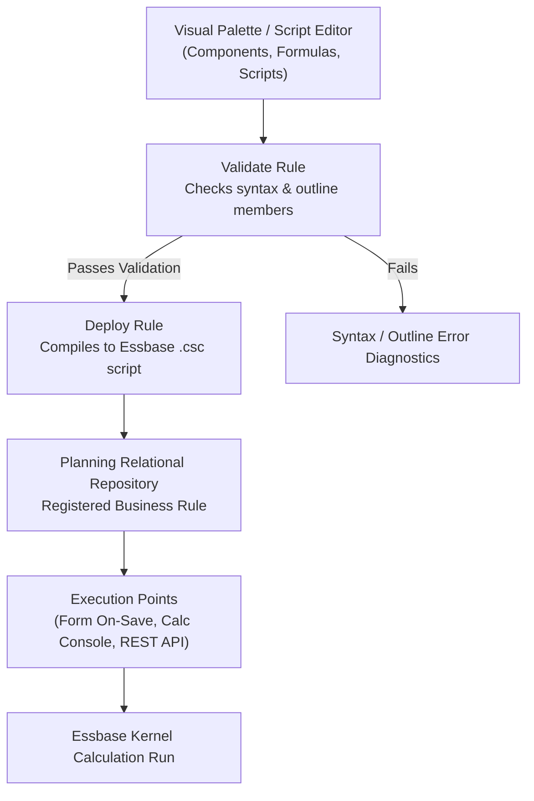

# 10. Calc Manager — Graphical Rule Designer, Custom Defined Functions & Script Lifecycle

> **Consultant High-Yield Summary:**  
> Calculation Manager is the centralized authoring environment for business rules, formulas, rule sets, and templates in Oracle Cloud EPM. Rules are designed visually or via script, validated against the Essbase outline, and deployed to production cubes.

---

## 🎯 Live Interactive Visual Architecture Card

<b>🎯 Live Interactive Architecture Card: Calc Manager Rule Compilation & Deployment Architecture</b>

| Lifecycle Phase | Technical Operation | Review Defense & Best Practice |
| :--- | :--- | :--- |
| **Design Phase** | Visual flowchart palette or text script editor | Use Variables (Global, App, Plan Type) instead of hardcoding member names. |
| **Validation Phase** | Verifies member names and syntax against Essbase outline | Errors flag invalid member names, unclosed FIX blocks, or type mismatches. |
| **Deployment Phase** | Compiles rule into Essbase `.csc` script and registers with Planning | Deployed rules appear in Planning Jobs Console and can be attached to web forms. |
| **Execution Phase** | Run via web form on-save, Jobs console, EPM Automate, or REST API | Monitor execution duration and block creation statistics in Essbase log. |

---

## 🏛️ Architectural Comparison & Design Patterns

| Authoring Mode | Graphical Flowchart Designer | Script Editor (Text Mode) |
| :--- | :--- | :--- |
| Target User | Beginner consultants and finance analysts | Senior technical consultants and calculation engineers |
| Flexibility | Limited to drag-and-drop components (Loops, Conditions, Formulas) | Full Essbase procedural syntax, compiler directives, and custom functions |
| Complex Logic | Visual flowcharts become unreadable with deep branching logic | Clean, concise script structure with inline comments and indentation |

---

## 💼 Tough & Twisted Review Scenarios (Consultant Review Defense)

### Question 1: "Why does a business rule validate successfully in Calc Manager but fail with an error when executed from a data form?"
> **Consultant Model Answer:**  
> Validation in Calc Manager checks syntax and verifies that referenced members exist in the outline at compile time. However, when run from a data form, **Runtime Prompts (RTP)** or substitution variables may inject invalid, missing, or unauthorized members at runtime. Additionally, if the user executing the rule has insufficient access or if dynamic variables evaluate to empty strings, the runtime execution fails.

---

## 📑 Complete Document Catalog

| # | Document File | Topic Description |
|---|---------------|-------------------|
| 01 | [08.01_Calc_Manager_Overview_and_Navigation.md](./08.01_Calc_Manager_Overview_and_Navigation.md) | 08.01 — Calc Manager Overview and Navigation: Complete Guide |
| 02 | [08.02_Formulas_Scripts_and_Conditions.md](./08.02_Formulas_Scripts_and_Conditions.md) | 08.02 — Formulas, Scripts, and Conditions: Component Deep Dive |
| 03 | [08.03_Custom_Defined_Functions_CDF.md](./08.03_Custom_Defined_Functions_CDF.md) | 08.03 — Custom Defined Functions (CDF): Complete Guide |
| 04 | [08.04_Calc_Manager_Errors_and_Debugging.md](./08.04_Calc_Manager_Errors_and_Debugging.md) | 08.04 — Calc Manager Errors and Debugging: Complete Guide |
| 05 | [08.05_System_Templates.md](./08.05_System_Templates.md) | 08.05 — System Templates Deep Dive: Complete Guide |
| 06 | [08.06_Rulesets_and_Execution_Flow.md](./08.06_Rulesets_and_Execution_Flow.md) | 08.06 — Rulesets and Execution Flow: Complete Guide |
| 07 | [08.07_Calc_Manager_Design_Patterns.md](./08.07_Calc_Manager_Design_Patterns.md) | 08.07 — Calc Manager Design Patterns: Complete Guide |
| 08 | [08.08_Design_Time_Prompts_and_Templates.md](./08.08_Design_Time_Prompts_and_Templates.md) | 08.08 — Design-Time Prompts and Templates: Complete Guide |
| 09 | [08.09_Rounding_and_Truncation_Math.md](./08.09_Rounding_and_Truncation_Math.md) | 08.09 — Rounding and Truncation Math: Complete Guide |
| 10 | [08.10_Graphical_Designer_and_Variable_Scope.md](./08.10_Graphical_Designer_and_Variable_Scope.md) | 08.10 — Graphical Designer and Variable Scope: Complete Guide |
| 11 | [08.11_Cross_Cube_Allocations_XREF.md](./08.11_Cross_Cube_Allocations_XREF.md) | 08.11 — Cross-Cube Allocations (XREF): Complete Guide |
| 12 | [08.12_All_Calc_Manager_Templates_Exhaustive.md](./08.12_All_Calc_Manager_Templates_Exhaustive.md) | 08.12 — All Calc Manager Templates: Exhaustive Reference |
| 13 | [08.13_Calc_Manager_Template_Code_Examples.md](./08.13_Calc_Manager_Template_Code_Examples.md) | 08.13 — Calc Manager Template Code Examples |
| 14 | [08.14_System_Templates_Deep_Dive.md](./08.14_System_Templates_Deep_Dive.md) | 08.14 System Templates Deep Dive |
| 15 | [08.15_Condition_Loop_Formula_Templates.md](./08.15_Condition_Loop_Formula_Templates.md) | 08.15 Condition, Loop & Formula Templates — Exhaustive Deep Dive |
| 16 | [08.16_Member_Range_Plan_Type_Map_Templates.md](./08.16_Member_Range_Plan_Type_Map_Templates.md) | 08.16 Member Range & Plan Type Map Templates — Exhaustive Deep Dive |
| 17 | [08.17_Graphical_Designer_Complete_Palette.md](./08.17_Graphical_Designer_Complete_Palette.md) | 08.17 Graphical Designer Complete Palette Reference |
| 18 | [08.18_Rule_Writing_Best_Practices_Bible.md](./08.18_Rule_Writing_Best_Practices_Bible.md) | 08.18 Rule Writing Best Practices Bible |
| 19 | [08.19_Variables_RTP_DTP_Complete_Reference.md](./08.19_Variables_RTP_DTP_Complete_Reference.md) | 08.19 Variables, RTP, DTP — Complete Reference |
| 20 | [08.20_Calc_Manager_Overview.md](./08.20_Calc_Manager_Overview.md) | Calculation Manager — Complete Guide |
| 21 | [08.21_Calc_Manager_Oracle_Deep_Reference.md](./08.21_Calc_Manager_Oracle_Deep_Reference.md) | Calculation Manager — Oracle Official Deep Reference |
| 22 | [08.25_Calc_Manager_Mastery_Deep_Dive.md](./08.25_Calc_Manager_Mastery_Deep_Dive.md) | 08.25 Calc Manager Mastery — Deep Dive |

---

> **Consultant Implementation Note:** Master the architectural comparison and review defense questions in this module before presenting designs to client stakeholders or senior review panels.